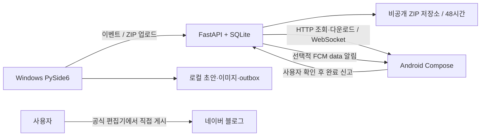

# AI Blog Auto System 통합 매뉴얼

문서 통합일: 2026-11-23 · 현재 Windows 버전: **v1.2.0**

이 파일은 프로젝트의 사용·설치·개발·보안·검증·출시 문서를 통합한 유일한 관리 원본입니다. 아래 원문 출처 표시는 통합 전 파일명이며 해당 파일은 삭제되었습니다. 동일한 배포 매뉴얼 2개는 중복 제거했습니다. 외부 라이브러리 라이선스와 과거 배포 아카이브는 문서 정리 대상에서 제외합니다.

## 현재 적용할 설정

- **ChatGPT Plus 글쓰기:** 설정 → ChatGPT 구독 → Continue with ChatGPT → 브라우저에서 구독 사용 승인 → 모델 불러오기 → 모델 선택 → Mock 해제 → 설정 저장 → AI 글 생성.
- ChatGPT 구독 방식은 API 키가 필요하지 않습니다. 별도 과금 API로 자동 전환하지 않습니다. 예약 이미지 생성은 해제합니다.
- **현재 Ubuntu 서버 주소:** `https://61.105.141.21:8001`. 외부 IP의 Nginx TLS 8001 → 내부 `127.0.0.1:8001` HTTP 구성입니다. WebConference 10443 공유 방식은 현재 적용하지 않습니다.
- ChatGPT 글쓰기에는 Ubuntu 변경이나 서버 연결이 필요하지 않습니다. 서버 업로드와 실제 블로그 발행은 별도 단계입니다.
- 자동 검증 129개, 최종 관련 재검증 49개 및 EXE 자체 점검 통과. 사용자 Plus 계정의 실제 승인·실시간 글 생성·실제 블로그 발행은 미검증입니다.
- 뒤에 보존한 v1.1.x/API 안내와 Phase별 기록은 해당 시점의 자료입니다. **현재 사용은 이 설정과 1~2장을 우선**하고, 과거의 '최신 버전', '미구현', 테스트 수치는 작성 시점의 의미로 읽으세요.

## 통합 목차

1. [ChatGPT Plus로 블로그 작성 — v1.2.0](#doc-01)
2. [AI Blog Auto System v1.2.0 — ChatGPT 구독 글쓰기](#doc-02)
3. [AI Blog Auto System 단계별 사용·서버 운영 매뉴얼](#doc-03)
4. [Windows 프로그램 설치·사용 가이드](#doc-04)
5. [Windows GUI 사용 안내](#doc-05)
6. [콘텐츠 출력 사용법](#doc-06)
7. [Ubuntu 서버 설치·사용 가이드](#doc-07)
8. [Windows ↔ Ubuntu HTTPS 연결](#doc-08)
9. [Phase 4: 수동 발행 패키지 서버](#doc-09)
10. [Android 앱 설치·사용 가이드](#doc-10)
11. [AI Blog Monitor — Android Phase 5](#doc-11)
12. [네이버 발행 경계](#doc-12)
13. [네이버 스마트에디터 ONE 실제 붙여넣기 시험](#doc-13)
14. [보안 및 운영 경계](#doc-14)
15. [Windows·Android 빌드 및 Ubuntu 배포 절차](#doc-15)
16. [AI Blog Auto System 개발 상세서](#doc-16)
17. [아키텍처](#doc-17)
18. [개발 계획](#doc-18)
19. [AI Blog Auto System — Windows · Ubuntu 서버 · Android](#doc-19)
20. [Windows·서버·Android 통합 시험 결과](#doc-20)
21. [Phase 1 검증 결과](#doc-21)
22. [Windows GUI 검증 결과](#doc-22)
23. [콘텐츠 출력 검증 결과](#doc-23)
24. [Phase 4 검증 결과](#doc-24)
25. [Android Phase 5 검증 결과](#doc-25)
26. [Windows v1.1.0 — 로컬 자동 작성 우선](#doc-26)
27. [v1.1.1 설정·연결 진단 개선](#doc-27)
28. [v1.1.2 — WebConference HTTPS 공유 연결](#doc-28)


---

<a id="doc-01"></a>

## 1. ChatGPT Plus로 블로그 작성 — v1.2.0

통합 전 출처: `docs/chatgpt-plus.md`


<a id="doc-01-s01"></a>

### 시작하기

1. 기존 프로그램을 종료합니다.
2. `release/v1.2.0/AI-Blog-Auto-Windows-v1.2.0-x64.zip`을 새 폴더에 전부 압축 해제합니다.
3. `AI-Blog-Auto/AI-Blog-Auto.exe`를 실행합니다. `_internal` 폴더를 함께 유지하세요.
4. 최초 마법사가 나오면 OpenAI API 키를 비워 두고 완료합니다.
5. 왼쪽 **설정**에서 **글쓰기 연결 → ChatGPT 구독 (Plus 등)**을 선택합니다.
6. **Continue with ChatGPT**를 누릅니다. 기본 브라우저가 열립니다.
7. Plus를 결제한 ChatGPT 계정으로 로그인합니다. 앱 이름은 **AI Blog Auto System**입니다.
8. **ChatGPT 구독 사용 / Use your ChatGPT plan** 권한을 확인하고 허용합니다.
9. 브라우저가 `http://127.0.0.1:임시포트/auth/callback`으로 돌아오면 프로그램으로 돌아갑니다. 이 주소는 Windows PC 내부 로그인 회신 주소이며 Ubuntu 서버 주소가 아닙니다.
10. **선택 계정 사용 · 모델 불러오기**를 누릅니다.
11. **ChatGPT 글 모델**에서 사용할 모델을 선택합니다. 계정이 제공하는 모델만 표시합니다.
12. **Mock 모드**를 해제하고 **설정 저장**을 누릅니다.
13. **AI 글쓰기** 메뉴에서 주제를 입력하고 **AI 글 생성**을 누릅니다.
14. 제목·본문·출처를 검토하고 **콘텐츠 출력**에서 필요한 파일을 저장합니다.

OpenAI API 키와 서버 토큰은 ChatGPT 글 생성에 필요하지 않습니다. 기존에 API 키가 저장되어 있어도 ChatGPT 모드에서는 API 키를 사용하지 않습니다. 오류나 사용 한도 초과 시 API 방식으로 자동 전환하지 않습니다.


<a id="doc-01-s02"></a>

### 예약 자동 작성

1. 위의 로그인과 모델 선택을 먼저 완료합니다.
2. **예약 스케줄**에서 주제·시간·요일을 설정합니다.
3. **이미지 자동 생성**은 해제합니다. ChatGPT 구독 연동의 이미지 생성은 지원되지 않습니다.
4. 예약 설정을 저장하고 필요할 때 예약을 켭니다.
5. 프로그램과 PC가 켜져 있어야 실행됩니다. 잠자기·종료 상태에서는 실행되지 않습니다.
6. 만료된 로그인은 가능한 경우 자동 갱신합니다. 갱신이 거부되면 설정에서 같은 계정을 선택해 다시 로그인하세요.

자동 작성은 글과 로컬 출력 파일 생성입니다. 실제 네이버 블로그 발행은 사용자가 검토하고 수행합니다. Ubuntu 업로드는 콘텐츠 출력에서 별도로 실행합니다.


<a id="doc-01-s03"></a>

### 이미지와 사용량

- 이 공식 구독 연동 경로는 이미지 생성을 지원하지 않습니다. ChatGPT 웹/앱에서 이미지를 만들어 저장한 뒤 글에 첨부할 수 있습니다.
- **ChatGPT 사용량 · 앱 한도 확인** 버튼에서 구독 사용량과 앱별 한도를 확인합니다.
- 앱에서 사용하는 양도 구독 한도에 포함됩니다. 무제한 생성이나 일정량을 보장하지 않습니다.
- 계정의 연동 자격·권한·사용 가능한 모델은 OpenAI가 결정합니다. 로그인이 거부되면 화면의 실패 내용을 확인하세요.
- 별도 API 요금을 원하지 않으면 **글쓰기 연결**을 **ChatGPT 구독**으로 유지하세요. **OpenAI API (별도 과금)**는 명시적으로 선택하는 대체 방식입니다.


<a id="doc-01-s04"></a>

### 서버 설정

ChatGPT 연결을 위해 Ubuntu에 설치하거나 수정할 항목은 없습니다. Windows에서 OpenAI 로그인과 글 생성 서버에 직접 연결합니다. ChatGPT 자격 증명을 Ubuntu에 복사하지 마세요.

기존 AI Blog 서버 기능을 사용할 때만 다음을 입력합니다.

| 항목 | 값 |
|---|---|
| 서버 주소 | `https://61.105.141.21:8001` |
| 기기 ID | `WINDOWS-DESKTOP` 또는 식별 가능한 고유 이름 |
| 서버 토큰 | Ubuntu AI Blog 서버에 설정한 토큰 |
| OpenAI API 키 | ChatGPT 모드에서는 비워 둠 |

이 프로젝트는 Nginx의 외부 IP `61.105.141.21:8001` TLS 접속과 Python의 `127.0.0.1:8001` 내부 HTTP를 사용합니다. WebConference 10443 접속 주소를 입력하지 마세요.


<a id="doc-01-s05"></a>

### 문제 해결

| 증상 | 확인 순서 |
|---|---|
| 로그인 대기 시간 초과 | 3분 내 브라우저에서 승인했는지 확인 → 다시 로그인. 루프백 연결을 차단하는 보안 프로그램 확인 |
| 구독 사용 권한 없음 | 같은 계정 재로그인 → 구독 사용 권한 허용 → 계정/워크스페이스 지원 여부 확인 |
| 모델 없음 | 선택한 계정에 Plus 구독이 있는지 확인 → 모델 불러오기 → 모델 선택 → 설정 저장 |
| 테스트 문구가 나옴 | Mock 해제 후 설정 저장 |
| HTTP 429 | ChatGPT 사용량·앱 한도 확인 후 나중에 재시도. API 비용으로 우회하지 않음 |
| 자동 작성에서 이미지 오류 | 예약 스케줄의 이미지 자동 생성 해제 |
| 로그인했는데 API 키 오류 | 글쓰기 연결을 ChatGPT 구독으로 선택하고 설정 저장 |
| 서버 연결 실패 | 글쓰기와 별개의 문제. 서버 주소·토큰·Nginx 점검 |


<a id="doc-01-s06"></a>

### 계정과 보관

계정 선택 → 모델 불러오기를 실행하면 해당 계정을 활성화합니다. 다른 계정 등록은 **새 ChatGPT 계정 연결**을 선택한 뒤 로그인합니다. 로그아웃은 현재 활성 계정에 적용됩니다. 앱 연결을 완전히 취소하려면 ChatGPT 설정에서 연결을 해제하세요.

토큰은 `%LOCALAPPDATA%/AI Blog Auto System/chatgpt-credentials.enc`에 암호화해 보관합니다. 암호화 키는 Windows Credential Manager에 저장합니다. 토큰·비밀번호를 프로그램 설정란이나 채팅에 붙여넣지 마세요. 로그·블로그 ZIP·서버 이벤트에 자격 증명을 포함하지 않습니다.


<a id="doc-01-s07"></a>

### 검증 범위와 공식 문서

로그인 회신/PKCE/서명/nonce/권한 검증, 토큰 갱신, 스트림 완료 처리, API로 전환하지 않는 동작, 이미지 차단, 로컬 파일 저장은 자동 테스트로 검증했습니다. 공식 OIDC 설정 서버의 정상 응답도 확인했습니다. 사용자 Plus 계정으로 승인하고 실제 글을 생성하는 검증은 아직 수행하지 않았습니다.

- [공식 로컬 앱 구독 연동](https://developers.openai.com/siwc/token-sharing-open-source)
- [로그인 절차](https://developers.openai.com/siwc/token-sharing-open-source/sign-in)
- [지원 범위와 제한](https://developers.openai.com/siwc/token-sharing-open-source/preview-limitations)

---

<a id="doc-02"></a>

## 2. AI Blog Auto System v1.2.0 — ChatGPT 구독 글쓰기

통합 전 출처: `release/v1.2.0/README.md`


`AI-Blog-Auto-Windows-v1.2.0-x64.zip`을 전부 압축 해제하고 `AI-Blog-Auto/AI-Blog-Auto.exe`를 실행하세요. EXE와 `_internal` 폴더를 함께 유지해야 합니다.

1. 설정 → 글쓰기 연결: **ChatGPT 구독 (Plus 등)**.
2. **Continue with ChatGPT** → 브라우저에서 Plus 계정 로그인 및 구독 사용 권한 승인.
3. 프로그램으로 돌아와 **선택 계정 사용 · 모델 불러오기** → 모델 선택.
4. **Mock 모드 해제** → **모델 선택 후 설정 저장**.
5. AI 글쓰기 → 주제 입력 → **AI 글 생성**.
6. 생성된 초안을 검토하고 콘텐츠 출력에서 저장합니다.

상세 절차: 동봉한 `MANUAL.md`. OpenAI API 키는 필요하지 않습니다. 구독 사용 한도 초과 시 별도 과금 API로 자동 전환하지 않습니다.

예약 작성에도 같은 ChatGPT 연결을 사용합니다. **예약 이미지 자동 생성은 해제**하세요. 이미지는 ChatGPT 웹/앱에서 만들어 파일로 첨부할 수 있습니다. 실제 블로그 발행은 사용자 검토 후 수동으로 수행합니다.

Ubuntu는 ChatGPT 연결 때문에 변경할 필요가 없습니다. 서버 업로드용 주소는 `https://61.105.141.21:8001`입니다.

검증: 전체 회귀 129개 통과, 최종 화면/연결 변경 관련 49개 재검증 통과. EXE 자체 점검 결과는 `validation.json`에 포함합니다. 사용자 Plus 계정의 실제 로그인 승인 및 실시간 글 생성은 미검증입니다. 계정별 제공 여부·사용 한도·모델 권한은 OpenAI 정책에 따릅니다.

---

<a id="doc-03"></a>

## 3. AI Blog Auto System 단계별 사용·서버 운영 매뉴얼

통합 전 출처: `MANUAL.md`

> 기존 문서의 고유 설명과 실행 예제를 보존한 장입니다. 버전·API 키 필수 여부·포트·검증 상태가 현재와 다른 경우 맨 앞의 현재 설정과 ChatGPT 사용법을 우선하세요.


작성일: 2026-11-21 · Windows v1.1.0 기준 · Ubuntu API 표시 버전 0.5.0

> 먼저 Windows에서 글 한 편을 만들고 파일로 저장하세요. 서버 설치는 그 다음입니다.
> 서버 없이 글·이미지·Word·ZIP을 만들 수 있습니다. 서버는 이벤트와 콘텐츠 패키지를 받아 Android에 전달합니다.
> 현재 네이버 블로그 직접 자동 게시 기능은 없습니다. 최종 게시는 네이버 편집기에서 직접 수행합니다.


<a id="doc-03-s01"></a>

### 목차

1. [진행 순서와 준비물](#doc-03-s02)
2. [Windows 설치·최초 실행](#doc-03-s06)
3. [무료로 정상 동작 확인](#doc-03-s09)
4. [실제 AI 글 한 편 작성](#doc-03-s12)
5. [이미지·파일 저장·뉴스 출처 사용](#doc-03-s16)
6. [자동 작성과 예약 실행](#doc-03-s19)
7. [Ubuntu 소스 준비](#doc-03-s23)
8. [Ubuntu 시험 서버 실행](#doc-03-s26)
9. [도메인 없이 Windows 연결 시험](#doc-03-s31)
10. [systemd 상시 서비스 설치](#doc-03-s33)
11. [HTTPS 설치와 인증서 갱신](#doc-03-s38)
12. [Windows 연결·업로드 확인](#doc-03-s44)
13. [매일 상태 확인·중지·재시작](#doc-03-s49)
14. [오류별 해결 순서](#doc-03-s52)
15. [데이터·백업·업데이트](#doc-03-s53)
16. [최종 점검표와 검증 범위](#doc-03-s57)


<a id="doc-03-s02"></a>

### 1. 진행 순서와 준비물


<a id="doc-03-s03"></a>

#### 1-1. 어느 단계까지 진행해야 하나요?

| 목적 | 진행할 절 |
|---|---|
| 프로그램이 작동하는지만 확인 | 2~3절 |
| AI로 글 작성·파일 저장 | 2~5절 |
| 자동으로 글·이미지·ZIP 생성 | 6절까지 |
| Ubuntu에 이벤트·ZIP 보내기 시험 | 7~9절, 12절 |
| 서버 재부팅 후에도 상시 운영 | 10~13절 |


<a id="doc-03-s04"></a>

#### 1-2. 준비물

| 구분 | 준비할 것 |
|---|---|
| 무료 점검 | Windows PC, v1.1.0 프로그램 |
| 실제 AI 작성 | 사용할 수 있는 OpenAI API 키·모델 |
| 서버 시험 | SSH 접속 가능한 Ubuntu, sudo 권한, Python 3.10 이상 |
| 원격 HTTPS 운영 | 실제 도메인, DNS 설정 권한, 외부 TCP 80·443 연결 |

이 매뉴얼의 Ubuntu 명령은 Bash 터미널용입니다. Windows 명령은 PowerShell이라고 별도 표시합니다.
`사용자`, `서버주소`, `blog.example.com`은 그대로 사용하지 말고 자신의 값으로 바꿉니다.
명령이 실패하면 다음 블록으로 넘어가지 말고 해당 절의 정상 결과부터 확인하세요.


<a id="doc-03-s05"></a>

#### 1-3. 키와 주소 구분

| 항목 | 용도 | 어디에 입력? |
|---|---|---|
| OpenAI API 키 | 실제 글·이미지 생성 | Windows 설정의 OpenAI API 키 |
| 서버 토큰 | Windows가 Ubuntu API를 사용할 권한 | Windows 서버 토큰, Ubuntu BLOG_DEVICE_TOKEN에 같은 값 |
| SSH 계정·암호/키 | Ubuntu 관리 접속 | SSH 접속 시 |
| 기기 ID | 이벤트를 보낸 PC의 이름 | Windows 설정, 예: WINDOWS-PC-01 |

이 값들은 서로 다릅니다. 토큰·API 키를 로그나 공개 문의에 붙여넣지 마세요.


<a id="doc-03-s06"></a>

### 2. Windows 설치·최초 실행


<a id="doc-03-s07"></a>

#### STEP 1. 배포 ZIP 압축 풀기

프로젝트의 `release\v1.1.0\AI-Blog-Auto-Windows-v1.1.0-x64.zip`을 새 폴더에 **전체 압축 해제**합니다.
이미 프로젝트가 있다면 `release\v1.1.0\AI-Blog-Auto\AI-Blog-Auto.exe`를 바로 실행할 수 있습니다.

```text
AI-Blog-Auto/
  AI-Blog-Auto.exe
  _internal/
```

EXE만 따로 옮기면 안 됩니다. `_internal` 폴더를 함께 유지하세요.

**정상 결과:** 창 제목에 `AI Blog Auto System · v1.1.0`이 표시됩니다.

- [ ] ZIP 전체를 압축 해제했다.
- [ ] v1.1.0 창이 열렸다.


<a id="doc-03-s08"></a>

#### STEP 2. 최초 설정 마법사

마법사가 나오지 않으면 기존 Windows 사용자 설정을 읽은 것입니다. 3절로 이동하세요.

| 화면 | 입력/버튼 |
|---|---|
| 로컬 작업 공간 | 다음 |
| 서버 연결 | 주소 `http://127.0.0.1:8000`, 기기 ID `WINDOWS-DESKTOP` 유지 |
| 서버 토큰 | 지금은 비워두고 다음 |
| AI 설정 | API 키는 비워두고 Mock 체크 |
| 마지막 | 완료/Finish |

서버 주소가 있어도 서버가 실행 중일 필요는 없습니다. **서버 연결 버튼을 누르지 않아도 됩니다.**

**정상 결과:** 대시보드가 열립니다.


<a id="doc-03-s09"></a>

### 3. 무료로 정상 동작 확인


<a id="doc-03-s10"></a>

#### STEP 3. 자동 작성 전체 흐름 점검

1. 왼쪽 **대시보드**를 누릅니다.
2. **무료 Mock 자동 작성 점검**을 누릅니다.
3. 글 생성 → 이미지 생성·첨부 → 파일 저장이 끝날 때까지 기다립니다.
4. 최근 자동 작성 상태가 `completed`인지 확인합니다.
5. **최근 자동 작성 결과 폴더 열기**를 누릅니다.

**정상 결과:** UUID 모양의 이름을 가진 ZIP 파일이 있습니다. 테스트용 글과 이미지가 생성됩니다.
Mock 점검은 네트워크·API 키·서버 토큰이 필요 없고 실제 AI를 호출하지 않습니다.
기존 실제/Mock 설정도 바꾸지 않습니다.


<a id="doc-03-s11"></a>

#### STEP 4. 결과 파일 직접 확인

ZIP을 새 폴더에 압축 해제하고 확인합니다.

| 파일 | 확인 방법 |
|---|---|
| `article.docx` | Word 또는 호환 프로그램으로 글과 이미지 확인 |
| `index.html` | 브라우저로 열기. 이미지 폴더도 함께 압축 해제해야 함 |
| `article.txt` | 메모장에서 글 확인 |
| `manifest.json` | 패키지 ID·파일 목록·이미지 순서 정보 |
| 이미지 파일 | ZIP 내 이미지 확인 |

기본 저장 경로는 `%LOCALAPPDATA%\AI Blog Auto System\pending-packages`입니다.
Windows 탐색기 주소창에 붙여넣으면 됩니다. `BLOG_GUI_DATA_DIR` 환경변수를 따로 설정한 경우 저장 위치는 달라집니다.

- [ ] 상태가 `completed`다.
- [ ] ZIP이 존재한다.
- [ ] 문서와 이미지가 열린다.

여기까지 성공하면 **Windows 로컬 자동 작성 흐름이 정상**입니다. Mock 결과는 실제 AI 글로 사용하지 마세요.


<a id="doc-03-s12"></a>

### 4. 실제 AI 글 한 편 작성


<a id="doc-03-s13"></a>

#### STEP 5. 설정 저장

왼쪽 **설정**에서 아래 항목을 입력합니다.

| 항목 | 첫 시험 값 |
|---|---|
| 서버 주소·기기 ID | 기본값 유지 |
| 서버 토큰 | 비워도 됨 |
| OpenAI API 키 | 자신의 API 키 |
| 실행 모드 | **Mock 체크 해제** |
| 글 모델 | 프로젝트 기본값 `gpt-4.1-mini` 또는 계정에서 사용 가능한 호환 모델 |
| 이미지 모델 | 프로젝트 기본값 `gpt-image-1` 또는 계정에서 사용 가능한 호환 모델 |
| 뉴스 RSS | 지금은 비워둠 |
| 글 스타일 | 아래 예시 |

```text
초보자가 이해하기 쉬운 한국어로 작성해주세요.
짧은 문단과 소제목을 사용해주세요.
사실과 의견을 구분하고 확인되지 않은 내용은 단정하지 마세요.
실용적인 예시를 포함하고 과장된 표현을 피해주세요.
```

**설정 저장**을 누릅니다. API 키 입력란이 비워져도 정상입니다. `OpenAI 키: 저장됨`을 확인하세요.
빈 키 입력란으로 다시 저장하면 기존 키를 유지합니다. 삭제하려면 **API 키 삭제**를 사용합니다.
서버 토큰도 동일한 방식이며 키·토큰은 Windows 자격증명 저장소에 보관됩니다.

**정상 결과:** Mock 체크 해제, OpenAI 키 저장됨. 실제 API 요청은 요금이 발생할 수 있습니다.


<a id="doc-03-s14"></a>

#### STEP 6. 주제 입력

1. 왼쪽 **AI 글쓰기**를 누릅니다.
2. 주제 입력란에 다음 예시를 넣습니다.

```text
집에서 처음 식물을 키우는 사람을 위한 관리 방법.
물 주기, 햇빛, 통풍을 중심으로 설명하고 초보자가 자주 하는 실수와 예시를 포함해주세요.
```

3. `출처 없음 · 일반 설명 초안`인지 확인합니다.
4. 출처가 선택돼 있으면 **출처 선택 해제**를 누릅니다.
5. **AI 글 생성**을 누릅니다.

출처를 선택하지 않았다면 출처 검토 체크는 필요 없습니다.

**정상 결과:** 제목, 제목 후보 3개, 요약, 본문, 태그가 표시됩니다. 실제 생성 결과에는 `[MOCK]` 표시가 없어야 합니다.

현재 개별 AI 글쓰기·이미지 생성은 키가 없으면 Mock으로 대체됩니다. 반면 **자동 작성 버튼/예약 실행은 실제 모드에서 키가 없으면 오류로 중단**합니다.
따라서 결과의 Mock 표시를 반드시 확인하세요.


<a id="doc-03-s15"></a>

#### STEP 7. 글 저장

| 원하는 동작 | 누를 버튼 |
|---|---|
| 본문 복사 | AI 글쓰기 → 본문 복사 |
| 텍스트 파일 | AI 글쓰기 → 텍스트 저장 |
| Word 파일 | 콘텐츠 출력 → Word 저장 |
| HTML 파일 | 콘텐츠 출력 → HTML 저장 |
| ZIP 파일 | 콘텐츠 출력 → ZIP 패키지 만들기 |

파일 저장창에서 경로를 선택하고 저장합니다. 개별 **AI 글 생성**만으로 Word/ZIP이 자동 생성되는 것은 아닙니다.
이전 글은 AI 글쓰기 화면의 이력 선택 상자에서 다시 열 수 있습니다.
개별 글쓰기에서 같은 주제·출처·스타일·모드·모델이면 기존 글을 재사용할 수 있습니다.

- [ ] 키가 저장됐다.
- [ ] 실제 생성 글에 Mock 표시가 없다.
- [ ] 텍스트 또는 Word로 저장했다.


<a id="doc-03-s16"></a>

### 5. 이미지·파일 저장·뉴스 출처 사용


<a id="doc-03-s17"></a>

#### STEP 8. 이미지 만들고 글에 붙이기 — 선택

1. **이미지 생성**에서 이미지 설명을 입력합니다.
2. 크기를 선택하고 **이미지 생성 / 재시도**를 누릅니다.
3. 생성된 이미지를 확인합니다.
4. **AI 글쓰기**에서 이미지를 붙일 글을 선택합니다.
5. **콘텐츠 출력 → 최근 생성 이미지 추가**를 누릅니다.
6. 이미지 목록과 HTML 미리보기에서 첨부를 확인한 뒤 Word/ZIP을 저장합니다.

개별 이미지 생성에서는 글에 자동 첨부되지 않습니다. 6절 자동 작성에서 이미지 옵션을 켜면 자동 첨부됩니다.
첫 이미지는 썸네일 위치, 나머지는 본문 뒤에 순서대로 배치됩니다.


<a id="doc-03-s18"></a>

#### STEP 9. RSS 뉴스 출처로 글 쓰기 — 선택

1. 설정의 **뉴스 RSS**에 사용 가능한 **HTTPS RSS/Atom 피드 주소**를 한 줄에 하나씩 입력합니다.
2. Mock을 해제하고 설정을 저장합니다.
3. **뉴스 수집 → 뉴스 수집**을 누릅니다.
4. 목록에서 기사를 선택하고 **선택 출처 열기**로 원문을 확인합니다.
5. **선택 뉴스를 글쓰기로**를 누릅니다.
6. **선택한 출처와 요약을 검토했습니다**를 체크하고 **AI 글 생성**을 누릅니다.

일반 홈페이지/기사 주소와 RSS 주소는 다릅니다. Mock 뉴스를 실제 AI 생성의 출처로 사용하면 차단됩니다.
RSS는 제목·요약 중심이며 사실 검증을 대신하지 않습니다.


<a id="doc-03-s19"></a>

### 6. 자동 작성과 예약 실행


<a id="doc-03-s20"></a>

#### STEP 10. 자동 작성 설정

왼쪽 **예약 스케줄**에서 다음을 설정합니다.

| 항목 | 예시 |
|---|---|
| 시간 | `08:00, 19:00` — 쉼표 구분, 24시간 HH:MM |
| 요일 | 원하는 요일을 최소 하나 선택 |
| 주제 | 자동으로 작성할 주제 |
| 재개 정책 | 처음에는 누락된 작업 건너뛰기 |
| 초안과 이미지 함께 생성 | 이미지가 필요하면 체크 |

**예약 설정 저장**을 누릅니다. 이 주제는 AI 글쓰기 화면에서 직접 입력하는 주제와 별개입니다.


<a id="doc-03-s21"></a>

#### STEP 11. 예약 시각까지 기다리지 않고 시험

**저장된 예약 작업 지금 실행**을 누릅니다. 대시보드의 **저장된 설정으로 자동 작성**도 같은 흐름입니다.

```text
저장된 주제로 새 글 생성
  → 이미지 옵션을 켠 경우 이미지 생성·첨부
  → HTML·Word·텍스트·이미지를 ZIP으로 저장
  → 대시보드 상태 completed
```

서버 접속은 수행하지 않습니다. 서버 이벤트는 로컬 대기열에 저장합니다.
같은 주제를 반복 실행해도 새 초안 ID를 만들지만, AI 문장의 차이 자체를 보장하지는 않습니다.
이미지/출력 단계가 실패해도 먼저 저장된 초안은 글쓰기 이력에서 확인할 수 있습니다.
이 자동 작성은 저장된 주제의 일반 설명 초안이며, 최신 RSS 뉴스를 자동 선정하는 기능은 아닙니다.


<a id="doc-03-s22"></a>

#### STEP 12. 예약 ON

1. 즉시 실행이 성공했으면 **예약 ON / OFF**를 누릅니다.
2. 화면에 **예약 ON · 다음 실행**과 날짜·시간이 표시되는지 확인합니다.
3. 프로그램과 PC를 켜둡니다. Windows 절전 중에는 실행되지 않습니다.
4. 종료하려면 진행 중인 작업이 끝난 뒤 창을 닫습니다.

시간대는 **Asia/Seoul**입니다. 다른 작업이 진행 중인 예약 시점에는 해당 예약을 건너뛰고 경고를 남깁니다.
재개 정책의 ‘누락 작업 1회 실행’은 앱을 다시 시작할 때 적용됩니다. 모든 누락 작업을 재생하지 않습니다.
무료 Mock 점검의 성공만으로 실제 API 계정/모델이 검증된 것은 아닙니다.

- [ ] 즉시 자동 작성이 완료됐다.
- [ ] ZIP에 선택한 이미지가 포함됐다.
- [ ] 예약 ON과 다음 시각을 확인했다.


<a id="doc-03-s23"></a>

### 7. Ubuntu 소스 준비

이제부터 서버가 필요한 경우에만 진행합니다. **7~9절은 시험 실행, 10절은 상시 운영**입니다.


<a id="doc-03-s24"></a>

#### STEP 13. SSH 접속과 Python 확인

Windows PowerShell:

```powershell
ssh 사용자@서버주소
```

접속한 Ubuntu 터미널:

```bash
sudo apt update
sudo apt install -y python3 python3-venv git curl ca-certificates
python3 --version
python3 -c 'import sys; assert sys.version_info >= (3, 10), "Python 3.10 이상이 필요합니다"'
```

**정상 결과:** Python 3.10 이상, 마지막 명령 오류 없음.
Python 3.8이라면 여기서 멈추고 호환 Python·venv를 준비하세요. 시스템 Python을 임의로 교체하지 마세요.
상시 서비스의 Python은 `/usr/bin/python3`처럼 서비스 계정이 접근 가능한 위치에 있어야 합니다.


<a id="doc-03-s25"></a>

#### STEP 14. 현재 Windows 소스를 서버로 복사

이번 수정은 로컬 작업 파일입니다. **GitHub에 푸시되지 않았다면 clone만으로 최신 코드를 받을 수 없습니다.**
정확히 현재 코드를 설치하려면 Windows의 프로젝트 폴더에서 다음과 같이 서버 파일만 묶습니다.

Windows PowerShell, 프로젝트 루트에서 실행:

```powershell
Set-Location 'C:\Users\Administrator\Downloads\proj\GITHUB\work\AI_Blog_Auto_System_Phase1\ai-blog-auto-system'
tar -czf release/v1.1.0/AI-Blog-Ubuntu-manual-source.tar.gz ubuntu-server/app ubuntu-server/deploy ubuntu-server/requirements.txt ubuntu-server/requirements-fcm.txt ubuntu-server/backup_metadata.py ubuntu-server/backup-excludes.txt shared MANUAL.md
scp release/v1.1.0/AI-Blog-Ubuntu-manual-source.tar.gz 사용자@서버주소:~/
```

이 명령은 `.env`, 데이터베이스, Windows 키·콘텐츠를 포함하지 않습니다.

Ubuntu 터미널:

```bash
mkdir -p ~/ai-blog-server-v1.1.0
tar -xzf ~/AI-Blog-Ubuntu-manual-source.tar.gz -C ~/ai-blog-server-v1.1.0
cd ~/ai-blog-server-v1.1.0
ls ubuntu-server/app/main.py ubuntu-server/deploy/ai-blog.service shared/event-schema.json
```

**정상 결과:** 세 파일이 모두 나옵니다. 아래 시험 명령은 이 폴더에서 실행합니다.
기존 폴더에 수정/운영 데이터가 있다면 새 이름의 폴더를 사용하세요.

대안으로 코드가 푸시된 것을 확인한 경우 다음 저장소를 clone할 수 있습니다.

```bash
mkdir -p ~/src
cd ~/src
git clone https://github.com/forlovesea/work.git
cd work/AI_Blog_Auto_System_Phase1/ai-blog-auto-system
git rev-parse HEAD
```

이 대안을 사용했다면 이후 `~/ai-blog-server-v1.1.0` 대신 위 프로젝트 경로를 사용합니다.


<a id="doc-03-s26"></a>

### 8. Ubuntu 시험 서버 실행


<a id="doc-03-s27"></a>

#### STEP 15. 가상환경과 의존성

Ubuntu의 소스 루트에서:

```bash
python3 -m venv .venv
.venv/bin/python -m pip install -r ubuntu-server/requirements.txt
mkdir -p data/metadata data/packages
chmod 700 data data/metadata data/packages
```

**정상 결과:** pip 설치 완료, data 폴더 존재. 이전 Python 버전으로 만든 `.venv`는 새 Python 설치만으로 변경되지 않습니다.


<a id="doc-03-s28"></a>

#### STEP 16. 시험용 환경파일을 한 번만 만들기

아래는 토큰과 데이터 경로를 `ubuntu-server/.env`에 저장합니다. 기존 파일이 있으면 덮어쓰지 않고 중단합니다.

```bash
umask 077
.venv/bin/python - <<'PY'
from pathlib import Path
import secrets
root = Path.cwd()
with (root / 'ubuntu-server/.env').open('x', encoding='utf-8') as f:
    f.write('BLOG_DEVICE_TOKEN=' + secrets.token_urlsafe(32) + '\n')
    f.write('BLOG_DB_PATH=' + str(root / 'data/metadata/events.sqlite3') + '\n')
    f.write('BLOG_PACKAGE_DIR=' + str(root / 'data/packages') + '\n')
    f.write('BLOG_PACKAGE_MAX_BYTES=104857600\n')
print('환경파일 생성 완료. 토큰은 파일에서 확인하세요.')
PY
chmod 600 ubuntu-server/.env
nano ubuntu-server/.env
```

편집기에서 `BLOG_DEVICE_TOKEN=` 뒤의 값을 확인하여 개인 비밀 저장소에 보관합니다. Windows의 서버 토큰에도 같은 값을 넣습니다.
`nano`는 Ctrl+X로 닫습니다. 파일이 이미 있다면 생성 코드를 다시 실행하지 말고 기존 파일을 확인하세요.

앱이 이 `.env`를 읽습니다. 같은 SSH 세션에서 이전 `BLOG_*` 환경변수를 export한 적이 있으면 해당 값이 파일보다 우선하므로 새 SSH 세션에서 시험하는 편이 명확합니다.


<a id="doc-03-s29"></a>

#### STEP 17. 서버 실행 — 터미널 A

```bash
cd ~/ai-blog-server-v1.1.0
.venv/bin/python -m uvicorn app.main:app --app-dir ubuntu-server --host 127.0.0.1 --port 8000 --workers 1 --no-access-log
```

**정상 결과:** `Application startup complete`, `127.0.0.1:8000` 안내. 이 터미널은 실행 상태로 유지합니다.
종료는 Ctrl+C입니다. SSH를 끊어도 유지하려면 10절의 systemd를 사용합니다.


<a id="doc-03-s30"></a>

#### STEP 18. 실행·인증 확인 — 별도 Ubuntu 터미널 B

```bash
curl --fail http://127.0.0.1:8000/api/v1/health
```

**정상 결과:** `{"status":"ok","version":"0.5.0"}`. 공백 순서는 다를 수 있습니다.
서버 버전 0.5.0과 Windows 버전 1.1.0은 별도 번호이며 오류가 아닙니다.

인증도 확인합니다. 토큰 입력은 화면에 표시되지 않습니다.

```bash
read -rsp '서버 토큰: ' BLOG_CHECK_TOKEN; echo
curl --fail 'http://127.0.0.1:8000/api/v1/events?limit=1' -H "X-Device-Token: $BLOG_CHECK_TOKEN"
unset BLOG_CHECK_TOKEN
```

**정상 결과:** HTTP 오류 없이 `[]` 또는 이벤트 JSON 배열. 401은 토큰 불일치입니다.
health 성공은 토큰 인증 성공을 의미하지 않습니다.

- [ ] health 응답 status가 ok다.
- [ ] 토큰을 넣은 events 조회가 성공한다.


<a id="doc-03-s31"></a>

### 9. 도메인 없이 Windows 연결 시험


<a id="doc-03-s32"></a>

#### STEP 19. SSH 터널 열기

Ubuntu 서버를 실행한 상태에서 **별도 Windows PowerShell**을 엽니다.

```powershell
ssh -N -o ExitOnForwardFailure=yes -L 127.0.0.1:18000:127.0.0.1:8000 사용자@서버주소
```

접속 후 출력 없이 대기하는 것은 정상입니다. 창을 열어둡니다.

다른 Windows PowerShell에서:

```powershell
curl.exe --fail http://127.0.0.1:18000/api/v1/health
```

**정상 결과:** status ok. Windows 프로그램 설정:

```text
서버 주소: http://127.0.0.1:18000
서버 토큰: STEP 16의 BLOG_DEVICE_TOKEN 값
기기 ID: WINDOWS-PC-01
```

설정 저장 후 12절의 연결 점검을 진행합니다. SSH 터널은 Windows 개발 시험용입니다.
Windows의 localhost는 Ubuntu가 아니라 Windows 자신입니다. 터널을 닫으면 이 주소의 연결도 종료됩니다.


<a id="doc-03-s33"></a>

### 10. systemd 상시 서비스 설치

시험을 통과한 후 진행합니다. 운영용 데이터는 시험 데이터와 분리합니다.
아래는 **새 서버에 최초 설치**하는 예시입니다. 기존 `/etc/ai-blog/server.env`나 릴리스가 있으면 덮어쓰지 말고 15절을 참고하세요.


<a id="doc-03-s34"></a>

#### STEP 20. 시험 서버 종료·계정과 경로 준비

터미널 A의 Uvicorn을 Ctrl+C로 종료합니다. 8000 포트가 비었는지 확인합니다.

```bash
sudo ss -ltnp | grep ':8000' || true
getent passwd ai-blog || sudo useradd --system --user-group --home-dir /var/lib/ai-blog --shell /usr/sbin/nologin ai-blog
sudo install -d -m 755 /opt/ai-blog/releases
sudo install -d -o ai-blog -g ai-blog -m 700 /var/lib/ai-blog/metadata /var/lib/ai-blog/packages
sudo install -d -o root -g root -m 700 /etc/ai-blog
```

처음 명령에 실행 중인 다른 프로세스가 보이면 정체를 확인하고 중복 실행을 해소합니다.


<a id="doc-03-s35"></a>

#### STEP 21. 소스·가상환경 설치

Ubuntu 소스 루트에서 다음을 실행합니다. 이미 같은 릴리스 폴더가 있으면 `mkdir` 오류에서 멈추고 새 릴리스명을 정하세요.

```bash
cd ~/ai-blog-server-v1.1.0
sudo mkdir /opt/ai-blog/releases/v1.1.0
sudo install -d -m 755 /opt/ai-blog/releases/v1.1.0/ubuntu-server
sudo cp -R ubuntu-server/app ubuntu-server/deploy /opt/ai-blog/releases/v1.1.0/ubuntu-server/
sudo cp ubuntu-server/requirements.txt ubuntu-server/requirements-fcm.txt ubuntu-server/backup_metadata.py ubuntu-server/backup-excludes.txt /opt/ai-blog/releases/v1.1.0/ubuntu-server/
sudo cp -R shared /opt/ai-blog/releases/v1.1.0/
sudo chmod -R a+rX /opt/ai-blog/releases/v1.1.0
sudo /usr/bin/python3 -m venv /opt/ai-blog/releases/v1.1.0/.venv
sudo /opt/ai-blog/releases/v1.1.0/.venv/bin/python -m pip install -r /opt/ai-blog/releases/v1.1.0/ubuntu-server/requirements.txt
```

**정상 결과:** 의존성 설치 성공. 시스템 Python이 3.10 이상이어야 합니다.
개인 홈에 설치된 Python은 서비스의 `ProtectHome=true` 때문에 사용할 수 없는 경우가 있습니다.


<a id="doc-03-s36"></a>

#### STEP 22. 운영 환경파일 생성

시험과 별개의 새 토큰을 생성합니다. Windows 설정에도 새 값을 저장해야 합니다.
기존 파일이 있으면 `open('x')`가 중단하므로 재설치로 토큰을 덮어쓰지 않습니다.

```bash
sudo python3 - <<'PY'
from pathlib import Path
import os, secrets
os.umask(0o077)
with Path('/etc/ai-blog/server.env').open('x', encoding='utf-8') as f:
    f.write('BLOG_DEVICE_TOKEN=' + secrets.token_urlsafe(32) + '\n')
    f.write('BLOG_DB_PATH=/var/lib/ai-blog/metadata/events.sqlite3\n')
    f.write('BLOG_PACKAGE_DIR=/var/lib/ai-blog/packages\n')
    f.write('BLOG_PACKAGE_MAX_BYTES=104857600\n')
print('운영 환경파일 생성 완료')
PY
sudo chmod 600 /etc/ai-blog/server.env
sudo nano /etc/ai-blog/server.env
```

토큰 값을 개인 비밀 저장소에 보관합니다. 기본 이벤트·패키지 서버에는 OpenAI 키가 필요하지 않습니다.
OpenAI 요청은 Windows에서 수행합니다. FCM은 별도 설정 항목이며 이 기본 설치에는 필요 없습니다.


<a id="doc-03-s37"></a>

#### STEP 23. 서비스 등록·시작

처음 설치에는 `/opt/ai-blog/current`가 없어야 합니다. 이미 있으면 15절의 업데이트 절차를 사용하세요.

```bash
sudo ln -s /opt/ai-blog/releases/v1.1.0 /opt/ai-blog/current
sudo install -m 644 /opt/ai-blog/current/ubuntu-server/deploy/ai-blog.service /etc/systemd/system/ai-blog.service
sudo systemd-analyze verify /etc/systemd/system/ai-blog.service
sudo systemctl daemon-reload
sudo systemctl enable --now ai-blog
systemctl is-active ai-blog
systemctl is-enabled ai-blog
curl --fail http://127.0.0.1:8000/api/v1/health
```

**정상 결과:** `active`, `enabled`, status ok.
`systemd-analyze verify`에서 오류가 나면 서비스 시작 전에 수정하세요.

실패하면:

```bash
sudo systemctl status ai-blog --no-pager -l
sudo journalctl -u ai-blog -n 100 --no-pager
```

- [ ] 서비스가 active다.
- [ ] 부팅 자동 시작이 enabled다.
- [ ] 루프백 health가 성공한다.


<a id="doc-03-s38"></a>

### 11. HTTPS 설치와 인증서 갱신


<a id="doc-03-s39"></a>

#### STEP 24. 도메인·포트 확인

연결 구조는 다음과 같습니다.

```text
Windows/Android -- HTTPS 443 --> Nginx -- HTTP 127.0.0.1:8000 --> Uvicorn
```

| 포트 | 역할 |
|---|---|
| SSH 포트, 보통 22 | 관리자 접속. 실제 SSH 설정에 맞춤 |
| 80 | 인증서 발급·갱신, HTTPS 이동 |
| 443 | Windows/Android 접속 |
| 8000 | 서버 내부 전용. 외부 공개하지 않음 |

도메인의 A 레코드는 서버의 실제 공개 IPv4를 가리켜야 합니다. AAAA가 있다면 IPv6도 올바르게 연결되어야 합니다.
클라우드 보안 그룹·공유기 포트 전달·방화벽에서 80/443을 허용합니다. SSH 접속을 유지하세요.

Ubuntu:

```bash
BLOG_DOMAIN=blog.example.com
getent ahosts "$BLOG_DOMAIN"
sudo apt install -y nginx certbot
sudo install -d -m 755 /var/www/ai-blog-acme
sudo systemctl enable --now nginx
```

`BLOG_DOMAIN`은 자신의 도메인으로 바꿉니다. 새 터미널을 열면 다시 지정해야 합니다.
기존 Nginx 사이트가 있다면 백업하고 동일 도메인의 중복 server 블록부터 확인합니다.


<a id="doc-03-s40"></a>

#### STEP 25. 인증서 발급용 설정 적용

아직 인증서 파일이 없으므로 최종 TLS 설정부터 적용하면 안 됩니다.

```bash
cd /opt/ai-blog/current
sed "s/blog-monitor.example.com/$BLOG_DOMAIN/g" ubuntu-server/deploy/nginx-bootstrap.conf.example | sudo tee /etc/nginx/sites-available/ai-blog >/dev/null
sudo ln -sfn /etc/nginx/sites-available/ai-blog /etc/nginx/sites-enabled/ai-blog
sudo nginx -t && sudo systemctl reload nginx
sudo certbot certonly --webroot -w /var/www/ai-blog-acme --cert-name "$BLOG_DOMAIN" -d "$BLOG_DOMAIN"
```

Certbot의 이메일·약관 안내를 완료합니다.
**정상 결과:** 인증서 발급 성공. 실패하면 DNS와 외부 80 포트부터 확인합니다.
기존 인증서가 있다면 `sudo certbot certificates`로 실제 인증서 이름과 경로를 확인하세요.


<a id="doc-03-s41"></a>

#### STEP 26. HTTPS 프록시 적용

```bash
sed "s/blog-monitor.example.com/$BLOG_DOMAIN/g" ubuntu-server/deploy/nginx.conf.example | sudo tee /etc/nginx/sites-available/ai-blog >/dev/null
sudo nginx -t && sudo systemctl reload nginx
curl --fail "https://$BLOG_DOMAIN/api/v1/health"
```

**정상 결과:** Nginx 설정 검사 성공, 인증서 오류 없이 status ok.
`https://서버:8000`으로 연결하지 마세요. 기본 Uvicorn 8000에는 TLS가 없습니다.
앱은 리디렉션을 따라가지 않으므로 처음부터 HTTPS 주소를 입력합니다.


<a id="doc-03-s42"></a>

#### STEP 27. 인증서 자동 갱신 확인

```bash
sudo install -d /etc/letsencrypt/renewal-hooks/deploy
printf '#!/bin/sh\nnginx -t && systemctl reload nginx\n' | sudo tee /etc/letsencrypt/renewal-hooks/deploy/ai-blog-nginx >/dev/null
sudo chmod 755 /etc/letsencrypt/renewal-hooks/deploy/ai-blog-nginx
sudo systemctl enable --now certbot.timer
sudo certbot renew --dry-run
systemctl list-timers --all | grep certbot
```

**정상 결과:** 갱신 시험 성공, 타이머 표시. webroot 갱신을 위해 80 포트와 challenge 경로를 유지합니다.
위 명령은 Ubuntu apt로 Certbot을 설치한 경로 기준입니다.


<a id="doc-03-s43"></a>

#### STEP 28. Windows에서 외부 접속 확인

Windows PowerShell:

```powershell
curl.exe --fail https://blog.example.com/api/v1/health
```

자신의 도메인으로 바꿔 실행합니다. **정상 결과:** 인증서 오류 없이 status ok.
서버 안에서만 성공하고 Windows에서 실패하면 외부 DNS·방화벽·포트 전달을 확인하세요.

- [ ] 외부 Windows에서 HTTPS health가 성공했다.
- [ ] 인증서 갱신 시험이 성공했다.
- [ ] 8000은 외부에 공개하지 않았다.


<a id="doc-03-s44"></a>

### 12. Windows 연결·업로드 확인


<a id="doc-03-s45"></a>

#### STEP 29. Windows 서버 설정

| 항목 | 원격 HTTPS 운영 | SSH 터널 시험 |
|---|---|---|
| 서버 주소 | `https://자신의도메인` | `http://127.0.0.1:18000` |
| 서버 토큰 | STEP 22 운영 토큰 | STEP 16 시험 토큰 |
| 기기 ID | `WINDOWS-PC-01` | 같은 규칙 |

주소에 `/api/v1`, `/docs`를 붙이지 않습니다. 토큰에는 `BLOG_DEVICE_TOKEN=`을 제외한 값만 입력합니다.
설정 저장 후 키 입력란이 비워지는 것은 정상입니다.


<a id="doc-03-s46"></a>

#### STEP 30. 연결·이벤트 시험

1. **서버 연결 → 연결 / 이벤트 조회**를 누릅니다.
2. `ONLINE · 인증된 API 연결 확인`인지 확인합니다.
3. **Mock 이벤트 전송**을 누릅니다.
4. 서버가 1건을 확인했다는 메시지를 확인합니다.
5. 다시 **연결 / 이벤트 조회**로 이벤트 목록을 확인합니다.

Mock 모드여도 이 버튼은 실제 서버에 접속합니다. 이벤트 대기열이 이미 있으면 전송 건수는 더 많을 수 있습니다.


<a id="doc-03-s47"></a>

#### STEP 31. 콘텐츠 패키지 전송

| 상황 | 동작 |
|---|---|
| 자동 작성으로 ZIP을 이미 만든 경우 | 콘텐츠 출력 → 대기 업로드 재시도 |
| 개별 글쓰기로 만든 글을 전송 | 글쓰기 이력에서 선택 → 콘텐츠 출력 → 수동 발행 패키지 생성·업로드 |

‘대기 업로드 재시도’는 **모든 미전송 대기 ZIP**을 대상으로 하므로 무료 Mock 점검 결과도 포함됩니다.
서버가 없거나 연결이 끊겨도 로컬 초안·대기 ZIP은 유지됩니다. 연결 복구 후 재시도합니다.
이벤트만 보내려면 서버 연결의 **대기 이벤트 재전송**을 사용합니다.

**정상 결과:** 업로드 완료/전달 완료 메시지. Ubuntu에서 목록도 확인할 수 있습니다.

```bash
read -rsp '운영 서버 토큰: ' BLOG_CHECK_TOKEN; echo
curl --fail http://127.0.0.1:8000/api/v1/packages -H "X-Device-Token: $BLOG_CHECK_TOKEN"
unset BLOG_CHECK_TOKEN
```

서버 패키지는 업로드 후 48시간부터 다운로드가 거부됩니다. PC에 저장된 원본은 별도로 남습니다.
패키지 재시도는 최초 ZIP을 재사용합니다. 업로드 후 내용을 바꿔 전달하려면 새 자동 작성 등으로 새 초안 ID를 만드세요.
로그 관리 화면의 일반 로그 전체는 서버로 자동 전송되지 않습니다. 서버에는 별도의 이벤트가 전달됩니다.


<a id="doc-03-s48"></a>

#### STEP 32. Android 연결 — 선택

Ubuntu에서 운영 토큰으로 일회용 페어링 코드를 발급합니다.

```bash
read -rsp '운영 서버 토큰: ' BLOG_CHECK_TOKEN; echo
curl --fail -X POST http://127.0.0.1:8000/api/v1/pairing/codes -H "X-Device-Token: $BLOG_CHECK_TOKEN"
unset BLOG_CHECK_TOKEN
```

Android에 같은 HTTPS 서버 주소와 응답의 `code`를 입력하여 페어링합니다.
유효시간은 `expires_at`을 확인합니다. 기기에 관리자 토큰을 직접 넣는 방식과 구분하세요.
상세 Android 사용법은 프로젝트의 `docs/android-install-use.md`를 참고하세요.


<a id="doc-03-s49"></a>

### 13. 매일 상태 확인·중지·재시작


<a id="doc-03-s50"></a>

#### 13-1. 최소 일일 점검

Ubuntu:

```bash
systemctl is-active ai-blog
systemctl is-active nginx
curl --fail http://127.0.0.1:8000/api/v1/health
curl --fail https://blog.example.com/api/v1/health
sudo journalctl -u ai-blog -n 50 --no-pager
df -h /var/lib/ai-blog
timedatectl status
```

자신의 도메인으로 바꿉니다. 정상 기준: 두 서비스 active, 두 health 성공, 반복 오류 없음, 디스크 여유 공간 있음, 시간 동기화 정상.
Windows에서는 예약 ON/다음 실행 시각, 최근 작성 결과와 로그도 확인하세요.


<a id="doc-03-s51"></a>

#### 13-2. 작업별 명령

| 목적 | Ubuntu 명령 |
|---|---|
| 상세 서비스 상태 | `sudo systemctl status ai-blog --no-pager -l` |
| 실시간 로그 보기 | `sudo journalctl -u ai-blog -f` — 종료 Ctrl+C는 로그 보기만 종료 |
| 서버 중지 | `sudo systemctl stop ai-blog` |
| 서버 시작 | `sudo systemctl start ai-blog` |
| 서버 재시작 | `sudo systemctl restart ai-blog` |
| 부팅 자동 시작 해제 | `sudo systemctl disable ai-blog` — 현재 실행은 그대로 |
| 자동 시작 해제와 즉시 중지 | `sudo systemctl disable --now ai-blog` |
| service 파일 변경 반영 | `sudo systemctl daemon-reload` 후 `sudo systemctl restart ai-blog` |
| server.env 변경 반영 | `sudo systemctl restart ai-blog` |
| Nginx 변경 반영 | `sudo nginx -t && sudo systemctl reload nginx` |
| 포트 확인 | `sudo ss -ltnp` |
| 인증서 목록 | `sudo certbot certificates` |

서버 재시작은 진행 중인 업로드가 없는 때 수행합니다. 재시작 후 health와 Windows 인증 조회를 다시 확인합니다.
시험 터미널에서 실행한 Uvicorn은 systemctl로 관리되지 않습니다. 해당 터미널에서 Ctrl+C로 종료합니다.


<a id="doc-03-s52"></a>

### 14. 오류별 해결 순서

| 증상 | 확인 및 조치 |
|---|---|
| EXE가 실행되지 않음 | ZIP 전체 압축 해제, `_internal` 동봉, 새 버전 폴더에서 실행 |
| 창 제목이 v1.1.0이 아님 | 예전 바로가기 대신 release/v1.1.0의 EXE 실행 |
| 키 저장 오류 | 로그인된 Windows 사용자 세션에서 실행. Windows 자격증명 저장소 사용 가능 여부 확인 |
| 생성 글에 MOCK 표시 | 설정 Mock 해제, API 키 저장 확인 후 다시 생성 |
| 실제 자동 작성에서 API 키 필요 오류 | 키 저장 또는 무료 Mock 점검 사용 |
| 실제 AI 401/403/모델 오류 | API 키·모델 접근 권한 확인. 서버 토큰과 혼동하지 않기 |
| 예약 실행 안 됨 | 예약 저장, ON, 요일·Asia/Seoul 시간, 앱/PC 실행·절전·진행 중 작업 확인 |
| 자동 작성 실패 | 대시보드 단계와 로그 확인. 글쓰기 이력에 부분 완료 초안이 남아 있는지 확인 |
| 이미지가 Word에 없음 | 개별 생성은 콘텐츠 출력에서 첨부 필요. 자동 작성은 이미지 옵션을 켜고 새 실행 |
| RSS 결과 없음 | HTTPS RSS/Atom 주소인지 확인. 일반 기사 URL은 피드가 아님 |
| 원격 HTTP 거부 | HTTPS 구축 또는 Windows SSH 터널 사용 |
| WRONG_VERSION_NUMBER/TLS 프로토콜 오류 | HTTPS로 HTTP 8000에 접속한 것인지 확인. Nginx 443 사용 |
| 인증서 검증 실패 | 도메인 일치, 만료, fullchain 경로, PC 시간 확인 |
| 연결 거부 | 서비스/터널 실행, 포트, DNS 확인 |
| 502/504 | Nginx 뒤 Uvicorn 실행과 내부 포트 일치 확인 |
| 서버 401 | 현재 서버 환경파일의 토큰과 Windows 토큰 비교. 토큰 변경 후 서버 재시작 |
| 404 | 올바른 Nginx 도메인 설정, 앱 URL에 /api/v1 제거 |
| 413 | 서버와 Nginx의 업로드 한도 확인. 기본 100 MiB |
| 패키지 410 | 서버 보존기간 만료. 새 초안 ID로 새 패키지 생성 |
| address already in use | 시험 Uvicorn과 systemd 중복 실행 확인 |
| systemd 203/EXEC | 가상환경 Python 경로·실행 권한·개인 홈 Python 의존 여부 확인 |
| Permission denied | ai-blog 계정의 데이터 폴더 권한, 소스 읽기 권한 확인 |
| Python 3.8 관련 타입 오류 | Python 3.10 이상으로 새 가상환경 생성 |

문제 문의 시 버전, 누른 버튼, 오류 문구, 발생 시각을 기록하세요. API 키·서버 토큰·전체 환경파일은 보내지 않습니다.


<a id="doc-03-s53"></a>

### 15. 데이터·백업·업데이트


<a id="doc-03-s54"></a>

#### 15-1. 저장 위치

| 위치 | 내용 |
|---|---|
| Windows `%LOCALAPPDATA%\AI Blog Auto System` | 설정·글 이력·이미지·로컬 로그·이벤트 대기열·대기 ZIP |
| Windows Credential Manager | API 키와 서버 토큰. 폴더 복사만으로 이전되지 않음 |
| Ubuntu `/var/lib/ai-blog/metadata` | 운영 메타데이터 DB |
| Ubuntu `/var/lib/ai-blog/packages` | 운영 콘텐츠 ZIP |
| Ubuntu `/etc/ai-blog/server.env` | 운영 토큰과 경로 |
| Ubuntu `/opt/ai-blog/releases` | 서버 코드·가상환경 |

Windows는 앱 종료 후 데이터 폴더를 백업합니다. 다른 PC로 옮기면 키·토큰은 다시 설정합니다.
서버 콘텐츠 ZIP은 48시간 보존 정책 때문에 백업·스냅샷에서 제외합니다. 메타데이터는
`ubuntu-server/backup_metadata.py`의 사용법과 기존 `docs/build-and-deploy.md`를 참고하여 별도로 백업합니다.
실행 중 SQLite 파일 하나만 무조건 복사하는 방식은 피하세요. 환경파일 백업도 접근 권한을 제한합니다.

운영 메타데이터만 백업하는 예시:

```bash
sudo install -d -m 700 /var/backups/ai-blog
sudo /opt/ai-blog/current/.venv/bin/python /opt/ai-blog/current/ubuntu-server/backup_metadata.py /var/lib/ai-blog/metadata/events.sqlite3 "/var/backups/ai-blog/events-$(date +%Y%m%d-%H%M%S).sqlite3"
sudo ls -lh /var/backups/ai-blog
```

**정상 결과:** 새 SQLite 백업 파일 생성. 같은 이름의 기존 파일은 덮어쓰지 않습니다.
복구는 서비스를 중지한 뒤 별도 시험 복사본에서 검증하고 파일 소유자를 `ai-blog:ai-blog`로 맞춰 진행합니다.


<a id="doc-03-s55"></a>

#### 15-2. Windows 업데이트

1. 현재 작업 완료 후 앱을 종료합니다.
2. 새 버전 ZIP을 다른 폴더에 전체 압축 해제합니다.
3. 새 EXE를 실행하고 제목의 버전을 확인합니다.
4. 같은 Windows 계정이면 기존 데이터·키를 읽습니다.
5. 무료 Mock 점검 → 실제 글쓰기 → 필요 시 서버 연결 순서로 확인합니다.


<a id="doc-03-s56"></a>

#### 15-3. 서버 업데이트·복구

1. 새 소스를 `/opt/ai-blog/releases/새버전`에 별도 설치하고 해당 경로에 가상환경·의존성을 준비합니다.
2. 기존 `/etc/ai-blog/server.env`와 `/var/lib/ai-blog`를 유지합니다. 토큰을 새로 생성하지 않습니다.
3. 현재 대상은 `readlink -f /opt/ai-blog/current`로 기록합니다.
4. 업로드가 없는 때 서비스를 중지하고 `current`를 새 릴리스로 전환합니다.
5. 시작 후 health와 인증 조회, 패키지 업로드를 확인합니다.
6. 실패하면 서비스를 중지하고 이전 대상 경로로 되돌려 재시작합니다.

예시의 `새버전`은 실제 준비한 디렉터리명으로 변경합니다. `current`가 디렉터리가 아닌 심볼릭 링크인지 확인하세요.

```bash
readlink -f /opt/ai-blog/current
sudo systemctl stop ai-blog
sudo ln -sfnT /opt/ai-blog/releases/새버전 /opt/ai-blog/current
sudo systemctl start ai-blog
curl --fail http://127.0.0.1:8000/api/v1/health
```

service 파일 자체를 바꿨다면 별도 설치와 daemon-reload도 필요합니다.
롤백하면서 만료된 콘텐츠를 복구하거나 보존기간을 연장하지 않습니다.


<a id="doc-03-s57"></a>

### 16. 최종 점검표와 검증 범위


<a id="doc-03-s58"></a>

#### 단계별 완료 기록

| 확인 항목 | 완료 | 확인일/메모 |
|---|---|---|
| Windows v1.1.0 실행 | [ ] | |
| 무료 Mock 점검 completed | [ ] | |
| Word·HTML·이미지 파일 확인 | [ ] | |
| 실제 AI 글쓰기 성공, Mock 표시 없음 | [ ] | |
| 자동 작성 새 초안·ZIP 생성 | [ ] | |
| 예약 ON·다음 실행 시각 확인 | [ ] | |
| Ubuntu Python 3.10+·의존성 설치 | [ ] | |
| 루프백 health와 인증 events 성공 | [ ] | |
| systemd active·enabled | [ ] | |
| 외부 Windows HTTPS health 성공 | [ ] | |
| Certbot 갱신 시험 성공 | [ ] | |
| Windows ONLINE·이벤트 전송 성공 | [ ] | |
| ZIP 업로드·서버 목록 확인 | [ ] | |
| 재시작 후 health·인증 재확인 | [ ] | |


<a id="doc-03-s59"></a>

#### 이 문서가 근거로 삼은 검증

- v1.1.0 코드 자동 테스트: 106개 통과.
- 빌드한 Windows EXE 자체 시험: 서버 없는 Mock 자동 작성·이미지 첨부·ZIP·GUI 초기화 통과.
- 로컬 HTTP 시험: 이벤트, ZIP, 페어링, WebSocket 통과.
- TLS 회귀 시험은 로컬 시험 인증서로 수행. 운영 도메인 인증서를 검증한 것은 아님.
- 실제 유료 AI 요청, 대상 Ubuntu OS/systemd/Nginx, 운영 DNS/인증서, 네이버 실제 게시 시험은 별도로 수행해야 함.

문서의 설치 명령을 작성한 것과 실제 서버에 설치한 것은 다릅니다. 이 매뉴얼 작성으로 운영 서버는 변경되지 않았습니다.


<a id="doc-03-s60"></a>

#### 추가 참고

- 프로젝트 내 `docs/windows-install-use.md`, `docs/ubuntu-install-use.md`, `docs/https-setup.md`
- [Ubuntu TLS 인증서 안내](https://ubuntu.com/server/docs/how-to/security/obtain-tls-certificates/)
- [Nginx WebSocket 프록시](https://nginx.org/en/docs/http/websocket.html)
- [Certbot 안내](https://certbot.eff.org/instructions?os=ubuntufocal&tab=standard&ws=other)

---

<a id="doc-04"></a>

## 4. Windows 프로그램 설치·사용 가이드

통합 전 출처: `docs/windows-install-use.md`

> 기존 문서의 고유 설명과 실행 예제를 보존한 장입니다. 버전·API 키 필수 여부·포트·검증 상태가 현재와 다른 경우 맨 앞의 현재 설정과 ChatGPT 사용법을 우선하세요.


[개발 상세서](#doc-16) · [Ubuntu 서버](#doc-07) · [Android 앱](#doc-10)


<a id="doc-04-s01"></a>

### 1. 설치 방법 선택

| 목적 | 방법 | 준비물 |
|---|---|---|
| 프로그램 사용 | Windows 배포 ZIP 압축 해제 | Windows 10/11 x64 |
| 소스 수정·실행 | Python 가상환경 설치 | Python 3.10 이상, 인터넷 |
| EXE 재생성 | PyInstaller 빌드 | Python 개발 환경 |

검증된 환경은 Windows 10 build 19045와 Python 3.10.11입니다.
Windows 11의 새 PC 설치·DPI·절전 동작은 별도 확인 항목입니다.


<a id="doc-04-s02"></a>

#### 방법 A — EXE 실행

1. 저장소의 `release/2026-11-19/AI-Blog-Auto-Windows-x64.zip`을 내려받습니다.
2. ZIP 전체를 원하는 폴더에 압축 해제합니다.
3. `AI-Blog-Auto/AI-Blog-Auto.exe`를 실행합니다.
4. 최초 설정 마법사에서 **Mock 모드**로 시작합니다.

`_internal` 폴더는 실행에 필요합니다. EXE 파일만 옮기지 마세요.
Python을 따로 설치할 필요는 없습니다. 이번 EXE는 Authenticode 서명이 없는 개발용 빌드입니다.
출처와 SHA-256 목록 (`release/2026-11-19/SHA256SUMS.json` — 이전 자료의 경로, 현재 파일 없음)을 확인한 파일만 실행하세요.


<a id="doc-04-s03"></a>

#### 방법 B — 소스에서 실행

PowerShell에서 프로젝트 루트, 즉 `windows-app`과 `ubuntu-server`가 보이는 폴더로 이동합니다.

```powershell
py -3.10 -m venv .venv
.\.venv\Scripts\python.exe -m pip install -r windows-app/requirements.txt
.\.venv\Scripts\python.exe windows-app/run_gui.py
```

Python 버전이 다르면 첫 명령의 `-3.10`을 설치한 3.10 이상 버전으로 바꿉니다.
가상환경 활성화 없이 위 실행 파일 경로를 사용하면 PowerShell 실행 정책 변경이 필요 없습니다.
전체 개발 시험에는 `requirements-dev.txt`를 추가 설치합니다.


<a id="doc-04-s04"></a>

### 2. 최초 설정

v1.1.0은 대시보드의 **무료 Mock 자동 작성 점검**으로 서버/API 키 없이 글·이미지 첨부·Word/HTML ZIP 저장까지 확인할 수 있습니다.
실제 자동 작성과 예약 실행 방법은 [v1.1.0 안내](#doc-26)를 참고하세요.
실제 자동 작성 모드는 API 키가 없으면 오류를 표시하며, 무료 점검 버튼은 저장된 모드를 바꾸지 않습니다.

| 항목 | 입력 방법 | 비고 |
|---|---|---|
| Mock 모드 | 처음에는 켬 | 뉴스·글·이미지를 로컬 예제로 체험 |
| 서버 URL | 같은 PC는 `http://127.0.0.1:8000` | 원격은 인증서와 주소가 일치하는 `https://도메인[:포트]` 또는 `https://IP[:포트]` |
| 기기 ID | 예: `WINDOWS-DESKTOP` | 영문·숫자·점·밑줄·하이픈, 최대 100자 |
| 서버 토큰 | 서버의 `BLOG_DEVICE_TOKEN`과 같은 값 | Windows Credential Manager에 저장 |
| OpenAI API 키 | 실제 글·이미지 호출 시 입력 | 없으면 글·이미지는 Mock |

서버가 없어도 Mock 콘텐츠 생성은 가능합니다. **Mock이더라도 서버 연결·업로드는 실제 인증이 필요**합니다.
설정의 키 입력란을 비워 저장하면 기존 키를 유지합니다. 삭제할 때는 삭제 버튼을 사용합니다.


<a id="doc-04-s05"></a>

### 3. 가장 빠른 콘텐츠 제작 흐름

1. **뉴스 수집**에서 `뉴스 수집`을 누릅니다.
2. 항목을 선택하고 `선택 출처 열기`로 자료를 확인합니다.
3. `선택 뉴스를 글쓰기로`를 누르고 글쓰기 화면에서 출처 검토 확인을 선택합니다.
4. `AI 글 생성`을 누릅니다. 뉴스 없이 직접 주제를 입력해 생성해도 됩니다.
5. **이미지 생성**에서 설명과 크기를 선택하여 PNG를 생성합니다.
6. **콘텐츠 출력**에서 최근 생성 이미지 또는 파일 이미지를 추가합니다.
7. 위/아래 이동으로 순서를 맞추고 각 이미지의 설명을 저장합니다.
8. HTML 미리보기를 확인한 뒤 복사, Word 저장, ZIP 생성 중 필요한 작업을 실행합니다.

이미지는 생성만 해서는 글에 자동 첨부되지 않습니다. 콘텐츠 출력에서 연결해야 합니다.
첫 이미지는 썸네일 위치, 나머지는 본문 이미지 순서로 출력됩니다.
같은 주제·출처·스타일·모드·모델 조합은 기존 초안을 재사용합니다. 다른 초안이 필요하면 주제나 스타일을 바꿉니다.


<a id="doc-04-s06"></a>

### 4. 서버 연결과 Android 전달

먼저 [서버 설치 가이드](#doc-07)에 따라 서버를 실행합니다.

1. **설정**에 서버 URL과 토큰을 저장합니다.
2. **서버 연결 → 연결 / 이벤트 조회**에서 ONLINE과 조회 결과를 확인합니다.
3. `Mock 이벤트 전송`으로 테스트 이벤트를 보낼 수 있습니다. 실제 게시 성공으로 집계되지 않습니다.
4. 콘텐츠를 선택하고 **콘텐츠 출력 → 수동 발행 패키지 생성·업로드**를 누릅니다.
5. 사용자가 발행 실패를 기록할 경우 `발행 실패 기록·패키지 전달`을 사용합니다.
6. Android에서 같은 서버와 페어링하고 동기화하면 패키지가 나타납니다.

실패 기록 버튼은 **네이버 자동 발행을 시도하는 버튼이 아닙니다**. 사용자 신고 이벤트를 만들고 수동 전달용 파일을 생성합니다.
서버 업로드가 끝나면 그 시각부터 48시간 보관합니다. PC의 생성 시각부터 계산하지 않습니다.


<a id="doc-04-s07"></a>

#### 연결이 끊긴 경우

- 이벤트는 `gui-outbox.sqlite3`, 패키지는 `pending-packages/<UUID>.zip`에 남습니다.
- 연결 복구 후 콘텐츠 출력의 `대기 업로드 재시도`를 누릅니다. 대기 패키지와 이벤트를 전송합니다.
- 이벤트만 보낼 때는 서버 연결의 `대기 이벤트 재전송`을 사용합니다.
- 응답을 잃어도 같은 UUID·동일 ZIP으로 재시도하므로 서버가 중복 저장하지 않습니다.
- 상시 자동 재전송 서비스는 없습니다. 사용자의 재시도 또는 다음 전달 작업이 필요합니다.

**패키지는 처음 만들 때 고정됩니다.** 같은 초안 ID로 재시도하면 이후 편집 내용 대신 기존 ZIP을 보냅니다.
이미 업로드한 콘텐츠를 변경하려면 새 초안을 만들어 새 ID로 전달하세요. 만료된 동일 ID는 재업로드할 수 없습니다.


<a id="doc-04-s08"></a>

### 5. 출력 형식

| 기능 | 결과 | 사용 시 확인 |
|---|---|---|
| HTML 미리보기 | 외부 리소스를 읽지 않는 미리보기 | 실제 스마트에디터 표시와 동일하다고 보장하지 않음 |
| 서식 포함 전체 복사 | CF_HTML + 일반 텍스트 | 대상 편집기의 이미지 붙여넣기 지원 확인 |
| HTML 저장 | 이미지가 내장된 HTML | 브라우저에서 확인 가능 |
| Word 저장 | 이미지 내장 DOCX | Word 등 호환 프로그램 필요 |
| ZIP 패키지 | HTML, TXT, DOCX, PNG, manifest | 순서·파일 해시를 포함한 전달 묶음 |

[출력 구조](#doc-06)와 [네이버 붙여넣기 시험표](#doc-13)를 참고하세요.


<a id="doc-04-s09"></a>

### 6. 예약과 로그인 상태

예약 화면에서 시간(HH:MM), 요일, 주제, 이미지 생성 여부를 저장하고 ON으로 바꿉니다.
기본 시간은 08:00·12:30·19:00·23:30이며 처음에는 OFF입니다. 기준 시간대는 Asia/Seoul입니다.
`저장된 예약 작업 지금 실행`으로 먼저 확인하세요.

예약은 초안과 선택적 이미지를 만들며 게시하거나 서버에 자동 업로드하지 않습니다.
앱/PC가 꺼져 있으면 실행되지 않습니다. 재개 정책은 누락 건너뛰기 또는 재시작 시 한 번 실행입니다.
실행 중 다른 작업이 있으면 예약을 겹쳐 실행하지 않고 경고를 남깁니다.

로그인 화면의 `네이버 공식 로그인 열기`는 브라우저만 엽니다.
성공·실패·만료는 사용자가 직접 기록하며 서버 이벤트로 전송할 수 있습니다.
로그아웃·확인 불가는 로컬 상태입니다. 네이버 비밀번호나 브라우저 쿠키를 읽지 않습니다.


<a id="doc-04-s10"></a>

### 7. 데이터와 업데이트

| 위치 | 내용 |
|---|---|
| `%LOCALAPPDATA%/AI Blog Auto System/desktop.sqlite3` | 설정, 뉴스, 초안, 로그 |
| 같은 폴더의 `gui-outbox.sqlite3` | 전송 대기 이벤트 |
| `images/` | 생성·첨부 이미지와 메타데이터 |
| `pending-packages/` | 업로드 재시도용 고정 ZIP |
| Windows Credential Manager | API 키와 서버 토큰 |

업데이트할 때 실행 중인 앱을 종료하고 새 배포 ZIP을 별도 폴더에 풉니다.
사용자 데이터 폴더를 삭제하지 않으면 기존 데이터가 유지됩니다.
초기화/삭제 전에는 로컬 초안과 이미지가 필요한지 확인하세요. 서버의 48시간 삭제는 PC 파일을 지우지 않습니다.
같은 사용자 데이터 폴더로 프로그램을 여러 개 동시에 실행하지 마세요.


<a id="doc-04-s11"></a>

### 8. 자주 발생하는 문제

| 증상 | 확인할 것 |
|---|---|
| EXE 실행 실패 | ZIP 전체 압축 해제 여부, `_internal` 누락, OS x64 여부 |
| `ModuleNotFoundError: httpx` | 최신 `windows-app/requirements.txt` 재설치 |
| 서버 401 | 서버와 Windows 토큰 일치, 공백·잘못된 저장 여부 |
| 원격 HTTP 주소 거부 | [Ubuntu HTTPS 설정](#doc-08)을 완료하고 HTTPS 도메인 사용 |
| HTTPS로 8000 연결 시 TLS 오류 | 기본 8000은 HTTP입니다. Nginx HTTPS 443 주소 사용 |
| 키 저장 실패 | Windows 로그인 사용자 세션과 Credential Manager 접근 |
| 글·이미지가 Mock으로 나옴 | Mock 설정 및 API 키 유무 |
| 업로드 409 | 동일 초안 ID에 다른 ZIP이 이미 존재함. 새 초안 필요 |
| 업로드/다운로드 410 | 48시간 만료. 새 초안 ID로 패키지 생성 |
| 이미지가 안 붙음 | 공식 편집기에 이미지를 직접 추가하거나 DOCX/ZIP 사용 |

EXE 재빌드·자체 시험 명령은 [빌드·배포 절차](#doc-15)에 있습니다.

---

<a id="doc-05"></a>

## 5. Windows GUI 사용 안내

통합 전 출처: `docs/windows-gui.md`

> 기존 문서의 고유 설명과 실행 예제를 보존한 장입니다. 버전·API 키 필수 여부·포트·검증 상태가 현재와 다른 경우 맨 앞의 현재 설정과 ChatGPT 사용법을 우선하세요.


<a id="doc-05-s01"></a>

### 실행

```powershell
.venv/Scripts/python -m pip install -r windows-app/requirements.txt
.venv/Scripts/python windows-app/run_gui.py
```

Windows 로그인 사용자 세션에서 실행하세요. 최초 실행은 설정 마법사를 표시합니다.
키가 없어도 Mock 모드로 시작할 수 있습니다. 취소하면 설정 없이 종료합니다.
다음 실행에는 저장된 설정으로 대시보드가 열립니다.


<a id="doc-05-s02"></a>

### 화면과 버튼

| 화면 | 동작 |
| --- | --- |
| 대시보드 | AI/뉴스 모드, 최근 100개 초안 수, 예약 상태, 새로고침 |
| 설정 | 서버 URL·기기 ID·토큰·API 키·모델·글 스타일·RSS 저장, 키/토큰 삭제, 마법사 재실행 |
| 서버 연결 | health와 인증된 이벤트 조회, Mock 이벤트 전송, 대기열 재전송 |
| 예약 | HH:MM 시간 목록, 요일, 주제, 재개 정책, 이미지 생성 여부 저장, ON/OFF, 지금 실행 |
| 뉴스 | Mock 또는 HTTPS RSS/Atom 수집, URL 중복 제거, 출처 브라우저 열기, 글쓰기로 선택 전달 |
| 글쓰기 | 출처 검토 확인, 생성, 출처 해제, 일반 텍스트 클립보드 복사, UTF-8 파일 저장, 과거 초안 조회 |
| 이미지 | 설명/크기 선택, 생성 또는 재시도, PNG 미리보기·다른 이름 저장 |
| 로그인 | 공식 네이버 로그인 열기, 사용자 신고 상태 기록, 확인 불가 초기화 |
| 로그 | 수준별 필터, 새로고침, UTF-8 내보내기, 로컬 로그 삭제 |
| 콘텐츠 출력 | 초안별 이미지 추가/순서/설명, HTML 미리보기·저장, CF_HTML 전체 복사, DOCX, ZIP, 서버 업로드·재시도 |

뉴스 원문이나 HTML 스크립트를 실행하지 않습니다. 수집된 제목/요약은 참고 자료이며
사실성·저작권·신뢰도 자동 검증을 보장하지 않습니다. 출처를 확인한 뒤 글쓰기에 사용하세요.
Mock 뉴스는 실제 OpenAI 요청의 사실 출처로 사용할 수 없습니다.


<a id="doc-05-s03"></a>

### Mock와 실제 모드

- Mock ON: 뉴스는 예제 데이터, 글은 테스트 초안, 이미지는 로컬에서 생성한 Mock PNG입니다.
- Mock OFF + API 키 없음: 뉴스는 설정된 실제 RSS, 글과 이미지는 Mock입니다.
- Mock OFF + API 키 있음: OpenAI API를 호출합니다. 오류 시 실제 성공으로 바꾸거나 Mock으로 숨기지 않습니다.
- 서버 연결은 어느 모드에서든 실제 Phase 1 API 인증을 검사합니다. 서버가 없으면 연결 실패를 표시합니다.

실제 글쓰기는 [Responses API](https://developers.openai.com/api/reference/resources/responses/methods/create),
이미지는 [Images API](https://developers.openai.com/api/reference/resources/images/methods/generate)를 사용합니다.
모델 이름은 설정에서 변경할 수 있으며 계정의 모델 접근 권한이 필요합니다.
기본 글 모델은 `gpt-4.1-mini`, 이미지 모델은 `gpt-image-1`입니다. 실제 계정 호출은 아직 검증하지 않았습니다.
API 사용 요금이 발생할 수 있습니다. 자동 무한 재시도는 하지 않으며 재시도 버튼은 새 요청입니다.
모델의 구조화된 응답을 검증한 후 저장합니다. 불완전·잘못된 JSON 응답은 오류로 처리합니다.

글에는 제목 후보 3개, 최종 제목, 요약, 소제목/본문, 태그, SEO 키워드, 출처, 생성 시각이 들어갑니다.
동일 주제/근거/스타일/모드/모델 조합은 저장된 초안을 반환하여 중복 생성을 줄입니다.
다른 초안을 원하면 주제나 스타일을 변경하세요. 의미상 유사한 문서까지 탐지하는 기능은 아닙니다.


<a id="doc-05-s04"></a>

### 예약과 종료

기본 시간은 08:00, 12:30, 19:00, 23:30, 모든 요일이며 최초 상태는 OFF입니다.
예약은 저장된 주제의 일반 설명 초안을 생성하고 선택적으로 이미지를 생성합니다.
예약에서 검토되지 않은 RSS를 자동으로 사실 근거에 넣거나 게시하지 않습니다.

PC/앱 종료 중 예약은 실행되지 않습니다. 30초마다 마지막 실행 상태를 기록합니다.
다음 시작 시 누락된 예약이 있으면 로그를 남기고, 설정에 따라 건너뛰거나 한 번 실행합니다.
작업 중 다음 예약이 오면 중복 실행 대신 경고 로그를 남기고 건너뜁니다.
앱 실행 중 시스템 절전 등으로 60초 이상 늦어진 작업은 APScheduler의 misfire 정책에 의해 건너뜁니다.
앱을 동시에 여러 개 실행하여 같은 데이터 디렉터리를 공유하지 마세요.


<a id="doc-05-s05"></a>

### 로그인 상태의 의미

성공/실패/만료/로그아웃/확인 불가를 사용자가 직접 기록합니다.
로그인 화면을 열었다는 이유로 성공 상태가 되지 않으며, 브라우저 세션을 읽지 않습니다.
이 상태는 사용자 신고이고 자동 인증 검증·서버 인증·게시 성공과 별개입니다.
성공/실패/만료는 이벤트 대기열에도 저장하며 서버 전송 후 Android에서 볼 수 있습니다.


<a id="doc-05-s06"></a>

### 저장 및 보안

- SQLite: `%LOCALAPPDATA%/AI Blog Auto System/desktop.sqlite3`
- GUI 이벤트 대기열: 같은 폴더의 `gui-outbox.sqlite3`
- 이미지: `images/<UUID>.png`와 프롬프트/Mock 여부/AI 표시 메타데이터 JSON
- 비밀정보: Windows Credential Manager, 서비스 이름 `AI Blog Auto System`
- 테스트 데이터 디렉터리: `BLOG_GUI_DATA_DIR` 환경변수. 자격증명 이름은 기본 서비스 이름을 사용합니다.

설정의 비밀정보 입력란을 비워 저장하면 기존 값을 유지합니다. 삭제 버튼으로 제거하세요.
자격증명 저장소가 동작하지 않으면 평문 저장으로 대체하지 않습니다.
로그는 최대 2,000건이며 비밀정보 및 HTTP 응답 본문을 기록하지 않습니다.
글·이미지·뉴스는 로컬 평문 콘텐츠이므로 OS 사용자 권한으로 보호하세요.

초안/이미지 생성 이벤트는 로컬 대기열에 저장됩니다. 서버 연결 화면의 대기 이벤트 재전송으로
서버에 동기화합니다. GUI가 이를 자동 푸시하는 기능은 아직 없습니다.


<a id="doc-05-s07"></a>

### 검증 범위

`python -m pytest -q`: Phase 1 회귀 + Qt 버튼/서비스/예약 테스트.
`python tests/smoke_gui.py`: 로컬 Uvicorn + Qt(offscreen) + 실제 Credential Manager 검증.
이 통합 시험은 임시 자격증명 이름과 임시 DB만 사용하고 종료 시 정리합니다.
일반 사용자 로그인 세션이 없는 제한된 실행 환경에서는 Credential Manager 테스트가 실패할 수 있습니다.

실제 유료 OpenAI 호출, 공개 RSS 서비스, 기본 브라우저의 네이버 로그인 결과,
Windows 10/11 각각의 설치·DPI·절전/재부팅, Python 3.11 환경은 별도 검증 대상입니다.
HTML/CF_HTML/DOCX/ZIP은 후속 Phase 3에서 추가했습니다. [출력 사용법](#doc-06)을 확인하세요.
네이버 자동 발행은 비활성화되어 있습니다. FCM 선택 연동·Android·EXE 빌드는 후속 통합 단계에서 구현했습니다.

현재 전체 설치·사용법은 [Windows 설치·사용 가이드](#doc-04),
프로젝트 구조와 현재 구현 범위는 [개발 상세서](#doc-16)를 참고하세요.

최종 결과와 시험 항목은 [GUI 검증 결과](#doc-22)에 정리했습니다.

---

<a id="doc-06"></a>

## 6. 콘텐츠 출력 사용법

통합 전 출처: `docs/content-exports.md`

> 기존 문서의 고유 설명과 실행 예제를 보존한 장입니다. 버전·API 키 필수 여부·포트·검증 상태가 현재와 다른 경우 맨 앞의 현재 설정과 ChatGPT 사용법을 우선하세요.


기존 Phase 1 서버/CLI와 Phase 2 GUI를 유지하고 **콘텐츠 출력** 화면을 추가했습니다.


<a id="doc-06-s01"></a>

### 사용 순서

1. **AI 글쓰기**에서 초안을 생성하거나 저장된 초안을 선택합니다.
2. **콘텐츠 출력**에서 **최근 생성 이미지 추가** 또는 **이미지 파일 추가**를 누릅니다.
3. 목록의 **위로/아래로** 버튼으로 순서를 정하고, 설명을 입력한 뒤 **설명 저장**을 누릅니다.
4. **HTML 미리보기**, **서식 포함 전체 복사**, **HTML 저장**, **Word 저장**, **ZIP 패키지 만들기**를 사용합니다.

목록과 설명은 초안별 SQLite JSON에 저장되며 재시작 후에도 유지됩니다.
이미지가 없는 기존 초안도 수정 없이 출력할 수 있습니다.
목록에서 제거해도 원본 이미지 파일은 삭제하지 않습니다.
생성한 이미지가 자동으로 글에 들어가지는 않으므로 원하는 초안에 명시적으로 추가하세요.


<a id="doc-06-s02"></a>

### 이미지 배치 규칙

- 첫 이미지: 제목/요약 뒤의 썸네일.
- 두 번째 이미지: 첫 본문 섹션 뒤.
- 세 번째 이미지: 두 번째 본문 섹션 뒤.
- 본문 섹션 수를 초과한 이미지: 마지막 본문 뒤에 목록 순서대로 배치.
- 모든 출력은 같은 배치 모델을 사용합니다. 순서를 바꾸면 썸네일도 함께 바뀝니다.

PNG/JPEG/WebP/BMP 입력을 PNG로 변환하고 EXIF 방향을 반영합니다.
이미지당 20 MiB/2,400만 픽셀, 글당 최대 30장/변환 이미지 합계 80 MiB를 허용합니다.
파일이 없거나 손상된 경우 오류를 표시하며 이미지를 조용히 누락시키지 않습니다.


<a id="doc-06-s03"></a>

### HTML

미리보기는 스크립트를 실행하지 않는 Qt 텍스트 브라우저를 사용합니다.
외부 이미지·스타일시트·로컬 파일 요청은 차단하고 생성된 inline PNG만 읽습니다.
텍스트와 설명은 HTML escape 처리하며 출처 링크는 HTTP/HTTPS만 허용합니다.
미리보기의 링크 자동 열기는 비활성화되어 있습니다.

**HTML 저장**은 이미지가 data URI로 내장된 단일 HTML 파일입니다.
다른 PC로 HTML 파일 하나만 옮겨도 원본 이미지 경로에 의존하지 않습니다.
ZIP 안의 `index.html`은 함께 포함된 `images/`의 상대 경로를 사용합니다.
ZIP을 완전히 압축 해제한 뒤 `index.html`을 여세요.
Qt 미리보기와 일반 브라우저의 세부 CSS 표현은 다를 수 있습니다.


<a id="doc-06-s04"></a>

### 서식 포함 전체 복사

일반 Windows 실행에서는 다음 클립보드 형식을 한 번의 복사로 제공합니다.

- Unicode 일반 텍스트(`CF_UNICODETEXT`), UTF-8 `text/plain`
- UTF-8 `text/html`
- Windows 등록 형식 `HTML Format` (`CF_HTML`)
- 이미지가 있으면 첫 이미지의 PNG/CF_DIB 보조 형식

전체 이미지의 순서와 본문 내 배치는 CF_HTML/HTML의 inline PNG에 들어갑니다.
PNG/CF_DIB는 단일 이미지용 보조 형식이므로 이를 선택하는 앱은 첫 이미지만 붙여넣을 수 있습니다.
붙여넣기 대상이 data URI 이미지를 제거하거나 HTML 대신 일반 텍스트를 선택할 수도 있습니다.
따라서 복사 성공을 특정 편집기의 붙여넣기 호환성 검증으로 간주하지 않습니다.

CF_HTML의 StartHTML/EndHTML/StartFragment/EndFragment는 문자 수가 아닌 **UTF-8 바이트 위치**입니다.
구현은 [Microsoft HTML Clipboard Format](https://learn.microsoft.com/en-us/windows/win32/dataxchg/html-clipboard-format)을 따릅니다.
자동 GUI 시험의 offscreen 환경은 [Qt QMimeData](https://doc.qt.io/qt-6/qmimedata.html)를 사용하고,
별도 Windows smoke 시험은 실제 Win32 등록 형식을 다시 읽어 확인합니다.

기존 **AI 글쓰기 → 본문 복사**는 일반 텍스트 복사로 유지됩니다.
전체 서식과 이미지를 복사하려면 **콘텐츠 출력 → 서식 포함 전체 복사**를 사용하세요.


<a id="doc-06-s05"></a>

### DOCX

python-docx로 A4 문서와 한글 글꼴을 설정하고 제목, 요약, 본문, 이미지, 설명, 태그, SEO, 출처를 기록합니다.
이미지는 외부 링크가 아닌 DOCX 내부 `word/media`에 포함됩니다.
이미지 크기는 비율을 유지하며 페이지 폭과 높이에 맞추고 설명과 함께 배치합니다.
원본 이미지가 없어도 Word 문서 하나만으로 열 수 있습니다.


<a id="doc-06-s06"></a>

### ZIP과 manifest

```text
index.html
article.txt
article.docx
images/thumbnail.png
images/body_01.png
images/body_02.png
...
manifest.json
```

이미지가 없는 글은 `images/` 파일 없이 생성됩니다. TXT에는 이미지 파일명·설명·표시 문구가
본문의 같은 위치에 들어갑니다. TXT 자체에 픽셀 데이터는 포함하지 않습니다.

manifest에는 형식 버전, 콘텐츠 ID, 제목, 초안 생성/패키지 생성 시각,
이미지 ID·순서·상대 경로·배치 위치·설명, 파일별 바이트 크기와 SHA-256이 들어갑니다.
manifest 자체의 해시는 자기 참조 문제 때문에 포함하지 않습니다.
ZIP 자체의 해시는 추후 업로드 단계에서 별도로 계산해야 합니다.

내보내기는 허용된 글 필드만 사용합니다. 서버 토큰, OpenAI 키, DB, 로컬 절대 이미지 경로를 포함하지 않습니다.
출력 파일은 같은 디렉터리의 임시 파일을 완성한 뒤 교체하므로 생성 실패로 기존 파일을 덮어쓰지 않습니다.
사용자가 글 본문이나 이미지 설명에 직접 입력한 내용은 그대로 출력됩니다.


<a id="doc-06-s07"></a>

### 검증

- 자동 테스트: `python -m pytest -q`
- 실제 Windows 클립보드/출력: `python tests/smoke_exports.py`
- Word 렌더링: `powershell -File tests/render_docx_word.ps1 -InputDocx <DOCX> -OutputPdf <PDF>`

`smoke_exports.py`는 시스템 클립보드를 테스트 콘텐츠로 바꾸며 `.pytest-tmp/exports-qa`에 QA 파일을 만듭니다.
Word 렌더링 도구는 설치된 Word가 필요하며 지정한 테스트 문서만 읽기 전용으로 엽니다.
테스트 파일은 제품 배포 산출물이 아니며 pytest가 다시 실행되면 제거될 수 있습니다.

[검증 결과](#doc-23) · [스마트에디터 실제 시험](#doc-13)

---

<a id="doc-07"></a>

## 7. Ubuntu 서버 설치·사용 가이드

통합 전 출처: `docs/ubuntu-install-use.md`

> 기존 문서의 고유 설명과 실행 예제를 보존한 장입니다. 버전·API 키 필수 여부·포트·검증 상태가 현재와 다른 경우 맨 앞의 현재 설정과 ChatGPT 사용법을 우선하세요.


[개발 상세서](#doc-16) · [Windows](#doc-04) · [Android](#doc-10)


<a id="doc-07-s01"></a>

### 1. 서버의 역할과 준비물

서버는 Windows의 이벤트와 수동 발행용 ZIP을 받아 Android에 전달합니다.
FastAPI + SQLite를 사용하며 네이버 로그인·자동 발행을 대신하지 않습니다.

| 항목 | 요구사항 |
|---|---|
| Python | 3.10 이상 |
| 저장 공간 | 메타데이터 SQLite와 최대 48시간분 ZIP을 저장할 로컬 디스크 |
| 연결 | 시험은 루프백 HTTP, 원격 사용은 유효한 인증서의 HTTPS |
| 외부 서비스 | 기본 실행에는 필요 없음. 실제 FCM 사용 때만 Firebase 서비스 계정 |
| 실행 방식 | 단일 호스트·단일 Uvicorn 워커 권장 구성 |

이 프로젝트의 서버 코드는 Windows 로컬에서 검증했습니다. Ubuntu OS·systemd·Nginx·권한 설정은
대상 시험 서버에서 별도 검증해야 합니다. 아래 운영 설치 명령은 **승인된 호스트에서만** 수행합니다.


<a id="doc-07-s02"></a>

### 2. GitHub에서 소스 내려받기

아래 명령은 **Ubuntu 서버에 SSH로 접속한 터미널**에서 순서대로 실행합니다.
Windows에 있는 프로젝트 폴더를 서버에 미리 복사할 필요는 없습니다.
저장소는 `https://github.com/forlovesea/work.git`이며, 이 프로젝트는 저장소의
`AI_Blog_Auto_System_Phase1/ai-blog-auto-system` 하위에 있습니다.


<a id="doc-07-s03"></a>

#### 2-1. Git과 Python 준비

```bash
sudo apt update
sudo apt install -y git ca-certificates curl python3 python3-venv
git --version
python3 --version
```

Python은 **3.10 이상**이어야 합니다. 3.10 미만이면 호환 Python과 해당 venv 모듈을
먼저 준비하고, 아래 `python3` 명령을 해당 인터프리터로 바꿉니다.

**기본 Python이 3.8인 환경:** `apt install python3`만으로 프로젝트 요구 버전이 되는 것은 아닙니다.
이미 Python 3.8로 설치하다 오류가 발생했다면 **8-2절의 복구 절차**를 순서대로 진행하세요.
시험 서버에서는 사용자 계정에 uv와 Python 3.11을 별도로 설치할 수 있습니다.
시스템 `/usr/bin/python3`는 교체하지 않습니다.

```bash
curl -LsSf https://astral.sh/uv/install.sh -o /tmp/ai-blog-uv-install.sh
sh /tmp/ai-blog-uv-install.sh
export PATH="$HOME/.local/bin:$PATH"
uv python install 3.11
```

프로젝트 루트로 이동한 뒤 아래 명령으로 가상환경을 만듭니다.
기존 `.venv`가 있다면 먼저 서버를 종료하고 보존용 이름으로 옮깁니다.

```bash
if command -v deactivate >/dev/null 2>&1; then deactivate; fi
if [ -d .venv ]; then mv .venv ".venv-backup-$(date +%Y%m%d-%H%M%S)"; fi
uv venv --python 3.11 --seed .venv
.venv/bin/python --version
.venv/bin/python -m pip install -r ubuntu-server/requirements.txt
```

이 경우 3절의 `python3 -m venv .venv`는 건너뜁니다. Python을 새로 설치해도 기존 3.8
가상환경은 자동으로 바뀌지 않습니다. 백업한 가상환경은 보존용이며 새 환경은 의존성을 다시 설치합니다.
uv가 설치한 Python은 사용자 홈에 있으므로 systemd 운영 배포 시에는 서비스 계정이 접근 가능한
별도 Python 설치 경로를 준비해야 합니다.
참고: [uv 설치](https://docs.astral.sh/uv/getting-started/installation/),
[Python 설치](https://docs.astral.sh/uv/guides/install-python/).


<a id="doc-07-s04"></a>

#### 2-2. 저장소 다운로드와 프로젝트 폴더 이동

처음 설치하는 경우 일반 사용자 계정으로 실행합니다. `sudo git clone`은 사용하지 않습니다.

```bash
mkdir -p ~/src
cd ~/src
git clone https://github.com/forlovesea/work.git
cd work/AI_Blog_Auto_System_Phase1/ai-blog-auto-system
pwd
ls ubuntu-server/requirements.txt ubuntu-server/app/main.py shared/event-schema.json
git rev-parse HEAD
```

마지막 명령의 커밋 해시를 기록하면 어떤 소스로 검증했는지 확인할 수 있습니다.
이후 명령의 **프로젝트 루트**는 방금 이동한 `ai-blog-auto-system` 폴더를 뜻합니다.
GitHub에는 커밋·푸시된 파일만 있으므로 Windows에서만 수정한 내용은 내려받아지지 않습니다.

비공개 저장소라면 접근 권한이 있는 GitHub 계정의 PAT 또는 등록된 SSH 키가 필요합니다.
HTTPS 인증에서 비밀번호를 요구하면 계정 비밀번호 대신 PAT를 사용하며, 토큰을 URL에 넣지 않습니다.
SSH 키를 이미 등록했다면 clone 명령을 `git clone git@github.com:forlovesea/work.git`으로 바꿀 수 있습니다.

이미 `~/src/work`를 내려받았다면 다시 clone하지 않고 다음과 같이 이동합니다.
새 소스를 반영할 때는 실행 중인 시험 서버를 Ctrl+C로 종료한 뒤 진행합니다.

```bash
cd ~/src/work/AI_Blog_Auto_System_Phase1/ai-blog-auto-system
git status --short
git pull --ff-only
git rev-parse HEAD
```

로컬 수정이 있거나 pull이 실패하면 변경 사항을 먼저 확인합니다. 강제 초기화하지 않습니다.
업데이트 후에는 3절의 의존성 설치 명령을 다시 실행하고 서버를 재시작합니다.


<a id="doc-07-s05"></a>

#### 2-3. 서버 압축 묶음으로 설치하는 경우 (선택)

위 GitHub 소스로 설치한다면 이 단계는 건너뛰고 **3절**로 이동합니다.
서버만 따로 옮길 때는 내려받은 프로젝트의 `release/2026-11-19/AI-Blog-Ubuntu-source.tar.gz`를 사용합니다.

```bash
mkdir -p ~/ai-blog-server
tar -xzf release/2026-11-19/AI-Blog-Ubuntu-source.tar.gz -C ~/ai-blog-server
cd ~/ai-blog-server
```

서버 묶음에는 `ubuntu-server`, `shared`, 설명 문서가 들어 있으며 Windows/Android 소스와 테스트 전체는 없습니다.
전체 통합 시험이나 앱 수정에는 Git 저장소를 사용하세요.


<a id="doc-07-s06"></a>

### 3. 격리된 시험 서버 실행

2절을 마친 프로젝트 루트에서 실행합니다. 처음 설치할 때 가상환경과 데이터 폴더를 준비합니다.

```bash
python3 -m venv .venv
.venv/bin/python -c 'import sys; assert sys.version_info >= (3, 10), "Python 3.10+ required: recreate .venv using section 2-1"'
.venv/bin/python -m pip install -r ubuntu-server/requirements.txt
mkdir -p data/metadata data/packages
chmod 700 data data/metadata data/packages
```

이어서 **같은 터미널**에서 토큰과 데이터 경로를 설정하고 시작합니다.
생성된 토큰은 Windows 설정과 인증 시험에 사용할 수 있도록 개인 비밀 저장소에 보관합니다.
`printf`는 토큰 확인용이므로 화면을 공유하거나 출력 내용을 로그로 남기지 않습니다.

```bash
export BLOG_DEVICE_TOKEN="$(.venv/bin/python -c 'import secrets; print(secrets.token_urlsafe(32))')"
printf '%s\n' "$BLOG_DEVICE_TOKEN"
export BLOG_DB_PATH="$PWD/data/metadata/events.sqlite3"
export BLOG_PACKAGE_DIR="$PWD/data/packages"
export BLOG_PACKAGE_MAX_BYTES=104857600
.venv/bin/python -m uvicorn app.main:app --app-dir ubuntu-server --host 127.0.0.1 --port 8000 --workers 1
```

서버 프로세스는 이 터미널을 유지해야 동작합니다. Ctrl+C로 종료합니다.
임의 토큰을 새로 만들 때마다 Windows에 저장한 서버 토큰도 일치시켜야 합니다.
여기서 만든 환경변수는 새 터미널에 자동으로 전달되지 않습니다.

다른 터미널에서 상태를 확인합니다.

```bash
curl --fail http://127.0.0.1:8000/api/v1/health
```

`status: ok`가 나오면 기본 서버가 실행된 것입니다. 이 health API만으로 인증 성공을 확인한 것은 아닙니다.
인증이 필요한 API는 같은 토큰의 `X-Device-Token` 헤더를 사용합니다.

두 번째 Ubuntu 터미널에서 앞서 보관한 토큰을 입력하여 인증도 확인합니다.
입력은 화면에 표시되지 않습니다.

```bash
read -rsp '서버 토큰: ' BLOG_DEVICE_TOKEN; echo
export BLOG_DEVICE_TOKEN
curl --fail http://127.0.0.1:8000/api/v1/events?limit=1 \
  -H "X-Device-Token: $BLOG_DEVICE_TOKEN"
```

HTTP 200과 JSON 응답이면 인증 조회까지 성공한 것입니다. 401이면 서버를 시작할 때의 토큰과 비교합니다.
`127.0.0.1`은 Ubuntu 서버 내부에서만 접근할 수 있습니다. Windows/Android 연결은
5절과 7절의 HTTPS 구성을 마친 뒤 진행합니다.


<a id="doc-07-s07"></a>

#### 종료 후 다시 실행

같은 터미널에서는 위 Uvicorn 명령만 다시 실행하면 됩니다. 새 SSH 세션에서는 다음과 같이
프로젝트 폴더로 이동하고 기존 토큰과 경로를 다시 설정합니다. 가상환경은 다시 만들 필요가 없습니다.
압축 묶음으로 설치했다면 첫 줄을 `cd ~/ai-blog-server`로 바꿉니다.

```bash
cd ~/src/work/AI_Blog_Auto_System_Phase1/ai-blog-auto-system
read -rsp '기존 서버 토큰: ' BLOG_DEVICE_TOKEN; echo
export BLOG_DEVICE_TOKEN
export BLOG_DB_PATH="$PWD/data/metadata/events.sqlite3"
export BLOG_PACKAGE_DIR="$PWD/data/packages"
export BLOG_PACKAGE_MAX_BYTES=104857600
.venv/bin/python -m uvicorn app.main:app --app-dir ubuntu-server --host 127.0.0.1 --port 8000 --workers 1
```

SSH 종료 후에도 계속 실행하거나 서버 재부팅 시 자동 실행하려면 7절의 systemd 배포 절차를 사용합니다.

Windows에서 서버 코드만 빠르게 시험할 경우에는 다음 명령을 사용할 수 있습니다.

```powershell
.\.venv\Scripts\python.exe -m pip install -r ubuntu-server/requirements.txt
$env:BLOG_DEVICE_TOKEN = .\.venv\Scripts\python.exe -c "import secrets; print(secrets.token_urlsafe(32))"
$env:BLOG_DB_PATH = '.\data\metadata\events.sqlite3'
$env:BLOG_PACKAGE_DIR = '.\data\packages'
.\.venv\Scripts\python.exe -m uvicorn app.main:app --app-dir ubuntu-server --host 127.0.0.1 --port 8000
```


<a id="doc-07-s08"></a>

### 4. 환경변수

| 이름 | 예시/기본값 | 설명 |
|---|---|---|
| `BLOG_DEVICE_TOKEN` | 기본 빈 값 | Windows/관리자 공유 토큰. 비어 있으면 관리자 API 거부 |
| `BLOG_DB_PATH` | `./blog_events.sqlite3` | SQLite 파일 경로 |
| `BLOG_PACKAGE_DIR` | DB 폴더 아래 `packages` | 외부 공개·백업에서 제외할 콘텐츠 저장 경로 |
| `BLOG_PACKAGE_MAX_BYTES` | `104857600` | ZIP 업로드 상한, 100 MiB |
| `BLOG_FCM_CREDENTIALS` | 미설정 | 실제 FCM 서비스 계정 JSON 경로 |

개발 시 `ubuntu-server/.env.example`을 `.env`로 복사할 수도 있습니다.
`.env`와 비밀 파일은 Git에 올리지 않습니다. 운영에서는 별도 권한 제한 환경파일을 사용합니다.
파일 저장 루트를 웹 서버의 static/alias 디렉터리로 연결하지 않습니다.


<a id="doc-07-s09"></a>

### 5. Windows 연결 및 Android 페어링

원격 앱 연결 전에 **[HTTPS 설정 절차](#doc-08)**를 완료하세요. 인증서 최초 발급부터 Nginx 적용·갱신까지 설명합니다. Uvicorn의 HTTP 8000 포트를 앱의 HTTPS 주소로 지정하면 연결되지 않습니다.


<a id="doc-07-s10"></a>

#### Windows

Windows 설정에 서버 URL과 관리자 토큰을 넣고 **서버 연결 → 연결 / 이벤트 조회**를 누릅니다.
서로 다른 PC/서버라면 HTTPS 도메인을 사용합니다. Windows의 `localhost`는 Windows 자신의 주소입니다.


<a id="doc-07-s11"></a>

#### Android

관리자 토큰을 사용할 수 있는 터미널에서 코드 발급 API를 호출합니다.

```bash
curl --fail -X POST http://127.0.0.1:8000/api/v1/pairing/codes \
  -H "X-Device-Token: $BLOG_DEVICE_TOKEN"
```

응답의 `code`를 10분 안에 Android 설정에 입력합니다. 한 번만 사용할 수 있습니다.
Android는 별도의 90일 기기 토큰을 받으므로 관리자 토큰을 앱에 입력하지 않습니다.
등록 기기는 관리자 인증으로 조회·폐기할 수 있습니다.

```bash
curl --fail http://127.0.0.1:8000/api/v1/devices \
  -H "X-Device-Token: $BLOG_DEVICE_TOKEN"
# 아래 ID를 실제 폐기할 기기 ID로 바꾼 뒤에만 실행
curl --fail -X DELETE http://127.0.0.1:8000/api/v1/devices/DEVICE_UUID \
  -H "X-Device-Token: $BLOG_DEVICE_TOKEN"
```

같은 서버에 페어링한 기기들은 콘텐츠와 이력을 공유합니다. 사용자별 테넌트 격리는 없습니다.


<a id="doc-07-s12"></a>

### 6. 콘텐츠 수명 주기

```text
Windows ZIP 생성 → 인증 업로드 → 무결성 검사·저장 완료
                                └─ 여기서부터 48시간
                                      ↓ 남은 6시간 / 1시간 알림
                                정확한 만료 시각: 다운로드 410
                                      ↓ 다음 정리 주기
                                파일 삭제 + PACKAGE_DELETED 이벤트
```

서버는 시작할 때와 이후 300초 간격으로 유지관리 작업을 수행합니다.
삭제 오류가 발생하면 다음 주기에 재시도합니다. 삭제가 늦어져도 만료 파일 다운로드는 허용하지 않습니다.
동일 UUID·동일 ZIP 재전송은 기존 결과를 반환하고 보존 기간을 연장하지 않습니다.
동일 UUID에 다른 내용은 409, 만료된 UUID 재업로드는 410입니다.

다운로드 유형: ZIP 기본, `kind=html|txt|docx|manifest|image`. 이미지에는 `image_index`를 사용합니다.
응답의 `X-Content-SHA256`과 bytes를 비교하여 무결성을 확인합니다.
다운로드한 PC/휴대폰의 파일은 서버 만료·삭제와 별도로 남습니다.


<a id="doc-07-s13"></a>

### 7. 운영 배포·백업·로그

[빌드·배포 문서](#doc-15)에 서비스 계정, `/opt/ai-blog/current`, systemd, TLS 프록시,
백업 제외, 재시작, 롤백 순서가 있습니다. 제공 파일은 다음과 같습니다.

- `ubuntu-server/deploy/ai-blog.service`: 단일 워커·비특권 계정 서비스 예시
- `ubuntu-server/deploy/nginx.conf.example`: HTTPS/WS 프록시, 업로드·응답 버퍼/캐시 비활성 예시
- `ubuntu-server/backup_metadata.py`: 콘텐츠를 복사하지 않는 SQLite 메타데이터 백업
- `ubuntu-server/backup-excludes.txt`: 콘텐츠 제외 정책 참고

서비스 설치 후 `systemctl status ai-blog`, `journalctl -u ai-blog`로 상태·오류를 확인합니다.
토큰·API 키·글 본문을 로그에 추가하지 않습니다. FCM 등록 토큰과 게시글 신고 URL은 DB에 있으므로 백업도 제한합니다.
전체 디스크 스냅샷에 콘텐츠가 포함된다면 48시간 보존 정책을 충족하지 못합니다.


<a id="doc-07-s14"></a>

### 8. 오류 해결

| 응답/증상 | 의미 | 조치 |
|---|---|---|
| `dict[str, Any]`에서 `TypeError: 'type' object is not subscriptable` | Python 3.8 가상환경 사용 | 아래 8-2절의 Python 3.8 → 3.11 복구 절차 실행 |
| `git: command not found` | Git 미설치 | 2-1절 패키지 설치 실행 |
| clone 시 `Repository not found` / 인증 실패 | 저장소 주소 또는 접근 권한 문제 | 주소와 GitHub 계정 권한, PAT/SSH 인증 확인 |
| `destination path 'work' already exists` | 이미 내려받은 폴더 존재 | 2-2절의 기존 저장소 이동·갱신 절차 사용 |
| `requirements.txt`를 찾을 수 없음 | 실행 폴더 오류 | 2-2절의 프로젝트 하위 경로로 이동 |
| `No module named venv` / `ensurepip` 오류 | venv 패키지 누락 | 사용 중인 Python 버전에 맞는 venv 패키지 설치 |
| `[Errno 98] address already in use` | 지정한 포트 사용 중 | 아래 8-1절에서 기존 프로세스 확인 또는 시험 포트 변경 |
| 401 | 토큰 없음·불일치·만료·폐기 | Windows 토큰 확인 또는 Android 재페어링 |
| 409 | 같은 UUID에 다른 ZIP/완료 URL | 기존 결과 확인, 새 콘텐츠는 새 ID 사용 |
| 410 | 콘텐츠 만료 | 새 초안·새 패키지 생성 |
| 413 | 서버 파일 상한 초과 | 이미지 크기/개수 줄이기 |
| 415/422 | 파일 형식·해시·manifest·요청 형식 오류 | 원본 앱에서 다시 생성, 파일 수동 수정 금지 |
| 503 | 파일 없음·손상 등 | 서버 디스크·권한·로그 확인 |
| health 성공, 앱 실패 | 인증·주소·TLS·Wi-Fi 정책 문제 가능 | 앱이 사용하는 실제 주소와 토큰 확인 |
| WS만 끊김 | 프록시 Upgrade/timeout 설정 | 제공 Nginx 예시와 비교 |
| 만료 파일이 남음 | 정리 주기 대기·서비스 중지·삭제 오류 | 로그와 권한 확인; 다운로드는 계속 차단되어야 함 |

실제 FCM 설정은 [Android 가이드](#doc-10)의 선택 설정을 참고하세요.


<a id="doc-07-s15"></a>

#### 8-1. 8000 포트 충돌 해결

다음 로그가 나오면 다른 프로세스가 이미 `127.0.0.1:8000`을 사용하고 있습니다.
`Application startup complete`가 앞에 나오더라도, 이후 바인딩 오류와 종료 로그가 나오면
이번에 실행한 서버는 종료된 상태입니다.

```text
ERROR: [Errno 98] error while attempting to bind on address ('127.0.0.1', 8000): address already in use
```

먼저 Ubuntu 서버 터미널에서 기존 응답과 포트를 점유한 프로세스를 확인합니다.

```bash
curl --fail http://127.0.0.1:8000/api/v1/health
sudo ss -ltnp 'sport = :8000'
```

- `"status":"ok"` 응답이면 기존 서버가 실행 중일 수 있습니다. `ss`의 프로세스 이름과 PID도 확인합니다.
  응답만으로 방금 실행한 소스 버전이 서비스 중이라고 판단하지 않습니다.
- 앞서 직접 실행한 이 프로젝트 서버라면 해당 터미널에서 **Ctrl+C**로 종료한 뒤 3절의 명령으로 다시 실행합니다.
- systemd로 설치한 서버라면 `systemctl status ai-blog`로 확인합니다. 실행 중인 서비스를 이용할 경우
  별도 Uvicorn을 중복 실행하지 않습니다.
- 다른 프로그램이 사용하는 포트라면 해당 프로세스를 임의로 종료하지 말고, 시험 서버 포트를 변경합니다.

**8001 포트로 시험 실행:** 프로젝트 루트에서 3절의 토큰·데이터 경로 환경변수를 설정한 상태로 실행합니다.

```bash
.venv/bin/python -m uvicorn app.main:app --app-dir ubuntu-server --host 127.0.0.1 --port 8001 --workers 1
```

다른 SSH 터미널에서 변경한 포트의 상태를 확인합니다.

```bash
curl --fail http://127.0.0.1:8001/api/v1/health
```

`"status":"ok"` 응답을 확인한 다음, 3절의 인증 조회도 URL의 포트를 `8001`로 바꾸어 수행합니다.
8001도 사용 중이면 같은 방식으로 점유 프로세스를 먼저 확인합니다.

포트를 변경하면 이후 로컬 API 호출과 페어링 명령에도 `8001`을 사용합니다.
Nginx를 사용하는 경우 upstream의 `proxy_pass` 대상 포트를 맞추고, systemd로 계속 실행하려면
서비스의 Uvicorn `--port`도 맞춥니다. HTTPS 프록시 뒤의 Windows/Android 앱은 기존 HTTPS URL을
사용하며, 내부 포트 번호를 앱 URL에 추가하지 않습니다.
`127.0.0.1` 바인딩은 그대로이므로 포트 변경만으로 외부 PC에서 직접 접속할 수 있게 되지는 않습니다.


<a id="doc-07-s16"></a>

#### 8-2. Python 3.8 오류와 Python 3.11로 전환

서버 실행 시 다음 위치에서 실패하고 traceback 경로에 `python3.8`이 표시되면,
Python 3.8로 만든 가상환경을 사용 중인 것입니다.

```text
File ".../ubuntu-server/app/main.py", line 37, in Event
    payload: dict[str, Any] = Field(default_factory=dict)
TypeError: 'type' object is not subscriptable
```

Python 3.8은 이 `dict[str, Any]` 타입 표기를 처리하지 못합니다. 프로젝트의 최소 요구 버전은
Python 3.10이며, 아래 절차는 Python 3.11로 환경을 다시 만듭니다.
Python만 새로 설치하거나 기존 `.venv`에서 pip 패키지만 갱신해도 가상환경의 Python 버전은 바뀌지 않습니다.

**1. 현재 프로젝트 폴더에서 가상환경 버전 확인**

GitHub에서 내려받은 `AI_Blog_Auto_System_Phase1/ai-blog-auto-system` 폴더로 이동합니다.
설치 경로를 다르게 지정했다면 실제 경로를 사용합니다.

```bash
pwd
.venv/bin/python --version
```

`Python 3.8.x`라면 아래 단계를 진행합니다. 실행 중인 시험 서버가 있다면 먼저 해당 터미널에서 Ctrl+C로 종료합니다.

**2. 사용자 계정에 Python 3.11 설치**

```bash
curl -LsSf https://astral.sh/uv/install.sh -o /tmp/ai-blog-uv-install.sh
sh /tmp/ai-blog-uv-install.sh
export PATH="$HOME/.local/bin:$PATH"
uv python install 3.11
```

시스템의 `/usr/bin/python3`는 변경하지 않습니다. uv가 이미 설치되어 있다면 설치 스크립트 실행은 생략할 수 있습니다.

**3. 기존 가상환경 보존 후 Python 3.11 가상환경 생성**

프로젝트 루트에서 실행합니다. 데이터 폴더와 소스는 그대로 두고 `.venv`만 보존용 이름으로 옮깁니다.

```bash
if command -v deactivate >/dev/null 2>&1; then deactivate; fi
if [ -d .venv ]; then mv .venv ".venv-backup-$(date +%Y%m%d-%H%M%S)"; fi
uv venv --python 3.11 --seed .venv
.venv/bin/python --version
.venv/bin/python -m pip install -r ubuntu-server/requirements.txt
```

버전 출력이 **`Python 3.11.x`**인지 확인합니다. 이후 `python3 -m venv .venv`로 다시 만들지 않습니다.
FCM을 사용하던 환경이라면 `.venv/bin/python -m pip install -r ubuntu-server/requirements-fcm.txt`도 실행합니다.

**4. 환경변수 설정 후 서버 재실행**

같은 터미널에 기존 토큰이 남아 있으면 그대로 사용합니다. 없다면 입력 요청에 기존 토큰을 넣습니다.
아직 토큰을 만들지 않았다면 3절의 토큰 생성 절차를 먼저 진행합니다.

```bash
if [ -z "$BLOG_DEVICE_TOKEN" ]; then
  read -rsp '기존 서버 토큰: ' BLOG_DEVICE_TOKEN; echo
fi
export BLOG_DEVICE_TOKEN
mkdir -p data/metadata data/packages
chmod 700 data data/metadata data/packages
export BLOG_DB_PATH="$PWD/data/metadata/events.sqlite3"
export BLOG_PACKAGE_DIR="$PWD/data/packages"
export BLOG_PACKAGE_MAX_BYTES=104857600
.venv/bin/python -m uvicorn app.main:app --app-dir ubuntu-server --host 127.0.0.1 --port 8000 --workers 1
```

기존 DB와 패키지 저장 경로를 별도로 지정했다면 위 기본 경로 대신 기존 값을 사용합니다.
`[Errno 98] address already in use`가 발생하면 **8-1절**을 따라 포트를 확인합니다.
8001로 변경했다면 아래 확인 명령도 8001로 바꿉니다.

**5. 다른 SSH 터미널에서 확인**

```bash
curl --fail http://127.0.0.1:8000/api/v1/health
```

`"status":"ok"` 응답이면 기본 실행 확인이 끝났습니다. 이어서 3절의 토큰 인증 조회를 수행합니다.
이 절차는 사용자 계정으로 실행하는 시험 서버용이며, systemd 배포 시 Python 경로와 서비스 계정 접근 권한은
2-1절과 7절을 함께 확인합니다.

---

<a id="doc-08"></a>

## 8. Windows ↔ Ubuntu HTTPS 연결

통합 전 출처: `docs/https-setup.md`

> 기존 문서의 고유 설명과 실행 예제를 보존한 장입니다. 버전·API 키 필수 여부·포트·검증 상태가 현재와 다른 경우 맨 앞의 현재 설정과 ChatGPT 사용법을 우선하세요.


Windows/Android → **HTTPS 443 Nginx** → **HTTP 127.0.0.1:8000 Uvicorn** 구조입니다.
서버 내부 HTTP는 정상이며 외부 연결에 TLS를 제공하는 Nginx가 필요합니다.
Uvicorn만 실행한 뒤 주소 앞에 `https://`를 붙여도 TLS가 활성화되지 않습니다.
Windows의 `localhost`는 Ubuntu가 아니라 Windows 자신입니다.

| 환경 | Windows 서버 URL |
|---|---|
| Windows에서 서버도 실행 | `http://127.0.0.1:8000` |
| 원격 Ubuntu 운영 | `https://blog.example.com` |
| 기존 WebConference HTTPS 공유 | `https://61.105.141.21:10443` |
| SSH 터널로 개발 시험 | `http://127.0.0.1:18000` |

원격 HTTP 허용이나 인증서 검증 해제로 해결하지 않습니다. URL에는 `/api/v1`을 붙이지 않습니다.
IP 주소로 접속하려면 TLS 인증서의 IP SAN에 해당 IP가 있어야 합니다.


<a id="doc-08-s01"></a>

### 1. 사전 준비

[운영 배포](#doc-15)에 따라 ai-blog 서비스를 설치합니다.
아래 명령은 Ubuntu의 프로젝트 루트에서 실행하며 `blog.example.com`은 실제 소유한 도메인으로 바꿉니다.
DNS A 레코드가 서버의 공개 IPv4를 가리켜야 합니다. AAAA를 등록했다면 IPv6도 실제 서버로 연결되어야 합니다.
클라우드 보안 그룹·공유기·방화벽에서 TCP 80(인증서 발급/갱신)과 443(앱)을 허용하고 8000은 공개하지 않습니다.
기존 Nginx 사이트가 있다면 설정을 백업하고 같은 도메인의 중복 server 블록을 제거한 후 적용합니다.

```bash
curl --fail http://127.0.0.1:8000/api/v1/health
sudo apt update
sudo apt install -y nginx certbot
sudo install -d -m 755 /var/www/ai-blog-acme
BLOG_DOMAIN=blog.example.com
```


<a id="doc-08-s02"></a>

### 2. 인증서 발급 전 HTTP challenge만 활성화

인증서 파일이 없는 상태에서 최종 TLS 설정을 먼저 적용하면 Nginx가 시작되지 않습니다.
이 bootstrap은 API를 노출하지 않습니다.

```bash
sed "s/blog-monitor.example.com/$BLOG_DOMAIN/g" ubuntu-server/deploy/nginx-bootstrap.conf.example | sudo tee /etc/nginx/sites-available/ai-blog >/dev/null
sudo ln -sfn /etc/nginx/sites-available/ai-blog /etc/nginx/sites-enabled/ai-blog
sudo nginx -t && sudo systemctl reload nginx
sudo certbot certonly --webroot -w /var/www/ai-blog-acme --cert-name "$BLOG_DOMAIN" -d "$BLOG_DOMAIN"
```

Certbot의 이메일·약관 안내를 완료합니다. 실패하면 DNS와 외부 80 포트부터 확인합니다.
이미 인증서가 있다면 `sudo certbot certificates`로 이름과 경로를 확인하고 다음 설정의 경로에 맞춥니다.


<a id="doc-08-s03"></a>

### 3. HTTPS 프록시 활성화와 갱신

```bash
sed "s/blog-monitor.example.com/$BLOG_DOMAIN/g" ubuntu-server/deploy/nginx.conf.example | sudo tee /etc/nginx/sites-available/ai-blog >/dev/null
sudo nginx -t && sudo systemctl reload nginx
sudo install -d /etc/letsencrypt/renewal-hooks/deploy
printf '#!/bin/sh\nnginx -t && systemctl reload nginx\n' | sudo tee /etc/letsencrypt/renewal-hooks/deploy/ai-blog-nginx >/dev/null
sudo chmod 755 /etc/letsencrypt/renewal-hooks/deploy/ai-blog-nginx
sudo systemctl enable --now certbot.timer
sudo certbot renew --dry-run
curl --fail "https://$BLOG_DOMAIN/api/v1/health"
```

80 포트의 challenge 경로를 유지해야 webroot 방식 갱신이 가능합니다. 다른 HTTP 요청은 HTTPS로 이동하지만
앱은 리디렉션을 따라가지 않으므로 **처음부터 HTTPS URL**을 저장해야 합니다.
Nginx는 WebSocket Upgrade와 ZIP 업로드를 프록시하며 Uvicorn은 127.0.0.1의 전달 헤더만 신뢰합니다.


<a id="doc-08-s04"></a>

### 기존 WebConference IP HTTPS와 함께 운영

WebConference가 이미 `https://61.105.141.21:10443`에서 동작한다면 별도의 인증서나 HTTPS 리스너를 만들지 말고
그 Nginx TLS 가상 서버를 재사용합니다. WebConference는 내부 `127.0.0.1:8000`을 사용하므로 AI Blog는
`127.0.0.1:8001`로 분리해야 합니다. 외부에는 10443만 사용하고 8000/8001은 공개하지 않습니다.

먼저 기존 인증서에 올바른 IP SAN이 있고 만료되지 않았는지, 10443 리스너가 이미 있는지 확인합니다.
기존 WebConference 설정·인증서·갱신 방식을 덮어쓰거나 재설치하지 마세요.

```bash
sudo ss -ltnp | grep -E ':(8000|8001|10443)\b'
sudo ls /etc/letsencrypt/live/
sudo openssl x509 -in /etc/letsencrypt/live/<기존-인증서이름>/fullchain.pem \
  -noout -dates -ext subjectAltName
```

`<기존-인증서이름>`을 실제 인증서 디렉터리 이름으로 바꾸고 SAN에 `IP Address:61.105.141.21`이 있는지 확인합니다.
AI Blog의 Ubuntu 설치 절차를 마친 뒤, 기존 WebConference의 8000 포트를 건드리지 않도록 AI Blog 서비스에만
systemd override를 적용합니다.

```bash
sudo systemctl edit ai-blog
```

열린 편집기에 다음을 넣어 저장합니다. `ExecStart`의 기존 값을 비우고 AI Blog만 8001로 시작하게 합니다.

```ini
[Service]
ExecStart=
ExecStart=/opt/ai-blog/current/.venv/bin/python -m uvicorn app.main:app --app-dir ubuntu-server --host 127.0.0.1 --port 8001 --proxy-headers --forwarded-allow-ips 127.0.0.1 --workers 1 --limit-concurrency 8 --no-access-log
```

```bash
sudo systemctl daemon-reload
sudo systemctl restart ai-blog
sudo systemctl is-active ai-blog
curl --fail http://127.0.0.1:8001/api/v1/health
```

다음으로 기존 WebConference의 10443 TLS server 블록 안에, catch-all `location /`보다 구체적인
`location /api/v1/`을 추가합니다. 예시는 [nginx-webconference-location.example](<ubuntu-server/deploy/nginx-webconference-location.example>)입니다.
그 예시는 URL의 `/api/v1/...` 경로를 유지해 내부 8001로 전달하고, 다른 경로는 기존 WebConference에 남겨둡니다.
설정 파일을 백업하고 기존 파일에 해당 location만 통합한 뒤 검사에 성공한 경우에만 reload합니다.

```bash
sudo nginx -t && sudo systemctl reload nginx
```

Windows에서 `Test-NetConnection 61.105.141.21 -Port 10443`과
`curl.exe --fail https://61.105.141.21:10443/api/v1/health`를 확인합니다.
health가 성공하면 프로그램의 서버 주소는 `https://61.105.141.21:10443`로 저장하고,
서버 토큰에는 기존 `BLOG_DEVICE_TOKEN` 값을 입력합니다. **서버 주소에 `/api/v1`을 붙이지 않습니다.**


<a id="doc-08-s05"></a>

### 4. Windows에서 실제 연결 확인

```powershell
curl.exe --fail https://blog.example.com/api/v1/health
```

`{"status":"ok"}`를 확인한 뒤 앱의 서버 URL에 `https://blog.example.com`, 토큰에 서버의
`BLOG_DEVICE_TOKEN`을 저장하고 **연결 / 이벤트 조회**를 실행합니다. 이어 Mock 이벤트 전송,
패키지 업로드, Android 페어링·다운로드·실시간 알림을 확인합니다.
health 성공만으로 토큰 인증까지 검증된 것은 아닙니다.

| 증상 | 확인할 항목 |
|---|---|
| 원격 HTTP 주소 거부 | Nginx TLS를 설치하고 HTTPS 도메인 사용 |
| `WRONG_VERSION_NUMBER` | `https://...:8000` 대신 Nginx의 HTTPS 443 사용 |
| 인증서 검증 실패 | 도메인/IP SAN 일치, 만료, fullchain.pem, PC 시간 확인 |
| 연결 실패/시간 초과 | 설정한 HTTPS 포트의 방화벽, Nginx 리스너와 서비스 확인 |
| 502/504 | ai-blog 서비스 및 proxy_pass의 내부 포트 확인 |
| 401 | Windows 토큰과 서버 환경파일의 토큰 비교 |
| 404 | URL의 /api/v1 제거, 올바른 Nginx 사이트가 로드됐는지 확인 |


<a id="doc-08-s06"></a>

### 도메인 없이 Windows에서 개발 시험

Windows 터미널에서 SSH 연결을 유지합니다. 로컬 포트 18000이 사용 중이면 다른 포트를 선택합니다.

```powershell
ssh -N -o ExitOnForwardFailure=yes -L 127.0.0.1:18000:127.0.0.1:8000 사용자@우분투서버
```

앱 주소는 `http://127.0.0.1:18000`입니다. 원격 구간은 SSH로 암호화됩니다.
이 터널은 Windows 개발용이며 Android 운영 연결에는 HTTPS 구성을 사용합니다.

공식 참고: [Ubuntu 인증서 발급](https://ubuntu.com/server/docs/how-to/security/obtain-tls-certificates/),
[Certbot](https://certbot.eff.org/instructions?os=ubuntufocal&tab=standard&ws=other),
[Nginx WebSocket 프록시](https://nginx.org/en/docs/http/websocket.html).

---

<a id="doc-09"></a>

## 9. Phase 4: 수동 발행 패키지 서버

통합 전 출처: `docs/server-packages.md`

> 기존 문서의 고유 설명과 실행 예제를 보존한 장입니다. 버전·API 키 필수 여부·포트·검증 상태가 현재와 다른 경우 맨 앞의 현재 설정과 ChatGPT 사용법을 우선하세요.


기존 FastAPI/SQLite 이벤트 서버에 구현했습니다. 운영 서버에 배포하지 않았습니다.
Windows 출력 기능이 만든 format_version 1.0 ZIP을 그대로 업로드합니다.
HTML, TXT, 이미지 내장 DOCX, PNG 이미지, manifest.json을 단일 비공개 ZIP에 저장하며
서버 디스크에 압축을 풀거나 공개 정적 파일 URL을 만들지 않습니다.


<a id="doc-09-s01"></a>

### API

모든 요청에 `X-Device-Token: <BLOG_DEVICE_TOKEN>`이 필요합니다. 빈 토큰은 거부합니다.
Phase 5에서 Windows/관리자는 기존 공유 토큰을 유지하고, Android는 일회용 페어링으로 받은
90일 읽기 전용 기기 토큰을 사용합니다. 업로드는 관리자 토큰만 허용합니다.
조회·다운로드는 관리자 또는 유효한 Android 토큰을 허용하며 만료·폐기를 검사합니다.
같은 서버에 등록된 기기는 동일 패키지를 공유합니다. 사용자별 테넌트 격리는 없습니다.
[Android 페어링 안내](#doc-11)를 참조하세요.

| 요청 | 동작 |
|---|---|
| POST /api/v1/packages | application/zip 원시 본문, X-Content-SHA256에 ZIP의 소문자 SHA-256 필수 |
| GET /api/v1/packages | 최신 메타데이터 최대 100개, 본문·서버 경로 미포함 |
| GET /api/v1/packages/{UUID}/download | 원본 ZIP 다운로드 |
| 위 URL에 ?kind=html 또는 txt/docx/manifest | 해당 파일 다운로드 |
| 위 URL에 ?kind=image&image_index=0 | manifest.image_order 기준 0부터 시작하는 이미지 다운로드 |

응답 메타데이터는 package_id(콘텐츠 UUID), sha256, size, uploaded_at, expires_at,
deleted_at입니다. 업로드 응답은 new도 포함합니다. 같은 UUID/동일 ZIP 재전송은 new=false,
보존 시각을 연장하지 않습니다. 같은 UUID/다른 ZIP은 409이며, 동일 ZIP도 만료 후에는 410입니다.
이미 만료된 콘텐츠를 다시 보관하려면 새 콘텐츠 UUID로 새 패키지를 만들어야 합니다.
UUID 중복 판정을 위해 본문 없는 메타데이터를 삭제 후에도 보관합니다.

인증 실패 401, 없는 UUID/이미지 404, 만료 410, 용량 초과 413, MIME 오류 415,
ZIP/해시/경로/manifest/형식 오류 422입니다. 저장 파일 유실·변조는 503으로 거부합니다.
다운로드는 attachment, no-store, nosniff이며 HTML도 서버에서 실행하거나 미리보기로 제공하지 않습니다.
개별 HTML 다운로드의 상대 이미지 경로는 ZIP을 함께 풀었을 때 연결됩니다.
서버는 외부 링크를 가져오지 않습니다. 업로드 형식 검증은 악성코드 백신 검사가 아닙니다.

PowerShell 업로드 예시(토큰은 환경변수로 제공):

```powershell
$zip = 'C:\exports\manual-package.zip'
$sha = (Get-FileHash -LiteralPath $zip -Algorithm SHA256).Hash.ToLowerInvariant()
$headers = @{ 'X-Device-Token' = $env:BLOG_DEVICE_TOKEN; 'X-Content-SHA256' = $sha }
$result = Invoke-RestMethod -Uri 'http://127.0.0.1:8000/api/v1/packages' -Method Post -ContentType 'application/zip' -Headers $headers -InFile $zip
Invoke-WebRequest -Uri "http://127.0.0.1:8000/api/v1/packages/$($result.package_id)/download" -Headers @{ 'X-Device-Token' = $env:BLOG_DEVICE_TOKEN } -OutFile 'downloaded.zip'
```

GUI 업로드 버튼 연결은 미구현입니다. Android 클라이언트는 후속 Phase 5에서 추가했습니다.


<a id="doc-09-s02"></a>

### 보존·알림·삭제

- 파일 검증과 전체 기록/fsync 완료 후, 최종 DB 트랜잭션에서 UTC uploaded_at을 기록합니다.
  expires_at = uploaded_at + 48시간입니다. 클라이언트 created_at/packaged_at은 보존 시각에 사용하지 않습니다.
- 다운로드 시작 전과 파일 읽기/무결성 검증 후 현재 시각을 다시 확인합니다.
  현재 시각 >= expires_at이면 정리 작업이 실행되기 전이라도 410입니다.
  만료 전에 이미 전송을 시작한 응답이나 사용자가 내려받은 복사본을 회수하지는 않습니다.
- FastAPI lifespan에서 시작 시 한 번, 이후 300초마다 정리 작업을 수행합니다.
  정상 실행 중 물리 삭제 지연은 주기 5분에 작업 실행 시간이 더해집니다.
  서버가 중지되었으면 다음 시작 때 정리하며, 삭제 실패는 로그 후 다음 주기에 재시도합니다.
- PACKAGE_UPLOAD_SUCCESS, PACKAGE_EXPIRING_6H, PACKAGE_EXPIRING_1H, PACKAGE_DELETED를
  기존 이벤트 테이블에 기록합니다. 기존 `/api/v1/events?after=...` API로 수신합니다.
  외부 푸시/FCM은 구현하지 않았습니다.
- 6시간/1시간 임계치를 지난 첫 정리 작업에서 각 이벤트를 한 번 기록합니다(정상 실행 중 최대 약 5분 지연).
  재시작으로 두 임계치를 모두 지났지만 아직 유효하면 두 이벤트를 따라잡아 기록하고,
  이미 만료됐으면 사전 알림 없이 삭제만 처리합니다.
- 이벤트 UUID와 DB 트랜잭션으로 여러 프로세스·재시작에서도 이벤트 중복을 방지합니다.
  삭제 후 DB 커밋 전 중단되면 다음 실행에서 파일 부재를 성공으로 처리합니다.
- 만료 ZIP 한 개를 삭제하면 안의 HTML/DOCX/TXT/이미지도 함께 사라집니다.
  업로드 파일 기록 중 중단되어 메타데이터 없이 남은 서버 생성 ZIP도 정리합니다.
  SSD 덮어쓰기 보안 삭제나 외부 저장소 스냅샷 제거를 수행한다는 의미는 아닙니다.


<a id="doc-09-s03"></a>

### 제한과 경로 방어

기본 업로드 100 MiB, ZIP 해제 크기 총 120 MiB, 구성 파일 최대 34개(이미지 30개)입니다.
manifest 256 KiB, PNG 20 MiB/24 MP, DOCX 내부 200개 항목/64 MiB 한도입니다.
Content-Length와 실제 스트림 바이트 수를 모두 검사합니다. 요청 본문과 다운로드를 메모리에서
처리하므로 프로세스 동시 요청 수와 메모리 용량을 함께 제한해야 합니다.

허용 파일 이름은 고정 4개와 images/thumbnail.png, images/body_XX.png뿐입니다.
절대 경로, 상위 경로, 역슬래시, 드라이브 경로, 중복 항목, 심볼릭 링크, 암호화 ZIP,
허용하지 않은 압축 방식, 미등록 파일을 거부합니다. ZIP CRC, manifest 크기/해시,
PNG 청크 CRC/구조, DOCX ZIP/XML 구조도 검증합니다. DOCX 매크로, 임베디드 개체,
외부 이미지/리소스를 거부하며 일반 출처 하이퍼링크는 허용합니다.

원본 파일명·제목을 디스크 경로에 사용하지 않습니다. 서버가 만든 난수 파일명과
고정 저장 루트만 사용하며 다운로드 URL은 UUID와 허용된 kind/index만 받습니다.
파일 권한은 POSIX 0600, 새 저장 디렉터리는 0700으로 생성합니다.
기존 디렉터리와 상위 디렉터리도 서비스 계정만 쓸 수 있게 관리해야 합니다.
Windows에서는 서비스 계정 ACL을 별도로 적용합니다.


<a id="doc-09-s04"></a>

### Ubuntu 실행 설정(배포용 안내, 현 서버 미적용)

Python 3.10 이상 구문을 사용합니다. 권장 Python 3.11에서 가상환경을 만들고
`ubuntu-server/requirements.txt`를 설치합니다. 이 세션의 실행 검증은 Windows Python 3.10.11이며
실제 Ubuntu 서비스/파일 권한 검증은 별도로 필요합니다.

```bash
export BLOG_DB_PATH=/var/lib/ai-blog/metadata/events.sqlite3
export BLOG_PACKAGE_DIR=/var/lib/ai-blog/packages
export BLOG_PACKAGE_MAX_BYTES=104857600
# BLOG_DEVICE_TOKEN은 권한 0600 환경파일/서비스 비밀정보로 설정
.venv/bin/python -m uvicorn app.main:app --app-dir ubuntu-server --host 127.0.0.1 --port 8000 --limit-concurrency 4
```

공개 접속에는 HTTPS 리버스 프록시를 사용하고 패키지 디렉터리를 alias/static으로 연결하지 않습니다.
프록시의 업로드/응답 디스크 버퍼와 캐시는 꺼야 임시 복제본이 별도 위치에 남지 않습니다.
예: 해당 API location에 `client_max_body_size 100m; proxy_request_buffering off; proxy_buffering off; proxy_cache off;`.
서비스는 상시 실행·자동 재시작하도록 구성하고 시계를 동기화해야 합니다.
SQLite의 쓰기 직렬화를 이용하므로 현재 구현은 단일 호스트의 로컬 디스크용입니다.
PostgreSQL/분산 저장소 마이그레이션은 미포함입니다.


<a id="doc-09-s05"></a>

### 백업 제외 정책

콘텐츠 루트, 프록시 임시 파일, 테스트 출력물, 다운로드 복사본을 서버 백업/동기화/스냅샷에서 제외합니다.
패키지 볼륨은 파일시스템·VM 전체 스냅샷 대상에서도 제외해야 합니다.
다른 경로로 `BLOG_PACKAGE_DIR`을 바꿀 때는 백업 제외 목록도 함께 수정해야 합니다.
`ubuntu-server/backup-excludes.txt`는 기본 경로용 tar 제외 템플릿이며 외부 백업 도구를 자동 변경하지 않습니다.

제공하는 백업 도구는 디렉터리를 순회하지 않고 SQLite 메타데이터만 복사합니다:

```bash
.venv/bin/python ubuntu-server/backup_metadata.py /var/lib/ai-blog/metadata/events.sqlite3 /secure-backups/events-20261118.sqlite3
```

대상은 새 파일이어야 하며 0600으로 생성합니다. 실행 중인 SQLite는 backup API로 일관되게 복사합니다.
DB에는 패키지 본문/이미지/ZIP이 없고 UUID·해시·크기·시각·상태와 감사 이벤트만 저장합니다.
Phase 5의 기기 토큰 해시와 FCM 등록 토큰도 메타데이터 DB에 있으므로 백업 권한을 제한합니다.
이벤트 payload에도 본문, API 키, 비밀번호, 쿠키를 넣지 마세요.
다운로드 이력은 package_downloads에 UUID·kind·시각만 기록합니다.
메타데이터 복원만으로 콘텐츠를 복원할 수 없으며, 복구 후에도 expires_at을 기준으로 거부합니다.
이 정책은 사용자 PC에 이미 다운로드된 파일을 삭제하지 않습니다.

---

<a id="doc-10"></a>

## 10. Android 앱 설치·사용 가이드

통합 전 출처: `docs/android-install-use.md`

> 기존 문서의 고유 설명과 실행 예제를 보존한 장입니다. 버전·API 키 필수 여부·포트·검증 상태가 현재와 다른 경우 맨 앞의 현재 설정과 ChatGPT 사용법을 우선하세요.


[개발 상세서](#doc-16) · [Windows](#doc-04) · [Ubuntu 서버](#doc-07)


<a id="doc-10-s01"></a>

### 1. 앱 설치 또는 빌드

| 방식 | 준비물 | 목적 |
|---|---|---|
| 개발용 APK 설치 | Android 8(API 26) 이상 단말 | 실제 화면 사용 |
| 소스 빌드 | JDK 17 + Android SDK 35/build-tools 35.0.0 | 앱 수정·재생성 |
| Robolectric 시험 | 위 개발 환경 | 단말 없이 로직/Compose 동작 검증 |


<a id="doc-10-s02"></a>

#### APK 설치

`release/2026-11-19/AI-Blog-Monitor-debug.apk`를 사용합니다.
파일을 단말에 전달하여 설치하거나, USB 디버깅과 ADB가 준비된 개발 PC에서 실행합니다.

```powershell
adb install -r release/2026-11-19/AI-Blog-Monitor-debug.apk
```

APK는 개발용 Debug 서명입니다. Play Store 배포용 서명은 포함하지 않습니다.
기존 앱과 서명이 다르면 업데이트할 수 없습니다. 앱을 삭제하면 로컬 이력·다운로드가 없어질 수 있으므로 먼저 필요한 파일을 저장하세요.


<a id="doc-10-s03"></a>

#### 소스 빌드

Android Studio에서 `android-app` 폴더를 열거나 프로젝트 루트에서 다음 명령을 실행합니다.
경로 예시는 설치한 JDK/SDK 위치로 바꿉니다.

```powershell
$env:JAVA_HOME='C:\toolchains\jdk-17'
$env:ANDROID_HOME='C:\Android\Sdk'
cd android-app
.\gradlew.bat :app:assembleDebug :app:testDebugUnitTest :app:lintDebug --no-daemon --console=plain
```

Linux/macOS에서는 `sh gradlew`를 사용합니다. 첫 빌드/시험은 의존성과 시험 런타임 다운로드에 인터넷이 필요합니다.
SDK 경로는 미추적 `local.properties`의 `sdk.dir`로 지정할 수도 있습니다.

결과는 `app/build/outputs/apk/debug/app-debug.apk`입니다.
단말 없이 시험이 통과해도 실제 Wi-Fi·FCM·OS 절전 정책까지 검증된 것은 아닙니다.


<a id="doc-10-s04"></a>

### 2. API 키 없이 Mock 체험

1. 앱을 실행하고 **Mock 모드 시작**을 누릅니다.
2. 대시보드에서 Windows·로그인·발행 상태를 확인합니다.
3. **이벤트**에서 예제 이력을 확인합니다.
4. **콘텐츠**에서 `HTML 미리보기 · 전체 복사`, `Word`, `전체 ZIP`, `HTML`을 사용합니다.
5. 다운로드 후 `저장 위치 선택` 또는 `공유 / 열기`를 누릅니다.
6. 대시보드의 `Mock 알림 발생`으로 로컬 알림을 시험합니다.

Mock에는 실제 네이버 게시나 Firebase 전송이 없습니다. Android 13 이상에서는 설정 화면에서 알림 권한을 허용해야 합니다.
Mock 패키지도 최초 Mock 시작 후 48시간에 만료됩니다. 다시 처음부터 체험하려면 필요한 파일을 보관한 뒤 앱 데이터를 초기화합니다.


<a id="doc-10-s05"></a>

### 3. 실제 서버 페어링

서버를 먼저 실행하고 [서버 가이드](#doc-07-s09)에 따라 일회용 코드를 발급합니다.

| 앱 입력 항목 | 예시/규칙 |
|---|---|
| 서버 주소 | 원격: `https://서버도메인` |
| 기기 이름 | 예: `내 휴대폰` |
| 페어링 코드 | 서버가 발급한 32자리 코드, 10분 유효·1회 사용 |
| Wi-Fi 전용 | 기본 켬. 셀룰러에서도 동기화하려면 해제 |

앱 설정에서 값을 입력하고 **서버 페어링**을 누릅니다.
성공하면 앱에 별도 기기 토큰이 암호화 저장됩니다. 유효 기간은 90일이며 관리자가 폐기할 수 있습니다.
관리자/Windows 공유 토큰을 Android에 직접 입력하지 않습니다.


<a id="doc-10-s06"></a>

#### 주소를 선택하는 방법

| 환경 | 주소 |
|---|---|
| 실제 단말 → 원격 서버 | 정상 인증서가 있는 HTTPS |
| Android 에뮬레이터 → 개발 PC | Debug에서 `http://10.0.2.2:8000` |
| 단말의 localhost | 단말 자체. PC의 localhost가 아님 |

Debug는 `127.0.0.1`, `localhost`, `10.0.2.2`에만 HTTP를 허용합니다.
일반 LAN IP의 HTTP와 TLS 인증서 검증 우회는 지원하지 않습니다.
에뮬레이터 네트워크가 Wi-Fi로 분류되지 않으면 시험할 때 Wi-Fi 전용을 해제합니다.


<a id="doc-10-s07"></a>

### 4. 화면별 사용법

| 화면 | 기능 | 상태 해석 |
|---|---|---|
| 대시보드 | Windows·로그인·발행 상태, 오늘 집계, 지금 동기화 | 최근 1,000개 저장 이벤트 기준 |
| 이벤트 | 시각·유형·sequence 이력 | UUID 중복 제거, 재연결 시 누락 구간 복구 |
| 콘텐츠 | 만료 시간, 미리보기·복사, Word/ZIP/HTML, 수동 완료 | 서버 만료 판단이 최종 기준 |
| 설정 | Mock/실서버 전환, 페어링, Wi-Fi 전용, 알림 권한 | 서버별/기기별 로컬 이력 구분 |

로그인 상태는 Windows 사용자가 신고한 결과입니다. 실제 네이버 세션을 읽지 않습니다.
Mock 성공, 자동 성공 이벤트, 수동 완료 신고는 서로 구분됩니다.
오프라인에는 마지막 저장 상태를 보여주므로 최신 상태라고 단정하지 마세요.


<a id="doc-10-s08"></a>

### 5. 다운로드부터 수동 발행 완료까지

1. 콘텐츠의 만료 시간을 확인합니다.
2. HTML 미리보기에서 글·이미지 순서를 검토합니다.
3. `글 전체 복사` 또는 Word/ZIP 다운로드를 사용합니다.
4. 사용자가 네이버 공식 웹/앱 편집기를 직접 열어 내용을 검토하고 발행합니다.
5. 앱으로 돌아와 **수동 발행 완료 기록**을 누릅니다.
6. 직접 게시한 글의 `https://blog.naver.com/...` 또는 `https://m.blog.naver.com/...` 주소를 입력합니다.
7. **직접 발행했음 · 기록**을 눌러 신고합니다.

이 버튼은 글을 발행하지 않습니다. 서버는 URL에 접속하여 게시 여부를 확인하지 않고 `verified=false`로 기록합니다.
동일 패키지와 URL 재전송은 중복 기록되지 않으며, 다른 URL로 변경 시 409가 발생합니다.
최초 완료 신고는 만료 전에 해야 합니다. 실제 게시 여부를 증명하는 기능은 아닙니다.

HTML 복사에는 일반 텍스트와 HTML을 함께 넣습니다. 이미지가 커서 클립보드 한도를 넘으면
전체 본문을 유지한 채 이미지 제외 안내를 표시합니다. 본문 자체도 너무 크면 복사를 거부하고 Word/ZIP을 사용하도록 안내합니다.
스마트에디터 이미지 붙여넣기 호환성은 [별도 실제 시험 항목](#doc-13)입니다.


<a id="doc-10-s09"></a>

### 6. 재연결·알림·보존

- 전경에서는 WebSocket을 사용하고 이벤트를 HTTP 커서로 다시 가져옵니다.
- Wi-Fi 복구를 감지하여 재연결하며 재시도 간격은 1~30초입니다.
- 백그라운드에서는 소켓을 닫고 FCM과 WorkManager를 사용합니다. 보완 동기화의 주기는 15분이며 OS 정책에 따라 지연될 수 있습니다.
- FCM/WS 메시지만으로 동기화 커서를 건너뛰지 않습니다. 같은 이벤트 알림은 UUID로 중복 제거합니다.
- 업로드 후 48시간이 지나면 서버 다운로드가 거부됩니다. 6시간·1시간 전 이벤트를 받을 수 있습니다.
- 이미 기기에 내려받은 파일은 서버 삭제 후에도 남습니다. 필요 없는 파일은 사용자가 직접 정리합니다.


<a id="doc-10-s10"></a>

### 7. 실제 FCM 사용 — 선택 설정

기본 APK/Mock 시험에는 Firebase 설정이 필요 없습니다. 실제 푸시는 다음 준비가 필요합니다.

1. Firebase에 Android applicationId `com.aiblog.monitor`를 등록합니다.
2. Android 설정 파일 `google-services.json`을 `android-app/app/`에 넣고 APK를 다시 빌드합니다.
3. 서버에 `ubuntu-server/requirements-fcm.txt`의 패키지를 설치합니다.
4. 서버 전용 서비스 계정 JSON을 권한 제한 위치에 두고 `BLOG_FCM_CREDENTIALS`로 지정합니다.
5. 서버를 해당 설정으로 실행하고 앱에서 페어링 및 알림 권한을 확인합니다.

서비스 계정 JSON을 Android, Git, ZIP 콘텐츠에 넣지 않습니다.
Google Services 파일도 이 저장소에는 포함하지 않습니다.
실제 기기의 FCM 수신·토큰 회전·절전·강제 종료 상황은 별도 현장 시험 대상입니다.


<a id="doc-10-s11"></a>

### 8. 문제 해결

| 증상 | 확인/해결 |
|---|---|
| 페어링 실패 | 코드 만료/이미 사용 여부, 서버 URL, 새 코드 재발급 |
| 401 | 90일 만료 또는 관리자 폐기 가능. 재페어링 |
| 연결 대기 | Wi-Fi 전용 정책, 실제 네트워크, TLS, 서버 실행 여부 |
| 알림 없음 | OS 알림 허용, FCM 설정 포함 재빌드 여부, 서버 발송 설정 |
| 콘텐츠 없음 | 같은 서버인지, Windows 업로드 완료 여부, 지금 동기화 |
| 410 | 패키지 만료. Windows에서 새 초안·새 패키지 필요 |
| 미리보기 크기 초과 | ZIP/Word 다운로드 사용 |
| 앱 재설치 후 토큰 복원 실패 | Keystore 키는 복구 보장 대상이 아님. 재페어링 |

실제 배포에는 자체 서명 키와 앱 배포 정책을 별도로 준비해야 합니다.

---

<a id="doc-11"></a>

## 11. AI Blog Monitor — Android Phase 5

통합 전 출처: `android-app/README.md`

> 기존 문서의 고유 설명과 실행 예제를 보존한 장입니다. 버전·API 키 필수 여부·포트·검증 상태가 현재와 다른 경우 맨 앞의 현재 설정과 ChatGPT 사용법을 우선하세요.


Kotlin + Jetpack Compose 앱입니다. API 26(Android 8) 이상, compile/target SDK 35.
기본 Mock 모드는 단말, 서버, Firebase 계정, API 키 없이 작동합니다.
대시보드/이벤트/콘텐츠/설정 화면과 최초 연결 마법사를 제공합니다.


<a id="doc-11-s01"></a>

### 빌드와 단말 없는 시험

필요 환경: JDK 17, Android SDK Platform 35 + Build Tools 35.0.0, 첫 의존성 다운로드용 인터넷.
Gradle Wrapper 8.11.1, AGP 8.9.2, Kotlin/Compose 플러그인 2.1.20을 고정했습니다.
Android Studio로 이 폴더를 열거나 JAVA_HOME과 ANDROID_HOME을 설정합니다.
SDK 위치는 미추적 `local.properties`에 `sdk.dir=...`로 지정해도 됩니다.

```powershell
cd android-app
.\gradlew.bat :app:assembleDebug :app:testDebugUnitTest :app:lintDebug --no-daemon
```

Linux/macOS에서는 `sh gradlew`로 같은 작업을 실행합니다.

- APK: `app/build/outputs/apk/debug/app-debug.apk`
- JVM/Robolectric: `app/build/reports/tests/testDebugUnitTest/index.html`
- Lint: `app/build/reports/lint-results-debug.html`
- Mock 파일: `app/src/main/assets/mock-package.zip` (Phase 3 출력기의 이미지 내장 DOCX 포함)
- Fixture 재생성: 루트에서 `.venv/Scripts/python tests/create_android_mock.py`

Robolectric은 JVM에서 Android와 Compose 버튼을 시험하므로 단말/에뮬레이터가 필요 없습니다.
첫 실행에는 시험용 Android 런타임을 다운로드합니다. APK는 개발용 서명입니다.


<a id="doc-11-s02"></a>

### Mock 체험

처음 실행 → Mock 모드 시작 → 대시보드 → 이벤트/콘텐츠.
Mock 알림 발생 버튼은 새 수동 발행 요청을 추가하고 로컬 알림을 생성합니다.
Android 13 이상에서는 설정 화면에서 알림 권한을 허용하세요.
Word/ZIP/HTML 다운로드, 이미지 포함 HTML 미리보기, HTML+일반 텍스트 전체 복사를 지원합니다.
다운로드 후 저장 위치 선택(SAF) 또는 파일 공유를 사용할 수 있습니다.
Mock 성공은 실제 발행 성공 집계와 구분합니다. Mock 패키지는 최초 시작 후 48시간에 만료됩니다.
반복 체험 시 앱 데이터를 초기화할 수 있습니다.


<a id="doc-11-s03"></a>

### 서버 페어링

이 저장소의 Phase 5 서버 변경이 필요합니다. 기존 Phase 4에는 페어링/WebSocket이 없습니다.
운영 서버에 자동 접속하거나 배포하지 않습니다.

1. BLOG_DEVICE_TOKEN은 관리자/Windows 송신용입니다. Android에 입력하지 않습니다.
2. 관리자 PC에서 `POST /api/v1/pairing/codes`를 호출합니다.
3. 응답의 32자리 일회용 코드를 Android 설정에 입력합니다. 유효 기간은 10분입니다.
4. 앱은 `/api/v1/pairing/claim`으로 90일 유효 제한 권한 토큰을 받습니다.
5. Android Keystore AES-GCM으로 저장합니다. 실패 시 평문 저장으로 대체하지 않습니다.

```powershell
$headers = @{ 'X-Device-Token' = $env:BLOG_DEVICE_TOKEN }
Invoke-RestMethod -Uri 'http://127.0.0.1:8000/api/v1/pairing/codes' -Method Post -Headers $headers
```

서버에는 코드/기기 토큰의 SHA-256만 저장합니다. 관리자 인증으로 `GET /api/v1/devices`에서
등록 목록을 보고 `DELETE /api/v1/devices/{device_id}`로 폐기합니다.
Android 토큰은 이벤트/패키지 읽기, 자신의 FCM 등록, 수동 발행 완료 신고를 허용합니다.
임의 이벤트 작성이나 패키지 업로드는 허용하지 않습니다.
같은 서버에 페어링된 기기는 운영 이력/콘텐츠를 공유합니다. 사용자별 테넌트 격리는 없습니다.

실제 연결은 정상 인증서의 HTTPS가 필요하며 TLS 우회 옵션은 없습니다.
Debug만 http://10.0.2.2:8000(에뮬레이터→PC), localhost, 127.0.0.1을 허용합니다.
Release는 HTTPS 전용입니다. 사용자정보/경로/쿼리가 붙은 서버 주소를 거부합니다.
에뮬레이터 네트워크 분류가 Wi-Fi가 아니면 시험 시 Wi-Fi 전용 설정을 해제하세요.


<a id="doc-11-s04"></a>

### 재연결과 이력

- 화면 진입/복귀 시 저장된 sequence 다음부터 HTTP 전체 페이지를 복구합니다.
- 전경에서는 인증 헤더를 넣은 `/api/v1/events/ws?after=<cursor>`에 연결합니다.
- 소켓 이벤트는 직렬화된 HTTP 동기화를 깨우는 신호입니다. FCM/소켓 sequence만 보고 커서를
  옮기지 않아 콜백 순서와 무관하게 누락 구간을 복구합니다.
- UUID 중복 제거와 커서는 SQLite 트랜잭션으로 저장하며 서버·기기별 이력을 분리합니다.
- Wi-Fi 복구를 ConnectivityManager로 감지하고 1~30초 간격으로 재시도합니다.
- 백그라운드에서는 소켓을 닫고 FCM/네트워크 복구 시 WorkManager와 15분 주기 보완 작업을 사용합니다.
- 오프라인에는 저장된 마지막 상태를 표시합니다. 이력과 오늘 카운터는 최근 1,000개 이벤트 기준입니다.
  공식 조회수 수집이나 게시 상태를 임의로 성공 처리하는 기능은 없습니다.


<a id="doc-11-s05"></a>

### 실제 FCM 설정(선택)

설정 없이도 빌드/Mock 시험이 가능합니다. 실제 푸시 설정:

1. Firebase에 applicationId `com.aiblog.monitor`를 등록합니다.
2. `google-services.json`을 `app/`에 넣습니다. 파일이 있을 때만 Google Services 플러그인을 적용합니다.
3. 서버에 `pip install -r ubuntu-server/requirements-fcm.txt`를 실행합니다.
4. 서비스 계정 JSON은 서버에만 권한을 제한하여 보관하고 BLOG_FCM_CREDENTIALS로 경로를 지정합니다.
5. 앱 페어링과 알림 권한을 설정하면 `/api/v1/devices/me/push`에 FCM 토큰을 등록합니다.

서버는 5초 주기로 FCM data 메시지(event_id, event_type, sequence)를 발송합니다.
본문/이미지/인증 토큰은 payload에 넣지 않습니다. 실패 시 커서를 유지하고 재시도합니다.
첫 등록 이전 이력은 HTTP로만 복구합니다. 중복 도착은 클라이언트 UUID로 제거합니다.
절전/강제 종료/Google Play Services 상태에 따라 수신이 지연될 수 있으며 영속 이벤트 API가 원본입니다.
서비스 계정 파일을 앱/저장소에 넣지 마세요. 실제 Firebase 발송은 자격증명 없이 검증할 수 없습니다.


<a id="doc-11-s06"></a>

### 콘텐츠 안전성과 만료

- 헤더 SHA-256 검증, ZIP 목록 해시 대조, 최대 100 MiB 스트리밍 다운로드.
- 비공개 임시 파일을 검증 후 이동하며 부분 파일은 삭제합니다. 명시적 SAF/공유만 외부에 노출합니다.
- 미리보기는 ZIP 16 MiB, 확장 합계 24 MiB, HTML/TXT 각각 2 MiB 제한입니다. 큰 콘텐츠는 다운로드를 사용합니다.
- ZIP은 추출하지 않고 이름/중복/크기/manifest 해시를 검사합니다. 이미지 data URI를 넣고 Jsoup 허용 목록으로 HTML을 정리합니다.
- WebView의 JavaScript, 파일/콘텐츠 접근, 외부 네트워크, DOM 저장소, 탐색을 차단합니다.
- 남은 시간은 매초 갱신하고 만료 정각에 다운로드/복사를 막습니다. 서버 410이 최종 검사입니다.
  휴대폰 시계가 틀리면 표시가 다를 수 있습니다.
- 명시적으로 내려받은 복사본은 기기에 남습니다. 서버 만료가 사용자 파일을 삭제하지 않습니다.
- 앱 비공개 파일/DB/설정은 cloud backup과 기기 간 전송에서 제외하도록 XML 정책을 지정했습니다.
- Android HTML 클립보드의 이미지 붙여넣기는 대상 앱별 실제 시험이 필요합니다.
  Binder 용량 한도를 넘는 큰 이미지는 알림과 함께 제외하고 전체 본문을 보존합니다.
  서식도 크면 일반 텍스트로 복사하며, 본문 자체가 256 KiB를 넘으면 자르지 않고 Word/ZIP 사용을 안내합니다.
  Windows CF_HTML을 재현하는 기능은 아니며 네이버 스마트에디터 호환성은 미검증입니다.


<a id="doc-11-s07"></a>

### 코드와 공식 참고 문서

MainActivity: 화면/SAF/클립보드/WebView. MonitorRepository: 상태·동기화·재연결.
Api: OkHttp/Mock. LocalStore: SQLite/Keystore. Background: FCM/네트워크/WorkManager.
Preview: ZIP/HTML 검증. 서버는 `ubuntu-server/app/mobile.py`입니다.

- [AGP 8.9 호환 JDK/Gradle](https://developer.android.com/build/releases/agp-8-9-0-release-notes)
- [네트워크 상태 감지](https://developer.android.com/develop/connectivity/network-ops/reading-network-state)
- [WebView 리소스 차단(data URI 포함)](https://developer.android.com/reference/android/webkit/WebViewClient)
- [Firebase Android 설정](https://firebase.google.com/docs/android/setup)
- [FCM Android와 알림 권한](https://firebase.google.com/docs/cloud-messaging/android/get-started)

<a id="doc-11-s08"></a>

### 통합 시험 추가 사항

콘텐츠 화면의 **수동 발행 완료 기록**은 사용자가 공식 편집기에서 직접 게시한 뒤 URL을 입력하는 기능입니다.
명시적인 확인 후 `MANUAL_PUBLISH_COMPLETED` 이벤트를 생성하며 실제 네이버 게시 여부를 검증하지 않습니다.
Mock에서는 서버에 쓰지 않고 Mock 이력에만 기록합니다. 자동 발행, 비공식 API, 종료된 앱 URL Scheme은 사용하지 않습니다.
페어링 토큰은 이벤트/패키지 읽기와 본인 푸시 등록, 이 제한된 완료 신고 API만 사용할 수 있습니다.

[통합 시험 결과](#doc-20) · [빌드와 배포 절차](#doc-15)

---

<a id="doc-12"></a>

## 12. 네이버 발행 경계

통합 전 출처: `docs/naver-publication-policy.md`

> 기존 문서의 고유 설명과 실행 예제를 보존한 장입니다. 버전·API 키 필수 여부·포트·검증 상태가 현재와 다른 경우 맨 앞의 현재 설정과 ChatGPT 사용법을 우선하세요.


확인일: 2026-11-18. 현재 구현에는 네이버 자동 발행 경로가 없습니다.
`windows-app/blog_gui/manual.py`의 `AUTO_PUBLISH_ENABLED=False`이며 `automatic_publish()`는 항상 거부합니다.
브라우저 자동 조작, 비공식 내부 API, 계정 비밀번호/쿠키 수집, 글쓰기 URL Scheme을 사용하지 않습니다.

공식 근거:

- [블로그 오픈 API 종료 공지](https://developers.naver.com/notice/article/7527): 로그인 방식 블로그 글쓰기 API는 2020-05-06 종료.
- [블로그앱 글쓰기 URL Scheme 지원 종료 공지](https://developers.naver.com/notice/article/8595): 2022-12-23 종료.

허용된 현재 흐름은 콘텐츠 작성·파일 출력 → 사용자가 공식 웹/앱 편집기를 직접 열어 검토·게시 → 앱에서 완료를 신고하는 방식입니다.
완료 신고 URL은 `https://blog.naver.com/...` 또는 `https://m.blog.naver.com/...`만 저장합니다.
서버는 URL을 요청하지 않으며 게시물 실재 여부를 확인하지 않습니다.
URL을 저장했다고 네이버에서 승인한 자동 연동으로 간주하지 않습니다.

로그인 상태는 사용자 신고 이벤트이며 `source=user_report, verified=false`를 명시합니다.
`PUBLISH_FAILED`도 이 통합 흐름에서는 사용자 신고/Mock 장애 주입입니다. 실제 자동 발행을 시도하여 얻은 실패가 아닙니다.
`MANUAL_PUBLISH_COMPLETED`는 `PUBLISH_SUCCESS`와 별도이며 자동 성공 통계에 더하지 않습니다.
서버 완료 API는 명시적 boolean 확인을 요구하고 동일 패키지/URL은 멱등 처리, 다른 URL 재기록은 409로 거부합니다.
최초 완료 신고는 만료 이후 거부합니다. 이미 성공한 동일 신고의 재시도는 만료 후에도 기존 결과를 돌려줍니다.

공식적으로 새 발행 기능이 제공되더라도 별도 확인·검토·시험 전까지 활성화하지 않습니다.
스마트에디터 HTML/이미지 붙여넣기는 [별도 실제 시험표](#doc-13)에 남겨 두었으며 호환성을 보증하지 않습니다.
통합 시험은 가짜 게시글 URL을 사용했고 네이버에 실제 글을 게시하지 않았습니다.

---

<a id="doc-13"></a>

## 13. 네이버 스마트에디터 ONE 실제 붙여넣기 시험

통합 전 출처: `docs/naver-paste-test.md`

> 기존 문서의 고유 설명과 실행 예제를 보존한 장입니다. 버전·API 키 필수 여부·포트·검증 상태가 현재와 다른 경우 맨 앞의 현재 설정과 ChatGPT 사용법을 우선하세요.


상태: **미실시 — 별도 실제 시험 필요**.
Windows CF_HTML 형식 검증 및 로컬 HTML/DOCX 시험만 완료했습니다.
네이버 계정 로그인, 스마트에디터 조작 또는 게시를 자동 수행하지 않았습니다.


<a id="doc-13-s01"></a>

### 환경 기록

| 항목 | 실제 시험 시 기록 |
| --- | --- |
| 시험일/시험자 | 미기록 |
| Windows 버전/빌드 | 미기록 |
| 브라우저 이름/버전 | Chrome 및 Edge 각각 기록 |
| 네이버 에디터 화면/버전 | 확인 가능한 정보 기록 |
| 앱 버전/커밋 | 미기록 |
| 이미지 개수/해상도 | 0장, 1장, 3장 이상 각각 시험 |
| 결과/캡처 위치 | 미기록 |


<a id="doc-13-s02"></a>

### 준비

사용자가 공식 네이버 화면에서 직접 로그인하고 비공개 초안 편집 화면을 엽니다.
기존 작성 중인 글이 아닌 테스트용 새 초안을 사용합니다. 시험만을 위해 공개 발행할 필요는 없습니다.
서로 구분되는 썸네일/본문 이미지 3장 이상과 한글·영문·숫자·줄바꿈을 포함한 글을 준비합니다.


<a id="doc-13-s03"></a>

### 절차 및 합격 기준

| 절차 | 확인 사항 | 상태 |
| --- | --- | --- |
| 콘텐츠 출력에서 이미지 순서 1→2→3 지정 | 미리보기와 목록 일치 | 실제 시험 대기 |
| 서식 포함 전체 복사 후 에디터에 Ctrl+V | 제목·소제목·문단 누락 없음 | 대기 |
| 이미지 확인 | 3장 모두 표시, 중복·누락 없음 | 대기 |
| 본문 배치 확인 | 썸네일→문단 1→이미지 2→문단 2→이미지 3 순서 | 대기 |
| 설명·태그·출처 확인 | 순서 및 한글, 링크 유지 | 대기 |
| 줄바꿈·굵기·여백 확인 | 과도한 빈 줄/합쳐진 문단/깨진 글자 없음 | 대기 |
| 비공개 초안 저장 후 다시 열기 | 이미지가 임시 경로에 의존하지 않고 유지 | 대기 |
| 앱 종료 후 붙여넣기 | CF_HTML과 이미지가 계속 사용 가능 | 대기 |
| 3→1→2로 재정렬 후 재시험 | 변경된 순서 유지 | 대기 |
| 이미지 0장/1장 및 큰 이미지 시험 | 오류·누락 여부 기록 | 대기 |
| Chrome/Edge 반복 | 브라우저별 결과 분리 기록 | 대기 |

이미지가 제거된다면 **data URI 거부**, 첫 이미지만 나온다면 **단일 PNG/CF_DIB 형식 선택** 여부를
구분하여 기록합니다. 텍스트만 붙으면 HTML 형식 선택 여부를 확인합니다.
이 경우 ZIP의 이미지 파일을 에디터에서 개별 업로드하고 미리보기 순서대로 배치하는 수동 경로를 시험합니다.
결과를 확인하기 전에는 스마트에디터 완전 호환 또는 이미지 전체 붙여넣기 성공으로 표시하지 않습니다.


<a id="doc-13-s04"></a>

### Android Phase 5 별도 시험 — 미실시

Android는 ClipData.newHtmlText로 HTML과 일반 텍스트를 함께 복사합니다.
이미지는 미리보기에서 data URI로 내장되지만 네이버 앱/모바일 브라우저의 클립보드 해석은 다를 수 있습니다.
실제 Android 기기에서 네이버 앱과 Chrome 각각 제목·문단·한글·이미지 3장 순서·초안 재열기를
확인해야 합니다. 미리보기/Mock 테스트 통과를 네이버 붙여넣기 호환성으로 간주하지 않습니다.
이미지가 빠지면 전체 ZIP을 저장하고 이미지 파일을 순서대로 직접 첨부하는 대체 경로를 사용합니다.

---

<a id="doc-14"></a>

## 14. 보안 및 운영 경계

통합 전 출처: `docs/security.md`

> 기존 문서의 고유 설명과 실행 예제를 보존한 장입니다. 버전·API 키 필수 여부·포트·검증 상태가 현재와 다른 경우 맨 앞의 현재 설정과 ChatGPT 사용법을 우선하세요.


Phase 1은 로컬 전용이며 127.0.0.1에만 바인딩합니다.
공유 개발 토큰은 기기별 인증이 아니며 device_id 소유권을 보장하지 않습니다.
토큰 미설정 시 이벤트 API는 차단됩니다. 애플리케이션은 토큰/요청 본문을 로그에 출력하지 않습니다.
payload에는 비밀번호, 쿠키, API 키 등 비밀정보를 넣지 마세요.
16 KiB payload 검사는 기밀정보 탐지나 HTTP 요청 크기 제한을 대신하지 않습니다.

송신기는 원격 HTTP를 거부하고 TLS 인증서 검증을 유지하며 리디렉션을 따르지 않습니다.
로컬 DB와 outbox는 암호화되지 않았으므로 OS 권한으로 보호합니다.
Windows GUI의 OpenAI 키와 서버 토큰은 Credential Manager에 보관합니다.
저장 실패 시 평문 파일로 대체하지 않습니다. 네이버 비밀번호·쿠키는 취급하지 않습니다.
Android는 Phase 5에서 Keystore AES-GCM으로 읽기 전용 토큰과 FCM 토큰을 암호화하여 저장합니다.
서버 페어링 코드는 10분 일회용이며 기기 토큰은 90일 만료·관리자 폐기를 지원합니다.
Android 토큰으로 이벤트 작성이나 패키지 업로드를 할 수 없습니다.
통합 단계에서 예외적으로 패키지의 수동 발행 완료 신고 API를 허용합니다.
명시적 사용자 확인과 네이버 HTTPS 글 주소를 요구하며 실제 게시 여부를 자동 검증하지 않습니다.
완료 신고는 `MANUAL_PUBLISH_COMPLETED`로 기록하고 자동 성공으로 집계하지 않습니다.

운영 전 필수: PostgreSQL/마이그레이션, 관리자 페어링, 기기별 토큰/범위/만료/폐기,
rate limit, 요청 크기 제한, HTTPS/인증서 갱신, 감사/로그 마스킹/로테이션,
서비스 재시작, DB 백업/복구 검증. 공인 IP만 있어도 TLS 검증을 생략하지 않습니다.
Ubuntu 20.04 보안 유지관리 또는 OS 업그레이드는 배포 전 검토합니다.

61.105.141.21에는 접속하거나 배포하지 않았습니다. 실제 접속/서비스/방화벽/운영 DB 변경은
사용자 승인과 백업 후 수행하고 포트 충돌을 확인합니다.
네이버 로그인은 사용자가 공식 화면에서 수행하며 인증정보를 서버로 전송하지 않습니다.
CAPTCHA 우회, 비공식 내부 API, 무허가 자동 게시를 구현하지 않습니다.

Phase 4 파일 API는 타입/경로/용량/SHA-256/공유 토큰 검사, 만료 즉시 다운로드 차단,
삭제 재시도와 본문 없는 메타데이터 전용 백업 도구를 구현했습니다.
Phase 5 Android 토큰은 기기별 만료·폐기를 지원하지만 같은 서버의 운영 콘텐츠를 공유합니다.
Windows 송신기는 기존 공유 관리자 토큰을 유지합니다. 사용자별 테넌트 격리는 없습니다.
서버 DB에는 기기 토큰의 해시와 FCM 등록 토큰이 있으므로 메타데이터 백업도 접근 권한을 제한합니다.
외부 백업/VM 스냅샷 제외 규칙은 배포 환경에서 적용해야 합니다.
상세 제한과 백업 제외 정책은 [서버 패키지 안내](#doc-09)를 참조하세요.

---

<a id="doc-15"></a>

## 15. Windows·Android 빌드 및 Ubuntu 배포 절차

통합 전 출처: `docs/build-and-deploy.md`

> 기존 문서의 고유 설명과 실행 예제를 보존한 장입니다. 버전·API 키 필수 여부·포트·검증 상태가 현재와 다른 경우 맨 앞의 현재 설정과 ChatGPT 사용법을 우선하세요.


이 문서는 검토용 절차입니다. 운영 서버에 명령을 실행하거나 배포하지 않았습니다.
운영 반영은 대상 호스트·도메인·릴리스·백업 위치를 확정하고 사용자 승인을 받은 뒤 수행합니다.


<a id="doc-15-s01"></a>

### Windows 10/11 x64

프로젝트 루트에서 실행합니다. 빌드에 사용한 환경은 Windows 10 build 19045,
Python 3.10.11, PyInstaller 6.16.0입니다. Windows 11의 새 사용자 계정 시험은 별도로 필요합니다.

```powershell
py -3.10 -m venv .venv
.venv/Scripts/python -m pip install -r windows-app/requirements-build.txt
.venv/Scripts/python -m PyInstaller --noconfirm windows-app/AI-Blog-Auto.spec
$env:QT_QPA_PLATFORM='offscreen'
$process = Start-Process -FilePath '.\dist\AI-Blog-Auto\AI-Blog-Auto.exe' -ArgumentList '--self-test','build/exe-smoke' -WindowStyle Hidden -PassThru -Wait
Get-Content build/exe-smoke/result.json
Remove-Item Env:QT_QPA_PLATFORM
```

결과는 `dist/AI-Blog-Auto/AI-Blog-Auto.exe`와 `_internal`입니다.
**EXE 단독으로 복사하지 말고 폴더 전체를 전달**합니다. 배포 ZIP은 폴더 전체를 압축합니다.
자체 시험은 외부 API·실계정 없이 Qt 화면 초기화, Mock 글·이미지, DOCX/ZIP, 로그인 기록을 검사합니다.
실행 때 가상환경이나 Python 설치는 필요 없습니다. 처음 실행하면 설정 마법사가 열립니다.
실제 GUI 실행에는 `QT_QPA_PLATFORM=offscreen`을 설정하지 않습니다.
데이터는 `%LOCALAPPDATA%/AI Blog Auto System`, 키는 Windows Credential Manager에 저장됩니다.
이번 EXE에는 Authenticode 배포 서명이 없습니다. 공식 배포 전 소유 인증서로 서명하고 새 PC에서 시험합니다.
검증 환경의 패키지 버전은 `docs/integration-python-environment.txt`에 기록합니다.


<a id="doc-15-s02"></a>

### Android APK

JDK 17, Android SDK platform 35/build-tools 35.0.0을 준비하고 환경변수를 자신의 경로로 설정합니다.
`android-app/local.properties`의 `sdk.dir`도 사용할 수 있습니다. 개발자 개인 경로는 커밋하지 않습니다.

```powershell
$env:JAVA_HOME='C:\toolchains\jdk-17'
$env:ANDROID_HOME='C:\Android\Sdk'
cd android-app
.\gradlew.bat :app:assembleDebug :app:testDebugUnitTest :app:lintDebug --no-daemon --console=plain
```

결과: `android-app/app/build/outputs/apk/debug/app-debug.apk`.
Debug 키로 서명되어 있으며 실제 배포 서명·Play 등록은 별도입니다.
실기기 연결 시 `adb install -r app/build/outputs/apk/debug/app-debug.apk`로 설치할 수 있습니다.
기본 Mock 모드는 Firebase/API 키 없이 동작합니다. 일반 단위 시험에서는 LiveIntegrationTest가 의도적으로 skip됩니다.

실제 FCM을 사용할 때만 Firebase 콘솔에서 `com.aiblog.monitor` 앱을 등록하고
`app/google-services.json`을 로컬에 넣은 뒤 다시 빌드합니다. 서비스 계정 JSON은 서버에만 둡니다.
서버 `requirements-fcm.txt`와 `BLOG_FCM_CREDENTIALS` 설정 후 페어링·알림 권한을 확인합니다.
Debug 빌드도 평문 HTTP는 127.0.0.1/localhost/10.0.2.2만 허용합니다. 실기기 원격 서버에는 유효한 HTTPS가 필요합니다.
상세 절차: [Android README](#doc-11).


<a id="doc-15-s03"></a>

### 세 프로그램 로컬 통합 시험 재현

위 JDK/SDK 환경변수를 설정한 상태에서 프로젝트 루트에서 실행합니다.

```powershell
.venv/Scripts/python -m pip install -r requirements-dev.txt
.venv/Scripts/python -m pytest -q
.venv/Scripts/python tests/integration_live.py
```

통합 스크립트는 임시 DB·난수 토큰으로 루프백 FastAPI 서버를 실행합니다.
Windows 서비스 코드로 패키지를 만들고, 실제 연결 거부·재시작·복구를 검사한 뒤
Gradle이 실제 Android HttpApi/WebSocket/Preview/알림 코드를 실행합니다.
FCM 경계는 파일에 캡처하는 가짜 발송기로 대체합니다. Google FCM 전송은 없습니다.
마지막에 가상 시계로 6시간·1시간·48시간 경계를 검사하고 임시 서버·파일을 정리합니다.
결과: `build/integration/result.json`, Android 테스트·Lint HTML 보고서.


<a id="doc-15-s04"></a>

### Ubuntu 사전 준비와 승인 후 배포

최초 소스 다운로드와 시험 서버 실행은 [Ubuntu 설치 가이드 2~3절](#doc-07-s02)을 먼저 진행합니다.
실제 저장소는 `https://github.com/forlovesea/work.git`이고 프로젝트 루트는
`work/AI_Blog_Auto_System_Phase1/ai-blog-auto-system`입니다. 아래 릴리스 배치는 이 프로젝트 루트를 기준으로 합니다.

대상은 별도의 Ubuntu 시험 서버부터 준비합니다. Python 3.10 이상이 필요하며,
이 세션에서는 Ubuntu 커널·systemd·Nginx·POSIX 권한을 실행 검증하지 못했습니다.
Ubuntu 기본 Python이 3.10 미만이면 먼저 호환 런타임을 준비해야 합니다.
아래 명령은 대상 서버를 변경하므로 **승인 전 실행하지 않습니다**.

1. 비특권 서비스 계정 `ai-blog`를 만들고 `/opt/ai-blog/releases/<릴리스>`에 검토한 소스를 배치합니다.
   기존 운영 소스에 덮어쓰지 않습니다. 릴리스에 `.env`, 키, DB, 콘텐츠 ZIP, Windows/Android 빌드 산출물을 포함하지 않습니다.
2. 릴리스 디렉터리에서 `python3 -m venv .venv` 및 `.venv/bin/python -m pip install -r ubuntu-server/requirements.txt`를 실행합니다.
   FCM 사용 시에만 `requirements-fcm.txt`를 설치합니다. 설치 후 `pip freeze`를 릴리스와 함께 보관합니다.
3. `sudo install -d -o ai-blog -g ai-blog -m 0700 /var/lib/ai-blog/metadata /var/lib/ai-blog/packages`로
   메타데이터와 48시간 콘텐츠를 분리합니다. `/etc/ai-blog`는 root 전용으로 만들고 `server.env`를 root:root 0600으로 저장합니다.
   서비스 계정은 소스/가상환경을 읽고 실행할 수 있어야 하며 쓰기는 `/var/lib/ai-blog`로 제한합니다.
4. `server.env`에 다음 값을 설정합니다. 토큰은 난수 32바이트 이상으로 별도 생성·전달하며 로그/소스에 넣지 않습니다.

```dotenv
BLOG_DEVICE_TOKEN=<충분히 긴 난수 관리자 토큰>
BLOG_DB_PATH=/var/lib/ai-blog/metadata/events.sqlite3
BLOG_PACKAGE_DIR=/var/lib/ai-blog/packages
BLOG_PACKAGE_MAX_BYTES=104857600
# FCM을 사용하는 경우에만, 서비스 계정이 읽을 수 있는 별도 비밀 파일:
# BLOG_FCM_CREDENTIALS=/etc/ai-blog/firebase-service-account.json
```

5. `/opt/ai-blog/current`가 승인된 릴리스를 가리키도록 설정하고
   [ai-blog.service](<ubuntu-server/deploy/ai-blog.service>)를 `/etc/systemd/system/ai-blog.service`로 설치합니다.
   `sudo systemd-analyze verify /etc/systemd/system/ai-blog.service` 후
   `sudo systemctl daemon-reload` 및 `sudo systemctl enable --now ai-blog`를 실행합니다.
6. `curl --fail http://127.0.0.1:8000/api/v1/health` 및 `systemctl status ai-blog`로 확인합니다.
   NTP 동기화, 재부팅 후 서비스 시작, 디스크 공간·삭제 오류 로그를 점검합니다.
7. [Nginx 예시](<ubuntu-server/deploy/nginx.conf.example>)의 도메인과 TLS 인증서 경로를 실제 값으로 바꿉니다.
   처음 설치하는 서버는 [HTTPS 설정 절차](#doc-08)에 따라 bootstrap → 인증서 발급 → 최종 TLS 설정 순서로 적용합니다.
   `sudo nginx -t` 통과 후에만 reload합니다. 앱 API는 HTTPS 443에서만 제공하고 8000은 루프백에 유지합니다. HTTP 80은 ACME 인증서 발급·갱신과 HTTPS 이동용입니다.
   패키지 경로를 static/alias로 공개하지 않습니다. 요청·응답 캐시/디스크 버퍼도 비활성화합니다.
8. 시험 데이터로 인증 거부, 페어링, Windows 업로드, Android WS/다운로드/수동 완료, 서비스 재시작을 확인합니다.
   운영에서 시스템 시계를 변경하여 48시간을 시험하지 않습니다. 격리된 시험 앱의 주입 시계만 사용합니다.

현재 SQLite 구현은 단일 호스트·로컬 디스크·단일 워커를 기준으로 합니다.
메모리에서 ZIP 검증/다운로드를 수행하므로 100 MiB 업로드 제한과 동시 요청 수에 맞는 메모리가 필요합니다.
로드 시험과 실제 최대 크기 파일 시험은 운영 용량 결정 전에 수행합니다.


<a id="doc-15-s05"></a>

### 보존·백업·복구와 롤백

- 보존 시작은 업로드 검증·파일 쓰기 완료 시각입니다. 정확히 48시간부터 다운로드를 거부합니다.
- 삭제 작업은 시작 시와 이후 300초 간격으로 실행합니다. 처리 시간·디스크 오류가 있으면 실제 삭제가 늦을 수 있지만 다운로드는 계속 거부합니다.
- 삭제 실패는 다음 주기에 재시도하며, 서버 중지 중 만료된 파일은 다음 시작에 정리합니다.
- `/var/lib/ai-blog/packages`와 프록시 임시 콘텐츠는 모든 백업·스냅샷·동기화에서 제외해야 합니다.
  제외할 수 없는 전체 디스크 스냅샷은 이 보존 정책과 양립하지 않습니다.
- `backup_metadata.py`로 메타데이터만 새 파일에 백업합니다. DB에는 기기 토큰 해시, FCM 토큰, 사용자 신고 게시글 URL도 포함되므로 접근을 제한합니다.
- 롤백은 서비스 중지 → 기존 승인 릴리스로 `current` 변경 → 서비스 시작 → health/인증 확인 순서입니다.
  이 변경은 기존 테이블을 파괴하지 않습니다. DB 복원이 필요하면 먼저 서비스를 중지하고 별도 복사본으로 검증합니다.
  메타데이터 복원으로 콘텐츠를 복원하지 않습니다. expires_at을 연장하거나 삭제된 ZIP을 백업에서 되살리지 않습니다.
- Windows·Android에 이미 내려받은 파일은 서버 삭제로 제거되지 않습니다.

승인 요청 시에는 대상 호스트/도메인, 릴리스 해시, 백업 제외 확인, 시험 결과, 서비스 중단 시간과 롤백 릴리스를 함께 제시합니다.

---

<a id="doc-16"></a>

## 16. AI Blog Auto System 개발 상세서

통합 전 출처: `docs/development-guide.md`

> 기존 문서의 고유 설명과 실행 예제를 보존한 장입니다. 버전·API 키 필수 여부·포트·검증 상태가 현재와 다른 경우 맨 앞의 현재 설정과 ChatGPT 사용법을 우선하세요.


**문서 기준: 2026-11-19 · Windows / Ubuntu 서버 / Android 통합 구현**

이 시스템은 Windows에서 초안과 이미지를 만들고, 서버에 수동 발행용 콘텐츠를 보관하며,
Android에서 알림·미리보기·다운로드·수동 완료 신고를 처리합니다.
네이버 자동 발행은 비활성화되어 있습니다. 실제 운영 서버에는 배포하지 않았습니다.


<a id="doc-16-s01"></a>

### 목차

1. [프로젝트별 시작 안내](#doc-16-s02)
2. [구성 및 처리 흐름](#doc-16-s03)
3. [현재 구현 범위](#doc-16-s05)
4. [개발 환경과 저장소](#doc-16-s06)
5. [Windows 내부 설계](#doc-16-s09)
6. [서버 내부 설계](#doc-16-s10)
7. [Android 내부 설계](#doc-16-s11)
8. [API 및 이벤트 계약](#doc-16-s12)
9. [데이터·파일·보안](#doc-16-s16)
10. [오류 처리와 복구](#doc-16-s17)
11. [테스트·빌드·배포](#doc-16-s18)
12. [유지보수와 남은 검증](#doc-16-s19)


<a id="doc-16-s02"></a>

### 1. 프로젝트별 시작 안내

| 프로젝트 | 사용하는 사람/목적 | 설치·사용 문서 | 주요 산출물 |
|---|---|---|---|
| Windows | 글·이미지 작성, 예약 초안 생성, 콘텐츠 전달 | **[Windows 설치·사용 가이드](#doc-04)** | `AI-Blog-Auto.exe` 실행 폴더 ZIP |
| Ubuntu 서버 | 이벤트 저장, 인증, 패키지 보관, 기기 연결 | **[Ubuntu 설치·사용 가이드](#doc-07)** | 서버 소스 TAR.GZ, systemd/Nginx 예시 |
| Android | 운영 이력 확인, 알림, 다운로드, 수동 완료 신고 | **[Android 설치·사용 가이드](#doc-10)** | 개발용 Debug APK |

처음 사용하는 순서:

1. Windows와 Android를 각각 Mock 모드로 체험합니다.
2. 격리된 로컬/시험 서버를 실행합니다.
3. Windows에 서버 주소·관리자 토큰을 저장하여 연결합니다.
4. 서버에서 페어링 코드를 발급하고 Android를 연결합니다.
5. Windows 패키지 업로드 → Android 다운로드 → 수동 완료 신고를 확인합니다.

설치 파일은 release/2026-11-19 (`release/2026-11-19/README.md` — 이전 자료의 경로, 현재 파일 없음)에 있습니다.
원격 Git 저장소: [forlovesea/work](https://github.com/forlovesea/work), 프로젝트 경로는
`AI_Blog_Auto_System_Phase1/ai-blog-auto-system`입니다.


<a id="doc-16-s03"></a>

### 2. 구성 및 처리 흐름




<a id="doc-16-s04"></a>

#### 표준 작업 흐름

| 단계 | 담당 | 처리 내용 | 남는 데이터 |
|---|---|---|---|
| 1 | Windows | 뉴스 확인, 초안·이미지 생성 | 초안 JSON, PNG, 생성 이벤트 |
| 2 | Windows | 이미지 순서 결정, 패키지 생성 | HTML/TXT/DOCX/PNG/manifest ZIP |
| 3 | Windows → 서버 | 토큰 인증, SHA-256 업로드 | 패키지 UUID, 해시, 크기, 완료/만료 시각 |
| 4 | 서버 → Android | 이벤트 복구 및 실시간 알림 | 로컬 이력, sequence, 알림 중복 제거 기록 |
| 5 | Android | 미리보기·복사·파일 저장 | 기기 다운로드 파일 |
| 6 | 사용자 | 네이버 공식 편집기에서 직접 발행 | 실제 블로그 게시물 |
| 7 | Android → 서버 | 게시글 URL과 명시적 완료 확인 | `MANUAL_PUBLISH_COMPLETED`, `verified=false` |
| 8 | 서버 | 만료 즉시 다운로드 차단, 다음 정리 주기에 삭제 | 삭제 이벤트, 감사 메타데이터 |


<a id="doc-16-s05"></a>

### 3. 현재 구현 범위

| 영역 | 구현 | 제한/미실시 |
|---|---|---|
| 이벤트 | UUID 멱등 저장, 충돌 거부, 인증, 커서 조회 | Windows는 공유 관리자 토큰 사용 |
| Windows | 마법사, RSS, Mock/AI 초안·이미지, 예약, 로그인 신고, 로그 | 앱 종료 중 예약 미실행, 유료 API 실제 호출 미검증 |
| 출력 | HTML, CF_HTML, 이미지 내장 DOCX, TXT, ZIP, 이미지 순서 | 스마트에디터 실제 붙여넣기 미시험 |
| 서버 콘텐츠 | 100 MiB 기본 상한, ZIP 검사, 48시간 보존, 300초 정리 | 분산 저장소·PostgreSQL/Alembic 미구현 |
| Android | 페어링, Wi-Fi 정책, WS, 이력, 알림, 다운로드, 미리보기, 복사 | 실기기 OS 정책·실제 FCM·Keystore 하드웨어 검증 남음 |
| 수동 완료 | 명시적 사용자 신고, 패키지별 멱등 처리 | 네이버 페이지 실재/게시 성공 자동 검증 안 함 |
| 빌드 | Windows EXE, Android APK 생성 및 로컬 시험 | 정식 코드 서명·Play 배포 미포함 |
| 운영 | systemd/Nginx·백업·복구 문서 | 실제 Ubuntu OS 설치·운영 반영 미실시 |

Mock 모드의 성공을 실제 발행 성공으로 바꾸지 않습니다.
네이버 글쓰기 API와 앱 글쓰기 Scheme의 공식 종료 공지를 확인했으며,
이를 비공식 API나 브라우저 자동 조작으로 대체하지 않습니다. [발행 정책과 공식 근거](#doc-12).


<a id="doc-16-s06"></a>

### 4. 개발 환경과 저장소


<a id="doc-16-s07"></a>

#### 기술 구성

| 구성 | 사용 기술 |
|---|---|
| Windows | Python, PySide6, APScheduler, httpx, feedparser, Pillow, python-docx, keyring |
| 서버 | Python, FastAPI, Pydantic, Uvicorn, SQLite, 선택적 firebase-admin |
| Android | Kotlin 2.1.20, Jetpack Compose, OkHttp, SQLiteOpenHelper, WorkManager, Firebase Messaging |
| Android 빌드 | JDK 17, Gradle 8.11.1, AGP 8.9.2, compile/target SDK 35, minSdk 26 |
| 시험 | pytest, pytest-qt, TestClient, Robolectric, Compose UI 테스트, 실제 HTTP/WS 로컬 시험 |

서버/Windows는 Python 3.10 이상 구문을 사용합니다. 검증 환경은 Python 3.10.11입니다.
Android는 Room이 아닌 SQLiteOpenHelper를 사용합니다. 상세 버전은
[검증 환경 목록](<docs/integration-python-environment.txt>)과 Gradle 설정 파일이 기준입니다.


<a id="doc-16-s08"></a>

#### 폴더 구조

```text
ai-blog-auto-system/
├─ windows-app/
│  ├─ run_gui.py                GUI 시작점 / --self-test
│  ├─ send_mock_event.py        CLI 송신기와 SQLite Outbox
│  ├─ blog_gui/                 화면·서비스·출력·수동 전달
│  └─ AI-Blog-Auto.spec         EXE 빌드 설정
├─ ubuntu-server/
│  ├─ app/                     이벤트·패키지·기기·수동 완료 API
│  ├─ deploy/                  systemd/Nginx 예시
│  └─ backup_metadata.py       메타데이터 전용 백업
├─ android-app/
│  ├─ app/src/main/            Kotlin·Compose·리소스·Mock ZIP
│  ├─ app/src/test/            Robolectric/Compose/실제 서버 시험
│  └─ gradle/wrapper/          고정 Wrapper
├─ shared/                    이벤트 JSON Schema와 예제
├─ tests/                     Python 회귀·통합·빌드 묶음 도구
├─ docs/                      이 상세서와 프로젝트별 안내
└─ release/2026-11-19/         전달용 ZIP/APK/TAR.GZ 및 해시
```

`.venv`, `build`, `.gradle`, `dist`, DB, 사용자 콘텐츠, `.env`, 자격증명 파일은 소스와 분리합니다.
`release`에는 검증된 배포 산출물만 선별하여 넣습니다.


<a id="doc-16-s09"></a>

### 5. Windows 내부 설계

| 모듈 | 책임 |
|---|---|
| `storage.py` | SQLite 설정/뉴스/초안/로그, Windows Credential Manager, 기본 경로 |
| `services.py` | 서버 통신, 로그인 신고 이벤트, RSS 수집, 글·이미지 생성 및 Mock |
| `scheduling.py` | Asia/Seoul cron, 누락 정책, 중복 실행 방지, 반복 종료 허용 |
| `window.py` | 10개 화면, 버튼 연결, 입력 검증, QThreadPool과 UI 결과 반영 |
| `exports.py` | 순서가 있는 Publication 모델, 이미지 bytes, HTML/DOCX/ZIP/manifest |
| `clipboard.py` / `preview.py` | Windows CF_HTML 및 외부 리소스 차단 미리보기 |
| `manual.py` | 자동 발행 거부, 실패 신고·수동 전달 ZIP 생성, 동일 파일 업로드/재시도 |
| `self_test.py` | EXE에 포함된 오프라인 GUI·콘텐츠 생성 시험 |

서비스가 이벤트를 만들면 HTTP보다 먼저 Outbox에 저장합니다.
서버가 같은 event_id와 `accepted=true`로 확인한 뒤에만 로컬 대기 이벤트를 삭제합니다.
네트워크 작업은 UI 스레드를 막지 않도록 작업 스레드에서 실행합니다. 작업 중에는 관련 버튼을 비활성화합니다.

콘텐츠 패키지는 초안 UUID에 연결하고 최초 생성한 bytes를 유지합니다.
재시도에서 ZIP을 재생성하지 않아 압축 시각 변경 등으로 SHA가 달라지는 문제를 방지합니다.
업로드 이력은 로컬 설정 저장소의 `uploaded:<UUID>`에 저장합니다.
로컬 대기 패키지는 업로드 성공 이후에도 유지되므로 별도 사용자 보관 정책이 필요합니다.


<a id="doc-16-s10"></a>

### 6. 서버 내부 설계

| 모듈 | 책임 |
|---|---|
| `main.py` | 앱 구성, 인증, 이벤트 API, SQLite 연결, 작업 수명 주기 |
| `packages.py` | ZIP/manifest 검증, 저장/다운로드, 만료·알림·삭제 |
| `mobile.py` | 페어링, 토큰 해시·만료·폐기, WS, FCM 등록/발송 |
| `manual.py` | 제한된 수동 완료 신고 API, URL 검사, 멱등 이벤트 |

앱 시작 시 유지관리와 푸시 작업을 시작하고 종료 시 중단합니다.
SQLite 쓰기는 트랜잭션으로 직렬화합니다. 패키지 업로드·삭제와 파일 읽기의 경쟁을 제어하기 위해
해당 경로는 `BEGIN IMMEDIATE` 트랜잭션을 사용합니다.

패키지 보존 시간은 검증과 파일 flush/fsync가 끝난 시각부터 계산합니다.
다운로드는 파일 읽기 전후에 만료를 검사하며 저장된 크기·SHA-256도 검증합니다.
만료 알림/삭제 이벤트에는 패키지 ID와 이벤트 종류로 만든 결정적 UUID를 사용하여 반복 실행 중복을 방지합니다.

푸시 발송은 이벤트 커서 기반입니다. 실패한 기기의 커서를 앞으로 이동시키지 않고 다음 주기에 재시도합니다.
FCM 전달은 exactly-once를 보장하지 않으므로 Android에서 UUID로 다시 중복 제거합니다.


<a id="doc-16-s11"></a>

### 7. Android 내부 설계

| 파일 | 책임 |
|---|---|
| `Models.kt` | 이벤트/패키지, 상태 집계, 만료 시간, 서버 주소 검증 |
| `LocalStore.kt` | SQLite 이력/커서/알림, 설정, Keystore AES-GCM 암호화 |
| `Api.kt` | HttpApi/MockApi, 페어링, 다운로드, SHA 검사, 완료 신고 |
| `MonitorRepository.kt` | StateFlow, 직렬 동기화, 재연결·작업 취소, UI 작업 |
| `Background.kt` | 네트워크 감시, 알림 채널, FCM 힌트, WorkManager |
| `Preview.kt` | ZIP 구조/해시/순서 검사, HTML 정제, 클립보드 크기 처리 |
| `MainActivity.kt` | Compose 화면, WebView, SAF 저장·공유, 완료 확인 대화상자 |

HTTP 커서를 순서대로 읽는 작업이 이벤트 복구의 기준입니다.
WS와 FCM은 동기화를 깨우는 힌트이며 수신된 sequence 하나만으로 커서를 건너뛰지 않습니다.
Mock ↔ 실제 서버 전환과 재페어링 시 이전 연결의 재시도 작업을 취소하여 오래된 연결이 다시 살아나지 않게 합니다.

WebView는 JavaScript·파일·content 접근·외부 네트워크를 차단하고 검증한 inline PNG만 허용합니다.
미리보기는 압축 16 MiB·해제 24 MiB 제한이 있으며 큰 콘텐츠는 ZIP/Word 다운로드를 사용합니다.
다운로드는 최대 100 MiB를 스트리밍하여 임시 파일에 저장하고 SHA를 확인한 뒤 완료 파일로 전환합니다.


<a id="doc-16-s12"></a>

### 8. API 및 이벤트 계약


<a id="doc-16-s13"></a>

#### 인증 규칙

보호 API는 `X-Device-Token` 헤더를 사용합니다. 토큰을 URL에 넣지 않습니다.

| 권한 | 허용 범위 |
|---|---|
| 인증 없음 | health, 유효한 코드로 페어링 claim |
| 관리자/Windows 토큰 | 이벤트 쓰기/읽기, 패키지 업로드/읽기, 코드 발급, 기기 관리, 수동 완료 |
| Android 기기 토큰 | 이벤트/패키지 읽기, 본인 FCM 등록, 수동 완료 신고 |


<a id="doc-16-s14"></a>

#### 주요 API

| Method | 경로 | 기능 |
|---|---|---|
| GET | `/api/v1/health` | 실행/DB 확인 |
| POST | `/api/v1/events` | UUID 이벤트 저장 |
| GET | `/api/v1/events?after=0&limit=100` | 수신 순서대로 커서 복구 |
| GET | `/api/v1/events?limit=20` | 최신 이벤트 조회 |
| POST | `/api/v1/packages` | application/zip 업로드, `X-Content-SHA256` 필수 |
| GET | `/api/v1/packages` | 최근 패키지 메타데이터 |
| GET | `/api/v1/packages/{id}/download` | ZIP 또는 kind별 파일 |
| POST | `/api/v1/packages/{id}/manual-completion` | 명시적 수동 완료 신고 |
| POST | `/api/v1/pairing/codes` | 10분 일회용 코드 발급 |
| POST | `/api/v1/pairing/claim` | 코드와 기기 이름으로 90일 기기 토큰 발급 |
| GET/DELETE | `/api/v1/devices`, `/api/v1/devices/{id}` | 기기 목록/폐기 |
| PUT | `/api/v1/devices/me/push` | 본인 FCM 토큰 등록 |
| WebSocket | `/api/v1/events/ws?after=0` | 인증 이벤트 재생 및 실시간 신호 |

API 입력 예제와 오류 형식은 로컬 실행 후 `/docs`에서 확인할 수 있습니다.
제공 운영 Nginx 예시는 `/docs`를 외부에 공개하지 않습니다.

이벤트 예제:

```json
{
  "event_id": "744eac85-82c7-4e96-871c-14bbaf52385c",
  "device_id": "WINDOWS-DESKTOP",
  "event_type": "NAVER_LOGIN_EXPIRED",
  "occurred_at": "2026-11-19T09:00:00+09:00",
  "payload": {"source": "user_report", "verified": false, "mock": true}
}
```

수동 완료 입력 예제(실제 사용 시 직접 게시한 URL):

```json
{"confirmed": true, "post_url": "https://blog.naver.com/example/123"}
```

`confirmed`는 문자열이 아닌 JSON boolean `true`여야 합니다.
같은 패키지·URL은 동일 이벤트 ID를 돌려주고 다른 URL이면 409입니다.
기록이 이미 있는 동일 요청은 만료 이후 재시도에도 기존 결과를 반환합니다. 최초 기록은 만료 전만 허용합니다.


<a id="doc-16-s15"></a>

#### 주요 이벤트

| 분류 | 이벤트 |
|---|---|
| 연결/로그인 | `PC_ONLINE`, `PC_OFFLINE`, `NAVER_LOGIN_SUCCESS/FAILED/EXPIRED` |
| 콘텐츠 | `CONTENT_GENERATED`, `IMAGE_GENERATED` |
| 발행 | `PUBLISH_STARTED/SUCCESS/FAILED/UNCONFIRMED`, `MOCK_PUBLISH_SUCCESS` |
| 수동 흐름 | `MANUAL_PUBLISH_REQUIRED`, `MANUAL_PUBLISH_COMPLETED` |
| 패키지 | `PACKAGE_UPLOAD_SUCCESS/FAILED`, `PACKAGE_EXPIRING_6H/1H`, `PACKAGE_DELETED` |
| 기타 | `STATISTICS_UPDATED`, `SERVER_ERROR` |

스키마가 지원하는 이벤트 목록과 현재 GUI가 실제 생성하는 이벤트는 구분해야 합니다.
예를 들어 자동 발행이 비활성화되어 있으므로 GUI가 네이버 자동 게시 성공을 생성하지 않습니다.
전체 계약은 [event-schema.json](<shared/event-schema.json>)에 있습니다.


<a id="doc-16-s16"></a>

### 9. 데이터·파일·보안

| 저장소 | 데이터 | 보호/정리 |
|---|---|---|
| Windows `desktop.sqlite3` | 설정/초안/뉴스/로그 | OS 사용자 권한, 로그 최근 2,000건 |
| Windows Outbox | 미확인 이벤트 JSON | 확인 응답 후 삭제 |
| 서버 `events` | UUID, 기기, 종류, 발생/수신 시각, payload | UUID PK, append-only 커서 |
| 서버 `packages` | UUID, SHA, 크기, 난수 파일명, 업로드/만료/삭제 시각 | 본문은 별도 비공개 ZIP |
| 서버 `package_downloads` | 패키지·kind·시각 | 콘텐츠 본문을 기록하지 않음 |
| 서버 페어링/기기 테이블 | 코드/기기 토큰 해시, 만료/폐기, FCM 토큰·커서 | 원본 인증 토큰은 저장하지 않음 |
| Android SQLite | scope별 이벤트/커서/알림 UUID | 서버·기기별 분리 |
| 비밀정보 | API 키/서버 토큰/기기 토큰 | Windows Credential Manager / Android Keystore |

ZIP에는 `index.html`, `article.txt`, `article.docx`, `images/*.png`, `manifest.json`을 포함합니다.
manifest는 파일 크기·SHA-256과 `image_order`를 기록합니다. 입력 파일명을 서버 저장 경로로 사용하지 않습니다.
경로 탈출, 중복 ZIP 엔트리, symlink, 허용되지 않은 파일·DOCX 구조, 과도한 해제 크기 등을 검사합니다.

기본 제한은 ZIP 100 MiB, 이미지 최대 30개입니다. 각 클라이언트의 미리보기/클립보드 제한은 더 작습니다.
Windows 출력과 서버/Android의 제한은 각각 적용되므로 업로드 가능 여부는 서버 응답으로 확인합니다.

패키지 디렉터리는 백업·VM 스냅샷·동기화에서 제외해야 합니다.
메타데이터 백업에는 FCM 토큰과 사용자 신고 URL이 포함될 수 있어 접근 제어가 필요합니다.
상세 보안 경계: [security.md](#doc-14), [서버 패키지](#doc-09).


<a id="doc-16-s17"></a>

### 10. 오류 처리와 복구

| 상황 | 처리 |
|---|---|
| Windows 네트워크 오류 | 이벤트·고정 ZIP 유지, 사용자 재시도 |
| 이벤트 ACK 유실 | 같은 UUID 재전송, 내용 동일하면 `new=false` |
| 업로드 ACK 유실 | 같은 UUID/SHA로 기존 결과 회수, 만료 시각 유지 |
| Android 연결 끊김 | 로컬 상태 유지, 네트워크/화면 복귀 시 HTTP 커서 복구 |
| FCM 실패 | 서버 커서 유지, 이후 주기에 재시도 |
| 파일 손상 | 해시 불일치 다운로드 거부 |
| 만료 | 즉시 410, 삭제 작업 결과와 분리 |
| 삭제 실패 | 로그 후 다음 정리 주기 재시도 |
| 인증 만료/폐기 | 401, 새 페어링 또는 관리 토큰 확인 |

외부 요청 오류를 실제 성공이나 Mock 성공으로 바꾸지 않습니다.
자동 재시도로 유료 AI 요청을 무한 반복하지 않습니다.
프로세스가 중지된 동안 유지관리/알림이 실행되지 않는 점은 운영 모니터링에서 고려해야 합니다.


<a id="doc-16-s18"></a>

### 11. 테스트·빌드·배포

프로젝트 루트에서 전체 Python 환경을 설치합니다.

```powershell
.\.venv\Scripts\python.exe -m pip install -r requirements-dev.txt
.\.venv\Scripts\python.exe -m pytest -q
# JDK/SDK 환경변수를 설정한 뒤 실행
.\.venv\Scripts\python.exe tests/integration_live.py
```

| 검사 | 최근 결과 |
|---|---|
| Python 회귀/통합 | 76개 통과 |
| Android JVM/Compose/실제 로컬 서버 통신 | 16개 통과 |
| Android Lint | 오류 0, 경고 26 |
| Windows EXE | 빌드·오프라인 자체 시험 통과 |
| APK | Debug 빌드·v2 서명 검증 통과 |

일반 Gradle 단위 시험은 실제 서버 시험을 opt-in으로 건너뜁니다.
`tests/integration_live.py`가 실행한 경우에는 임시 서버와 설정을 전달하여 해당 시험도 실행합니다.
48시간/5분 경계는 주입 시계/가상 대기를 사용했고 실제 시간 경과 시험으로 표시하지 않습니다.
실제 FCM 전송 대신 서버 발송 경계의 payload를 캡처하여 Android 알림 코드에 전달했습니다.

EXE/APK 재빌드, Ubuntu 설치, TLS, 백업, 롤백은 [build-and-deploy.md](#doc-15)에 정리했습니다.
[통합 시험 결과](#doc-20)에는 각 시나리오의 증거와 미실시 항목이 있습니다.

운영 서버 변경은 별도 승인을 받아야 합니다. 이 문서 작성 및 GitHub 등록은 운영 배포를 포함하지 않습니다.


<a id="doc-16-s19"></a>

### 12. 유지보수와 남은 검증

이벤트를 추가할 때는 서버 `EVENT_TYPES`, 공유 JSON Schema, Android 표시/집계,
관련 회귀 시험을 함께 확인합니다. 패키지 포맷을 바꾸면 Windows 출력기·서버 검증기·Android 미리보기를 함께 수정합니다.
인증 범위를 바꾸면 정상 호출뿐 아니라 기존 기기의 권한 거부·폐기·만료 시험도 확인합니다.

릴리스 전 점검:

- 프로젝트별 설치 방법으로 새 환경에서 실행되는지 확인합니다.
- EXE/APK의 서명 종류·해시와 문서를 맞춥니다.
- 실제 Ubuntu 파일 권한·TLS·서비스 재시작·백업 제외를 확인합니다.
- Windows 11·Android 실기기의 알림·절전·클립보드·대용량 저장을 확인합니다.
- 네이버 미확인 기능은 비활성화하고 수동 게시/완료 신고의 차이를 유지합니다.
- 키·쿠키·DB·사용자 콘텐츠·빌드 캐시를 Git에 포함하지 않습니다.

기존 단계별 시험 보고서는 당시 상태를 설명하는 이력입니다. 현재 사용법은 이 상세서와 프로젝트별 가이드를 우선합니다.

---

<a id="doc-17"></a>

## 17. 아키텍처

통합 전 출처: `docs/architecture.md`

> 기존 문서의 고유 설명과 실행 예제를 보존한 장입니다. 버전·API 키 필수 여부·포트·검증 상태가 현재와 다른 경우 맨 앞의 현재 설정과 ChatGPT 사용법을 우선하세요.


- windows-app: 기존 Mock CLI와 SQLite outbox, PySide6 GUI, HTML/DOCX/ZIP 출력. 이후 발행 Adapter.
- ubuntu-server: FastAPI, SQLite 이벤트/패키지 메타데이터, 비공개 ZIP 저장. 이후 PostgreSQL/기기별 인증.
- android-app: Kotlin/Compose, StateFlow, SQLiteOpenHelper, WorkManager, Keystore, OkHttp, 선택적 FCM.
- shared: JSON 이벤트 계약. tests: 임시 DB 통합 테스트.

전송 흐름: UUID/UTC 시각 생성 → outbox 커밋 → 인증 POST → 서버 커밋 →
응답 UUID 확인 → outbox 삭제. 응답 유실 시 동일 UUID로 재시도합니다.
UUID 기본 키로 중복을 방지하며 내용 충돌은 409입니다. 기존 events 테이블 구조를 유지합니다.

커서 조회는 발생 시각 대신 수신 sequence 순서로 지연 이벤트를 복구합니다.
Phase 1은 이벤트를 삭제하지 않으며 SQLite rowid를 사용합니다. PostgreSQL 전환 시
명시적 증가 시퀀스와 마이그레이션이 필요합니다. Phase 5는 WebSocket 힌트와 HTTP 커서 동기화를 함께 사용합니다.

목표 DB: devices, device_tokens, events, posts, publishing_jobs, publishing_history,
content_packages, package_files, package_downloads, notification_history,
statistics_snapshots, audit_logs. 현재 서버에는 events, packages, package_downloads,
pairing_codes, mobile_devices가 생성됩니다.

Phase 4: 파일은 공개 웹 경로 밖에 저장하고 인증 다운로드만 허용합니다.
expires_at = upload_completed_at + 48 hours. 요청 시 만료를 즉시 차단하고
5분 정리 작업은 삭제 실패를 재시도합니다. 감사 로그는 파일 본문과 분리합니다.
실제 구현은 `app/packages.py`이며 FastAPI lifespan으로 정리 작업을 시작/종료합니다.
ZIP 단일 사본에서 개별 파일을 메모리로 내려주므로 디스크의 파생 복사본은 없습니다.
단일 호스트 SQLite 트랜잭션으로 업로드/다운로드/정리를 직렬화합니다.

발행 Adapter는 지원 수단을 검증한 경우만 활성화합니다. 발행 미확인은 자동 재발행하지 않고,
실제 게시 URL 등 확인 근거가 있을 때만 성공으로 기록합니다.


<a id="doc-17-s01"></a>

### Windows GUI 모듈

- `run_gui.py`: QApplication과 최초 설정 마법사 진입점.
- `blog_gui/storage.py`: SQLite 설정/뉴스/초안/로그, Windows Credential Manager.
- `blog_gui/services.py`: Phase 1 API 연결, 기존 Outbox 재사용, RSS/Atom,
  OpenAI Responses/Images API 및 Mock 구현.
- `blog_gui/scheduling.py`: APScheduler, Asia/Seoul cron, 누락 작업 판정.
- `blog_gui/window.py`: 9개 화면, QThreadPool 작업, GUI 스레드 결과 반영.

네트워크 호출은 작업 스레드에서 수행합니다. 한 번에 하나의 작업만 실행하고,
진행 중에는 작업 버튼을 비활성화합니다. 설정은 작업 시작 시 복사합니다.
종료 시 진행 중인 요청 완료를 기다리도록 안내하며 각 HTTP 요청에 시간 제한을 둡니다.
GUI의 이벤트 대기열은 CLI와 별도 파일이며 같은 UUID 재전송 규칙을 따릅니다.


<a id="doc-17-s02"></a>

### 콘텐츠 출력

초안 JSON의 선택적 `images` 배열에 이미지 ID/로컬 경로/설명/AI 표시 문구를 저장합니다.
이전 초안은 배열 없이 그대로 읽을 수 있습니다. GUI 순서 변경은 해당 초안에만 적용됩니다.

`exports.Publication`은 이미지 bytes를 읽어 스냅샷으로 만들고 동일한 block 순서를
HTML/TXT/DOCX에 사용합니다. ZIP은 상대 이미지 경로와 검증용 manifest를 포함합니다.
출력에는 명시적으로 선택한 공개 콘텐츠 필드만 들어갑니다.
`clipboard`는 일반 Windows 실행에서 Win32 등록 형식 `HTML Format`을 직접 작성하고,
offscreen 테스트에서는 QMimeData로 동일 콘텐츠를 검증합니다.
`preview.HtmlPreview`는 생성한 inline PNG 이외의 리소스를 로드하지 않습니다.


<a id="doc-17-s03"></a>

### 통합 수동 발행 흐름

Windows `manual.ManualHandoff`가 사용자 실패 신고/수동 전달 요청을 받아 ZIP을 생성하고
`pending-packages`에 고정된 bytes로 저장합니다. 네트워크 장애 후 재시도는 동일 UUID와 SHA-256을 사용합니다.
업로드 응답을 잃어도 서버는 기존 업로드의 만료 시각을 연장하지 않고 동일 결과를 반환합니다.
GUI의 대기 업로드 재시도 버튼은 대기 패키지와 이벤트 outbox를 함께 전송합니다.
상시 자동 재시도 데몬은 없으며 사용자가 재시도하거나 다음 전달 작업을 실행해야 합니다.

Android는 서버 이벤트를 HTTP 커서로 복구하고 WS/FCM을 알림 신호로 사용합니다.
다운로드 후 사용자가 공식 편집기에서 직접 게시하고 완료를 신고합니다.
서버 `manual.py`는 패키지별 멱등 완료 이벤트를 만들며 실제 네이버 페이지를 요청하지 않습니다.
정확한 권한과 네이버 기능 제한은 [발행 정책](#doc-12)을 참조하세요.

---

<a id="doc-18"></a>

## 18. 개발 계획

통합 전 출처: `docs/development-plan.md`

> 기존 문서의 고유 설명과 실행 예제를 보존한 장입니다. 버전·API 키 필수 여부·포트·검증 상태가 현재와 다른 경우 맨 앞의 현재 설정과 ChatGPT 사용법을 우선하세요.


1. Phase 1: 이벤트 API/Mock CLI, 계약/문서/통합 테스트. 로컬 SQLite.
2. Phase 2: PySide6 최초 설정, AI 글/이미지, 출처/중복 검사, OS 비밀정보 보관.
3. Phase 3: HTML/CF_HTML/DOCX, 이미지 내장, manifest/해시/ZIP. 실제 붙여넣기 검증.
4. Phase 4: PostgreSQL/Alembic, 기기 인증, 파일 업로드/다운로드, 48시간 만료 및 알림.
5. Phase 5: Android Compose/Room, Wi-Fi 재연결, 커서 동기화, WebSocket/FCM, 다운로드/복사.
6. Phase 6: 네이버 공식 인증 및 지원 가능한 발행 Adapter 검증, 중복 발행 방지.
7. Phase 7: 요구서 25개 시나리오, 배포/복구 검증, EXE/APK 빌드.

각 단계에서 소스, 테스트, 실행 방법, 오류 수정, README와 상태표를 함께 갱신합니다.
수행하지 않은 검증을 완료로 표시하지 않습니다. Phase 1 테스트는 Android나 만료 테스트를 대신하지 않습니다.
Phase 2 GUI 구현 및 Mock/테스트 응답 기반 자동 검증을 완료했습니다.
실제 OpenAI 호출, 공개 RSS, Windows 10/11 및 Python 3.11 환경 검증은 남아 있습니다.
Phase 3 HTML/CF_HTML/DOCX/ZIP 출력과 이미지 순서 자동 검증을 구현했습니다.
네이버 스마트에디터 붙여넣기 호환성은 `naver-paste-test.md`의 별도 실제 시험 대상입니다.
Phase 4 서버 콘텐츠 업로드/다운로드/48시간 만료·알림·삭제를 기존 SQLite 기반으로 구현했습니다.
PostgreSQL/Alembic, Windows 기기별 인증과 실제 Ubuntu 검증은 남아 있습니다. GUI 업로드는 통합 단계에서 연결했습니다.
Phase 5는 Kotlin/Compose Android 앱과 단말 없는 Mock/Robolectric 시험을 추가했습니다.
Android 일회용 페어링, 90일 읽기 토큰/폐기, Wi-Fi 복구, WebSocket, 선택적 FCM을 구현했습니다.
실제 FCM/절전/단말별 HTML 붙여넣기와 배포 서명은 별도 검증 대상입니다.
실제 외부 서버 변경은 승인 및 백업 후 수행합니다.

통합 단계: Windows EXE 및 Android APK 빌드, 실제 로컬 HTTP/WS 연결,
실패 신고 → 자동 패키지 → 업로드/알림 → 다운로드 → 수동 완료 → 만료/삭제 시험을 추가했습니다.
네이버 글쓰기 API/앱 글쓰기 Scheme 종료를 공식 공지로 확인하여 자동 발행은 비활성 상태로 유지합니다.
자세한 완료/미실시 범위는 [통합 시험 결과](#doc-20)에 구분합니다.

커밋 준비 시 .env/DB/outbox/가상환경을 제외하고 diff와 테스트 결과를 확인합니다.
현재 상위 저장소 소유권 경고는 전역 safe.directory를 임의 변경하지 않고 별도 점검합니다.
자동 커밋/푸시는 수행하지 않습니다.

---

<a id="doc-19"></a>

## 19. AI Blog Auto System — Windows · Ubuntu 서버 · Android

통합 전 출처: `README.md`

> 기존 문서의 고유 설명과 실행 예제를 보존한 장입니다. 버전·API 키 필수 여부·포트·검증 상태가 현재와 다른 경우 맨 앞의 현재 설정과 ChatGPT 사용법을 우선하세요.


**최신 Windows v1.2.0: [ChatGPT Plus 글쓰기 사용법](#doc-01)** — 설정에서 ChatGPT 로그인 → 계정 모델 선택 → Mock 해제 → 저장. ChatGPT 구독 모드에는 API 키가 필요 없고 별도 API로 자동 전환하지 않습니다. [실행 패키지 안내](#doc-02)

**현재 Ubuntu 접속 주소: `https://61.105.141.21:8001`** — 복사한 인증서를 사용하는 AI Blog 전용 Nginx 접속입니다. WebConference 10443 공유 접속을 설명한 과거 v1.1.2 안내는 현재 운영 구성에 적용하지 않습니다.

**설정·서버 연결 문제 개선: [Windows v1.1.1](#doc-27)** — 설정 진단, 단계별 연결 오류, 실제 AI 모드의 API 키 누락 안내. v1.1.1에서는 개별 글/이미지 생성도 키가 없으면 Mock으로 자동 대체하지 않습니다.

**처음 사용자: [단계별 통합 매뉴얼 MANUAL.md](#doc-03)** — Windows 글쓰기·자동 작성, Ubuntu 설치·실행·상태 확인, HTTPS와 업로드를 체크리스트로 진행합니다.

**이전 Windows 버전: [v1.1.0 다운로드·실행 방법](#doc-26)** — 서버 없이 무료 자동 작성 점검, 예약 글·이미지·ZIP 자동 저장. 네이버 직접 자동 게시 기능은 포함하지 않습니다.


<a id="doc-19-s01"></a>

### 개발 상세서 및 설치·사용법

**원격 연결 전 필수: [Windows ↔ Ubuntu HTTPS 설정](#doc-08)** — 인증서 발급, Nginx 443 → Uvicorn 8000 연결, 갱신 및 오류 진단. 서버 실행만으로 HTTPS가 활성화되지는 않습니다.

**[개발 상세서 바로가기](#doc-16)** — 구조, 구현 범위, 모듈, API, 데이터, 오류 복구, 테스트와 유지보수.

| 프로젝트 | 설치·사용법 |
|---|---|
| Windows EXE / PySide6 | [Windows 설치·사용 가이드](#doc-04) |
| Ubuntu / FastAPI 서버 | [Ubuntu 설치·사용 가이드](#doc-07) |
| Android / Compose | [Android 설치·사용 가이드](#doc-10) |

설치 파일과 SHA-256 (`release/2026-11-19/README.md` — 이전 자료의 경로, 현재 파일 없음) · [통합 시험 결과](#doc-20) · [운영 배포·롤백](#doc-15)

아래 명령은 개발 환경의 빠른 시작용입니다. 처음 사용하는 경우 위 프로젝트별 가이드 순서대로 진행하세요.

Phase 1 서버/CLI를 유지하면서 PySide6 Windows GUI를 추가했습니다.
Mock 모드에서 API 키 없이 뉴스·글·이미지와 예약 작업을 실행할 수 있습니다.
실제 네이버 로그인 자동 확인·자동 게시는 비활성화되어 있습니다. Windows EXE와 Android APK를 로컬 빌드하며 운영 서버에는 배포하지 않았습니다.

[3개 프로그램 통합 시험](#doc-20) · [EXE/APK 빌드·Ubuntu 배포 절차](#doc-15)


<a id="doc-19-s02"></a>

### Windows GUI 빠른 시작

기존 `.venv`가 있다면 가상환경 생성 단계는 생략하세요.

```powershell
py -3.11 -m venv .venv
.venv/Scripts/python -m pip install -r requirements-dev.txt
.venv/Scripts/python windows-app/run_gui.py
```

1. 최초 설정 마법사에서 Mock 모드를 선택하면 서버/API 키 없이 시작할 수 있습니다.
2. **뉴스 수집** → **선택 뉴스를 글쓰기로** → 출처 검토 확인 → **AI 글 생성**을 실행합니다.
3. **이미지 생성**에서 PNG를 생성·저장합니다. 글은 본문 복사 또는 텍스트 저장을 제공합니다.
4. **예약 스케줄**에서 시간·요일을 저장하고 ON으로 전환합니다. **지금 실행**으로 즉시 시험합니다.
5. 서버를 아래 명령으로 실행한 뒤, **설정**에 동일 토큰을 저장하고 **서버 연결**에서 시험합니다.

설정/뉴스/초안/로그는 `%LOCALAPPDATA%/AI Blog Auto System`에 저장합니다.
키와 토큰은 Windows Credential Manager에 저장하며 SQLite에 저장하지 않습니다.
테스트용 저장 경로는 `BLOG_GUI_DATA_DIR`로 지정할 수 있습니다.
상세 화면 동작 및 제한은 [Windows GUI 안내](#doc-05)를 확인하세요.


<a id="doc-19-s03"></a>

### HTML / 전체 복사 / Word / ZIP

**AI 글쓰기**에서 글을 선택한 뒤 **콘텐츠 출력**으로 이동하세요.
최근 생성 이미지 또는 로컬 이미지 파일을 추가하고 위로/아래로 순서를 바꿀 수 있습니다.
HTML 미리보기·저장, Windows CF_HTML 서식 포함 전체 복사, 이미지 내장 DOCX,
HTML/TXT/DOCX/이미지/manifest ZIP을 제공합니다.

[출력 사용법](#doc-06) · [출력 검증 결과](#doc-23) · [스마트에디터 실제 시험 대기 항목](#doc-13)


<a id="doc-19-s04"></a>

### 설치와 실행

Ubuntu 서버를 처음 설치한다면 **[GitHub 다운로드부터 서버 설치·실행까지](#doc-07-s02)**를 따라 진행하세요.
Git 설치, `forlovesea/work` 저장소 다운로드, 프로젝트 폴더 이동, 가상환경 설치, 서버 실행과 인증 확인, 재시작 순서가 있습니다.

목표 환경: Windows 10/11, Ubuntu 20.04, Python 3.11.
실제 검증 환경과 결과는 [Phase 1 결과](#doc-21), [GUI 결과](#doc-22)에 기록합니다.
프로젝트 루트에서 PowerShell로 실행하세요.

```powershell
py -3.11 -m venv .venv
.venv/Scripts/python -m pip install -r requirements-dev.txt
$env:BLOG_DEVICE_TOKEN = .venv/Scripts/python -c "import secrets; print(secrets.token_urlsafe(32))"
.venv/Scripts/python -m uvicorn app.main:app --app-dir ubuntu-server --host 127.0.0.1 --port 8000
```

두 번째 터미널에도 동일한 토큰을 설정합니다. 토큰을 Git에 저장하지 마세요.

```powershell
$env:BLOG_DEVICE_TOKEN = '<서버와 동일한 토큰>'
$env:BLOG_SERVER_URL = 'http://127.0.0.1:8000'
.venv/Scripts/python windows-app/send_mock_event.py
# 장애 복구 후 대기 이벤트만 재전송
.venv/Scripts/python windows-app/send_mock_event.py --flush-only
```

Ubuntu 로컬 실행(별도로 준비한 Python 3.11 사용):

```bash
python3.11 -m venv .venv
.venv/bin/python -m pip install -r ubuntu-server/requirements.txt
export BLOG_DEVICE_TOKEN="$(.venv/bin/python -c 'import secrets; print(secrets.token_urlsafe(32))')"
.venv/bin/python -m uvicorn app.main:app --app-dir ubuntu-server --host 127.0.0.1 --port 8000
```

서버는 `ubuntu-server/.env.example`을 `.env`로 복사하여 토큰을 설정해도 됩니다.
송신기는 환경변수로 토큰을 설정합니다. 기본 저장 파일은 실행 디렉터리의
`blog_events.sqlite3`와 `outbox.sqlite3`이며 `BLOG_DB_PATH`, `BLOG_OUTBOX_PATH`로 변경합니다.
`BLOG_DEVICE_ID` 기본값은 `WINDOWS-PC-TEST`입니다.


<a id="doc-19-s05"></a>

### API

- `GET /api/v1/health`: DB 연결 검사, 인증 불필요.
- `POST /api/v1/events`: `X-Device-Token` 필수. 새 이벤트 `new=true`, 동일 UUID/내용 재전송 `new=false`, 내용 충돌 409.
- `GET /api/v1/events?limit=20`: 인증된 최신순 조회, 최대 100개.
- `GET /api/v1/events?after=0&limit=100`: 수신 순서대로 복구. 마지막 `sequence`를 다음 `after`로 저장하고 빈 목록까지 반복.
- `POST /api/v1/packages`: 인증된 ZIP 업로드, SHA-256 검증, 48시간 보관.
- `GET /api/v1/packages`: 패키지 메타데이터 조회.
- `GET /api/v1/packages/{UUID}/download`: 인증 다운로드. `kind=html|txt|docx|manifest|image` 지원.
- `POST /api/v1/pairing/codes`: 관리자용 일회용 페어링 코드 발급.
- `POST /api/v1/pairing/claim`: Android 읽기 전용 기기 토큰 발급.
- `GET /api/v1/events/ws?after=0`: 인증 WebSocket 이벤트 복구/실시간 알림.
- `PUT /api/v1/devices/me/push`: 페어링된 기기의 FCM 토큰 등록.
- `POST /api/v1/packages/{UUID}/manual-completion`: 관리자/페어링 기기의 명시적 수동 완료 신고. 실제 네이버 게시 검증 아님.
- `http://127.0.0.1:8000/docs`: 각 보호 API의 `x-device-token` 헤더 입력란에 토큰 입력.

계약: `shared/event-schema.json`. 예제: `shared/event-schema.example.json`.
Mock 성공은 `MOCK_PUBLISH_SUCCESS`이며 실제 게시 성공과 구분됩니다.
송신기는 전송 전 SQLite에 저장하고 UUID가 일치하는 성공 응답 후 삭제합니다.
실패 시 종료 코드 1을 반환하고 재실행하면 복구합니다. 자동 주기 재시도는 후속 단계입니다.
하나의 outbox에 대해 송신기를 동시에 여러 개 실행하지 마세요.


<a id="doc-19-s06"></a>

### 테스트 및 상태

```powershell
.venv/Scripts/python -m pytest -q
.venv/Scripts/python tests/smoke_local.py
.venv/Scripts/python tests/smoke_gui.py
.venv/Scripts/python tests/smoke_exports.py
```

임시 DB로 인증, 계약, 중복/충돌, 동시 전송, 재시작, 커서 동기화, 오프라인 복구를 검사합니다.

- 구현: Phase 1 이벤트 API/CLI, PySide6 GUI, 설정 마법사, 자격증명 저장,
  서버 연결, 예약, RSS, OpenAI 글·이미지 연동, Mock 모드, 로그인 상태 기록, 로그,
  HTML/CF_HTML/DOCX/ZIP 출력, 초안별 이미지 순서·설명 저장,
  서버 패키지 업로드/다운로드, 48시간 만료 차단, 5분 정리, 6시간·1시간 전 알림 이벤트,
  Android Compose/Mock 앱, 페어링·읽기 전용 토큰, WebSocket, FCM 선택 연동.
- 검증 필요: Python 3.11, Windows 10/11 각각의 실제 데스크톱, 실제 OpenAI 유료 호출 및 공개 RSS, Ubuntu/PostgreSQL.
- Android 실기기의 Wi-Fi/절전/FCM 수신·Keystore·네이버 붙여넣기는 별도 실제 시험 대상입니다.
- 추가 구현: Windows 실패 신고·자동 패키지 생성·GUI 업로드/재시도, Android 수동 완료 신고, Windows EXE 빌드.
- 미구현/비활성: Windows 송신기의 기기별 인증, 네이버 자동 발행 Adapter, EXE/Android 정식 배포 서명.

[Android 빌드·Mock 체험·페어링·FCM 설정](#doc-11)
· [Android/서버 Phase 5 검증 결과](#doc-25)

[패키지 API·Ubuntu 실행·백업 제외 정책](#doc-09) · [Phase 4 테스트 결과](#doc-24)

[구조](#doc-17) · [보안](#doc-14) · [개발 계획](#doc-18)

---

<a id="doc-20"></a>

## 20. Windows·서버·Android 통합 시험 결과

통합 전 출처: `docs/integration-test-results.md`

> 기존 문서의 고유 설명과 실행 예제를 보존한 장입니다. 버전·API 키 필수 여부·포트·검증 상태가 현재와 다른 경우 맨 앞의 현재 설정과 ChatGPT 사용법을 우선하세요.


정리일: 2026-11-19 (사용자 시간대 Asia/Seoul).
실행 호스트의 원본 로그에는 2026-11-18이 기록되어 있으며 원본 시각을 변경하지 않았습니다.
**운영 서버 변경·배포·실제 네이버 게시·실제 Firebase 발송은 수행하지 않았습니다.**


<a id="doc-20-s01"></a>

### 결과와 실행 범위

| 검사 | 결과 | 실제 실행 범위 |
|---|---|---|
| Python 회귀·통합 | 76 passed, 1 warning, exit 0 | Windows 서비스·GUI, FastAPI/SQLite, 기존 Phase 1~5 |
| Android 단위/Mock | 14개 통과 | Robolectric API 28 |
| Compose 버튼 흐름 | 1개 통과 | Mock 설정 → 다운로드 → 미리보기/복사 → 수동 완료 신고 |
| Android 실제 서버 통신 | 1개 통과, skip 0 | 실제 Kotlin HttpApi/OkHttp/WebSocket와 로컬 Uvicorn 연결 |
| Android 합계 | 16개 통과, 실패/오류 0 | 실제 단말은 사용하지 않음 |
| Android 빌드/Lint | BUILD SUCCESSFUL, 오류 0 / 경고 26 | assembleDebug/testDebugUnitTest/lintDebug |
| APK 서명 | apksigner v2 검증 통과 | 개발용 Debug 서명 |
| Windows EXE | PyInstaller 빌드·자체 실행 시험 통과 | Windows 10 x64, Qt offscreen |
| Ubuntu 실행 환경 | 미실시 | 같은 서버 코드는 Windows에서 실행; Ubuntu 커널/systemd/Nginx는 미검증 |

환경: Windows 10 build 19045, Python 3.10.11, PyInstaller 6.16.0,
JDK 17.0.20.1, Gradle 8.11.1, AGP 8.9.2, Kotlin 2.1.20, Android SDK 35.
[Python 패키지 버전](<docs/integration-python-environment.txt>).


<a id="doc-20-s02"></a>

### 요구 시나리오별 증거

| 시나리오 | 검증 결과 | 근거 및 한계 |
|---|---|---|
| 네트워크 장애 | 통과 | 실제 루프백 TCP 연결 거부 → SQLite 이벤트/ZIP 보존 → Windows 서비스 재생성 → 전송 복구 |
| 업로드 응답 유실 | 통과 | 서버 저장 뒤 응답만 유실시켜 재시도, 동일 SHA/UUID/new=false, 중복 업로드·보존 시간 연장 없음 |
| 로그인 상태 이벤트 | 통과 | 성공/실패/만료 신고를 서버·Android로 전달, 자동 로그인 검증 아님 |
| 발행 실패 | 통과(신고/장애 주입) | PUBLISH_FAILED → MANUAL_PUBLISH_REQUIRED, 실제 네이버 자동 발행을 시도하지 않음 |
| 자동 패키지 생성 | 통과 | 실패 기록·전달 버튼에서 HTML/TXT/DOCX/PNG/manifest ZIP 생성, 고정 파일로 재시도 |
| 서버 업로드 | 통과 | 실제 HTTP 업로드·인증·SHA 검사·중복 처리, GUI 버튼 연결도 별도 검사 |
| Android 이벤트/알림 | 통과(전송 경계 Mock) | 실제 WS 완료 이벤트, 서버 FCM adapter가 만든 데이터 캡처 → 실제 Android 알림 생성/UUID 중복 제거 |
| 콘텐츠 다운로드 | 통과 | 실제 Android HttpApi로 ZIP/Word 다운로드·해시 검증, 3개 이미지 순서·inline HTML·전체 텍스트 확인 |
| 수동 발행 완료 | 통과(사용자 신고) | Compose 명시적 확인 → 서버 API → MANUAL_PUBLISH_COMPLETED → WS/알림, 같은 요청 멱등·다른 URL 409 |
| 6시간·1시간 알림 | 통과 | 주입 시계로 임계점 이동, 중복 정리 실행에도 각 이벤트 1개, FCM 발송 경계 데이터 확인 |
| 정확히 48시간 만료 | 통과 | 만료 1μs 전 200, 만료 순간 파일이 남아 있어도 410 |
| 파일 삭제 | 통과 | 유지관리 실행 후 ZIP 제거, 삭제 이후에도 410, 반복 실행 멱등 |
| 5분 정리·삭제 실패 | 통과(가상 대기) | 300초 재시도 인자 확인, 디스크 오류 후 다음 주기 재실행, 기존 파일 잠금/삭제 재시도 시험 포함 |
| 보안·백업 제외 | 코드 시험 통과 | 인증/만료/권한, 경로 조작, 용량, 무결성, 메타데이터 전용 백업 회귀 시험; 운영 백업 도구 제외 설정은 미적용 |

48시간 실제 대기를 수행한 결과가 아니라 서버의 주입 가능한 시계로 경계를 검증한 결과입니다.
5분 삭제 주기는 실제로 5분 대기하지 않고 scheduler wait 인자와 재시도 동작을 검증했습니다.
서버가 정지해 있거나 디스크 삭제가 실패하면 물리 삭제는 늦어지지만 만료 API 차단은 독립적으로 유지됩니다.

FCM은 실제 Google 네트워크를 통과하지 않았습니다. 가짜 발송기가 캡처한 payload를 Robolectric의
NotificationManager에 전달했고 별도 기존 시험에서 PushHints 처리·중복 제거·커서 보존을 확인했습니다.
실기기 Wi-Fi 단절/복구, 절전/백그라운드 정책, Android 13+ 권한과 실제 푸시 수신은 통과로 표시하지 않습니다.


<a id="doc-20-s03"></a>

### 재현과 산출물

```powershell
.venv/Scripts/python -m pytest -q
# JAVA_HOME/ANDROID_HOME 설정 필요
.venv/Scripts/python tests/integration_live.py
.venv/Scripts/python -m PyInstaller --noconfirm windows-app/AI-Blog-Auto.spec
# EXE 자체 실행: build-and-deploy.md 참고
.venv/Scripts/python tests/package_release.py
```

- [실제 통합 실행 요약](<build/integration/result.json>)
- [Android 테스트 보고서](<android-app/app/build/reports/tests/testDebugUnitTest/index.html>)
- [Android Lint 보고서](<android-app/app/build/reports/lint-results-debug.html>)
- [Windows EXE 자체 시험](<build/exe-smoke/result.json>)
- [Windows 실행 폴더 ZIP](<build/deliverables/AI-Blog-Auto-Windows-x64.zip>)
- [Android 개발용 APK](<build/deliverables/AI-Blog-Monitor-debug.apk>)
- [Ubuntu 소스 배포 묶음](<build/deliverables/AI-Blog-Ubuntu-source.tar.gz>)
- [산출물 크기·SHA-256](<build/deliverables/SHA256SUMS.json>)
- [빌드·Ubuntu 설치·백업·롤백 절차](#doc-15)

Windows ZIP은 압축 해제 후 `_internal`을 포함한 폴더 전체를 유지해야 합니다.
Ubuntu 묶음은 소스와 템플릿이며 가상환경·비밀정보·운영 DB·콘텐츠 파일이 없습니다.
Windows EXE Authenticode와 Android 정식 배포 키 서명은 포함하지 않았습니다.


<a id="doc-20-s04"></a>

### 수정 및 남은 실제 시험

통합 중 Windows 로그인 이벤트 전송, GUI 패키지 업로드/재시도, Android 수동 완료 신고를 연결했습니다.
GUI 종료를 반복할 때 예약 엔진이 이미 종료되었다는 오류도 발견하여 stop을 반복 호출 가능하게 수정했습니다.
Python 경고 1개는 기존 Starlette/httpx 폐기 예정 안내입니다.
Android Lint 26개는 의존성 최신 버전, SharedPreferences, KTX 권고입니다.
SDK XML 버전 안내와 LiveIntegrationTest의 환경변수 nullable 타입 컴파일 경고 2개가 있지만 빌드·검사는 성공했습니다.

다음은 별도 환경에서 확인해야 합니다.

1. Ubuntu 시험 서버의 systemd/Nginx 설정 검사, POSIX 권한, TLS·재시작·실제 백업/스냅샷 제외.
2. Windows 11 새 사용자 계정에서 설치·Credential Manager·실제 화면과 클립보드.
3. 실제 Android 단말의 Wi-Fi/절전/FCM/Keystore/SAF와 대용량 파일·저장 공간 부족.
4. [네이버 스마트에디터 붙여넣기](#doc-13)와 실제 사용자의 수동 게시 확인.
5. 장시간·부하·최대 용량 환경의 삭제 지연/메모리 사용 측정.

네이버 자동 발행은 비활성화되어 있습니다. 종료된 공식 API/URL Scheme 대신 비공식 기능으로 우회하지 않습니다.
[공식 근거와 발행 정책](#doc-12)을 참조하세요.

---

<a id="doc-21"></a>

## 21. Phase 1 검증 결과

통합 전 출처: `docs/test-results.md`

> 기존 문서의 고유 설명과 실행 예제를 보존한 장입니다. 버전·API 키 필수 여부·포트·검증 상태가 현재와 다른 경우 맨 앞의 현재 설정과 ChatGPT 사용법을 우선하세요.


검증일: 2026-11-17 (Asia/Seoul). 환경: Windows, Python 3.10.11, 프로젝트 .venv.


<a id="doc-21-s01"></a>

### 완료

- `.venv/Scripts/python -m pytest -q`: **17 passed**, 1 warning.
- `.venv/Scripts/python tests/smoke_local.py`: **PASS**.
  실제 loopback Uvicorn 서버와 별도 CLI 프로세스 실행, 1건 저장,
  flush-only에서 0건 재전송 및 서버 조회 확인. 프로세스와 임시 DB 정리 완료.
- 인증 누락/오류/토큰 미설정 차단, 이벤트 검증, UUID 중복/충돌,
  동시 중복 전송, DB 재개방 후 영속성, 커서 페이지 조회,
  네트워크 장애 및 응답 유실 후 outbox 재전송, 잘못된 인증 후 이벤트 보존 검증.
- JSON Schema 예제 및 서버 이벤트 타입 목록 일치 검증.

Starlette TestClient가 httpx 사용에 대해 deprecation 경고를 출력합니다.
현재 테스트는 통과했으며 향후 테스트 클라이언트 의존성 업데이트 시 호환성을 확인해야 합니다.
설치 버전은 `docs/tested-environment-windows-py310.txt`에 기록했습니다.
이는 Ubuntu/Python 3.11용 공통 lock 파일이 아닙니다.

최초 pytest 실행은 테스트 통과 후 시스템 임시 디렉터리 정리 권한 오류가 발생했습니다.
pytest.ini에서 전용 `.pytest-tmp` 디렉터리를 사용하도록 수정한 최종 실행은 해당 오류 없이 종료했습니다.
이 디렉터리는 pytest가 재생성하므로 사용자 파일을 보관하지 마세요.


<a id="doc-21-s02"></a>

### 검증 필요 / 미구현

Python 3.11 및 Ubuntu 20.04 실환경은 아직 검증하지 않았습니다.
PostgreSQL/SQLAlchemy/Alembic, WebSocket/FCM, Android 실제 수신, GUI/AI,
파일 출력/업로드/48시간 만료, 네이버 발행, EXE/APK는 후속 단계입니다.
공인 서버 접속/배포, 운영 DB 및 방화벽 변경을 수행하지 않았습니다.

Git 상태 조회는 상위 저장소의 dubious ownership 경고로 실패했습니다.
전역 Git 설정을 변경하거나 커밋/푸시하지 않았습니다.

---

<a id="doc-22"></a>

## 22. Windows GUI 검증 결과

통합 전 출처: `docs/phase2-test-results.md`

> 기존 문서의 고유 설명과 실행 예제를 보존한 장입니다. 버전·API 키 필수 여부·포트·검증 상태가 현재와 다른 경우 맨 앞의 현재 설정과 ChatGPT 사용법을 우선하세요.


검증일: 2026-11-17 (Asia/Seoul).
환경: Windows 실행 환경, Python 3.10.11, PySide6 6.12.0, Qt offscreen 렌더링.
목표 환경인 Windows 10/11 각각과 Python 3.11을 모두 검증한 것은 아닙니다.


<a id="doc-22-s01"></a>

### 최종 자동 테스트

```text
.venv/Scripts/python -m pytest -q
39 passed, 1 warning in 4.47s
```

기존 Phase 1 테스트 17개와 Phase 2 테스트 22개가 통과했습니다.

- 최초 설정 마법사의 Next/Finish, 설정 영속 저장, 비밀정보 SQLite 미포함
- 서버 연결/인증, Mock 전송, 대기열 비우기, 인증 설정 누락 시 오류 표시
- 뉴스 수집/선택/출처 열기/글쓰기로 전달/출처 확인 필수 검사
- 글 생성/과거 초안 조회/클립보드/UTF-8 내보내기
- Mock PNG 생성/해상도/미리보기/파일 저장
- 실제 OpenAI 요청 형식 및 텍스트/이미지 응답 처리 (HTTP 테스트 응답 사용)
- 불완전 응답, 잘못된 JSON/필드 거부, 토큰이 포함된 HTTP 오류의 로그 노출 방지
- 실제 RSS 형식 파싱 (테스트 응답), 중복 URL, 잘못된 링크, 2 MiB 제한
- 동일 콘텐츠 재수집 및 최근 100건을 넘어선 초안의 중복 방지, DB 재개방
- Asia/Seoul/요일 cron, 예약 설정 저장/ON/OFF/즉시 실행, 실제 scheduler callback
- 누락 작업 판정과 경고 전달, 백그라운드 작업 중 UI 응답 및 종료 방지
- 사용자 신고 로그인 상태, 초기화, 공식 URL 열기 요청 (브라우저 실행은 테스트 대역 사용)
- 로그 수준 필터/내보내기/삭제와 대시보드 갱신

기존 Starlette TestClient의 httpx deprecation 경고 1건은 남아 있습니다.
`pip check`는 `No broken requirements found`를 반환했습니다.


<a id="doc-22-s02"></a>

### 실제 로컬 프로세스 통합 시험

```text
.venv/Scripts/python tests/smoke_local.py
Acknowledged events: 1
Acknowledged events: 0
PASS: real HTTP server + CLI + persisted event + empty retry

.venv/Scripts/python tests/smoke_gui.py
PASS: Qt GUI buttons + real HTTP auth/events + Mock news/article/PNG + encrypted credentials
PASS: 3 event types persisted on Phase 1 server; no external service requests
```

GUI 통합 시험은 실제 loopback Uvicorn 서버를 별도 프로세스로 실행했습니다.
Qt 버튼을 통해 서버 인증, Mock 뉴스 수집, 글/PNG 생성 및 이벤트 전송을 수행했습니다.
서버에 MOCK_PUBLISH_SUCCESS, CONTENT_GENERATED, IMAGE_GENERATED가 저장된 것을 확인했습니다.
테스트 전용 Windows Credential Manager 항목을 실제 저장·조회·삭제했습니다.
서버 프로세스와 임시 데이터는 시험 종료 시 정리했습니다.

제한된 샌드박스 세션에서 Credential Manager 저장은 WinError 1312로 실패했습니다.
승인된 일반 Windows 실행 환경에서 재시험하여 통과했습니다.
일반 사용자 로그인 세션이 없는 환경에서 비밀정보를 평문 저장으로 대체하지 않습니다.


<a id="doc-22-s03"></a>

### 화면 확인

대시보드, 글쓰기, 이미지 화면을 Qt로 렌더링해 캡처하고 직접 확인했습니다.
최초 offscreen 렌더링에서 한글이 사각형으로 표시되는 문제를 발견하여
Windows 맑은 고딕을 명시적으로 로드하도록 수정했습니다. 수정 후 한글 표시와
본문/버튼/이미지 배치를 확인했습니다.


<a id="doc-22-s04"></a>

### 아직 검증하지 않은 항목

- 실제 OpenAI 계정의 유료 글·이미지 생성, 모델 권한 및 실제 서비스 응답
- 공개 RSS 서버에 대한 실제 네트워크 수집 (RSS 파싱/HTTP 오류는 테스트 응답 검증)
- 기본 브라우저를 통한 실제 네이버 로그인 및 로그인 세션 자동 확인
- Windows 10/11 각각의 물리적 데스크톱, DPI 설정, 절전/재부팅, Python 3.11
- 패키징된 EXE, HTML/CF_HTML/DOCX, 자동 발행, Android/FCM

운영 서버 배포·운영 DB·방화벽 변경은 수행하지 않았습니다.
Phase 1 서버/CLI 소스는 수정하지 않았습니다.

현재 상위 Git 저장소에서는 이 프로젝트 폴더가 untracked로 표시됩니다.
커밋/푸시는 수행하지 않았으며 전역 Git 설정도 변경하지 않았습니다.

---

<a id="doc-23"></a>

## 23. 콘텐츠 출력 검증 결과

통합 전 출처: `docs/phase3-test-results.md`

> 기존 문서의 고유 설명과 실행 예제를 보존한 장입니다. 버전·API 키 필수 여부·포트·검증 상태가 현재와 다른 경우 맨 앞의 현재 설정과 ChatGPT 사용법을 우선하세요.


검증일: 2026-11-18 (Asia/Seoul).
환경: Windows, Python 3.10.11, PySide6 6.12.0, python-docx 1.2.0.


<a id="doc-23-s01"></a>

### 자동 테스트

```text
.venv/Scripts/python -m pytest -q
47 passed, 1 warning
PYTEST_EXIT=0
```

기존 Phase 1/2의 39개 테스트와 출력 관련 8개 테스트가 통과했습니다.
Starlette TestClient의 httpx deprecation 경고 1건은 기존과 동일합니다.
`pip check`도 의존성 문제 없음으로 통과했습니다.
전체 시험 종료 시 Qt offscreen 클립보드 객체 정리에서 발생한 비정상 종료를 발견해,
QApplication 종료 전에 테스트 클립보드를 해제하도록 수정했습니다.
기존 scheduler callback 시험도 일회성 작업의 내부 정리가 끝난 후 종료하도록 보완했습니다.
최종 실행은 모든 테스트 통과 후 종료 코드 0을 확인했습니다.

검증 내용:

- 4개 이미지의 기본 순서와 재정렬 순서를 HTML/CF_HTML/TXT/DOCX/manifest에서 비교.
- 이미지 실데이터 SHA-256을 비교하여 파일명뿐 아니라 실제 이미지 순서가 일치함을 확인.
- DOCX 본문의 drawing 순서와 relationship 대상 이미지 확인. 외부 이미지 링크 없음.
- 원본 이미지를 삭제한 뒤에도 ZIP의 DOCX와 이미지가 독립적으로 유효함을 확인.
- ZIP 포함 파일 목록, 상대 경로, 이미지 순서, 파일 크기, SHA-256 검증.
- manifest/HTML/TXT에 로컬 절대 이미지 경로나 테스트 비밀정보가 포함되지 않음.
- 한글·다중 바이트 문자의 CF_HTML 바이트 오프셋과 fragment 내용 검증.
- HTML의 텍스트/설명 escape, 위험한 URL 제외, 미리보기 외부/로컬 리소스 접근 차단.
- 이미지 없는 글, 손상된 이미지 오류, 실패 시 기존 출력 파일 보존.
- GUI 이미지 추가/최근 이미지 추가/위아래 이동/제거/설명 저장/미리보기/복사/HTML·DOCX·ZIP 저장.
- 이미지 순서를 SQLite에 저장한 뒤 다시 읽어 일치함을 확인.


<a id="doc-23-s02"></a>

### 실제 Windows 클립보드

```text
.venv/Scripts/python tests/smoke_exports.py
PASS: native Windows HTML Format, Unicode text, text/html, text/plain, PNG and CF_DIB
PASS: standalone HTML, embedded DOCX and ZIP generated for three ordered images
```

Qt의 offscreen MIME 객체 검증과 별개로, Win32 API를 통해 시스템 클립보드에 쓴 뒤
`HTML Format`, CF_UNICODETEXT, `text/html`, `text/plain`, PNG, CF_DIB를 다시 읽었습니다.
CF_HTML 전체 바이트와 한글 일반 텍스트가 생성 데이터와 일치함을 확인했습니다.
이는 네이버 스마트에디터에서의 붙여넣기 결과를 검증한 것이 아닙니다.


<a id="doc-23-s03"></a>

### HTML 및 DOCX 화면 확인

GUI 콘텐츠 출력 화면을 렌더링해 미리보기의 제목·본문·이미지·설명을 확인했습니다.
이미지 선택 행의 낮은 글자 대비를 수정했습니다.

Documents 스킬의 `render_docx.py` 실행은 pdf2image 의존성이 없어 실패했습니다.
대신 설치된 Microsoft Word로 테스트 DOCX를 읽기 전용으로 열어 PDF로 변환하고,
Qt PDF로 2개 페이지를 PNG로 렌더링한 뒤 두 페이지 모두 직접 확인했습니다.
제목 아래 남아 있던 기본 스타일의 파란 테두리를 제거하고 재생성·재렌더링했습니다.
최종 문서에서 한글, 빨강→초록→파랑 이미지 순서, 설명, 태그와 출처를 확인했습니다.
잘림이나 겹침은 발견되지 않았습니다.

재현 도구:

```powershell
.venv/Scripts/python tests/smoke_exports.py
powershell -File tests/render_docx_word.ps1 -InputDocx .pytest-tmp/exports-qa/sample.docx -OutputPdf .pytest-tmp/exports-qa/sample.pdf
.venv/Scripts/python tests/render_pdf_pages.py .pytest-tmp/exports-qa/sample.pdf .pytest-tmp/exports-qa/pages
```

Word 렌더링 도구는 설치된 Word가 필요합니다. QA 파일은 `.pytest-tmp`에 생성하며
자동 테스트가 다시 실행되면 지워질 수 있습니다.


<a id="doc-23-s04"></a>

### 별도 실제 시험

**네이버 스마트에디터 ONE 호환성은 미실시**입니다.
[실제 붙여넣기 시험표](#doc-13)에 Windows/브라우저별 이미지 유지,
순서, 서식, 줄바꿈, 초안 저장 후 다시 열기, 앱 종료 후 붙여넣기 항목을 기록했습니다.
data URI 이미지의 허용 여부는 대상 편집기에 따라 달라질 수 있습니다.

Windows 10/11 각각, Python 3.11, 다양한 Word/브라우저 버전과 대용량 문서의 실제 호환성은
추가 검증 대상입니다. 운영 서버 접속·배포 또는 네이버 게시를 수행하지 않았습니다.

---

<a id="doc-24"></a>

## 24. Phase 4 검증 결과

통합 전 출처: `docs/phase4-test-results.md`

> 기존 문서의 고유 설명과 실행 예제를 보존한 장입니다. 버전·API 키 필수 여부·포트·검증 상태가 현재와 다른 경우 맨 앞의 현재 설정과 ChatGPT 사용법을 우선하세요.


검증일: 2026-11-18. 로컬 Windows / Python 3.10.11 가상환경.
운영 서버 접속·설정 변경·배포는 하지 않았습니다.


<a id="doc-24-s01"></a>

### 실행 결과

```text
.venv\Scripts\python.exe -m pytest -q
68 passed, 1 warning in 12.50s
exit code: 0

.venv\Scripts\python.exe tests/smoke_local.py
Acknowledged events: 1
Acknowledged events: 0
PASS: real HTTP server + CLI + persisted event + empty retry
PASS: real HTTP ZIP upload/download + auth + duplicate + immediate expiry denial
exit code: 0
```

기존 Phase 1~3 47개와 Phase 4 21개 테스트가 통과했습니다.
경고 1개는 설치된 Starlette TestClient의 httpx 사용에 대한 의존성 폐기 예정 안내입니다.
실패한 테스트는 없습니다. 실제 HTTP 시험에서 발견한 테스트 SQLite 연결 미종료를
수정한 후 재실행하여 임시 폴더 정리까지 정상 종료한 것을 확인했습니다.


<a id="doc-24-s02"></a>

### 검증 범위

| 항목 | 결과 |
|---|---|
| 기존 이벤트 API·GUI·출력 회귀 | 통과 |
| 실제 Publication ZIP 업로드·원본 다운로드 | 바이트 일치 |
| HTML/TXT/DOCX/manifest/PNG 개별 다운로드 | 원본 ZIP 내부 파일과 일치 |
| PNG 순서 | manifest.image_order 순서의 3개 이미지 바이트 일치 |
| 인증 누락/오류, UUID/인덱스 검증 | 거부 확인 |
| Content-Length 및 길이 없는 청크 업로드 한도 | 모두 413 |
| ZIP SHA-256/내부 해시/manifest/형식 불일치 | 422 |
| 경로 조작 6종, 중복 ZIP 항목, ZIP 심볼릭 링크 | 모두 거부 |
| 확장 크기 제한 | 테스트 한도를 낮춰 거부 확인 |
| 동일 UUID 4개 동시 업로드 | 한 파일·새 업로드 1개·이벤트 1개 |
| 같은 UUID 다른 내용 | 409 |
| 재업로드 보존 시간 | 연장 없음 |
| 기록 지연 시 업로드 완료 시각 | fsync 후 테스트 시각을 기준으로 +48시간 |
| 만료 1μs 전 / 만료 정각 | 200 / 410 |
| 미삭제 파일 다운로드 | 만료 정각 410, 개별 파일도 차단 |
| 6시간·1시간 임계 이벤트 | 중복 실행·저장소 재생성 후에도 각각 1개 |
| 중지 후 알림 따라잡기 | 유효 기간 안에서만 각 임계 이벤트 1개 |
| 만료 후 사전 알림 | 생략 |
| 파일 삭제 실패 | 이벤트/삭제 완료 상태 없음, 다운로드는 계속 차단 |
| 삭제 재시도·이미 없는 파일 | 정상 완료, 삭제 이벤트 1개 |
| 실제 주기 작업 | 테스트에서 30ms 주기로 동작시켜 삭제 확인 |
| 재시작 후 만료 상태 | 계속 410, 이벤트 중복 없음 |
| 디스크 기록 실패 | 파일과 메타데이터 남지 않음 |
| 저장 파일 변조/유실 | 503, 다운로드 이력 추가 안 됨 |
| DB 경로 변조/저장 링크 | 외부 파일을 읽거나 삭제하지 않음 |
| 커밋 전 중단 흔적 | 메타데이터 없는 서버 생성 ZIP 정리, 무관 파일 유지 |
| SQLite 전용 백업 | 메타데이터만 생성, ZIP/이미지 복사 없음, 기존 백업 덮어쓰기 거부 |

시간 경계는 주입한 UTC 시계로 검증했습니다. 실제 48시간을 기다리지 않았습니다.
정리 작업 기본값은 300초이며 주기 실행 테스트만 짧게 설정했습니다.
저장 링크 검사는 Windows 심볼릭 링크 생성 권한 없이 링크 판정을 모의하여 확인했습니다.
ZIP 심볼릭 링크 메타데이터 거부는 실제 ZIP 파일로 확인했습니다.


<a id="doc-24-s03"></a>

### 남은 실제 환경 시험

- Ubuntu/Python 3.11 서비스 실행, POSIX 권한, 프로세스 강제 중단/정전 복구.
- HTTPS 리버스 프록시의 디스크 버퍼·캐시 비활성화와 업로드 한도.
- 100 MiB 최대 용량 및 동시 요청 부하/메모리 측정.
- 운영 백업·VM 스냅샷에서 콘텐츠 볼륨 제외 여부. 외부 백업 설정은 이 작업에서 변경하지 않았습니다.
- 기기별 인증/권한 격리, PostgreSQL, FCM/Android 및 GUI 업로드 연결.
- 네이버 스마트에디터 붙여넣기는 기존 [별도 실제 시험](#doc-13) 상태를 유지합니다.

---

<a id="doc-25"></a>

## 25. Android Phase 5 검증 결과

통합 전 출처: `docs/phase5-test-results.md`

> 기존 문서의 고유 설명과 실행 예제를 보존한 장입니다. 버전·API 키 필수 여부·포트·검증 상태가 현재와 다른 경우 맨 앞의 현재 설정과 ChatGPT 사용법을 우선하세요.


검증일: 2026-11-18. 로컬 Windows에서 실행했습니다.
운영 서버 배포, 실제 Firebase 발송, 실기기 설치는 수행하지 않았습니다.


<a id="doc-25-s01"></a>

### 결과

| 검사 | 결과 |
|---|---|
| Android Debug APK | assembleDebug 성공 |
| Kotlin/Android 로직 Mock 시험 | Robolectric 14개 통과 |
| Compose 버튼 흐름 시험 | Robolectric 1개 통과 |
| Android 합계 | 15개, 실패/오류 0 |
| Android Lint | 오류 0, 경고 26 |
| 서버·Windows 기존 기능 회귀 | pytest 72개 통과, 종료 코드 0 |
| 실제 로컬 HTTP/WebSocket 통신 | 페어링·읽기 권한·실시간 이벤트·ZIP·만료 차단 통과 |
| APK 개발용 서명 | apksigner v2 검증 통과 |

환경: JDK 17.0.20.1, Gradle 8.11.1, AGP 8.9.2, Kotlin 2.1.20,
Android SDK/Build Tools 35/35.0.0. Robolectric JVM 시험 런타임은 API 28입니다.
앱의 minSdk는 26, target/compileSdk는 35입니다.
서버 시험은 기존 Python 3.10.11 가상환경을 사용했습니다.

실행 명령:

```powershell
# android-app 폴더
.\gradlew.bat :app:assembleDebug :app:testDebugUnitTest :app:lintDebug --no-daemon --console=plain

# 프로젝트 루트
.\.venv\Scripts\python.exe -m pytest -q
.\.venv\Scripts\python.exe tests/smoke_local.py
```

Android 결과: `BUILD SUCCESSFUL`. pytest: `72 passed, 1 warning in 27.96s`.
실제 통신 시험:

```text
PASS: real HTTP server + CLI + persisted event + empty retry
PASS: real HTTP ZIP upload/download + auth + duplicate + immediate expiry denial
PASS: real HTTP pairing + read-only token + live WebSocket event
```


<a id="doc-25-s02"></a>

### 시험 범위

- HTTPS와 debug 로컬 주소 정책, URL의 사용자정보·경로·쿼리 거부.
- 일회용 코드의 재사용/10분 만료, 동시 교환 1개만 성공.
- 90일 Android 토큰 만료, 관리자 폐기, 토큰 해시 저장.
- Android 토큰의 읽기 허용/작성·업로드·관리자 API 차단.
- WebSocket 인증, 커서 재생, 신규 이벤트, 폐기 후 연결 종료.
- FCM 등록, 설정 없는 모드, 가짜 발송기 실패 후 재시도, 토큰 회전, 기기 폐기.
- 앱 SQLite UUID 중복 제거/커서 후퇴 방지/재시작/서버별 분리.
- 오프라인 실패 중 이력·커서 보존과 Mock 복구.
- FCM 힌트의 중복 알림 제거와 HTTP로 가져오기 전 커서 이동 방지.
- Mock ZIP/Word 다운로드, SHA-256 오류와 410 처리.
- 이미지 3장의 manifest 순서와 미리보기 data URI 바이트 일치.
- ZIP 경로 조작·변조·만료 거부, HTML 스크립트/핸들러/외부 이미지 제거.
- WebView의 inline PNG 허용과 HTTP/file/content/HTML data 리소스 차단.
- 48시간 만료 경계와 남은 시간 표시, Mock 성공과 실제 성공 집계 분리.
- 큰 HTML 이미지의 클립보드 한도 처리: 전체 본문 보존, 이미지 제외 안내, 본문 잘라내기 없음.
- Compose 화면에서 최초 Mock 시작 → 대시보드 → 이력 → 콘텐츠 → Word 다운로드 →
  HTML 미리보기 → 전체 복사 → 닫기를 실제 버튼으로 실행했습니다.
  ClipboardManager의 HTML/일반 텍스트를 원본과 비교했습니다.

Robolectric의 WebView는 실제 Chromium 픽셀 렌더링과 동일한 시험이 아닙니다.
URI 허용 정책과 생성 HTML/이미지 bytes는 자동 검증했으며 실제 표시 품질은 단말에서 확인해야 합니다.
Android Keystore의 하드웨어 보호, OS Wi-Fi 이벤트/절전 스케줄링은 실제 기기 검증이 남아 있습니다.


<a id="doc-25-s03"></a>

### 경고와 미실시 항목

Lint 26개 경고는 최신 의존성 버전 안내, SharedPreferences의 apply 권고,
KTX 편의 함수 사용 권고입니다. Lint 검사를 비활성화하거나 baseline으로 오류를 숨기지 않았습니다.
SDK XML 버전 차이 안내와 debug 네이티브 라이브러리 strip 안내가 있었으나 빌드는 성공했습니다.
pytest 경고는 기존 Starlette TestClient의 httpx 폐기 예정 안내입니다.

실제 기기/Firebase 설정 후 별도 확인:

1. Wi-Fi 끊김·복구, 화면 복귀, 프로세스 종료 후 누락 이벤트 복구.
2. Android 13+ 알림 허용/거부, FCM 토큰 회전, 백그라운드·절전·강제 종료 상태.
3. Keystore 재시작/복원 실패 처리, cloud backup과 기기 간 전송 제외 정책.
4. 큰 파일·저장 공간 부족, SAF 저장과 Office/파일 앱 공유.
5. HTML 이미지 실제 표시와 [네이버 붙여넣기 별도 시험](#doc-13).
6. Firebase 서비스 계정과 실제 data 메시지 발송. 이번 시험은 외부 푸시를 보내지 않았습니다.


<a id="doc-25-s04"></a>

### 산출물

- APK: `android-app/app/build/outputs/apk/debug/app-debug.apk`
- 최종 APK 크기: 12,843,531 bytes. 재연결 작업 취소 수정 포함, 최종 빌드 성공 및 v2 서명 검증 완료.
- SHA-256: `A7ADEFCD95984BE117F34F0F01DE44B1CFFB62508C23AAA74014FB7B42F9828F`
- Android 시험 보고서: `android-app/app/build/reports/tests/testDebugUnitTest/index.html`
- Lint 보고서: `android-app/app/build/reports/lint-results-debug.html`
- 빌드·설정·페어링·FCM 안내: [Android README](#doc-11)

개발용 서명 APK이며 Play Store 배포 서명과 등록은 포함하지 않습니다.

---

<a id="doc-26"></a>

## 26. Windows v1.1.0 — 로컬 자동 작성 우선

통합 전 출처: `release/v1.1.0/README.md`

> 기존 문서의 고유 설명과 실행 예제를 보존한 장입니다. 버전·API 키 필수 여부·포트·검증 상태가 현재와 다른 경우 맨 앞의 현재 설정과 ChatGPT 사용법을 우선하세요.


**[단계별 통합 매뉴얼](#doc-03)**: Windows 사용부터 Ubuntu 서버 설치·실행·상태 확인까지 32단계로 설명합니다. 이 매뉴얼은 릴리스 폴더에 별도로 추가되었으며 기존 배포 ZIP에는 포함되지 않습니다.

빌드 날짜: 2026-11-21. 기존 2026-11-19 릴리스는 보존합니다.


<a id="doc-26-s01"></a>

### 실행과 무료 정상 동작 확인

1. `AI-Blog-Auto-Windows-v1.1.0-x64.zip`을 새 폴더에 전체 압축 해제합니다.
2. `AI-Blog-Auto/AI-Blog-Auto.exe`를 실행합니다. `_internal` 폴더가 함께 있어야 합니다.
3. 최초 설정에서는 기본 서버 주소와 기기 ID를 유지하고 서버 토큰/API 키 없이 Mock 모드로 완료할 수 있습니다.
4. 대시보드의 **무료 Mock 자동 작성 점검**을 누릅니다. 서버·API 연결과 비용 없이 글, 이미지, Word/HTML/TXT/이미지가 포함된 ZIP을 만듭니다.
5. 최근 자동 작성 상태가 `completed`인지 확인하고 **최근 자동 작성 결과 폴더 열기**를 누릅니다.
6. ZIP을 압축 해제하여 `index.html`, `article.docx`, `article.txt`, 이미지와 `manifest.json`을 확인합니다.

점검은 저장된 실제/Mock 설정을 바꾸지 않습니다. 점검 결과는 Mock 초안으로 이력에 보관됩니다.
기존 설정/이력은 동일 Windows 계정의 `%LOCALAPPDATA%\AI Blog Auto System`에서 그대로 읽습니다.
ZIP은 그 폴더의 `pending-packages`에 보관됩니다. 앱을 종료해도 결과는 남습니다.


<a id="doc-26-s02"></a>

### 실제 자동 작성

1. 설정에 OpenAI API 키를 저장하고 Mock을 해제합니다. 글·이미지 모델은 계정에서 사용할 수 있는 모델로 설정합니다.
2. 예약 스케줄 화면에서 주제, 요일, 시간, 이미지 함께 생성 여부를 설정하고 **예약 설정 저장**을 누릅니다.
3. 대시보드의 **저장된 설정으로 자동 작성** 또는 예약 화면의 **저장된 예약 작업 지금 실행**으로 즉시 확인합니다. 실제 AI 호출은 요금이 발생할 수 있습니다.
4. 자동 반복이 필요하면 **예약 ON / OFF**로 ON 상태를 확인합니다. 앱과 PC가 켜져 있어야 하며 시간대는 Asia/Seoul입니다.

자동 작성은 저장된 주제에 관한 일반 설명 초안을 생성합니다. RSS의 최신 뉴스를 자동 선택하는 기능은 아닙니다.
RSS 출처를 쓰려면 뉴스 수집 → 출처 검토 → AI 글쓰기 흐름을 사용합니다.
실제 자동 작성 모드에서 키가 없으면 명확히 실패를 알립니다. 무료 Mock 점검은 언제든 별도로 사용할 수 있습니다.
각 자동 실행은 같은 주제여도 새 초안 ID를 만듭니다. 이미지 선택 시 생성한 이미지를 글과 ZIP에 자동 첨부합니다.
이미지/파일 출력 실패 시 이미 저장된 글은 AI 글쓰기 이력에 남고 대시보드에 실패 단계가 표시됩니다.


<a id="doc-26-s03"></a>

### 서버 전달은 이후에

로컬 자동 작성에는 Ubuntu URL/토큰이 필요하지 않습니다. 이벤트는 로컬 대기열에 쌓이며 이벤트 대기열 오류가 콘텐츠 생성을 중단시키지 않습니다.
서버를 설정한 뒤 **콘텐츠 출력 → 대기 업로드 재시도**로 대기 ZIP과 이벤트를 전달합니다.
이 작업은 대기 중인 Mock 점검 ZIP도 포함합니다. 일반 로그는 로컬에 보관되며 서버로 자동 전송되지 않습니다.

서버 업로드는 Ubuntu/Android 전달용입니다. 네이버 블로그 자동 게시는 구현되어 있지 않으며,
공식 편집기에서 내용 검토 후 직접 게시해야 합니다.


<a id="doc-26-s04"></a>

### 변경과 검증

- 대시보드에서 로컬 자동 작성과 무료 Mock 전체 흐름 점검.
- 예약 글 생성 → 이미지 첨부 → ZIP 저장까지 자동 완료, 새 실행마다 새 초안.
- 실제 자동 작성의 API 키 누락 표시, 실행 단계/결과 경로 표시.
- HTTPS 주소 안내와 TLS 오류 진단 개선 포함.
- `validation.json`: 자동 테스트 및 EXE 자체 점검 결과.
- `SHA256SUMS.json`: 배포 ZIP 및 EXE의 SHA-256.

실제 유료 AI 요청, 운영 Ubuntu, 실제 네이버 게시까지 검증한 릴리스는 아닙니다.
EXE에는 Authenticode 서명이 없습니다.

---

<a id="doc-27"></a>

## 27. v1.1.1 설정·연결 진단 개선

통합 전 출처: `release/v1.1.1/README.md`

> 기존 문서의 고유 설명과 실행 예제를 보존한 장입니다. 버전·API 키 필수 여부·포트·검증 상태가 현재와 다른 경우 맨 앞의 현재 설정과 ChatGPT 사용법을 우선하세요.


2026-11-22. ZIP 전체를 압축 해제하여 AI-Blog-Auto/AI-Blog-Auto.exe를 실행합니다.
기존 Windows 설정과 이력은 같은 사용자 계정에서 유지됩니다.


<a id="doc-27-s01"></a>

### 먼저 확인할 내용

제공된 화면에는 Mock 체크 ON, OpenAI 키 없음, 서버 토큰 저장됨이 표시됩니다.
따라서 실제 AI 요청을 하려면 설정에서 API 키를 입력하고 Mock을 해제한 후 저장해야 합니다.
서버 토큰은 AI 키와 별개입니다. 서버 연결이 실패해도 AI 글쓰기는 가능합니다.

서버 주소의 8001 포트는 외부 점검에서 HTTP와 HTTPS 모두 TCP 접속에 실패했습니다.
이는 특정 점검 위치에서의 결과이며 서버의 프로토콜, 실행 여부, 방화벽 중 어느 하나가 원인인지 아직 확정하지 못했습니다.


<a id="doc-27-s02"></a>

### 변경 사항

- 설정의 **현재 입력값 진단 (통신·비용 없음)**: 실제 입력한 주소/포트, IP 인증서 조건, Mock·키 준비 상태 표시.
- 서버 실패 화면: health 접속 실패인지, health 성공 후 토큰 인증 실패인지 본문에 표시. 오류 텍스트 복사 가능.
- AI 글쓰기 화면: 현재 모드 및 실패 이유 표시.
- 실제 모드에서 키가 없으면 글/이미지를 몰래 Mock으로 대체하지 않고 안내 후 중단.
- OpenAI API 오류와 Ubuntu 서버 오류를 구분. 오류 응답 본문과 키는 표시하지 않음.


<a id="doc-27-s03"></a>

### 사용자 확인 순서

1. 무료 시험: 대시보드 → 무료 Mock 자동 작성 점검 → completed 확인.
2. 실제 글쓰기: 설정 → API 키 입력 → Mock 해제 → 설정 저장 → AI 글쓰기에서 주제 입력 → AI 글 생성.
3. Ubuntu SSH 터미널에서 아래 읽기 전용 명령 확인:

```bash
sudo systemctl status ai-blog --no-pager -l
sudo journalctl -u ai-blog -n 50 --no-pager
sudo ss -ltnp | grep -E ':8000|:8001|:443'
curl --connect-timeout 5 --max-time 10 http://127.0.0.1:8000/api/v1/health
curl --connect-timeout 5 --max-time 10 http://127.0.0.1:8001/api/v1/health
sudo nginx -t
```

8000/8001은 사용하지 않는 쪽에서 실패할 수 있습니다. systemd가 아닌 직접 실행이면 서비스 상태 대신 해당 Uvicorn 프로세스를 확인합니다.
루프백 health가 성공하고 외부가 실패하면 방화벽/공유기/NAT/리스닝 주소를 확인합니다.
127.0.0.1에만 바인딩한 Uvicorn은 외부에서 직접 접속할 수 없으며 정상 운영은 Nginx HTTPS 프록시를 사용합니다.
외부 포트 8001을 HTTPS로 사용할 계획이라면 그 포트의 Nginx TLS 리스닝 또는 공유기 8001→내부 HTTPS 포트 전달이 필요합니다.
도메인 인증서를 사용한다면 앱에도 인증서와 일치하는 도메인을 넣습니다. IP로 접속하려면 인증서에 해당 IP가 포함돼야 합니다.

도메인 없이 먼저 시험하려면 Ubuntu에서 실제 성공한 내부 포트에 SSH 터널을 연결합니다.
아래는 Ubuntu 내부 8001이 HTTP health에 성공한 경우의 Windows PowerShell 예시입니다.

```powershell
ssh -N -o ExitOnForwardFailure=yes -L 127.0.0.1:18000:127.0.0.1:8001 사용자@61.105.141.21
```

터널 창을 유지하고 앱 주소를 http://127.0.0.1:18000으로 저장합니다.
내부 서버가 8000에서 동작하면 명령의 마지막 8001을 8000으로 바꿉니다.
사용자와 SSH 접속 포트는 실제 환경에 맞춰야 합니다.

확인 결과를 공유할 때 키·토큰·환경파일은 제외하고 서비스 상태, 리스닝 포트, health 결과, 앱 오류 단계만 전달하세요.
운영 서버 변경과 실제 유료 AI 호출은 이 릴리스에서 수행하지 않았습니다.

---

<a id="doc-28"></a>

## 28. v1.1.2 — WebConference HTTPS 공유 연결

통합 전 출처: `release/v1.1.2/README.md`

> **과거 대안 구성:** 이 장의 WebConference 10443 공유 방식은 현재 채택하지 않았습니다. 현재 전용 HTTPS 8001 설정을 사용하세요. 변경 이력 보존을 위해 원문을 남깁니다.


2026-11-22. Windows ZIP 전체를 압축 해제하여 AI-Blog-Auto/AI-Blog-Auto.exe를 실행합니다.
기존 설정과 사용자 데이터는 유지됩니다.


<a id="doc-28-s01"></a>

### 확인된 구성과 선택한 연결

WebConference 문서와 인증 없는 실제 요청으로 다음을 확인했습니다.

| 대상 | 확인 결과 |
|---|---|
| `https://61.105.141.21:10443/api/health` | HTTPX 인증서 검증 ON, HTTP 200, `{"ok":true}` |
| `https://61.105.141.21:10443/api/v1/health` | HTTP 404: AI Blog 경로는 아직 없음 |
| `61.105.141.21:8001` 외부 접속 | 직전 점검에서 HTTP/HTTPS 모두 TCP 연결 실패 |

원하는 최종 구조:

```text
Windows: https://61.105.141.21:10443
                 ↓ 기존 Nginx와 인증서
  /api/v1/* → AI Blog: 127.0.0.1:8001
  나머지 기존 경로 → WebConference: 127.0.0.1:8000
```

기존 인증서·갱신 방식·10443 방화벽을 그대로 사용합니다. 새 인증서 발급, 80/443 신규 점유, TLS 검증 해제가 필요하지 않습니다.
WebConference 소스에는 /api/v1 경로가 없지만 운영 서버에 별도 추가한 라우트가 있다면 적용 전 충돌을 확인합니다.


<a id="doc-28-s02"></a>

### Ubuntu 작업 1: 현재 코드 전달

이번 변경이 GitHub에 아직 없다면 로컬의 파일을 직접 복사합니다. 아래 명령은 Windows PowerShell의 프로젝트 루트에서 실행합니다.

```powershell
scp ubuntu-server/deploy/nginx-ai-blog-location.conf ubuntu-server/deploy/ai-blog-8001.conf 사용자@61.105.141.21:~/
```

`사용자`를 실제 SSH 계정으로 바꿉니다. 비표준 SSH 포트면 scp에 `-P 포트`를 지정합니다.
이하 명령은 Ubuntu SSH 터미널에서 실행합니다.


<a id="doc-28-s03"></a>

### Ubuntu 작업 2: AI Blog를 내부 8001로 실행

먼저 현재 상태를 확인합니다.

```bash
sudo systemctl status ai-blog --no-pager -l
sudo systemctl cat ai-blog
sudo ss -ltnp | grep -E ':8000|:8001|:10443'
curl --noproxy '*' --connect-timeout 5 --max-time 10 http://127.0.0.1:8000/api/health
```

8000은 WebConference용입니다. 해당 프로세스를 종료하지 않습니다.
8001도 다른 서비스가 사용 중이면 먼저 용도를 확인하고, 아래 두 설정의 내부 포트를 함께 다른 빈 포트로 바꿉니다.

AI Blog가 `/opt/ai-blog/current`에 설치되고 `/etc/ai-blog/server.env` 및 서비스 계정이 준비된 경우:

```bash
sudo install -d /etc/systemd/system/ai-blog.service.d
sudo install -m 644 ~/ai-blog-8001.conf /etc/systemd/system/ai-blog.service.d/port.conf
sudo systemctl daemon-reload
sudo systemctl restart ai-blog
systemctl is-active ai-blog
curl --noproxy '*' --fail http://127.0.0.1:8001/api/v1/health
```

정상: `active`, `{"status":"ok","version":"0.5.0"}`.
다른 경로에 설치했다면 drop-in의 Python/WorkingDirectory 기준을 실제 서비스와 맞춰야 합니다.
오류는 `sudo journalctl -u ai-blog -n 80 --no-pager`에서 확인합니다.

아직 서비스 설치 전이라면 프로젝트 루트에서 먼저 시험합니다.

```bash
.venv/bin/python -m uvicorn app.main:app --app-dir ubuntu-server --host 127.0.0.1 --port 8001 --workers 1 --no-access-log
```

이 시험에는 기존 `.env`의 BLOG_DEVICE_TOKEN/데이터 경로가 필요하고 터미널을 유지해야 합니다.
상시 서비스 설치 자체는 프로젝트 MANUAL.md의 10절을 따르되, **서비스를 처음 시작하기 전에 이 8001 drop-in을 설치**하세요.
기존 Ubuntu 20.04 기본 Python 3.8은 사용할 수 없습니다. WebConference 문서의 `/opt/moa/python/3.12.15/bin/python3.12`가 실제 존재하면 그 인터프리터로 **AI Blog 전용 가상환경**을 만들 수 있습니다. Moa 가상환경을 공유하거나 수정하지 않습니다.


<a id="doc-28-s04"></a>

### Ubuntu 작업 3: 기존 Nginx에 경로 하나 추가

실제로 10443을 처리하는 설정 파일을 찾습니다.

```bash
sudo nginx -T 2>&1 | grep -E 'configuration file|listen .*10443|server_name|ssl_certificate|location .*api/v1'
```

예시 파일명은 `/etc/nginx/sites-available/moa-10443`입니다. **실제 출력에 있는 파일을 사용**하세요.
공유기에서 외부 10443을 다른 내부 TLS 포트로 전달한다면 실제로 요청을 받는 server 블록을 선택합니다.
기존 설정을 백업합니다(아래 파일 경로를 실제 값으로 변경).

```bash
sudo cp -a /etc/nginx/sites-available/moa-10443 /etc/nginx/sites-available/moa-10443.backup-$(date +%Y%m%d-%H%M%S)
sudo install -d /etc/nginx/snippets
sudo install -m 644 ~/nginx-ai-blog-location.conf /etc/nginx/snippets/ai-blog-location.conf
sudo nano /etc/nginx/sites-available/moa-10443
```

기존 **TLS server { ... } 안에**, 기존 `location / { ... }`와 같은 깊이로 다음 한 줄을 추가합니다.
`location` 안에 중첩해서 넣거나 파일 바깥에 붙이지 않습니다. 이미 같은 include 또는 /api/v1 location이 있으면 중복 추가하지 않습니다.

```nginx
include /etc/nginx/snippets/ai-blog-location.conf;
```

기존 ssl_certificate, ssl_certificate_key, location /, WebSocket 설정은 그대로 유지합니다.
snippet은 AI Blog 경로에만 100 MiB 업로드 한도를 적용하므로 WebConference의 기존 1 MiB 한도 때문에 ZIP이 막히지 않습니다.

```bash
sudo nginx -t && sudo systemctl reload nginx
curl --noproxy '*' --fail https://61.105.141.21:10443/api/health
curl --noproxy '*' --fail https://61.105.141.21:10443/api/v1/health
```

정상: WebConference는 `ok:true`, AI Blog는 `status:ok`가 각각 응답합니다.
설정 검사가 실패하면 reload하지 말고 include 위치·중복 location·포트 등을 수정하세요.
404가 계속되면 다른 server 블록을 수정했거나 설정이 반영되지 않은 것입니다. 502는 내부 8001 서비스부터 확인합니다.


<a id="doc-28-s05"></a>

### Windows 작업

1. v1.1.2 실행 → 설정 → **기존 WebConference HTTPS 주소 입력 (10443)**.
2. 서버 주소가 `https://61.105.141.21:10443`인지 확인합니다. /api/v1은 붙이지 않습니다.
3. 서버 토큰은 **AI Blog의 BLOG_DEVICE_TOKEN**을 입력합니다. Moa Master 키가 아닙니다.
4. **설정 저장 → 서버 연결 → 연결 / 이벤트 조회**.
5. ONLINE이면 Mock 이벤트 전송, ZIP 업로드를 순서대로 시험합니다.

Windows PowerShell에서 인증 없는 사전 확인:

```powershell
curl.exe --fail https://61.105.141.21:10443/api/v1/health
```

실제 AI 글쓰기는 별도로 API 키 저장·Mock 해제가 필요하며 서버 연결과 독립적입니다.


<a id="doc-28-s06"></a>

### 되돌리기

Nginx 공유 경로가 문제면 추가한 include 한 줄만 제거하고 `nginx -t` 성공 후 reload합니다.
기존 WebConference 상태를 다시 확인합니다. 전체 Nginx 설정 초기화나 Moa 서비스 중지는 필요 없습니다.
AI Blog를 다른 포트로 되돌릴 때는 WebConference 8000과 충돌하지 않는 포트인지 확인합니다.

이 릴리스는 Windows 코드와 Ubuntu 적용 파일을 준비한 것입니다. Ubuntu SSH 접속·설정 변경은 아직 수행하지 않았으므로 **서버 적용 전 ONLINE 성공을 보장하지 않습니다.**
