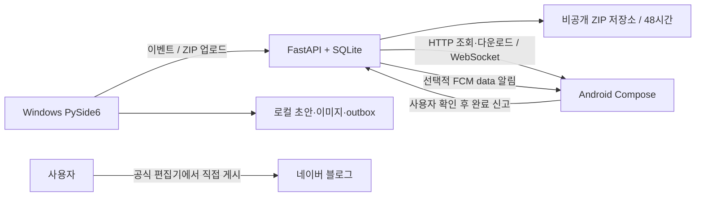

# AI Blog Auto System 개발 상세서

**문서 기준: 2026-11-19 · Windows / Ubuntu 서버 / Android 통합 구현**

이 시스템은 Windows에서 초안과 이미지를 만들고, 서버에 수동 발행용 콘텐츠를 보관하며,
Android에서 알림·미리보기·다운로드·수동 완료 신고를 처리합니다.
네이버 자동 발행은 비활성화되어 있습니다. 실제 운영 서버에는 배포하지 않았습니다.

## 목차

1. [프로젝트별 시작 안내](#1-프로젝트별-시작-안내)
2. [구성 및 처리 흐름](#2-구성-및-처리-흐름)
3. [현재 구현 범위](#3-현재-구현-범위)
4. [개발 환경과 저장소](#4-개발-환경과-저장소)
5. [Windows 내부 설계](#5-windows-내부-설계)
6. [서버 내부 설계](#6-서버-내부-설계)
7. [Android 내부 설계](#7-android-내부-설계)
8. [API 및 이벤트 계약](#8-api-및-이벤트-계약)
9. [데이터·파일·보안](#9-데이터파일보안)
10. [오류 처리와 복구](#10-오류-처리와-복구)
11. [테스트·빌드·배포](#11-테스트빌드배포)
12. [유지보수와 남은 검증](#12-유지보수와-남은-검증)

## 1. 프로젝트별 시작 안내

| 프로젝트 | 사용하는 사람/목적 | 설치·사용 문서 | 주요 산출물 |
|---|---|---|---|
| Windows | 글·이미지 작성, 예약 초안 생성, 콘텐츠 전달 | **[Windows 설치·사용 가이드](windows-install-use.md)** | `AI-Blog-Auto.exe` 실행 폴더 ZIP |
| Ubuntu 서버 | 이벤트 저장, 인증, 패키지 보관, 기기 연결 | **[Ubuntu 설치·사용 가이드](ubuntu-install-use.md)** | 서버 소스 TAR.GZ, systemd/Nginx 예시 |
| Android | 운영 이력 확인, 알림, 다운로드, 수동 완료 신고 | **[Android 설치·사용 가이드](android-install-use.md)** | 개발용 Debug APK |

처음 사용하는 순서:

1. Windows와 Android를 각각 Mock 모드로 체험합니다.
2. 격리된 로컬/시험 서버를 실행합니다.
3. Windows에 서버 주소·관리자 토큰을 저장하여 연결합니다.
4. 서버에서 페어링 코드를 발급하고 Android를 연결합니다.
5. Windows 패키지 업로드 → Android 다운로드 → 수동 완료 신고를 확인합니다.

설치 파일은 [release/2026-11-19](../release/2026-11-19/README.md)에 있습니다.
원격 Git 저장소: [forlovesea/work](https://github.com/forlovesea/work), 프로젝트 경로는
`AI_Blog_Auto_System_Phase1/ai-blog-auto-system`입니다.

## 2. 구성 및 처리 흐름



### 표준 작업 흐름

| 단계 | 담당 | 처리 내용 | 남는 데이터 |
|---|---|---|---|
| 1 | Windows | 뉴스 확인, 초안·이미지 생성 | 초안 JSON, PNG, 생성 이벤트 |
| 2 | Windows | 이미지 순서 결정, 패키지 생성 | HTML/TXT/DOCX/PNG/manifest ZIP |
| 3 | Windows → 서버 | 토큰 인증, SHA-256 업로드 | 패키지 UUID, 해시, 크기, 완료/만료 시각 |
| 4 | 서버 → Android | 이벤트 복구 및 실시간 알림 | 로컬 이력, sequence, 알림 중복 제거 기록 |
| 5 | Android | 미리보기·복사·파일 저장 | 기기 다운로드 파일 |
| 6 | 사용자 | 네이버 공식 편집기에서 직접 발행 | 실제 블로그 게시물 |
| 7 | Android → 서버 | 게시글 URL과 명시적 완료 확인 | `MANUAL_PUBLISH_COMPLETED`, `verified=false` |
| 8 | 서버 | 만료 즉시 다운로드 차단, 다음 정리 주기에 삭제 | 삭제 이벤트, 감사 메타데이터 |

## 3. 현재 구현 범위

| 영역 | 구현 | 제한/미실시 |
|---|---|---|
| 이벤트 | UUID 멱등 저장, 충돌 거부, 인증, 커서 조회 | Windows는 공유 관리자 토큰 사용 |
| Windows | 마법사, RSS, Mock/AI 초안·이미지, 예약, 로그인 신고, 로그 | 앱 종료 중 예약 미실행, 유료 API 실제 호출 미검증 |
| 출력 | HTML, CF_HTML, 이미지 내장 DOCX, TXT, ZIP, 이미지 순서 | 스마트에디터 실제 붙여넣기 미시험 |
| 서버 콘텐츠 | 100 MiB 기본 상한, ZIP 검사, 48시간 보존, 300초 정리 | 분산 저장소·PostgreSQL/Alembic 미구현 |
| Android | 페어링, Wi-Fi 정책, WS, 이력, 알림, 다운로드, 미리보기, 복사 | 실기기 OS 정책·실제 FCM·Keystore 하드웨어 검증 남음 |
| 수동 완료 | 명시적 사용자 신고, 패키지별 멱등 처리 | 네이버 페이지 실재/게시 성공 자동 검증 안 함 |
| 빌드 | Windows EXE, Android APK 생성 및 로컬 시험 | 정식 코드 서명·Play 배포 미포함 |
| 운영 | systemd/Nginx·백업·복구 문서 | 실제 Ubuntu OS 설치·운영 반영 미실시 |

Mock 모드의 성공을 실제 발행 성공으로 바꾸지 않습니다.
네이버 글쓰기 API와 앱 글쓰기 Scheme의 공식 종료 공지를 확인했으며,
이를 비공식 API나 브라우저 자동 조작으로 대체하지 않습니다. [발행 정책과 공식 근거](naver-publication-policy.md).

## 4. 개발 환경과 저장소

### 기술 구성

| 구성 | 사용 기술 |
|---|---|
| Windows | Python, PySide6, APScheduler, httpx, feedparser, Pillow, python-docx, keyring |
| 서버 | Python, FastAPI, Pydantic, Uvicorn, SQLite, 선택적 firebase-admin |
| Android | Kotlin 2.1.20, Jetpack Compose, OkHttp, SQLiteOpenHelper, WorkManager, Firebase Messaging |
| Android 빌드 | JDK 17, Gradle 8.11.1, AGP 8.9.2, compile/target SDK 35, minSdk 26 |
| 시험 | pytest, pytest-qt, TestClient, Robolectric, Compose UI 테스트, 실제 HTTP/WS 로컬 시험 |

서버/Windows는 Python 3.10 이상 구문을 사용합니다. 검증 환경은 Python 3.10.11입니다.
Android는 Room이 아닌 SQLiteOpenHelper를 사용합니다. 상세 버전은
[검증 환경 목록](integration-python-environment.txt)과 Gradle 설정 파일이 기준입니다.

### 폴더 구조

```text
ai-blog-auto-system/
├─ windows-app/
│  ├─ run_gui.py                GUI 시작점 / --self-test
│  ├─ send_mock_event.py        CLI 송신기와 SQLite Outbox
│  ├─ blog_gui/                 화면·서비스·출력·수동 전달
│  └─ AI-Blog-Auto.spec         EXE 빌드 설정
├─ ubuntu-server/
│  ├─ app/                     이벤트·패키지·기기·수동 완료 API
│  ├─ deploy/                  systemd/Nginx 예시
│  └─ backup_metadata.py       메타데이터 전용 백업
├─ android-app/
│  ├─ app/src/main/            Kotlin·Compose·리소스·Mock ZIP
│  ├─ app/src/test/            Robolectric/Compose/실제 서버 시험
│  └─ gradle/wrapper/          고정 Wrapper
├─ shared/                    이벤트 JSON Schema와 예제
├─ tests/                     Python 회귀·통합·빌드 묶음 도구
├─ docs/                      이 상세서와 프로젝트별 안내
└─ release/2026-11-19/         전달용 ZIP/APK/TAR.GZ 및 해시
```

`.venv`, `build`, `.gradle`, `dist`, DB, 사용자 콘텐츠, `.env`, 자격증명 파일은 소스와 분리합니다.
`release`에는 검증된 배포 산출물만 선별하여 넣습니다.

## 5. Windows 내부 설계

| 모듈 | 책임 |
|---|---|
| `storage.py` | SQLite 설정/뉴스/초안/로그, Windows Credential Manager, 기본 경로 |
| `services.py` | 서버 통신, 로그인 신고 이벤트, RSS 수집, 글·이미지 생성 및 Mock |
| `scheduling.py` | Asia/Seoul cron, 누락 정책, 중복 실행 방지, 반복 종료 허용 |
| `window.py` | 10개 화면, 버튼 연결, 입력 검증, QThreadPool과 UI 결과 반영 |
| `exports.py` | 순서가 있는 Publication 모델, 이미지 bytes, HTML/DOCX/ZIP/manifest |
| `clipboard.py` / `preview.py` | Windows CF_HTML 및 외부 리소스 차단 미리보기 |
| `manual.py` | 자동 발행 거부, 실패 신고·수동 전달 ZIP 생성, 동일 파일 업로드/재시도 |
| `self_test.py` | EXE에 포함된 오프라인 GUI·콘텐츠 생성 시험 |

서비스가 이벤트를 만들면 HTTP보다 먼저 Outbox에 저장합니다.
서버가 같은 event_id와 `accepted=true`로 확인한 뒤에만 로컬 대기 이벤트를 삭제합니다.
네트워크 작업은 UI 스레드를 막지 않도록 작업 스레드에서 실행합니다. 작업 중에는 관련 버튼을 비활성화합니다.

콘텐츠 패키지는 초안 UUID에 연결하고 최초 생성한 bytes를 유지합니다.
재시도에서 ZIP을 재생성하지 않아 압축 시각 변경 등으로 SHA가 달라지는 문제를 방지합니다.
업로드 이력은 로컬 설정 저장소의 `uploaded:<UUID>`에 저장합니다.
로컬 대기 패키지는 업로드 성공 이후에도 유지되므로 별도 사용자 보관 정책이 필요합니다.

## 6. 서버 내부 설계

| 모듈 | 책임 |
|---|---|
| `main.py` | 앱 구성, 인증, 이벤트 API, SQLite 연결, 작업 수명 주기 |
| `packages.py` | ZIP/manifest 검증, 저장/다운로드, 만료·알림·삭제 |
| `mobile.py` | 페어링, 토큰 해시·만료·폐기, WS, FCM 등록/발송 |
| `manual.py` | 제한된 수동 완료 신고 API, URL 검사, 멱등 이벤트 |

앱 시작 시 유지관리와 푸시 작업을 시작하고 종료 시 중단합니다.
SQLite 쓰기는 트랜잭션으로 직렬화합니다. 패키지 업로드·삭제와 파일 읽기의 경쟁을 제어하기 위해
해당 경로는 `BEGIN IMMEDIATE` 트랜잭션을 사용합니다.

패키지 보존 시간은 검증과 파일 flush/fsync가 끝난 시각부터 계산합니다.
다운로드는 파일 읽기 전후에 만료를 검사하며 저장된 크기·SHA-256도 검증합니다.
만료 알림/삭제 이벤트에는 패키지 ID와 이벤트 종류로 만든 결정적 UUID를 사용하여 반복 실행 중복을 방지합니다.

푸시 발송은 이벤트 커서 기반입니다. 실패한 기기의 커서를 앞으로 이동시키지 않고 다음 주기에 재시도합니다.
FCM 전달은 exactly-once를 보장하지 않으므로 Android에서 UUID로 다시 중복 제거합니다.

## 7. Android 내부 설계

| 파일 | 책임 |
|---|---|
| `Models.kt` | 이벤트/패키지, 상태 집계, 만료 시간, 서버 주소 검증 |
| `LocalStore.kt` | SQLite 이력/커서/알림, 설정, Keystore AES-GCM 암호화 |
| `Api.kt` | HttpApi/MockApi, 페어링, 다운로드, SHA 검사, 완료 신고 |
| `MonitorRepository.kt` | StateFlow, 직렬 동기화, 재연결·작업 취소, UI 작업 |
| `Background.kt` | 네트워크 감시, 알림 채널, FCM 힌트, WorkManager |
| `Preview.kt` | ZIP 구조/해시/순서 검사, HTML 정제, 클립보드 크기 처리 |
| `MainActivity.kt` | Compose 화면, WebView, SAF 저장·공유, 완료 확인 대화상자 |

HTTP 커서를 순서대로 읽는 작업이 이벤트 복구의 기준입니다.
WS와 FCM은 동기화를 깨우는 힌트이며 수신된 sequence 하나만으로 커서를 건너뛰지 않습니다.
Mock ↔ 실제 서버 전환과 재페어링 시 이전 연결의 재시도 작업을 취소하여 오래된 연결이 다시 살아나지 않게 합니다.

WebView는 JavaScript·파일·content 접근·외부 네트워크를 차단하고 검증한 inline PNG만 허용합니다.
미리보기는 압축 16 MiB·해제 24 MiB 제한이 있으며 큰 콘텐츠는 ZIP/Word 다운로드를 사용합니다.
다운로드는 최대 100 MiB를 스트리밍하여 임시 파일에 저장하고 SHA를 확인한 뒤 완료 파일로 전환합니다.

## 8. API 및 이벤트 계약

### 인증 규칙

보호 API는 `X-Device-Token` 헤더를 사용합니다. 토큰을 URL에 넣지 않습니다.

| 권한 | 허용 범위 |
|---|---|
| 인증 없음 | health, 유효한 코드로 페어링 claim |
| 관리자/Windows 토큰 | 이벤트 쓰기/읽기, 패키지 업로드/읽기, 코드 발급, 기기 관리, 수동 완료 |
| Android 기기 토큰 | 이벤트/패키지 읽기, 본인 FCM 등록, 수동 완료 신고 |

### 주요 API

| Method | 경로 | 기능 |
|---|---|---|
| GET | `/api/v1/health` | 실행/DB 확인 |
| POST | `/api/v1/events` | UUID 이벤트 저장 |
| GET | `/api/v1/events?after=0&limit=100` | 수신 순서대로 커서 복구 |
| GET | `/api/v1/events?limit=20` | 최신 이벤트 조회 |
| POST | `/api/v1/packages` | application/zip 업로드, `X-Content-SHA256` 필수 |
| GET | `/api/v1/packages` | 최근 패키지 메타데이터 |
| GET | `/api/v1/packages/{id}/download` | ZIP 또는 kind별 파일 |
| POST | `/api/v1/packages/{id}/manual-completion` | 명시적 수동 완료 신고 |
| POST | `/api/v1/pairing/codes` | 10분 일회용 코드 발급 |
| POST | `/api/v1/pairing/claim` | 코드와 기기 이름으로 90일 기기 토큰 발급 |
| GET/DELETE | `/api/v1/devices`, `/api/v1/devices/{id}` | 기기 목록/폐기 |
| PUT | `/api/v1/devices/me/push` | 본인 FCM 토큰 등록 |
| WebSocket | `/api/v1/events/ws?after=0` | 인증 이벤트 재생 및 실시간 신호 |

API 입력 예제와 오류 형식은 로컬 실행 후 `/docs`에서 확인할 수 있습니다.
제공 운영 Nginx 예시는 `/docs`를 외부에 공개하지 않습니다.

이벤트 예제:

```json
{
  "event_id": "744eac85-82c7-4e96-871c-14bbaf52385c",
  "device_id": "WINDOWS-DESKTOP",
  "event_type": "NAVER_LOGIN_EXPIRED",
  "occurred_at": "2026-11-19T09:00:00+09:00",
  "payload": {"source": "user_report", "verified": false, "mock": true}
}
```

수동 완료 입력 예제(실제 사용 시 직접 게시한 URL):

```json
{"confirmed": true, "post_url": "https://blog.naver.com/example/123"}
```

`confirmed`는 문자열이 아닌 JSON boolean `true`여야 합니다.
같은 패키지·URL은 동일 이벤트 ID를 돌려주고 다른 URL이면 409입니다.
기록이 이미 있는 동일 요청은 만료 이후 재시도에도 기존 결과를 반환합니다. 최초 기록은 만료 전만 허용합니다.

### 주요 이벤트

| 분류 | 이벤트 |
|---|---|
| 연결/로그인 | `PC_ONLINE`, `PC_OFFLINE`, `NAVER_LOGIN_SUCCESS/FAILED/EXPIRED` |
| 콘텐츠 | `CONTENT_GENERATED`, `IMAGE_GENERATED` |
| 발행 | `PUBLISH_STARTED/SUCCESS/FAILED/UNCONFIRMED`, `MOCK_PUBLISH_SUCCESS` |
| 수동 흐름 | `MANUAL_PUBLISH_REQUIRED`, `MANUAL_PUBLISH_COMPLETED` |
| 패키지 | `PACKAGE_UPLOAD_SUCCESS/FAILED`, `PACKAGE_EXPIRING_6H/1H`, `PACKAGE_DELETED` |
| 기타 | `STATISTICS_UPDATED`, `SERVER_ERROR` |

스키마가 지원하는 이벤트 목록과 현재 GUI가 실제 생성하는 이벤트는 구분해야 합니다.
예를 들어 자동 발행이 비활성화되어 있으므로 GUI가 네이버 자동 게시 성공을 생성하지 않습니다.
전체 계약은 [event-schema.json](../shared/event-schema.json)에 있습니다.

## 9. 데이터·파일·보안

| 저장소 | 데이터 | 보호/정리 |
|---|---|---|
| Windows `desktop.sqlite3` | 설정/초안/뉴스/로그 | OS 사용자 권한, 로그 최근 2,000건 |
| Windows Outbox | 미확인 이벤트 JSON | 확인 응답 후 삭제 |
| 서버 `events` | UUID, 기기, 종류, 발생/수신 시각, payload | UUID PK, append-only 커서 |
| 서버 `packages` | UUID, SHA, 크기, 난수 파일명, 업로드/만료/삭제 시각 | 본문은 별도 비공개 ZIP |
| 서버 `package_downloads` | 패키지·kind·시각 | 콘텐츠 본문을 기록하지 않음 |
| 서버 페어링/기기 테이블 | 코드/기기 토큰 해시, 만료/폐기, FCM 토큰·커서 | 원본 인증 토큰은 저장하지 않음 |
| Android SQLite | scope별 이벤트/커서/알림 UUID | 서버·기기별 분리 |
| 비밀정보 | API 키/서버 토큰/기기 토큰 | Windows Credential Manager / Android Keystore |

ZIP에는 `index.html`, `article.txt`, `article.docx`, `images/*.png`, `manifest.json`을 포함합니다.
manifest는 파일 크기·SHA-256과 `image_order`를 기록합니다. 입력 파일명을 서버 저장 경로로 사용하지 않습니다.
경로 탈출, 중복 ZIP 엔트리, symlink, 허용되지 않은 파일·DOCX 구조, 과도한 해제 크기 등을 검사합니다.

기본 제한은 ZIP 100 MiB, 이미지 최대 30개입니다. 각 클라이언트의 미리보기/클립보드 제한은 더 작습니다.
Windows 출력과 서버/Android의 제한은 각각 적용되므로 업로드 가능 여부는 서버 응답으로 확인합니다.

패키지 디렉터리는 백업·VM 스냅샷·동기화에서 제외해야 합니다.
메타데이터 백업에는 FCM 토큰과 사용자 신고 URL이 포함될 수 있어 접근 제어가 필요합니다.
상세 보안 경계: [security.md](security.md), [서버 패키지](server-packages.md).

## 10. 오류 처리와 복구

| 상황 | 처리 |
|---|---|
| Windows 네트워크 오류 | 이벤트·고정 ZIP 유지, 사용자 재시도 |
| 이벤트 ACK 유실 | 같은 UUID 재전송, 내용 동일하면 `new=false` |
| 업로드 ACK 유실 | 같은 UUID/SHA로 기존 결과 회수, 만료 시각 유지 |
| Android 연결 끊김 | 로컬 상태 유지, 네트워크/화면 복귀 시 HTTP 커서 복구 |
| FCM 실패 | 서버 커서 유지, 이후 주기에 재시도 |
| 파일 손상 | 해시 불일치 다운로드 거부 |
| 만료 | 즉시 410, 삭제 작업 결과와 분리 |
| 삭제 실패 | 로그 후 다음 정리 주기 재시도 |
| 인증 만료/폐기 | 401, 새 페어링 또는 관리 토큰 확인 |

외부 요청 오류를 실제 성공이나 Mock 성공으로 바꾸지 않습니다.
자동 재시도로 유료 AI 요청을 무한 반복하지 않습니다.
프로세스가 중지된 동안 유지관리/알림이 실행되지 않는 점은 운영 모니터링에서 고려해야 합니다.

## 11. 테스트·빌드·배포

프로젝트 루트에서 전체 Python 환경을 설치합니다.

```powershell
.\.venv\Scripts\python.exe -m pip install -r requirements-dev.txt
.\.venv\Scripts\python.exe -m pytest -q
# JDK/SDK 환경변수를 설정한 뒤 실행
.\.venv\Scripts\python.exe tests/integration_live.py
```

| 검사 | 최근 결과 |
|---|---|
| Python 회귀/통합 | 76개 통과 |
| Android JVM/Compose/실제 로컬 서버 통신 | 16개 통과 |
| Android Lint | 오류 0, 경고 26 |
| Windows EXE | 빌드·오프라인 자체 시험 통과 |
| APK | Debug 빌드·v2 서명 검증 통과 |

일반 Gradle 단위 시험은 실제 서버 시험을 opt-in으로 건너뜁니다.
`tests/integration_live.py`가 실행한 경우에는 임시 서버와 설정을 전달하여 해당 시험도 실행합니다.
48시간/5분 경계는 주입 시계/가상 대기를 사용했고 실제 시간 경과 시험으로 표시하지 않습니다.
실제 FCM 전송 대신 서버 발송 경계의 payload를 캡처하여 Android 알림 코드에 전달했습니다.

EXE/APK 재빌드, Ubuntu 설치, TLS, 백업, 롤백은 [build-and-deploy.md](build-and-deploy.md)에 정리했습니다.
[통합 시험 결과](integration-test-results.md)에는 각 시나리오의 증거와 미실시 항목이 있습니다.

운영 서버 변경은 별도 승인을 받아야 합니다. 이 문서 작성 및 GitHub 등록은 운영 배포를 포함하지 않습니다.

## 12. 유지보수와 남은 검증

이벤트를 추가할 때는 서버 `EVENT_TYPES`, 공유 JSON Schema, Android 표시/집계,
관련 회귀 시험을 함께 확인합니다. 패키지 포맷을 바꾸면 Windows 출력기·서버 검증기·Android 미리보기를 함께 수정합니다.
인증 범위를 바꾸면 정상 호출뿐 아니라 기존 기기의 권한 거부·폐기·만료 시험도 확인합니다.

릴리스 전 점검:

- 프로젝트별 설치 방법으로 새 환경에서 실행되는지 확인합니다.
- EXE/APK의 서명 종류·해시와 문서를 맞춥니다.
- 실제 Ubuntu 파일 권한·TLS·서비스 재시작·백업 제외를 확인합니다.
- Windows 11·Android 실기기의 알림·절전·클립보드·대용량 저장을 확인합니다.
- 네이버 미확인 기능은 비활성화하고 수동 게시/완료 신고의 차이를 유지합니다.
- 키·쿠키·DB·사용자 콘텐츠·빌드 캐시를 Git에 포함하지 않습니다.

기존 단계별 시험 보고서는 당시 상태를 설명하는 이력입니다. 현재 사용법은 이 상세서와 프로젝트별 가이드를 우선합니다.
