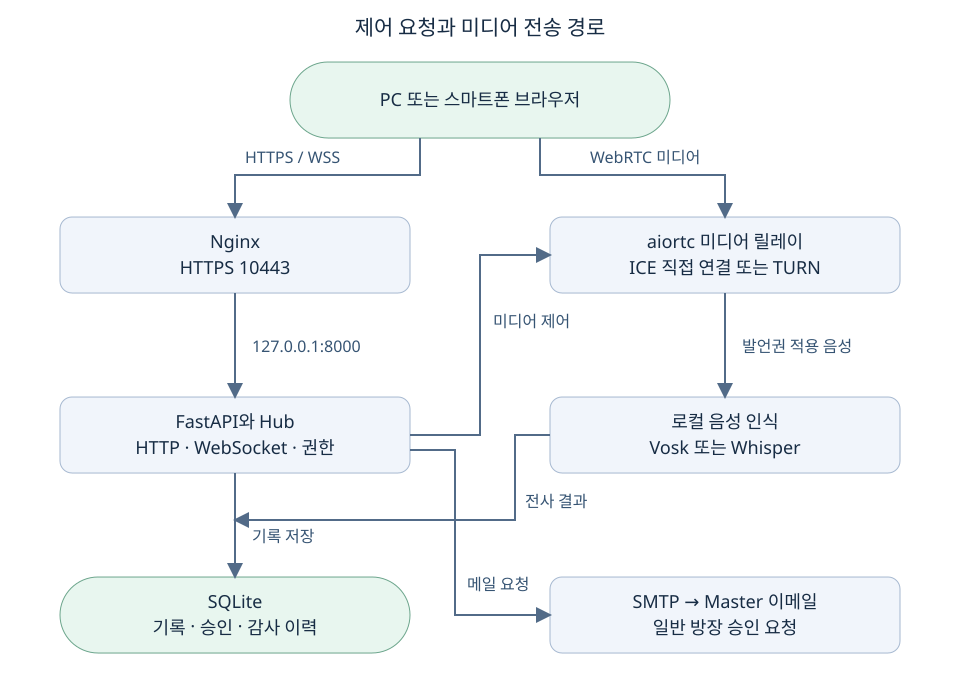
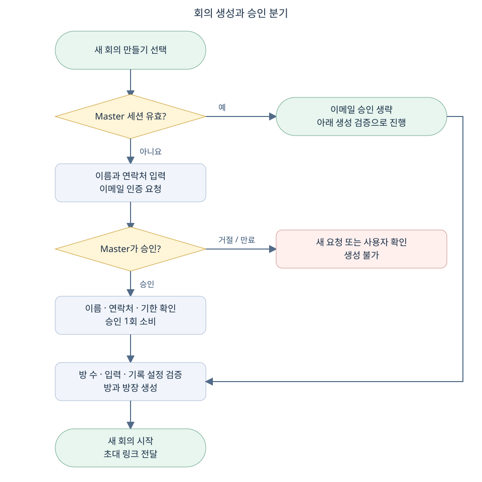
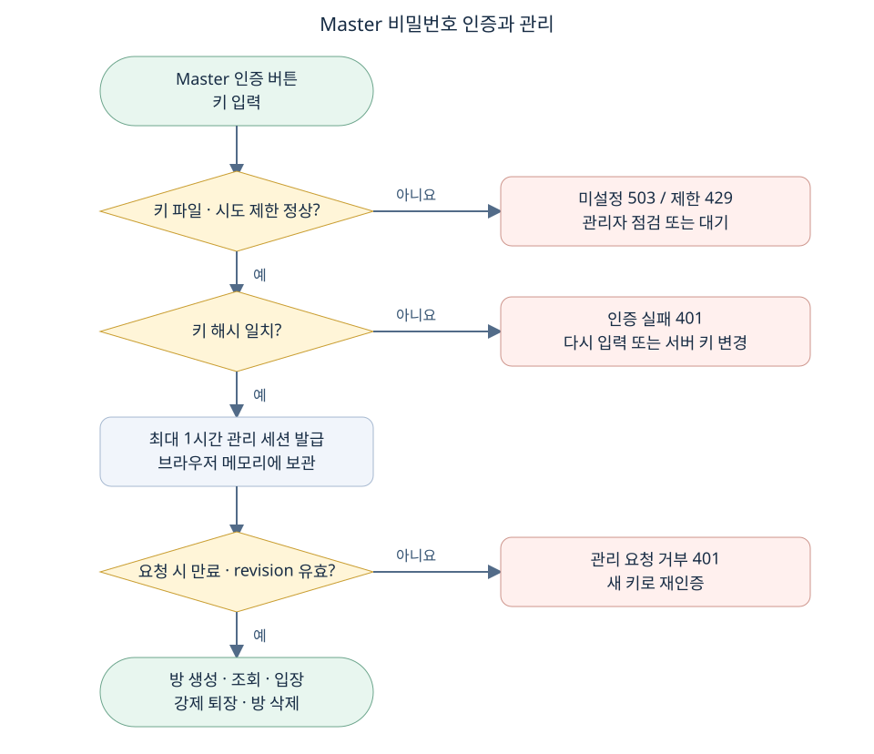
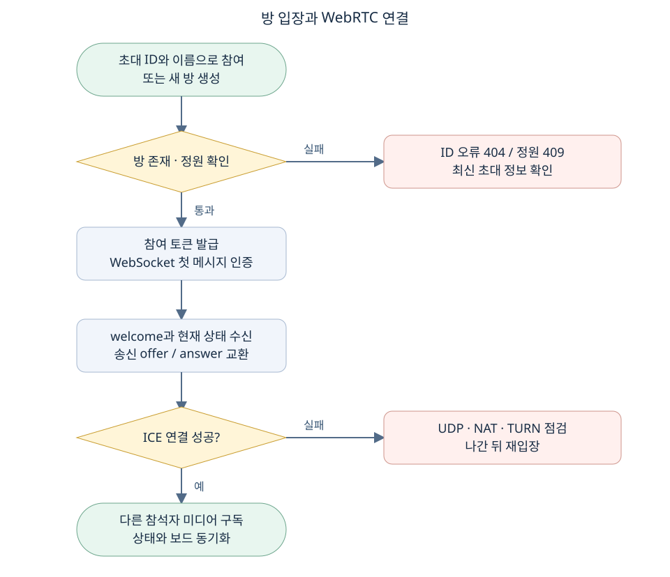
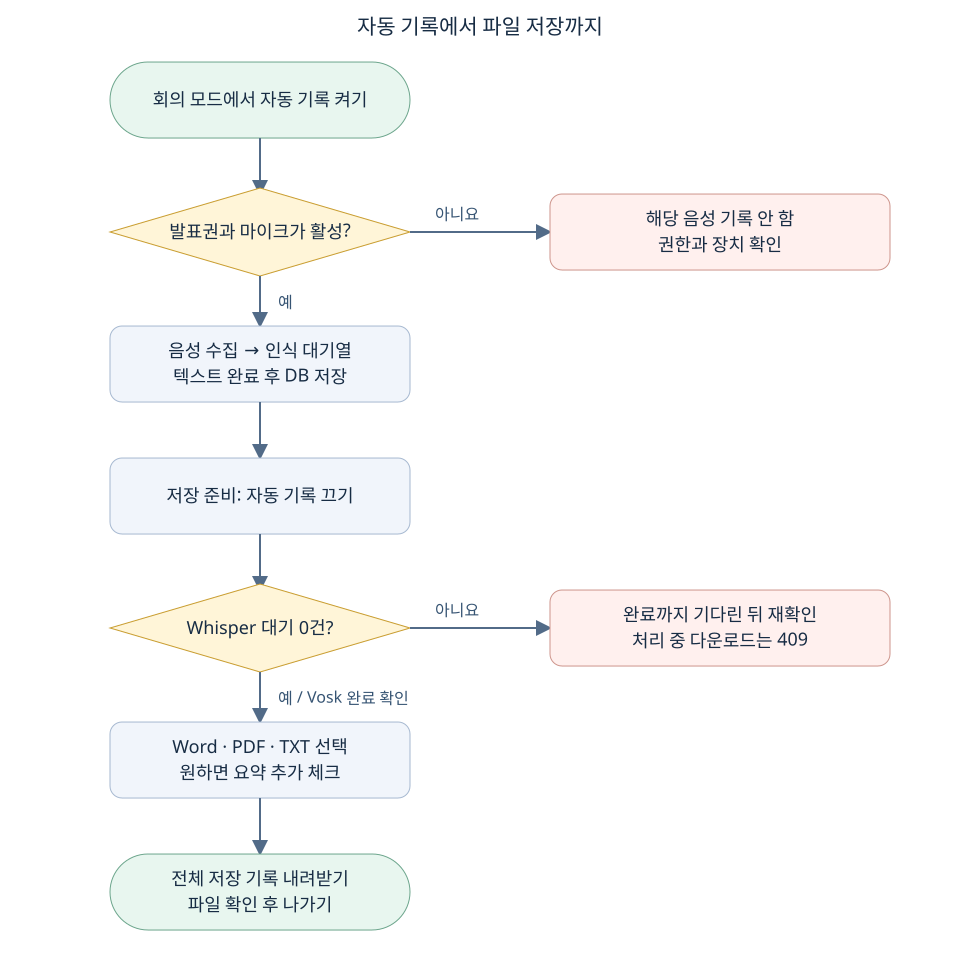
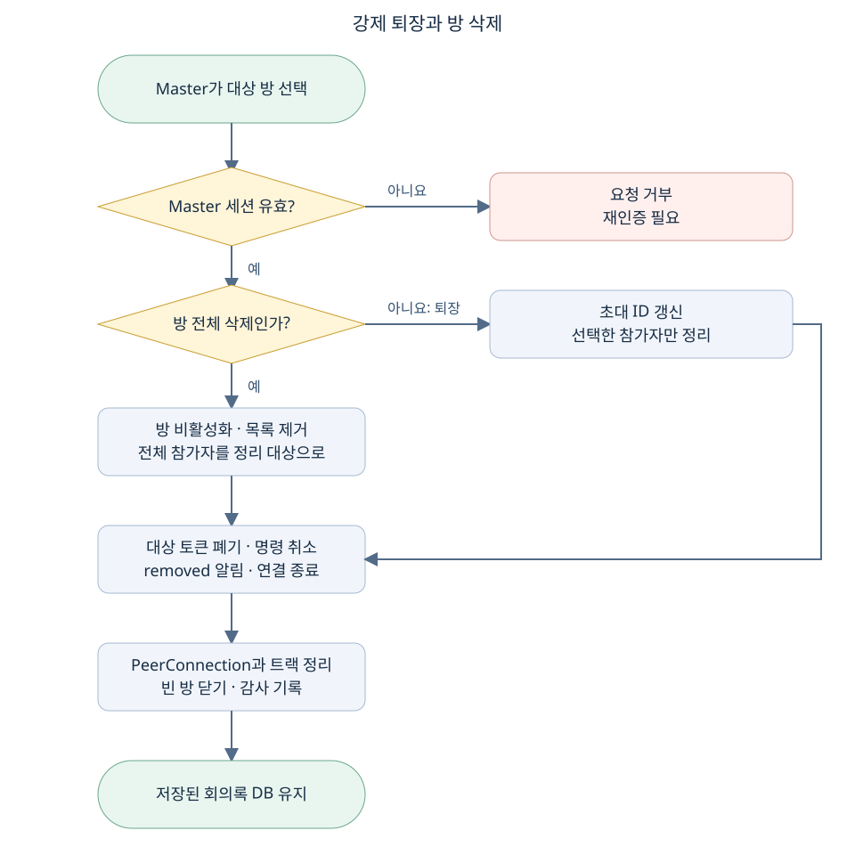
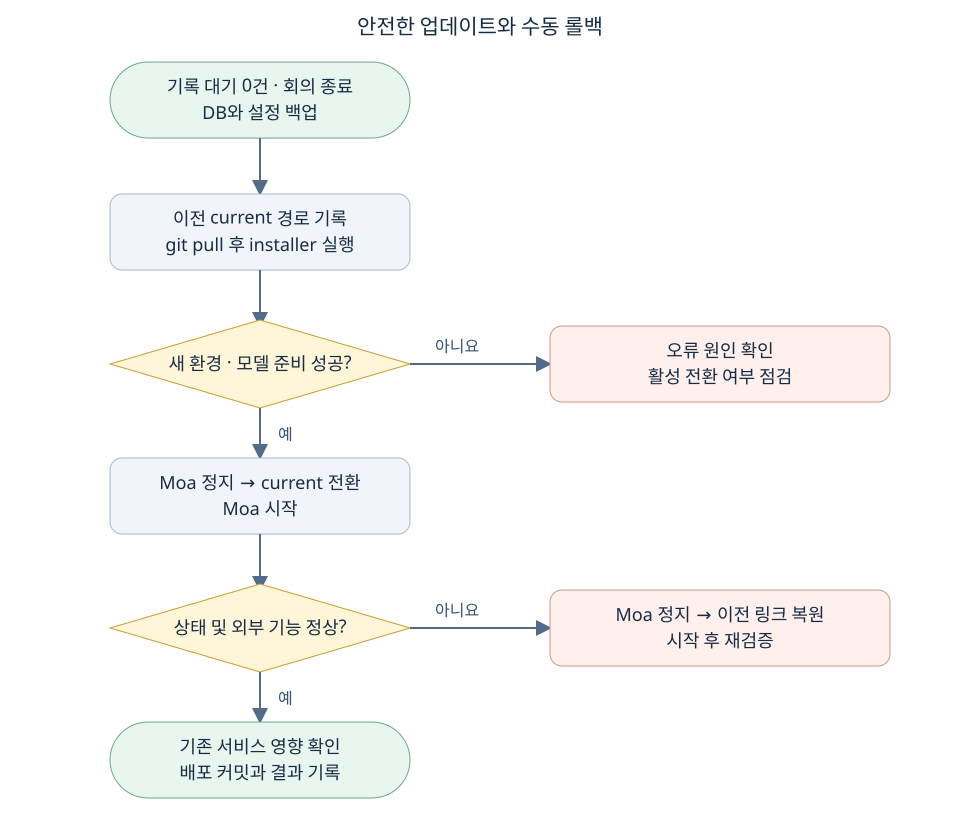

# 모아 화상회의 개발상세서

브라우저 화상회의 서비스의 구조와 처리 흐름, 권한, 데이터, 배포 및 검증 기준을 설명합니다. 개발자는 기능 변경 시 이 문서의 권한과 상태 전이를 먼저 확인하고, 운영자는 배포와 데이터 보존 범위를 기준으로 작업합니다.

**문서 기준일 2026년 10월 18일 · 구현 기준 Git 커밋 fd1a7d0 · 대상 WebConference/RelayServer.** 서비스 화면의 v0.1 표시는 배포 커밋을 구분하지 못하므로 운영 이력에는 Git 커밋과 릴리스 경로를 함께 기록합니다. 아래 구성값은 프로젝트 및 제공된 운영 정보를 기준으로 하며 대상 서버의 현재 상태는 배포 전에 확인합니다.

## 1 서비스 범위와 구현 경계

모아는 HTML·CSS·JavaScript 클라이언트와 Python FastAPI 서버로 구성됩니다. aiortc가 브라우저의 WebRTC 미디어를 수신하고 다른 참석자에게 전달하며, WebSocket으로 회의 상태·발표권·화이트보드·회의록을 동기화합니다. 설치형 스마트폰 앱 구현은 포함하지 않습니다. 스마트폰에는 HTTPS 초대 링크를 보내 브라우저로 참여하게 합니다.

| 항목 | 현재 구현 | 경계와 주의점 |
| --- | --- | --- |
| 회의 모드 | 발표자로 지정된 한 사람의 음성 전달 | 방장도 발표자가 아니면 발언권을 요청하거나 자신을 지정해야 함 |
| FREE Talk | 마이크를 켠 참석자가 동시에 대화 | 자동 음성 회의록을 사용할 수 없음 |
| 화면 공유 | 발표자의 화면·창·탭을 영상 트랙으로 전달 | 파일 업로드 기능이 아님. 공유 대상의 시스템 소리는 전송하지 않음 |
| 화이트보드 | 발표자 입력, 참석자 전체 동기화 | 메모리에만 저장. 영구 저장·다운로드 기능 없음 |
| 음성 인식 | Vosk 또는 CPU INT8 faster-whisper | 실제 한국어 인식률과 지연은 대상 장비·음성으로 측정 필요 |
| 회의록 | SQLite 저장, Word·PDF·TXT 내보내기 | 녹음 원본이 아님. 기록이 꺼진 발언이나 인식 실패 구간 복원 불가 |
| 요약 | 주요 키워드와 대표 발언 발췌 | 생성형 AI 의미 요약이나 자동 합의 확정 기능이 아님 |
| 사용자 승인 | Master 이메일 링크로 방 생성 1회 승인 | 사용자 이메일 소유권 인증이나 회원가입이 아님 |
| Master 관리 | 비밀번호 인증, 전체 방 조회·입장·퇴장·삭제 | 방장 고유 기능을 자동으로 대체하지 않음 |
| 방 지속성 | 실행 중인 단일 프로세스 메모리에서 유지 | 재시작 후 회의방·연결 복구 없음. 저장된 회의록은 유지 |

## 2 시스템 구성과 네트워크



**그림 1. HTTPS 제어 경로와 WebRTC 미디어 경로는 서로 다릅니다.** 웹페이지가 열리고 health가 정상이어도 UDP·NAT·TURN 문제로 음성·영상이 실패할 수 있습니다. Nginx가 일반 HTTPS 요청을 전달한다고 해서 WebRTC 미디어까지 자동으로 중계하지는 않습니다.

| 구성 요소 | 위치 또는 포트 | 책임 |
| --- | --- | --- |
| PC·스마트폰 브라우저 | 사용자의 HTTPS 접속 | 장치 권한, 미디어 취득, 로컬 UI, WebRTC 연결 |
| 외부 접속 주소 | https://61.105.141.21:10443 | 이 운영 환경의 접속 주소. 서버에서 실제 리스너·인증서 확인 필요 |
| Nginx | 운영 HTTPS 포트 | TLS 종료, HTTP 전달, WebSocket Upgrade |
| Uvicorn/FastAPI | 127.0.0.1:8000 | 정적 파일, REST API, WebSocket, 앱 생명주기 |
| aiortc/MediaRelay | 별도 ICE 미디어 경로 | 미디어 수신·구독, 음성 발언권 제어 |
| coturn | 선택 구성 | 직접 연결이 실패하는 네트워크에서 TURN 경유 |
| SQLite | /var/lib/moa/meetings.db | 방 이력, 전체 기록, 승인 요청, 인증 제한, 관리 감사 기록 |
| 음성 모델 | /var/lib/moa/models | 로컬 음성 인식. 모델 다운로드와 실제 추론은 별도 단계 |
| SMTP 서버 | 설정한 SSL 또는 STARTTLS 포트 | 승인 요청을 Master 이메일로 발송 |

동일 서버의 축전지 모니터링·스마트폰 원격제어 서비스를 유지해야 합니다. 신규 작업 전 `sudo ss -ltnup`으로 사용 포트를 확인하고, 기존 인증서·타이머·프록시·방화벽 설정을 일괄 덮어쓰지 않습니다. Moa 설치기는 Moa를 재시작하며 Nginx나 기존 서비스 설정을 직접 변경하지 않습니다. 다만 시스템 패키지 설치와 CPU·메모리·네트워크 공유에 따른 영향은 별도로 확인해야 합니다.

## 3 소스 구성과 책임 분리

| 파일 | 주요 책임 |
| --- | --- |
| server.py | 실행 인자 검증, 작업 폴더 설정, Uvicorn 단일 worker 실행 |
| app/main.py | 앱 lifespan, Hub, REST API, WebSocket 인증·명령 처리, 강제 퇴장 |
| app/domain.py | Participant·Room 상태, 역할 규칙, Store 및 SQLite 저장 |
| app/master_auth.py | Master 키 해시, 세션, 키 변경 감지, 로그인 제한·감사 기록 |
| app/approvals.py | 일반 방장 승인 상태, SMTP, 링크 토큰 검증, 1회 승인 소비 |
| app/media.py | AudioGate, Vosk 전사, 미디어 소비 |
| app/whisper_speech.py | 음성 버퍼·대기열·순차 추론·완료 상태 알림 |
| app/minutes_export.py | 요약 블록, 전체 기록, Word·PDF·TXT 출력 |
| static/index.html | 로비, 회의, Master 관리, 회의록·화이트보드 UI |
| static/app.js | 화면 상태, API/RPC, 미디어 연결, 역할별 버튼, 장치 종료 |
| static/master-approval.html 및 js | 이메일 링크의 사용자 확인·승인·거절 화면 |
| deploy/native/install.sh | 새 릴리스 준비, 가상환경, 모델, current 전환, 상태 점검 |
| deploy/native/moa.service | 전용 계정·권한·자동 시작·네트워크 주소군 |
| scripts/set_master_key.py | 서버 관리자용 대화형 키 등록·재설정 |
| scripts/export_minutes.py | 종료된 방의 저장 기록을 서버에서 Markdown으로 추출 |
| tests 및 scripts/browser_*_smoke.py | API·도메인·미디어·전사·브라우저 검증 |

요구 라이브러리는 `requirements.txt`에 버전이 고정되어 있습니다. FastAPI 0.115.12, Uvicorn 0.34.2, aiortc 1.14.0, PyAV 16.0.1, Vosk 0.3.45, NumPy 2.2.6, python-docx 1.2.0, ReportLab 4.4.3을 사용합니다. Whisper 의존성은 별도 `requirements-whisper.txt`로 설치합니다. 새 버전 도입 시 미디어 휠 호환성과 Python 3.12 동작을 다시 검증합니다.

## 4 역할과 권한 설계

Master는 서비스 전체 관리 역할, 방장은 특정 방의 진행 역할, 발표자는 해당 방의 현재 공유·발언 역할입니다. 한 사람이 여러 역할을 겸할 수 있습니다. Master가 기존 방에 들어오더라도 기존 방장을 자동으로 대체하지 않습니다.

| 기능 | Master 인증 | 현재 방장 | 일반 참석자 | 현재 발표자 조건 |
| --- | --- | --- | --- | --- |
| 새 방 생성 | 이메일 승인 없이 가능 | 일반 사용자라면 생성 전 이메일 승인 필요 | 이메일 승인 후 생성 가능 | 없음 |
| 전체 방 목록 조회 | 가능 | 불가 | 불가 | 없음 |
| 사용자 강제 퇴장·방 삭제 | 가능 | Master 인증 없으면 불가 | 불가 | 없음 |
| 발표자 지정 | 방장을 겸할 때 가능 | 가능 | 불가 | 지정받는 사람은 접속 중이어야 함 |
| 자동 회의록 켜기·끄기 | 방장을 겸할 때 가능 | 회의 모드에서 가능 | 불가 | 인식 엔진 준비 필요 |
| 수동 메모·결정·실행 항목 | 방장을 겸할 때 가능 | 가능 | 불가 | 없음 |
| 화면·화이트보드 공유 | 발표자를 겸할 때 가능 | 발표자를 겸할 때 가능 | 발표자로 지정되면 가능 | 필수 |
| 회의록 다운로드 | 해당 방 접속 토큰 필요 | 가능 | 가능 | 인식 대기가 없어야 함 |

API는 버튼 표시 여부와 별개로 권한을 검증합니다. 클라이언트가 `is_master=true`를 보내거나 이름을 Master로 지정해도 권한을 얻지 못합니다. 방 참여 토큰, Master 세션 토큰, 이메일 승인용 토큰은 서로 다른 용도이며 교환해 사용할 수 없습니다.

## 5 회의 생성과 이메일 승인 Flowchart



**그림 2. 일반 사용자는 이름·연락처에 묶인 1회 승인을 사용하고, Master 세션은 별도 경로로 검증합니다.** 승인 대기 중에는 회의 생성 버튼이 비활성화됩니다. 서버는 이름·연락처, 상태, 만료, 사용 여부를 다시 확인합니다.

1. 로비에서 `/api/config`를 읽어 음성 인식·메일 설정·Master 키 준비 여부를 표시합니다.
2. 일반 사용자가 이름·연락처를 입력하고 이메일 인증을 요청합니다. 연락처는 이메일 또는 전화번호 형식이어야 합니다.
3. 서버는 사용자 토큰과 승인 링크 토큰을 별도로 만들고 SHA-256 해시를 DB에 저장합니다. Master 메일 주소는 `forlovesea@gmail.com`으로 고정되어 있습니다.
4. SMTP 발송 성공 후 `pending` 상태가 됩니다. Master는 메일의 링크에서 사용자 정보를 확인하고 인증완료 또는 거절을 누릅니다. 링크 열기만으로 승인되지 않습니다.
5. 신청 브라우저가 상태를 조회하고 승인되면 시작 버튼을 활성화합니다. 이름 또는 연락처를 바꾸면 새 요청이 필요합니다.
6. 서버는 승인 소비와 방 DB 삽입을 같은 트랜잭션으로 커밋합니다. 사용된 승인으로 두 번째 방을 만들 수 없습니다.

| 승인 상태 | 의미 | 다음 처리 |
| --- | --- | --- |
| sending | 메일 전송 중 | 성공 시 pending, 실패 시 failed |
| pending | Master 결정 대기 | approve 또는 reject |
| approved | 생성 허용 | 승인 후 30분 내 방 1회 생성 |
| rejected | 거절됨 | 필요 시 새 요청 |
| used | 방 생성에 소비됨 | 재사용 불가 |
| failed | 메일 전송 실패 | SMTP 확인 후 새 요청 |
| expired | 유효시간 경과 | 응답에서 계산되는 상태. 새 요청 필요 |

최초 요청 링크는 30분 유효하며 승인 시 사용 기한이 다시 30분으로 설정됩니다. 요청 제한은 1시간 동안 전체 20회·IP별 5회·연락처별 3회이며 동일 연락처의 60초 이내 재요청도 제한합니다. 이름과 연락처는 승인 DB에 저장되고 만료 후 하루가 지난 요청은 정리 시 삭제됩니다. 이 절차는 입력한 연락처의 실제 소유 여부를 자동 검증하지 않습니다.

## 6 Master 인증과 키 재설정 Flowchart



**그림 3. 키 파일을 매 요청 확인하여 키 변경 이후 기존 관리 세션을 즉시 거부합니다.** 브라우저에는 관리 토큰을 메모리에만 보관합니다. 새로고침·탭 종료·서버 재시작 후 다시 로그인해야 합니다.

키는 PBKDF2-HMAC-SHA256 600,000회, 임의 32바이트 salt로 해시합니다. 키 파일에는 알고리즘·반복 수·salt·hash·revision이 들어갑니다. Linux 기본 경로는 `/etc/moa/master-key.json`, 권한은 `root:moa 0640`입니다. 실제 키와 해시는 Git에 포함하지 않습니다.

로그인 세션은 최대 1시간이며 서버 메모리에 토큰 해시로 저장합니다. 키 파일 revision이 달라지면 기존 세션은 거부됩니다. UI는 약 15초마다 세션 상태를 확인하지만 서버 권한 해제는 다음 관리 요청부터 적용됩니다. 키 변경 시 관리 권한은 해제되고 이미 입장한 일반 회의 연결은 유지됩니다. 참가자 목록의 Master 표시는 입장 시 부여된 표시이며 현재 관리 요청의 권한을 보장하는 증거로 사용하지 않습니다.

로그인은 10분 동안 IP별 5회·전체 30회로 제한하며 성공 시도도 횟수에 포함합니다. 시도 기록은 SQLite에 유지되어 재시작으로 초기화되지 않습니다. 키가 바뀐 뒤 첫 로그인에서는 이전 시도 기록을 초기화합니다. 해시 검증은 최대 2개 동시 실행으로 제한합니다.

```bash
sudo /opt/moa/current/.venv/bin/python /opt/moa/current/scripts/set_master_key.py
```

서버 관리자는 기존 키를 몰라도 위 명령으로 새 키를 두 번 입력하여 변경할 수 있습니다. 12~256자를 사용하며 입력 문자는 숨겨집니다. 임시 파일 작성 후 원자적으로 교체하고, 앱이 매 요청 읽으므로 재시작이 필요 없습니다. `MASTER_KEY_FILE`을 별도 지정했다면 명령에도 같은 `--path`를 전달합니다. 웹 Master 권한만으로 서버 키 파일을 바꾸는 API는 없습니다.

## 7 회의 입장과 WebRTC 연결 Flowchart



**그림 4. REST에서 방 참여 자격을 받고 WebSocket 첫 메시지로 인증한 뒤 미디어를 협상합니다.** 방 ID는 내부 식별자, 접속 ID는 초대용 코드, 참여 토큰은 해당 연결의 권한입니다.

1. `/api/rooms` 또는 `/api/join`이 `room_id`, `code`, `participant_id`, `token`, `ice_servers`를 반환합니다.
2. 클라이언트가 `/ws`에 연결하고 첫 메시지 `{"token":"참여 토큰"}`을 보냅니다. 서버는 10초 내 인증을 요구하고 이미 연결된 토큰의 중복 사용을 거부합니다.
3. `welcome`에는 본인 ID, 회의 snapshot, 화이트보드, 최근 기록, 음성 대기 건수가 포함됩니다.
4. 브라우저는 송신용 RTCPeerConnection을 만들고 publish offer를 전송합니다. 서버는 remote description 설정, answer 생성, ICE 수집 후 SDP를 반환합니다.
5. 각 참석자는 다른 참석자의 미디어를 구독하는 연결을 만듭니다. 서버 MediaRelay는 소스를 구독자에게 전달합니다.
6. 연결 종료 시 토큰·참석자·미디어 작업·PeerConnection·트랙을 정리합니다. 자동 재접속으로 동일 참가 상태를 복원하지 않으므로 다시 입장해야 합니다.

음성 트랙은 서버의 AudioGate를 통과합니다. 회의 모드에서는 현재 발표자이고 연결 중이며 마이크가 켜진 경우만 음성을 전달합니다. FREE Talk는 발표권과 무관하게 마이크를 켠 참석자가 말할 수 있습니다. 브라우저에서도 해당 조건으로 마이크 트랙을 제어합니다.

이 구조는 브라우저 간 직접 mesh가 아니라 서버를 경유하는 미디어 릴레이입니다. 참석자 수가 늘면 구독 연결 수와 서버 송신량이 대략 N×(N−1)에 비례해 증가합니다. 전용 SFU 수준의 확장성을 전제로 사용하지 않으며 `MAX_PARTICIPANTS=8`, `MAX_ROOMS=30`은 허용 상한일 뿐 성능 보장값이 아닙니다.

## 8 발표권과 화면 및 보드 동기화

방 생성자는 최초 방장이자 발표자가 됩니다. 방장은 `presenter` 명령으로 접속 중인 참가자를 지정하고 서버는 다른 참석자의 공유 상태를 해제합니다. 클라이언트는 발표권을 잃으면 진행 중인 화면 공유를 중단합니다. 손들기는 요청 목록을 토글할 뿐 자동으로 발표권을 넘기지 않습니다.

화면 공유는 `getDisplayMedia({video:{frameRate:15},audio:false})`를 사용하고 기존 영상 sender의 트랙을 교체합니다. 공유 화면과 카메라는 같은 송신 영상 자리를 사용합니다. 문서 공유는 파일을 로컬 프로그램에서 연 후 해당 창을 공유하는 방식입니다. 별도의 업로드·다운로드·파일 저장소는 없습니다.

화이트보드는 1280×720 캔버스를 사용하고 좌표를 0~1로 정규화합니다. 클라이언트는 약 90ms 간격 또는 점 개수에 따라 선 데이터를 묶어 전송합니다. 서버는 발표자 권한, 점 1~128개, 각 점의 좌표 범위, 색상 HEX, 선 두께 1~16을 검사합니다. 최대 10,000개 stroke를 메모리에 보관하고 새 참석자에게 welcome으로 전달합니다. `clear_board`는 발표자만 실행하며 전체 선을 지웁니다.

## 9 음성 인식과 저장 Flowchart



**그림 5. 저장 버튼은 원본 녹음이 아니라 DB에 완료된 기록을 내보냅니다.** Whisper 대기 중 내보내기는 409로 거부됩니다. 자동 기록을 끄고 대기 0건을 확인한 뒤 저장해야 합니다.

Vosk는 기존 경량 스트리밍 경로입니다. Whisper는 한국어 문맥 인식을 위해 최대 약 20초 구간을 모으고, 최소 약 3초 수집 뒤 약 0.8초 무음이 있으면 구간을 조기에 제출합니다. 발언권·마이크·기록 상태 변경 시 epoch 변화로 버퍼를 구분하며 종료 시 남은 버퍼도 제출합니다.

| Whisper 설정 | 현재 값 | 목적 |
| --- | --- | --- |
| 입력 | 16kHz mono signed 16-bit PCM | 인식용 음성 표준화 |
| 모델 | faster-whisper-small, CPU INT8 | GPU 없는 운영 환경 |
| 실행 | 추론 스레드 1, worker 1 | 기존 서비스와 자원 경쟁 완화 |
| 대기열 | 서버 전체 최대 60구간 | 무한 메모리 증가 방지 |
| 언어·탐색 | ko, beam_size 5, temperature 0 | 한국어 인식 |
| VAD | 활성, 최소 무음 600ms, 여유 300ms | 무음·비음성 구간 제거 |
| 용어 힌트 | WHISPER_PROMPT 최대 1,000자 | 전문용어 입력. 결과 강제 삽입 아님 |
| 종료 대기 | queue.join 최대 25초 | 처리 전 음성의 유실을 완전히 막지는 못함 |

음성 원본은 디스크에 기록하지 않고 메모리에서만 처리합니다. 이미 전사한 텍스트는 SQLite에 남습니다. 대기열이 가득 차면 해당 구간은 버리고 notice로 알립니다. 프로세스 장애 시 미완료 음성은 복구할 수 없습니다. i5-3340M에서의 실제 처리 속도와 인식률은 측정하지 않았으며 대기 건수·CPU·기존 서비스 응답을 함께 확인해야 합니다.

### 요약 및 내보내기 알고리즘

내보내기는 `at, id` 순서로 전체 기록을 정렬합니다. 기본값은 전체 기록만 저장하며 요약을 선택해도 원문이 제외되지 않습니다. 화면에는 최근 200건이 표시되지만 다운로드는 DB의 해당 방 전체 기록을 조회합니다.

요약은 음성 발언의 중복을 줄이고 단어 빈도를 계산하여 최대 6개 주제를 선택합니다. 주제별 대표 발언을 최대 3개, 각 발언 최대 400자로 발췌하고 발언자와 시각을 함께 표시합니다. 방장이 작성한 확정 결정·실행 항목·추가 메모는 별도로 수록합니다. 자동 발췌는 의미 이해나 사실 확인을 대체하지 않으며 숫자·인명·결정 문구는 전체 기록과 대조해야 합니다.

Word는 python-docx, PDF는 ReportLab과 번들 한국어 폰트, TXT는 UTF-8 BOM을 사용합니다. 내보내기 시간은 KST로 표시하고 DB 시각은 UTC ISO 문자열을 사용합니다. 동시 내보내기는 2개로 제한하며 파일은 응답 바이트로 생성합니다.

## 10 강제 퇴장과 회의 종료 Flowchart



**그림 6. 퇴장은 대상 연결을 제거하고, 방 삭제는 해당 방 전체를 닫습니다.** 데이터 삭제와 실시간 회의 종료는 다릅니다. 방 삭제 시에도 저장된 회의록은 DB에 남습니다.

강제 퇴장은 먼저 초대 코드를 새로 발급하고 DB·감사 기록에 반영합니다. 대상의 revoked 상태 설정, 토큰 폐기, 진행 중 명령 취소, removed 알림, WebSocket 종료, 미디어 정리를 수행합니다. 기존 참석자는 계속 회의할 수 있고 신규 입장자는 새 초대 코드가 필요합니다. 익명 참석자에게 계정 기반 영구 차단을 제공하지 않으므로 새 초대 코드를 다시 얻으면 다른 연결로 들어올 수 있습니다.

방 삭제는 방을 inactive로 바꾸고 활성 목록에서 즉시 제거합니다. 모든 참여 토큰을 폐기하고 각 연결·미디어를 종료합니다. 마지막 참석자가 일반 나가기로 나가는 경우에도 빈 방을 비동기 미디어 정리 전에 목록에서 제거해 재입장 경합을 방지합니다.

방장이 나가면 연결 중인 다른 참석자 우선으로 방장 역할을 넘깁니다. 발표자가 나가면 연결된 방장에게 발표권을 넘길 수 있습니다. 따라서 일반 참석자도 자동 승계로 방장이 될 수 있으며, 방장이 나가는 것만으로 전체 방이 닫히지는 않습니다. Master의 방 삭제는 인식 대기를 기다리지 않으므로 정상 종료 시에는 먼저 자동 기록 끄기·대기 0건·다운로드를 마쳐야 합니다.

## 11 REST API 계약

기본 경로는 HTTPS origin입니다. 인증 값은 `Authorization: Bearer <token>` 헤더로 보내며 아래 표의 토큰 종류를 구분합니다. 실제 비밀 토큰을 URL 질의 문자열이나 운영 로그에 남기지 않습니다.

| 메서드 및 경로 | 인증 | 핵심 입출력 |
| --- | --- | --- |
| GET /api/health | 없음 | ok: true. 프로세스 응답 확인용 |
| GET /api/config | 없음 | speech_available, speech_message, speech_engine, 승인·키 준비 여부, max_participants, version |
| POST /api/host-approvals | 없음·요청 제한 | name, contact → request_id, client_token, status, expires_at |
| GET /api/host-approvals/{rid} | 사용자 승인 토큰 | 신청 상태 |
| GET /api/master-approvals/{rid} | 이메일 링크 토큰 | 신청자 정보와 상태 |
| POST /api/master-approvals/{rid}/decision | 이메일 링크 토큰 | decision: approve 또는 reject |
| POST /api/master/login | 키·시도 제한 | key → token, expires_at |
| GET /api/master/me | Master 세션 | expires_at |
| POST /api/master/logout | Master 세션 값 | 해당 토큰 폐기 |
| GET /api/master/rooms | Master 세션 | 활성 방·초대 코드·참석자 목록. 참여 토큰은 반환 안 함 |
| POST /api/master/rooms/{rid}/participants/{pid}/kick | Master 세션 | 대상 강제 퇴장 |
| POST /api/master/rooms/{rid}/delete | Master 세션 | 방 종료 |
| POST /api/rooms | Master 세션 또는 body의 승인 정보 | title, name, mode, minutes_enabled, contact, approval_id, approval_token → 참여 자격. 성공 201 |
| POST /api/join | 없음 또는 Master 세션 | code, name → 참여 자격 |
| GET /api/rooms/{rid}/minutes | 해당 방 참여 토큰 | format=docx/pdf/txt, summary=true/false. API 기본 txt |
| GET / 및 /static/* | 없음 | 클라이언트 정적 파일 |
| GET /master-approval | 없음 | 승인 페이지. 별도 링크 토큰으로 API 인증 |

| 응답 코드 | 대표 원인 | 클라이언트 처리 |
| --- | --- | --- |
| 401 | Master 키 불일치·세션 만료·키 변경 | 다시 인증 |
| 403 | 미승인·사용된 승인, 방 토큰 불일치 | 승인 또는 재입장 확인 |
| 404 | 방·참석자가 종료됨, 초대 ID 불일치 | 새 초대 정보 확인 |
| 409 | 정원 초과, 전사 대기, 승인 상태 충돌 | 해당 상태 해소 후 다시 시도 |
| 410 | 승인 링크 만료 | 새 요청 |
| 422 | 입력 형식·길이 오류 | 안내에 따라 입력 수정 |
| 429 | 인증·메일 요청 횟수 제한 | 제한 시간 후 재시도 |
| 503 | SMTP·키·음성 인식 준비 실패 또는 방 수 초과 | 관리자 점검 |

## 12 WebSocket 메시지 계약

인증 후 일반 명령은 `{id, action, ...payload}`를 사용하고 서버는 `{type:"reply",id,ok,result}` 또는 오류 내용을 보냅니다. 연결당 메시지 100,000자 상한, 1초 창당 80개 제한, 명령 처리 45초 timeout을 적용합니다. SDP 입력은 80,000자를 넘을 수 없습니다.

| action | 입력 | 권한 및 처리 |
| --- | --- | --- |
| publish | sdp | 본인 송신 연결. 중복 publish 거부 |
| subscribe | target, sdp | 다른 준비된 참가자의 미디어 구독 |
| devices | mic, camera | bool 값으로 본인 상태 변경 |
| hand | 없음 | 손들기 토글 |
| presenter | target | 방장만 지정 |
| minutes | enabled | 방장, 회의 모드, 엔진 준비 필요 |
| sharing | enabled | 현재 발표자 |
| stroke | points, color, width | 현재 발표자, 좌표·색·크기 검증 |
| clear_board | 없음 | 현재 발표자 |
| note | text, kind | 방장, note/decision/action, 1~2,000자 |
| ping | 없음 | 빈 성공 응답 |

서버 이벤트는 welcome, state, reply, entry, stroke, board, speech_status, notice, removed입니다. state는 방·참석자 상태, entry는 신규 기록, speech_status는 미완료 건수를 알립니다. removed 수신 시 클라이언트는 나가기 정리를 실행해 카메라·마이크·공유 트랙을 멈춥니다.

## 13 데이터 모델과 저장 수명

| 테이블 | 주요 필드 | 목적 및 수명 |
| --- | --- | --- |
| rooms | id PK, title, code, mode, created_at, closed_at | 회의 이력. 재시작 시 닫히지 않은 방의 closed_at 갱신 |
| entries | id PK, room_id, speaker_id, speaker, text, kind, at | 전체 텍스트 기록. entries_room(room_id,id) 인덱스 |
| host_approvals | id PK, client_hash, master_hash, name, contact, status, created, expires | 일반 방장 승인. 만료 후 정리 정책 적용 |
| approval_attempts | at, ip_hash, contact_hash | 최근 1시간 이메일 요청 제한 |
| master_login_attempts | at, ip_hash | 최근 10분 로그인 제한 |
| master_audit | at, action, room_id, participant_id | login/create_room/join_room/kick/delete_room 관리 기록 |

rooms.id와 entries.room_id는 애플리케이션에서 연결하며 명시적 FOREIGN KEY 제약은 없습니다. SQLite WAL을 사용하고 주요 변경마다 커밋합니다. 회의 삭제는 rooms.closed_at만 기록하고 entries를 지우지 않습니다. 회의록·감사 이력의 자동 장기 삭제 정책은 구현되어 있지 않아 보관 기간은 운영자가 별도 정해야 합니다.

메모리 상태에는 Hub.rooms, Hub.tokens, 참여자의 WebSocket·PeerConnection·tasks, 보드 stroke, 최근 기록, Master 세션, Whisper 버퍼·대기열이 있습니다. active 방을 DB에서 자동 복구하지 않으므로 worker를 여러 개 띄우거나 프로세스를 늘리면 상태가 분리됩니다. 운영은 단일 worker로 유지합니다.

클라이언트 localStorage에는 서버 주소와 이름, sessionStorage에는 이메일 승인 정보가 저장됩니다. Master 토큰은 메모리에서만 유지합니다. 일반 회의 접속 정보도 새로고침으로 자동 복구하지 않습니다. 별칭은 고유 신원 식별자가 아니므로 감사 기록의 participant_id를 실명 인증으로 해석하면 안 됩니다.

## 14 환경 설정과 서비스 운영

| 설정 | 예시 또는 기본 | 변경 영향 |
| --- | --- | --- |
| DB_PATH | /var/lib/moa/meetings.db | 다른 경로 지정 시 다른 DB를 보게 됨 |
| SPEECH_ENGINE | vosk 또는 whisper | 엔진·모델 설치 후 Moa 재시작 |
| VOSK_MODEL_PATH | /var/lib/moa/models/vosk-model-small-ko-0.22 | 모델 읽기 권한 필요 |
| WHISPER_MODEL_PATH | /var/lib/moa/models/faster-whisper-small | 로컬 모델 사용 |
| WHISPER_PROMPT | 실제 회의 전문용어 | 문장 강제 삽입용으로 쓰지 않음 |
| MAX_PARTICIPANTS | 8 | Master는 추가 1자리까지 입장 가능 |
| MAX_ROOMS | 30 | 실제 동시 운용 가능 수와 다름 |
| PUBLIC_BASE_URL | https://61.105.141.21:10443 | 이메일 승인 링크 주소 |
| SMTP_HOST/PORT/SECURITY | 공급자 설정, 587/starttls 예시 | 일반 사용자 승인 메일 필수 |
| SMTP_USERNAME/PASSWORD/FROM | 발송 계정·비밀정보 | Git·일반 로그에 포함 금지 |
| MASTER_KEY_FILE | /etc/moa/master-key.json | 비기본 경로는 setter --path와 일치 필요 |
| ALLOWED_ORIGINS | 빈 값 기본 | 다른 origin 클라이언트 사용 시 명시 설정 |
| ICE_SERVERS_JSON | [] 기본 | NAT 환경 필요 시 STUN/TURN 설정 |

systemd EnvironmentFile은 셸 스크립트가 아닙니다. JSON 전체는 작은따옴표로 감싸고 항목은 중복 없이 편집합니다. 키 파일 내용 교체를 제외한 환경 설정 변경은 Moa 재시작으로 적용합니다.

`moa.service`는 moa 계정, ProtectSystem=strict, ProtectHome=true, ReadWritePaths=/var/lib/moa로 실행합니다. Python이 /home 아래에 있으면 서비스에서 접근하지 못할 수 있으므로 `/opt/moa/python/3.12.15/bin/python3.12`를 사용합니다. ICE 인터페이스 열거를 위해 RestrictAddressFamilies에 AF_NETLINK를 포함하며 시작 전 ifaddr.get_adapters를 검사합니다. 이를 누락하면 Errno 97이 날 수 있습니다.

## 15 배포와 롤백 Flowchart



**그림 7. 릴리스를 준비한 뒤 current를 전환하며 자동 롤백은 하지 않습니다.** 설치 중 apt 저장소 오류가 있으면 해당 저장소를 별도로 진단하고 해결해야 합니다. 문서 작성·열람만으로 서버 명령이 실행되지는 않습니다.

1. 진행 중인 기록을 끄고 대기 0건 및 다운로드를 확인합니다. 기존 서비스의 상태·포트·응답 시간을 기록합니다.
2. DB·설정을 백업하고 `readlink -f /opt/moa/current`로 이전 릴리스를 기록합니다.
3. Git 작업 폴더에서 `git pull --ff-only`를 실행한 뒤 installer를 실행합니다.
4. installer는 전용 계정·필요 디렉터리, 새 가상환경, 의존성·모델을 준비합니다. 기존 moa.env는 보존합니다.
5. moa를 정지하고 current를 새 릴리스로 전환한 뒤 시작합니다. 최대 60회 상태 확인 후 실패하면 오류로 종료합니다.
6. HTTPS 외부 접속, 이메일 승인, Master, 서로 다른 네트워크의 실제 미디어, 회의록 저장을 확인합니다. 실패 시 이전 릴리스로 수동 전환합니다.

```bash
# 기존 Git 작업 폴더의 WebConference/RelayServer에서 실행
git pull --ff-only
sudo bash deploy/native/install.sh /opt/moa/python/3.12.15/bin/python3.12
sudo systemctl status moa --no-pager -l
curl --noproxy '*' -fsS http://127.0.0.1:8000/api/health
curl --noproxy '*' -fsS http://127.0.0.1:8000/api/config
```

Whisper 신규 설치는 `sudo env INSTALL_WHISPER=1 bash deploy/native/install.sh /opt/moa/python/3.12.15/bin/python3.12`를 사용한 후 moa.env의 SPEECH_ENGINE을 whisper로 지정합니다. 기존 env가 정확히 `SPEECH_ENGINE=whisper`이면 업데이트 시 의존성을 자동 설치합니다.

```bash
# 실제 이전 릴리스 경로 확인 후 대체. 회의 연결이 종료됨
sudo systemctl stop moa
sudo ln -sfn /opt/moa/releases/release-PREVIOUS /opt/moa/current
sudo systemctl start moa
```

코드 롤백은 DB·설정·Master 키를 되돌리지 않습니다. 이전 버전의 DB 호환성을 확인해야 합니다. Nginx·인증서·배터리·원격제어 서비스 재설치나 재시작을 이 절차에 추가하지 않습니다.

## 16 검증 기준과 유지보수

구현 기준 커밋에서 자동 테스트 46개와 Master 관리·이메일 승인 브라우저 시나리오가 통과했습니다. 이는 로컬 검증 결과이며 실제 Ubuntu·공인망·스마트폰의 성능 또는 가용성 보장이 아닙니다. 문서 추가 후에는 링크·도표·레이아웃을 별도로 검사합니다.

| 검증 영역 | 핵심 시나리오 |
| --- | --- |
| 인증 | 미인증·가짜 역할·방 토큰으로 Master API 접근 거부, 키 회전·만료·로그아웃 |
| 승인 | 대기·승인·거절·만료·이름 변경·한 번 사용·발송 실패·제한 |
| 방 관리 | 정원, Master 추가 자리, 강제 퇴장 시 토큰 폐기·초대 갱신·방장 승계 |
| 자원 정리 | 삭제 후 재입장 거부, 빈 방 정리 중 재입장 경합 방지 |
| 미디어 | 발표권 음성 차단, 공유 권한, 다중 참석자 송수신 |
| 기록 | 전사 버퍼·대기·실패, 전체 내보내기, 한글·시간·요약·특수문자 |
| 브라우저 | Master 생성·기존 방 입장·퇴장·삭제, 카메라·마이크 종료, 모바일 화면 |
| 운영 수용 | 외부 Wi-Fi와 LTE/5G 간 실제 영상·음성, TLS·갱신, 기존 서비스 영향 |

```bash
# 개발 환경 RelayServer 폴더, 개발 의존성을 설치한 Python으로 실행
python -m pytest tests -q
python scripts/browser_approval_smoke.py
python scripts/browser_master_smoke.py
```

브라우저 smoke는 별도 로컬 서버·임시 키·가짜 장치·가짜 메일 발송을 사용합니다. Chrome 및 Playwright 실행 환경이 필요하며 실제 SMTP 또는 운영 방을 대상으로 실행하는 테스트가 아닙니다.

향후 확장 시 우선 검토할 항목은 계정 기반 신원·영구 차단, 방장 권한 이양 UI, 과거 회의록 웹 조회, 보드 저장, 승인 목록 관리, 감사 보관 정책, 부하 지표, 실제 SFU 도입입니다. 이 항목들은 현재 제공 기능이 아닙니다.

## 17 소스 근거와 관련 문서

문서의 동작·상한·상태는 아래 저장소 구현을 기준으로 정리했습니다. 외부 제품의 향후 버전이나 대상 서버의 변경을 자동 반영하지 않습니다. 코드 변경 시 권한표, API 표, 상태 흐름, 테스트 수를 함께 갱신합니다.

- [API와 회의 Hub](../RelayServer/app/main.py)
- [도메인과 DB](../RelayServer/app/domain.py)
- [Master 인증](../RelayServer/app/master_auth.py)
- [이메일 승인](../RelayServer/app/approvals.py)
- [Whisper 처리](../RelayServer/app/whisper_speech.py)
- [회의록 내보내기](../RelayServer/app/minutes_export.py)
- [브라우저 동작](../RelayServer/static/app.js)
- [설치 스크립트](../RelayServer/deploy/native/install.sh)
- [역할별 사용 매뉴얼](사용매뉴얼.md)
- [Master 운영 안내](../MASTER_ADMIN.md)
- [Whisper 배포 안내](../WHISPER_DEPLOY.md)
