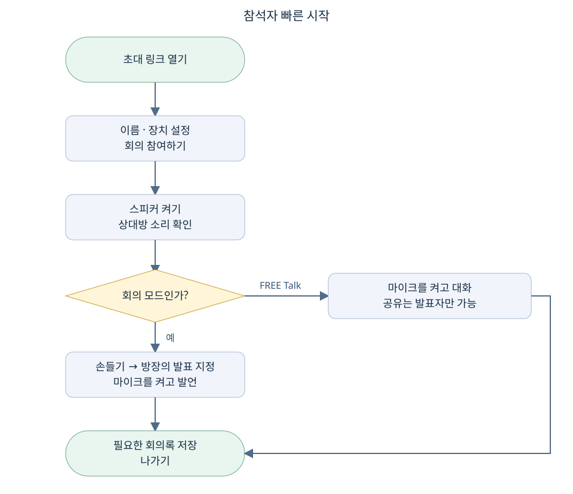

# 모아 화상회의 역할별 사용 매뉴얼

Master, 방장, 참석자, 서버 관리자가 각자의 역할에 맞게 회의를 준비하고 진행하며 기록을 안전하게 보관하는 안내서입니다. 처음 사용하는 참석자는 2장과 3장, 방장은 4장과 7장, Master는 5장, 서버 관리자는 10장부터 읽으면 됩니다.

**2026년 10월 18일 기준 · 구현 커밋 fd1a7d0 · 운영 접속 주소 https://61.105.141.21:10443.** 실제 서버에 해당 버전이 적용되어 있어야 안내된 버튼이 표시됩니다. 이 문서는 서버를 자동 변경하지 않습니다. HTML은 인터넷 없이 열람할 수 있고 Ctrl+F로 검색, Ctrl+P로 인쇄할 수 있습니다.

## 1 역할을 먼저 확인하세요

| 역할 | 하는 일 | 알아둘 점 |
| --- | --- | --- |
| Master | 비밀번호 인증 후 전체 방 조회, 직접 회의 생성, 방 입장, 강제 퇴장, 방 삭제 | 다른 방에 입장해도 그 방의 방장·발표자가 자동으로 되지는 않음 |
| 방장 | 회의 생성, 초대, 발표자 지정, 자동 기록 설정, 결정·실행 항목 작성 | 전체 방 관리와 강제 퇴장은 Master만 가능 |
| 참석자 | 초대 링크로 입장, 음성·영상 참여, 손들기, 회의록 저장 | 회의 모드에서는 발표자로 지정되어야 음성 전달 |
| 발표자 | 회의 모드의 발언, 화면 공유, 화이트보드 그리기·지우기 | 방장이 정하는 현재 역할. 일반 참석자도 가능 |
| 서버 관리자 | 설치·업데이트, 인증서·메일·모델·백업, Master 키 재설정 | SSH 및 sudo 권한이 필요하며 웹 Master와 별개 |

**Master 비밀번호 인증과 이메일 인증은 다릅니다.** 비밀번호 인증은 서비스 전체 관리 권한을 줍니다. 이메일 인증은 일반 사용자가 회의 한 개를 만들도록 Master가 승인하는 과정이며, 전체 관리 권한을 주지 않습니다. 화면에 이름을 Master로 적는 것만으로 관리자 권한이 생기지 않습니다.

## 2 첫 접속과 장치 준비

### 접속 전 확인

1. 이어폰 또는 헤드셋을 준비합니다. 같은 공간의 여러 기기에서 스피커를 동시에 켜면 울림이 생길 수 있습니다.
2. 방장이 보낸 HTTPS 초대 링크를 엽니다. 직접 접속하는 경우 `https://61.105.141.21:10443`을 사용합니다.
3. 중계 서버 주소를 확인하고 **연결 확인**을 누릅니다. 방장이 다른 주소를 안내했다면 그 주소를 사용합니다.
4. **내 이름**에 서로 구별할 수 있는 이름을 입력합니다. 예: `김지현 설비팀`. 같은 이름도 입력할 수 있으므로 구분되는 이름이 좋습니다.
5. 입장 시 사용할 **마이크**, **스피커**, **카메라**를 선택합니다. 기본은 꺼져 있으므로 듣기만 할 때도 스피커는 직접 켭니다.
6. 브라우저가 카메라·마이크 사용 권한을 물으면 필요한 장치에 허용합니다.

원격 접속에서는 신뢰되는 HTTPS 인증서가 필요합니다. 인증서 경고가 뜨거나 장치 권한을 사용할 수 없으면 서버 관리자에게 접속 주소와 오류를 전달하세요. 일반 HTTP 공인 IP 주소로 바꾸는 것은 해결 방법이 아닙니다.

### 스마트폰에서 접속

메신저나 앱으로 초대 링크를 받을 수 있습니다. 앱 내부 브라우저에서 장치가 동작하지 않으면 메뉴의 **외부 브라우저로 열기**를 사용하세요. 브라우저·OS에 따라 화면 공유 지원이 다르므로, 전화기에서는 참여와 음성·카메라를 먼저 확인하고 발표용 화면 공유는 PC에서 준비합니다. 실제 스마트폰 호환성은 사용하는 기기에서 시험해야 합니다.

회의 중 앱 전환·화면 잠금·절전으로 연결이 중단될 수 있습니다. 가능하면 화면을 켜 둔 상태로 참여하고, 끊어지면 최신 초대 링크로 다시 들어갑니다. 별도의 네이티브 스마트폰 앱 설치 기능은 이 프로젝트에 포함되어 있지 않습니다.

## 3 참석자 빠른 시작



**그림 1. 초대 링크로 입장한 후 스피커와 발언권을 확인하세요.** 일반 참석자는 기존 방에 들어갈 때 Master 이메일 승인을 받을 필요가 없습니다.

1. 초대 링크를 엽니다. 방 접속 ID가 자동으로 채워져 있는지 확인합니다. ID만 받은 경우 **회의 참여** 탭에 직접 입력합니다.
2. 내 이름과 장치를 설정하고 **회의 참여하기**를 누릅니다.
3. 상대방을 들으려면 하단 **스피커 꺼짐** 버튼을 눌러 켭니다.
4. **회의 모드**에서는 **손들기**를 누르고 방장이 **발표 지정**할 때까지 기다립니다. 손들기만으로 음성이 전달되지는 않습니다.
5. 발표자로 지정된 뒤 **마이크 꺼짐**을 눌러 켭니다. FREE Talk에서는 발표자 지정 없이 마이크를 켜고 대화할 수 있습니다.
6. 영상이 필요하면 **카메라 꺼짐**을 눌러 켭니다. 본인이 말하지 않아도 카메라 영상은 표시될 수 있습니다.
7. 종료 전 회의록이 필요하면 7장의 저장 절차를 따르고 **나가기**를 누릅니다.

| 화면 요소 | 사용법 |
| --- | --- |
| 다중 화면 | 참석자 영상을 모아서 보기 |
| 발표자 | 현재 발표자의 영상·공유 화면 크게 보기 |
| 화이트보드 | 공유 보드 보기. 그리기는 발표자만 가능 |
| 참석자 | 방장·발표자·손들기·음성 상태 확인 |
| 회의록 | 음성 전사와 방장 수동 기록 확인 |
| 접속 ID 복사 | 서버 주소와 접속 ID를 복사 |
| 마이크 | 내 음성 송신 설정. 회의 모드에서는 발언권도 필요 |
| 스피커 | 내 기기에서 상대방 소리를 재생할지 선택 |
| 나가기 | 내 연결과 장치 사용 종료 |

브라우저를 새로고침하면 기존 참여 연결은 종료되고 자동으로 복구되지 않습니다. 다시 참여해야 합니다. 마지막 참석자가 나가면 방이 닫혀 이전 접속 ID로 들어갈 수 없습니다.

## 4 방장 매뉴얼

통신 상태와 화질 설정은 방장뿐 아니라 각 참석자가 자신의 기기에서 사용할 수 있습니다. 자세한 사용법은 아래 6장의 통신 상태와 웹캠 화질 항목을 참고하세요.

### 일반 사용자가 새 회의를 만들기

1. 접속 화면에서 **내 이름**을 입력하고 **새 회의 만들기** 탭을 선택합니다.
2. **방장 연락처**에 연락 가능한 이메일 주소 또는 전화번호를 입력합니다.
3. 오른쪽 **이메일 인증**을 누릅니다. 이름과 연락처가 Master의 `forlovesea@gmail.com`으로 발송됩니다.
4. Master가 사용자 정보를 확인하고 **인증완료**를 누를 때까지 대기합니다. 이 승인은 입력한 연락처의 소유권을 자동 인증하는 절차가 아닙니다.
5. 승인 완료가 표시되면 **회의 이름**, **회의 방식**, 필요 시 **음성 인식으로 자동 회의록 작성**을 선택합니다.
6. 활성화된 **새 회의 시작하기**를 누릅니다. 생성한 사람은 최초 방장이자 발표자가 됩니다.
7. 참석자 패널의 **초대 링크 복사**를 눌러 참석자에게 전달합니다.

신청 링크는 30분 유효하고, 승인 후에는 30분 안에 회의를 한 번 만들 수 있습니다. 승인받은 이름·연락처를 바꾸거나 이미 사용한 승인으로 다른 방을 만들려면 새 인증 요청이 필요합니다. SMTP 설정이 준비되지 않으면 이메일 인증을 사용할 수 없으므로 서버 관리자에게 문의합니다. Master로 직접 인증한 경우 이메일 승인 과정은 생략됩니다.

### 회의 방식을 선택하기

| 비교 | 회의 모드 | FREE Talk |
| --- | --- | --- |
| 대화 방식 | 발표자로 지정된 한 사람씩 | 마이크를 켠 사람이 자유롭게 |
| 손들기 | 발표권 요청에 사용 | 필요 시 의사 표시 |
| 자동 음성 회의록 | 엔진이 준비되면 사용 가능 | 사용 불가 |
| 화면 공유·보드 편집 | 현재 발표자 | 현재 발표자 |
| 사용 예 | 정기회의, 발표, 결정 사항 기록 | 비공식 대화, 짧은 협의 |

회의 방식은 생성할 때 정하며 진행 중 변경하는 버튼은 없습니다. 자동 회의록이 필요하면 처음부터 회의 모드를 선택하세요.

### 참석자를 초대하기

1. 방에 들어온 뒤 우측 **참석자** 탭을 엽니다.
2. **참여자 초대 링크** 아래의 **초대 링크 복사**를 누릅니다.
3. 메신저·문자·메일 등 평소 사용하는 수단으로 링크를 전달합니다. 링크 복사는 메시지 자동 발송 기능이 아닙니다.
4. 참석자는 이름과 장치를 설정한 후 참여합니다.

localhost 또는 127.0.0.1 링크는 다른 사람의 기기에서 서버를 가리키지 않습니다. 외부 참석자에게는 공인 HTTPS 주소가 들어간 링크를 보냅니다. Master가 누군가를 강제 퇴장시킨 뒤에는 초대 링크가 갱신되므로 새 링크를 다시 복사하세요.

### 발표권을 넘기기

1. 참석자 목록에서 손을 든 사람을 확인합니다.
2. 해당 이름 옆 **발표 지정**을 누릅니다.
3. 상대방에게 마이크를 켜도록 안내합니다.
4. 다시 본인이 진행하려면 자신의 이름 옆 **발표 지정**을 누릅니다.

발표자가 바뀌면 이전 발표자의 화면 공유 권한이 해제됩니다. 방장이더라도 현재 발표자가 아니라면 회의 모드에서 마이크를 켜는 것만으로 음성이 전달되지 않습니다. 방장은 다른 사람의 장치 권한을 대신 허용하거나 마이크를 강제로 켤 수 없습니다.

### 방장 수동 기록

**회의록** 탭에서 **방장 기록 추가**를 사용합니다. 종류는 추가 메모, 확정 결정, 실행 항목입니다. 자동 전사가 중요한 내용을 잘못 인식하면 검토한 문장을 수동 기록으로 보완합니다. 기존 자동 전사를 화면에서 직접 편집·삭제하는 기능은 없습니다.

| 기록 종류 | 작성 예시 |
| --- | --- |
| 추가 메모 | 2호기 셀 전압 측정 결과는 별도 점검표와 대조 필요 |
| 확정 결정 | 참석자 확인 후 2호기 정밀 점검을 실시하기로 결정 |
| 실행 항목 | 담당 김지현 / 10월 20일 17시까지 / 점검표 초안 공유 |

각 기록은 최대 2,000자입니다. 실행 항목은 담당자·기한·산출물을 함께 적으면 요약본에서도 명확합니다. 위 예시는 작성 형식을 보여주기 위한 가상 내용입니다.

### 방장 나가기와 회의 종료

방장이 **나가기**를 누르면 남아 있는 참석자에게 방장 역할이 자동 승계됩니다. 전체 회의를 강제로 끝내는 동작이 아닙니다. 모든 참석자가 나가면 방이 닫힙니다. 즉시 전체 방을 종료해야 한다면 Master에게 방 삭제를 요청합니다. 어떤 방식이든 먼저 기록을 끄고 대기 0건을 확인한 뒤 필요한 회의록을 내려받으세요.

## 5 Master 매뉴얼

### 비밀번호로 인증하기

1. 화면 우측 상단 **Master 인증**을 누릅니다.
2. 서버에 등록된 **Master 키**를 입력하고 **Master 인증**을 누릅니다.
3. 성공하면 버튼이 **Master 관리**로 바뀌고 유효시간과 활성 방 목록이 표시됩니다.
4. 공용 기기에서 작업을 마치면 **Master 로그아웃**을 누릅니다.

관리 인증은 최대 1시간입니다. 새로고침·탭 종료·서버 재시작 후에는 다시 인증해야 하며 서버에서 키를 변경해도 기존 인증이 해제됩니다. 비밀번호는 매뉴얼·GitHub·초대 메시지에 기재하지 않습니다. 여러 사람이 같은 키를 사용하면 관리자를 개인별로 구분하는 계정 체계가 아니므로 키 공유 범위를 제한하세요.

### Master가 직접 회의 만들기

Master 관리 창에서 **새 회의 만들기**를 누르고 회의 이름·방식·장치를 설정한 뒤 **새 회의 시작하기**를 누릅니다. 일반 사용자용 이메일 승인은 필요하지 않습니다. 다른 방에 들어가 있었다면 현재 회의에서 나갈지 확인 창이 표시됩니다.

### 사용자가 만든 방에 들어가기

1. **Master 관리**를 열고 **방 목록 새로고침**을 누릅니다.
2. 방 제목·접속 ID·참석자 이름을 확인합니다.
3. 원하는 방의 **방에 입장**을 누릅니다.
4. 다른 회의에 참여 중이면 나가기 확인 후 이동합니다.

정원이 찬 경우 Master용 추가 1자리까지 입장할 수 있습니다. 그 자리도 차 있다면 관리 창에서 먼저 필요한 조치를 할 수 있습니다. Master 입장만으로 기존 방장을 바꾸지는 않습니다. 발표하거나 화면을 공유하려면 해당 방장이 Master를 발표자로 지정해야 합니다.

### 사용자를 강제 퇴장시키기

1. Master 관리 창의 방별 참석자 목록 또는 입장한 방의 참석자 목록에서 대상을 확인합니다.
2. **강제 퇴장**을 누르고 확인 창에서 대상과 초대 링크 갱신 안내를 확인합니다.
3. 실행하면 대상 연결과 참여 토큰이 폐기되고 대상 브라우저는 로비로 돌아갑니다.
4. 남아 있는 참석자는 계속 회의합니다. 신규 참석자에게는 갱신된 초대 링크를 전달합니다.

강제 퇴장된 연결은 기존 초대 ID를 재사용할 수 없습니다. 다만 이 서비스는 일반 참석자 계정 로그인이 없으므로 다른 사람이 새 초대 링크를 다시 전달하면 재입장할 수 있습니다. 영구 차단 기능으로 이해하면 안 됩니다.

### 방 삭제하기

1. 정상 종료라면 방장에게 자동 기록 끄기·대기 0건 확인·회의록 저장을 먼저 요청합니다.
2. **Master 관리**에서 방 제목과 접속 ID를 확인합니다.
3. **방 삭제**를 누르고 확인합니다.
4. 해당 방의 모든 연결이 종료되고 활성 목록에서 사라집니다. 이전 ID로 재입장할 수 없습니다.

**방 삭제는 저장된 회의록 DB를 삭제하지 않습니다.** 그러나 종료된 방은 브라우저에서 다시 열어 다운로드할 수 없습니다. 필요한 저장 기록은 서버 관리자가 추출해야 합니다. 아직 인식 중인 음성의 완료를 기다려주는 기능은 아니므로 기록이 중요한 회의를 바로 삭제하지 마세요.

### 일반 방장의 이메일 요청 승인하기

1. Master 이메일에서 제목 **[모아] 새 회의 생성 승인 요청**을 확인합니다.
2. 이름·연락처를 확인하고 필요한 경우 별도로 사용자에게 연락합니다.
3. 메일 안의 승인 링크를 엽니다.
4. 승인할 사용자가 맞으면 **인증완료**, 아니면 **거절**을 누릅니다.
5. 사용자는 원래 신청 화면에서 상태가 바뀐 것을 확인한 후 새 회의를 시작합니다.

이메일 링크를 가진 사람은 해당 요청을 승인할 수 있으므로 다른 사람에게 전달하지 않습니다. 이 링크는 요청 한 건을 처리하는 용도이며 Master 비밀번호 관리 화면과 별개입니다. Master 비밀번호를 변경해도 이미 발송한 이메일 승인 링크가 함께 취소되지는 않습니다. 승인 페이지를 새로고침하여 요청 정보가 없어졌다면 원래 이메일 링크를 다시 엽니다.

## 6 화면 공유와 화이트보드

### 통신 상태와 웹캠 화질

**다중 화면 · 발표자 · 화이트보드** 보기 영역의 가장 오른쪽에 5단계 통신 표시가 있습니다. 색상뿐 아니라 막대 수와 단계 숫자로도 구분합니다. 누르거나 터치하면 왕복 지연, 손실률, 지터를 확인할 수 있습니다.

| 단계 | 색상 | 의미 |
| --- | --- | --- |
| 5 매우 좋음 | 초록 | 측정된 경로가 안정적 |
| 4 좋음 | 파랑 | 대체로 원활 |
| 3 보통 | 황금색 | 일부 지연·손실이 관찰됨 |
| 2 불안정 | 주황 | 영상 끊김·음성 지연에 주의 |
| 1 매우 불안정 | 빨강 | 큰 지연·손실 또는 미디어 연결 실패 |
| 측정 중 | 회색 | 연결 준비 중이거나 측정값 부족. 5단계 평가와 별도 |

표시는 내 브라우저와 중계서버 사이의 미디어 연결을 약 3초마다 확인한 추정 상태입니다. 다른 참석자의 인터넷 전체 상태나 인터넷 회선 속도 측정값은 아닙니다. 여러 미디어 경로가 있으면 측정 가능한 경로 중 가장 낮은 단계를 표시합니다. 불안정하면 다른 다운로드를 줄이고 네트워크를 확인하세요.

같은 줄의 **웹캠 화질**은 기본 **자동**입니다. 자동은 540p로 시작하며 내 송신 경로가 나쁘면 360p로 낮추고, 안정적인 상태가 이어지면 최대 720p까지 높입니다. 급격한 반복 변경을 줄이도록 나쁜 상태는 2회, 개선 상태는 5회 연속 관찰한 뒤 조절합니다. 브라우저가 제공하면 가용 송신 대역폭과 인코딩 CPU 부담도 반영합니다.

직접 선택하려면 **낮음 360p · 표준 540p · 높음 720p · 최고 1080p** 중 하나를 고르세요. 카메라를 껐다 켜도 현재 선택이 적용되며 회의에서 나가면 자동으로 초기화됩니다. 수동 선택은 목표값이고 실제 해상도는 카메라와 브라우저에 따라 달라집니다. 선택 상자 아래에 실제 카메라 해상도를 표시하며 일부 설정을 적용하지 못하면 미지원 안내가 나타납니다. 네트워크 상황에 따라 실제 송신 프레임·비트레이트는 더 낮아질 수 있습니다.

화질 선택은 **내 웹캠 송신**에 적용됩니다. 다른 사람의 카메라나 공유 화면 해상도를 바꾸지 않습니다. 화면 공유 중에는 웹캠용 송신 제한을 제거하고 공유가 끝나면 다시 적용합니다. 고화질은 서버·네트워크 부하를 늘릴 수 있으므로 기존 서비스와 함께 운영하는 환경에서는 자동을 기본으로 사용하세요.

### 문서 또는 화면 공유

1. 방장에게 **발표 지정**을 요청합니다.
2. PC에서 보여줄 PDF·Word·엑셀·프레젠테이션 파일을 해당 프로그램으로 엽니다.
3. 회의 하단 **화면·파일 공유**를 누릅니다.
4. 브라우저 선택 창에서 전체 화면, 프로그램 창 또는 탭 중 보여줄 대상을 선택합니다.
5. 참석자에게 **발표자** 보기를 선택하도록 안내합니다.
6. 마치면 **공유 중지**를 누릅니다.

파일 자체를 서버에 업로드하거나 참석자에게 다운로드시키는 기능은 아닙니다. 공유한 영상에 시스템 소리는 포함되지 않으며 설명은 마이크로 전달합니다. 화면 공유 동안 영상 자리는 공유 화면으로 대체됩니다. 민감한 알림이나 다른 창이 보이지 않도록 공유할 창을 확인하세요.

### 화이트보드 사용

1. 방장에게 발표자로 지정받습니다.
2. 상단 보기에서 **화이트보드**를 선택합니다.
3. 색상과 펜 두께를 선택합니다. 가는 펜, 굵은 펜, 마커를 사용할 수 있습니다.
4. 마우스로 드래그하거나 터치 화면에서 손가락으로 그립니다.
5. 다른 참석자도 화이트보드 보기를 선택하면 같은 내용이 표시됩니다.
6. **지우기**는 보드 전체를 지웁니다. 부분 지우개나 되돌리기 기능은 없습니다.

보드를 보는 것은 모든 참석자가 가능하지만 그리기·지우기는 현재 발표자만 가능합니다. 보드는 방이 열린 동안만 유지되고 회의록 Word·PDF·TXT에 포함되지 않습니다. 보관이 필요하면 종료 전에 기기의 화면 캡처 기능으로 따로 저장하세요.

## 7 회의록 작성과 저장

### 자동 기록 켜기

방장은 회의 생성 시 자동 기록을 선택하거나 입장 후 **회의록 → 켜기**를 누릅니다. 회의 모드이고 서버 음성 인식이 준비되어 있어야 합니다. 자동 기록이 켜진 동안 발언권이 있고 마이크를 켠 사람의 음성을 텍스트로 기록합니다. 녹음 파일을 저장하는 기능은 아닙니다.

Whisper 모드에서는 문맥을 모아 처리하므로 화면 표시가 늦을 수 있습니다. 대기 건수가 잠시 늘었다가 줄어드는지 확인하세요. 인식률을 높이려면 헤드셋을 사용하고 한 사람씩 말하며 장비명·수치·단위를 또렷하게 발음합니다. 중요한 수치·결정은 방장의 수동 기록으로 확인하여 남깁니다.

### 저장 순서

저장 버튼 아래와 회의록 패널에 파스텔톤 상태 안내와 큰 대기 숫자가 표시됩니다. 라벤더색은 자동 기록을 꺼야 하는 상태, 살구색은 인식 대기 중, 민트색은 기록을 끈 뒤 대기 0건으로 저장 가능한 상태입니다. 기록 중·대기 중에는 배경과 테두리가 부드럽게 깜박이며, 기기의 동작 줄이기 설정을 사용하면 깜박임을 생략합니다. 자동 기록이 켜져 있으면 숫자가 0이어도 먼저 기록을 끄라는 안내가 유지됩니다.


**그림 2. 전체 대화 저장은 서버에 기록된 전체 텍스트를 뜻합니다. 기록을 꺼 둔 구간이나 인식되지 않은 발언까지 포함하는 것은 아닙니다.**

1. 방장이 **회의록 → 끄기**를 눌러 새 음성 수집을 멈춥니다.
2. Whisper 사용 시 **음성 수집·인식 대기 0건**이 될 때까지 기다립니다.
3. 마지막 발언과 수동 기록이 표시되는지 확인합니다.
4. 상단 **저장 형식**에서 Word, PDF, 텍스트를 선택합니다.
5. 주제별 발췌 요약도 필요하면 **회의록 요약 추가**를 체크합니다. 기본은 체크되지 않습니다.
6. **회의록 저장**을 누르고 내려받은 파일을 엽니다.
7. 마지막 내용·발언자·시각·확정 결정·실행 항목을 확인한 뒤 회의에서 나갑니다.

| 형식 | 적합한 용도 | 특징 |
| --- | --- | --- |
| Word .docx | 내용 검토·수정 후 보고 | 한글 문서 편집 가능 |
| PDF .pdf | 배포·인쇄·보관 | 한국어 폰트를 포함한 고정 레이아웃 |
| 텍스트 .txt | 다른 시스템에 붙여넣기·검색 | UTF-8 텍스트, 서식 단순 |

요약을 선택해도 전체 대화와 수동 기록이 함께 저장됩니다. 요약은 빈도 높은 키워드와 대표 발언을 뽑는 방식이므로 회의의 최종 합의를 자동으로 판정하지 않습니다. **확정 결정**과 **실행 항목**은 방장이 확인하여 기록한 항목을 기준으로 읽으세요.

현재 방에 연결된 일반 참석자도 회의록을 저장할 수 있습니다. 화면은 최근 200건을 보여주지만 내보내기는 DB에 있는 해당 방 전체 기록을 읽습니다. 방을 나가거나 삭제한 후에는 기존 토큰으로 웹 다운로드할 수 없습니다. 닫힌 방 기록이 필요하면 서버 관리자에게 회의 이름과 시간을 전달합니다.

## 8 종료 전후 체크리스트

| 시점 | 확인할 사항 |
| --- | --- |
| 회의 시작 전 | HTTPS 연결, 이름, 스피커·마이크, 발표자, 기록 여부 안내 |
| 회의 중 | 손들기·발표 지정, 전사 오류 확인, 결정·담당자·기한 수동 기록 |
| 정상 종료 전 | 자동 기록 끄기, 대기 0건, 필요한 형식으로 저장, 마지막 내용 확인 |
| 참석자 나가기 | 카메라·마이크 사용 표시 종료 확인 |
| 방장 나가기 | 남은 참가자에게 방장 승계됨을 인지 |
| Master 방 삭제 | 모든 연결 종료, 저장된 DB는 유지, 이전 초대 ID 사용 불가 |
| 업데이트 전 | 모든 회의 종료, 기록·설정 백업, 이전 릴리스 경로 기록 |

## 9 사용 중 문제 해결

| 증상 | 먼저 확인 | 다음 조치 |
| --- | --- | --- |
| 웹페이지가 열리지 않음 | 주소의 https와 :10443, 인터넷 연결 | 관리자에게 오류 화면·발생 시각 전달 |
| 페이지는 열리지만 카메라·마이크 사용 불가 | 사이트 권한, 다른 앱의 장치 사용, HTTPS | 브라우저 설정에서 허용 후 재입장 |
| 상대방 소리가 안 들림 | 내 스피커 버튼, 기기 볼륨·출력 장치 | 상대 마이크와 발표자 지정 확인 |
| 내 마이크가 켜졌는데 전달 안 됨 | 회의 모드에서 내가 발표자인지 | 손들기 후 방장에게 발표 지정 요청 |
| 화면·파일 공유가 비활성 | 현재 발표자인지 | 방장에게 지정 요청. 미지원 브라우저는 PC 사용 |
| 화이트보드에 안 그려짐 | 현재 발표자인지 | 발표 지정 후 그리기. 참석자는 보기만 가능 |
| 새 회의 시작 버튼이 비활성 | 일반 사용자 승인 상태·이름·연락처 | 이메일 인증 또는 Master 직접 인증 |
| 이메일 인증을 누를 수 없음 | 서버 메일 설정 준비 여부 | 관리자에게 SMTP 설정 확인 요청 |
| 승인 메일을 못 찾음 | Master 수신함·스팸함 | 관리자 SMTP 로그 확인. 연속 재요청 자제 |
| Master 키 오류 | 입력값·키 변경 여부·유효시간 | 서버 관리자에게 키 재설정 요청 |
| 인증 요청이 너무 많음 | 반복 시도 여부 | Master 로그인은 10분 창 제한. 기다린 뒤 재시도 |
| 접속 ID를 확인하라는 메시지 | 닫힌 방, 퇴장 후 초대 갱신 여부 | 방장에게 최신 링크 요청 |
| 서버에서 요청을 처리하지 못함 | 발생 시각·입장 단계 | 관리자에게 moa 로그 전달. 반복 클릭 대신 원인 확인 |
| 영상·음성만 연결 안 됨 | 다른 네트워크에서도 같은지 | 관리자에게 ICE·UDP·TURN 점검 요청 |
| 자동 기록이 안 나옴 | 회의 모드·기록 켜짐·발표자·마이크 | 엔진 준비와 인식 대기 확인 |
| 대기 건수가 계속 증가 | 서버 부하·동시 자동 기록 | 자동 기록을 끄고 처리 완료 대기 |
| 저장 시 처리 중 안내 | 전사 미완료 | 자동 기록 끄기 후 0건에서 저장 |
| 방을 나간 뒤 기록이 필요함 | 회의 이름·시각 | 서버 관리자에게 DB 추출 요청 |

문제 신고에는 발생 시각, 접속 주소, 기기·브라우저, 회의 이름, 수행한 버튼, 화면의 오류를 포함합니다. Master 키, SMTP 비밀번호, 승인 링크의 토큰은 함께 보내지 않습니다.

## 10 서버 관리자 점검과 업데이트

이 장은 Ubuntu 20.04에 Moa가 이미 설치되어 있는 운영 환경을 기준으로 합니다. 축전지 모니터링과 원격제어 서비스는 계속 운영해야 하므로 **Moa에 필요한 항목만 확인·변경**합니다. 아래 읽기 명령으로 시작하고, 다른 서비스의 포트·인증서·타이머를 임의로 교체하지 않습니다.

```bash
sudo ss -ltnup
sudo systemctl status moa --no-pager -l
readlink -f /opt/moa/current
curl --noproxy '*' -fsS http://127.0.0.1:8000/api/health
curl --noproxy '*' -fsS http://127.0.0.1:8000/api/config
sudo journalctl -u moa -n 100 --no-pager -o cat
```

health의 `ok:true`는 HTTP 프로세스 응답을 뜻합니다. 자동 기록은 config의 `speech_available`, `speech_engine`을 확인하고, 일반 방장 승인은 `master_email_ready`, Master 키는 `master_password_ready`를 확인합니다. health 정상만으로 외부 미디어·SMTP 전송까지 성공했다고 판단하지 않습니다.

### 기존 서버 업데이트

1. 회의가 없는 시간을 정합니다. 방장에게 자동 기록 끄기·대기 0건·저장을 요청합니다.
2. 12장의 절차로 DB와 설정을 백업하고 이전 릴리스 경로를 기록합니다.
3. 최초 Git 다운로드 위치의 `work/WebConference/RelayServer` 폴더로 이동합니다. `/opt/moa/current`는 배포 릴리스이므로 그곳에서 git pull을 하지 않습니다.
4. 아래 명령을 실행합니다. 현재 설치된 별도 Python 3.12 경로를 사용합니다.

```bash
git pull --ff-only
sudo bash deploy/native/install.sh /opt/moa/python/3.12.15/bin/python3.12
```

5. 상태를 확인하고 브라우저를 새로고침합니다. Master 로그인, 일반 승인, 두 기기의 음성·영상, 기록 저장을 시험합니다.
6. 축전지·원격제어 서비스의 응답과 자원 사용도 확인합니다.

설치기는 Moa를 재시작하므로 진행 중인 회의는 종료됩니다. env·DB·기존 Master 키는 보존합니다. Nginx·기존 인증서를 새로 설치하거나 덮어쓸 필요가 없습니다. 이 서버의 기존 Python이 정상이라면 build-python.sh를 다시 실행할 필요도 없습니다.

### 서버에 최초 설치하는 전체 순서

현재 서버에 Moa와 HTTPS 접속이 이미 동작한다면 앞의 업데이트 절차만 수행합니다. 다음은 Moa를 처음 설치하거나 다른 Ubuntu 20.04 x86_64 장비에 구성할 때의 순서입니다. 새로 설치할 서버에도 다른 서비스가 있다면 포트와 인증서를 먼저 조사합니다.

**1단계 설치 전 상태를 기록합니다.**

```bash
cat /etc/os-release
uname -m
sudo ss -ltnup
free -h
systemctl is-active nginx
systemctl list-timers --all --no-pager
```

Moa의 내부 HTTP는 127.0.0.1:8000, 외부 HTTPS는 이 환경에서 10443을 사용합니다. 8000이 다른 프로그램에 사용 중이면 임의 종료하지 말고 Moa 서비스와 프록시·상태 검사 포트를 함께 조정할 계획을 먼저 세웁니다. installer는 8000을 전제로 하므로 충돌을 해결하지 않은 상태로 실행하지 않습니다.

**2단계 소스를 내려받습니다.** 기존 work 저장소가 있으면 다시 clone하지 말고 해당 폴더에서 git pull을 사용합니다.

```bash
sudo apt update
sudo apt install -y git ca-certificates
git clone https://github.com/forlovesea/work.git
cd work/WebConference/RelayServer
```

apt update에서 focal-pgdg 등의 404 오류가 나면 설치 단계로 넘어가기 전에 해당 저장소를 복구합니다. 기존 축전지·원격제어 시스템에서 쓰는 패키지 저장소를 일괄 삭제하지 않습니다.

**3단계 별도 Python 3.12를 확인합니다.** 현재 운영 서버의 아래 Python이 있으면 빌드를 건너뜁니다.

```bash
/opt/moa/python/3.12.15/bin/python3.12 --version
```

이 파일이 없는 신규 장비에서만 다음 빌드 명령을 실행합니다. Ubuntu 시스템 Python을 교체하지 않습니다. /home 아래의 개인 Python은 서비스의 ProtectHome 제한 때문에 운영 경로로 사용하지 않습니다.

```bash
sudo bash deploy/native/build-python.sh
```

**4단계 Moa 서비스를 설치합니다.** 정확도 우선 Whisper를 함께 설치하려면 두 번째 명령을 선택합니다. 두 명령을 연속 실행할 필요는 없습니다.

```bash
# 기본 Vosk 설치
sudo bash deploy/native/install.sh /opt/moa/python/3.12.15/bin/python3.12
```

```bash
# Whisper 패키지와 모델도 설치하는 경우
sudo env INSTALL_WHISPER=1 bash deploy/native/install.sh /opt/moa/python/3.12.15/bin/python3.12
```

설치기는 moa 계정, 릴리스 폴더, 가상환경, 모델, 환경 파일, systemd 자동 시작을 구성합니다. Whisper를 함께 설치해도 환경 파일의 엔진 선택은 별도로 확인해야 합니다.

**5단계 설정과 Master 키를 등록합니다.**

```bash
sudo nano /etc/moa/moa.env
```

DB_PATH는 `/var/lib/moa/meetings.db`, PUBLIC_BASE_URL은 `https://61.105.141.21:10443`으로 확인합니다. 일반 사용자의 방 생성이 필요하면 11장의 SMTP 값을 넣고, Whisper 사용 시 SPEECH_ENGINE 및 모델 경로를 지정합니다. 다음 명령으로 운영할 Master 키를 두 번 입력합니다. 실제 키는 명령줄 인수로 넣지 않습니다.

```bash
sudo /opt/moa/current/.venv/bin/python /opt/moa/current/scripts/set_master_key.py
sudo systemctl restart moa
curl --noproxy '*' -fsS http://127.0.0.1:8000/api/health
curl --noproxy '*' -fsS http://127.0.0.1:8000/api/config
```

이 재시작은 env 변경을 적용하기 위한 것입니다. 이후 Master 키만 바꿀 때는 재시작하지 않습니다.

**6단계 HTTPS 전달을 확인합니다.** 현재 서버에서 10443 웹 접속이 이미 되면 기존 Nginx 설정을 유지하고 이 단계의 신규 사이트 생성을 건너뜁니다. 신규 서버에서는 신뢰되는 인증서의 IP SAN에 `61.105.141.21`이 포함되어야 하며 실제 서버 주소가 달라지면 인증서와 PUBLIC_BASE_URL도 맞춰야 합니다.

```bash
command -v nginx
sudo ss -ltnp 'sport = :10443'
sudo ls /etc/letsencrypt/live/
# 아래 경로는 실제 사용하려는 인증서 이름으로 바꿉니다.
sudo openssl x509 -in /etc/letsencrypt/live/실제_인증서이름/fullchain.pem \
  -noout -dates -ext subjectAltName
```

Nginx가 없는 신규 장비에서만 설치합니다. 패키지는 기본 80번 사이트를 만들고 시작할 수 있으므로 기존 80번 서비스나 standalone 인증서 갱신이 있는 서버에서는 그대로 설치·활성화하지 말고 포트 충돌을 먼저 해결합니다. 이 운영 서버의 기존 HTTPS를 재설치하는 명령이 아닙니다.

```bash
# 기존 웹 서비스와 인증서 갱신 충돌이 없는 신규 장비에서만
sudo apt install -y nginx
```

새 사이트가 필요한 경우 아래는 10443 전용 설정 예시입니다. 인증서 두 경로를 실제 값으로 바꾸고 기존에 같은 listen 설정이 없는지 확인합니다. 기존 batterywatch-ip·remotecontrol-ip 인증서를 삭제하거나 갱신 설정을 변경하지 않습니다. 별도 신규 인증서 발급이 필요한 환경은 실제 인증서 관리 방식에 맞춰 먼저 준비해야 합니다.

```nginx
server {
    listen 10443 ssl;
    server_name 61.105.141.21;
    ssl_certificate /etc/letsencrypt/live/실제_인증서이름/fullchain.pem;
    ssl_certificate_key /etc/letsencrypt/live/실제_인증서이름/privkey.pem;
    client_max_body_size 1m;
    location / {
        proxy_pass http://127.0.0.1:8000;
        proxy_http_version 1.1;
        proxy_set_header Host $http_host;
        proxy_set_header X-Real-IP $remote_addr;
        proxy_set_header X-Forwarded-For $proxy_add_x_forwarded_for;
        proxy_set_header X-Forwarded-Proto $scheme;
        proxy_set_header Upgrade $http_upgrade;
        proxy_set_header Connection "upgrade";
        proxy_read_timeout 3600s;
        proxy_send_timeout 3600s;
        proxy_buffering off;
    }
}
```

예시를 `/etc/nginx/sites-available/moa-10443`에 저장하고 해당 이름의 링크가 아직 없을 때만 활성화합니다. 새 패키지의 default 사이트가 80을 점유한다면 다른 서비스용이 아닌 새 기본 사이트인지 먼저 확인하여 비활성화합니다. 기존 사이트를 일괄 제거하지 않습니다.

```bash
# 신규 사이트에만 적용. 이미 동작하는 사이트가 있으면 실행하지 않음
sudo ln -s /etc/nginx/sites-available/moa-10443 /etc/nginx/sites-enabled/moa-10443
sudo nginx -t
# 위 검사가 성공한 경우에만, 실행 중인 Nginx 설정을 다시 읽음
sudo systemctl reload nginx
```

Nginx가 아직 실행 중이 아닌 신규 장비는 구성 검사가 성공한 뒤 `sudo systemctl enable --now nginx`로 시작합니다. 인증서가 갱신되면 Nginx도 새 파일을 다시 읽어야 하므로 기존 갱신 체계에 reload가 포함되어 있는지 확인합니다. 기존 standalone 갱신이 사용하는 80번 포트를 새 사이트가 점유하지 않도록 합니다.

**7단계 외부 접속과 실제 미디어를 확인합니다.** 네트워크 장비·호스트 방화벽에서 10443 TCP의 도달 여부를 확인합니다. 기존 규칙을 초기화하거나 UFW를 무조건 활성화하지 않습니다. 8000은 외부에 개방하지 않습니다. 영상·음성은 별도 ICE 경로이므로 필요하면 기존 네트워크 정책에 맞게 UDP 및 TURN을 구성하고 서로 다른 Wi-Fi·LTE 기기로 시험합니다. TURN이 필요한 경우 개발상세서와 Ubuntu 배포 안내의 미디어 절차를 확인합니다.

**8단계 자동 시작과 역할별 사용을 확인합니다.**

```bash
sudo systemctl is-enabled moa
sudo systemctl is-active moa
```

웹에서 **Master 인증 → 키 입력 → 새 회의 만들기 → 새 회의 시작하기 → 초대 링크 복사**를 시험합니다. 일반 사용자는 별도 브라우저에서 초대 링크로 참여하고, 일반 방장 생성은 이메일 인증 경로로 시험합니다. 마지막으로 3종 회의록 저장과 기존 축전지·원격제어 서비스를 확인하면 인수 점검을 마칠 수 있습니다.

### 신규 설치 환경의 주의점

이 프로젝트는 Docker 없이 Python 가상환경과 systemd로 실행합니다. 신규 설치 절차는 [Ubuntu 배포 안내](../UBUNTU_DEPLOY.md)를 참고하되, 그 문서의 도메인 기반 80/443 예시는 현재 공인 IP·10443 운영 구성에 그대로 적용하지 않습니다. 실제 포트와 기존 인증서 갱신 방법을 확인한 후 필요한 구성만 선택합니다. 다른 서비스의 standalone 인증서 갱신이 80 포트를 이용한다면 이를 상시 점유하는 새 설정을 추가하지 않습니다.

## 11 Master 키와 이메일 및 음성 설정

### Master 키 최초 등록 또는 분실 시 변경

서버에 SSH로 접속한 뒤 실행합니다. **처음 등록할 때와 잊어버렸을 때의 명령은 같습니다.**

```bash
sudo /opt/moa/current/.venv/bin/python /opt/moa/current/scripts/set_master_key.py
```

1. `New Master key`에 사용할 키를 입력합니다. 화면에는 글자가 표시되지 않습니다.
2. `Confirm Master key`에 같은 값을 한 번 더 입력합니다.
3. 완료 메시지를 확인하고 웹에서 새 키로 Master 인증합니다.

12~256자를 사용하며 기존 키를 알 필요가 없습니다. **재시작 없이 적용**되고 기존 Master 인증은 해제되지만 회의 연결은 유지됩니다. Linux 기본 파일은 `/etc/moa/master-key.json`이며 root:moa, 640 권한으로 저장됩니다. 평문 키를 환경 파일이나 GitHub에 추가하지 않습니다.

### 일반 방장 승인용 메일 설정

```bash
sudo nano /etc/moa/moa.env
```

PUBLIC_BASE_URL은 `https://61.105.141.21:10443`으로 설정합니다. SMTP_HOST, SMTP_PORT, SMTP_SECURITY, SMTP_USERNAME, SMTP_PASSWORD, SMTP_FROM은 사용하는 메일 공급자의 발송 정보로 지정합니다. SMTP_SECURITY는 starttls 또는 ssl을 사용하며 인증이 필요한 경우 username과 password를 함께 지정합니다. 실제 비밀번호는 이 문서에 넣지 않습니다.

설정 변경 후 회의가 없는 시간에 `sudo systemctl restart moa`를 실행합니다. config의 `master_email_ready:true`는 형식상 설정 준비를 뜻하므로 실제 이메일 요청 1건으로 전송과 링크 접근까지 확인해야 합니다. 메일 수신자는 고정 Master 주소이며 사용자 연락처로 인증번호를 보내는 방식이 아닙니다.

### 정확도 우선 Whisper 설정

Whisper를 아직 설치하지 않았다면 Git의 RelayServer 폴더에서 다음을 실행합니다. 패키지·모델 다운로드가 필요합니다.

```bash
sudo env INSTALL_WHISPER=1 bash deploy/native/install.sh /opt/moa/python/3.12.15/bin/python3.12
sudo nano /etc/moa/moa.env
```

아래 항목을 중복 없이 추가하거나 기존 값을 바꿉니다.

```ini
SPEECH_ENGINE=whisper
WHISPER_MODEL_PATH=/var/lib/moa/models/faster-whisper-small
WHISPER_PROMPT="축전지, 정류기, 충전 전압, 방전 전류, 셀 전압, 내부 저항"
```

```bash
sudo systemctl restart moa
curl --noproxy '*' -fsS http://127.0.0.1:8000/api/config
```

`speech_available:true`와 `speech_engine:faster-whisper`를 확인합니다. 용어 힌트는 실제 회의 용어로 바꾸거나 비워도 됩니다. i5-3340M은 2코어 4스레드이므로 인식과 회의 수를 늘리기 전에 기존 서비스 부하를 함께 측정합니다. 기본 방·참석자 제한은 동시 성능 보장이 아닙니다. 부담이 크면 기록을 끄거나 SPEECH_ENGINE을 vosk로 바꾸고 Moa를 재시작합니다.

## 12 백업과 종료된 회의록 복구

### DB와 설정 백업

자동 기록을 끄고 대기 0건을 확인한 뒤 회의가 없는 시간에 실행합니다. 이 작업은 Moa만 일시 중지합니다. 백업에는 회의록·승인 연락처·SMTP 정보·Master 키 해시 등이 포함되므로 접근을 제한합니다.

```bash
sudo systemctl stop moa
sudo install -d -m 0700 /var/backups/moa
sudo sh -c 'umask 077; tar -czf /var/backups/moa/backup-$(date +%Y%m%d-%H%M%S).tar.gz /var/lib/moa /etc/moa'
sudo systemctl start moa
sudo systemctl is-active moa
```

tar가 오류를 내면 오류 원인을 확인하고 Moa가 다시 시작되었는지 별도로 확인합니다. SQLite의 WAL/SHM까지 포함하도록 상태 디렉터리를 함께 보관합니다. 이 백업은 Nginx·TLS 인증서·코드 릴리스 전체를 포함하지 않으므로 서버 전체 복구용 자료는 별도로 보관합니다. 단순 DB 파일만 복사하거나 실행 중인 DB 위에 덮어쓰지 않습니다.

### 닫힌 방의 저장 기록 추출

서버에서 기록된 회의 목록을 확인합니다. 아래 명령은 DB를 읽기 전용으로 엽니다.

```bash
sudo /opt/moa/current/.venv/bin/python /opt/moa/current/scripts/export_minutes.py \
  --db /var/lib/moa/meetings.db --list
```

조회한 실제 내부 room ID를 넣어 추출합니다. 이 ID는 화면의 초대용 접속 ID와 다릅니다.

```bash
sudo install -d -m 0700 /var/backups/moa
sudo sh -c 'umask 077; /opt/moa/current/.venv/bin/python /opt/moa/current/scripts/export_minutes.py --db /var/lib/moa/meetings.db --room-id 실제_ROOM_ID --output /var/backups/moa/recovered-minutes.md'
```

현재 서버 추출 CLI는 **Markdown .md만 지원**합니다. 웹의 Word·PDF·TXT 내보내기 옵션과 다르며, 기존 발언자별 정리 형식을 사용합니다. 확장자만 docx나 pdf로 바꾸어도 형식이 변환되지는 않습니다. 처리 전 유실된 음성, 기록을 꺼 둔 발언, 화이트보드 내용은 이 명령으로 복구할 수 없습니다.

### 업데이트 후 문제 시 롤백

이전 릴리스 경로를 확인하고 `release-PREVIOUS`를 실제 값으로 바꿉니다. 회의가 없는 시간에 실행합니다.

```bash
sudo systemctl stop moa
sudo ln -sfn /opt/moa/releases/release-PREVIOUS /opt/moa/current
sudo systemctl start moa
sudo systemctl status moa --no-pager -l
```

코드와 가상환경만 이전 버전으로 돌아갑니다. DB·환경 설정·Master 키는 되돌아가지 않습니다. 데이터 복원은 먼저 현재 파일을 별도 보관하고, Moa를 멈춘 상태에서 검증한 백업의 `/var/lib/moa` 및 필요한 설정만 복원하며 소유권을 확인하는 관리 작업입니다. 다른 서비스의 디렉터리를 포함해 일괄 복원하지 않습니다.

## 13 운영 장애 점검표

| 로그 또는 현상 | 의미 | 점검 방향 |
| --- | --- | --- |
| Errno 97 Address family not supported | 인터페이스 열거에 필요한 주소군 차단 가능 | systemctl cat moa에서 AF_NETLINK 포함 확인. 최신 서비스 파일 적용 |
| apt focal-pgdg Release 404 | 설치 이전 apt 저장소 단계 오류 | 해당 저장소 관리 정책 확인 후 정상 복구. 무작정 모든 저장소 삭제 금지 |
| health 정상, 외부 웹 실패 | 프록시·포트·TLS 문제 가능 | 기존 Nginx 리스너와 10443 전달·인증서 확인 |
| 웹 정상, WebSocket 실패 | Upgrade·origin·프록시 설정 문제 가능 | /ws 연결과 프록시 설정 확인 |
| 방 입장 후 영상만 실패 | ICE·UDP·NAT·TURN 문제 가능 | 서로 다른 외부망 시험, 미디어 후보·방화벽 확인 |
| 인증서 경고 | IP SAN·만료·클라이언트 신뢰 문제 가능 | 실제 인증서와 자동 갱신 로그 확인 |
| speech_available:false | 모델·패키지·접근권한 문제 | 엔진 경로, 설치 로그, moa 계정 읽기 권한 확인 |
| 인식 대기 지속 증가 | 처리량보다 음성 입력량이 많음 | 자동 기록 일시 중지, 동시 회의·기존 부하 점검 |
| Master 키 등록했는데 503 | 서버가 키를 읽지 못함 | 파일 경로·소유권·640 권한·MASTER_KEY_FILE 확인 |
| 기존 회의가 재부팅 후 없음 | 정상적인 현재 설계 | 새 방 생성. 완료된 텍스트는 DB에서 추출 |

```bash
sudo systemctl cat moa
sudo journalctl -u moa -f -n 50 --no-pager -o cat
free -h
uptime
sudo ss -ltnup
systemctl list-timers --all --no-pager
```

로그 명령은 Ctrl+C로 종료합니다. 운영 조치는 원인을 확인한 서비스에 한정합니다. 기존 축전지·원격제어 서비스의 인증서 갱신 방식이나 방화벽 전체를 회의 연결 문제 때문에 일괄 변경하지 않습니다.

## 14 운영 인수 확인과 관련 문서

| 확인 항목 | 통과 기준 |
| --- | --- |
| 사용자 접속 | PC와 실제 스마트폰에서 공인 HTTPS 주소 열림 |
| 미디어 | 서로 다른 네트워크 두 기기의 음성·영상 송수신 |
| 일반 방장 | 요청 메일 수신, Master 승인, 회의 1회 생성 |
| Master | 직접 생성·방 입장·퇴장·삭제 및 키 변경 후 재인증 |
| 발표·보드 | 발표 지정, 음성 권한, 화면 공유, 보드 동기화 |
| 기록 | 자동 기록 끄기 후 대기 0건, 3종 저장, 요약·전체 기록 확인 |
| 재시작 | Moa 자동 시작, 저장 기록 유지, 새 방 생성 가능 |
| 기존 서비스 | 축전지·원격제어 응답 정상, 부하·인증서 갱신 영향 확인 |

- [개발상세서와 Flowchart](개발상세서.md)
- [Master 인증과 키 운영](../MASTER_ADMIN.md)
- [일반 방장 이메일 승인 설정](../MASTER_APPROVAL.md)
- [Whisper 배포와 대기열 운영](../WHISPER_DEPLOY.md)
- [회의록 저장 상세](../MINUTES_EXPORT.md)
- [Ubuntu 신규 설치 참고](../UBUNTU_DEPLOY.md)

프로그램 변경 후에는 이 매뉴얼의 버튼 이름, 역할별 권한, 접속 주소, 운영 명령을 함께 갱신합니다. 실제 Master 키나 메일 비밀번호는 문서에 기록하지 않습니다.
